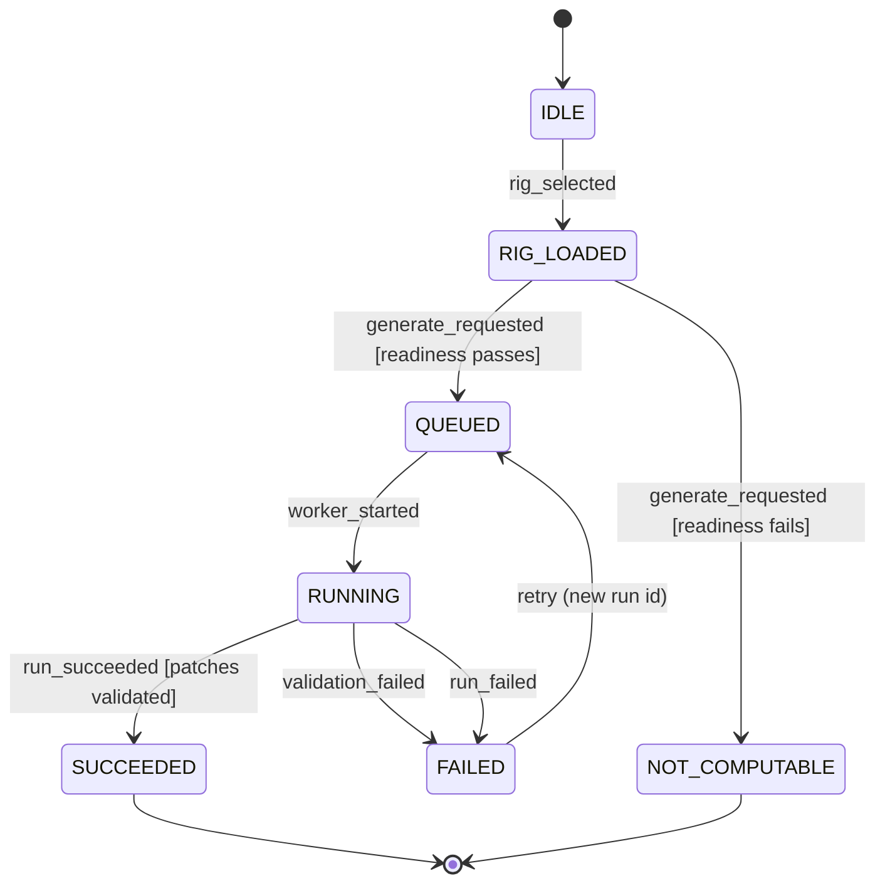
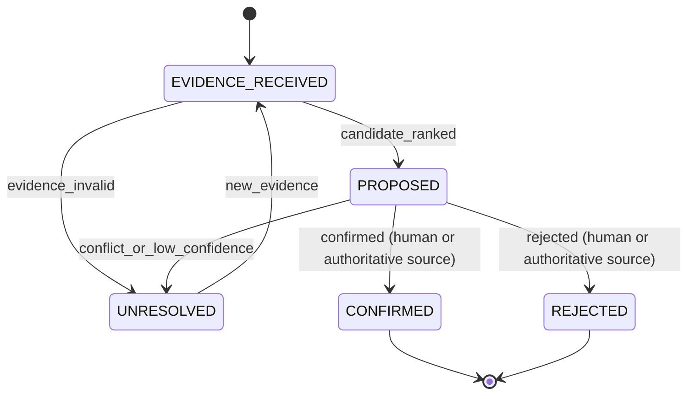

# Plan: 001-rig-intelligence

> An agent finished this plan on 2026-11-04 under the owner's delegation, from [spec.md](spec.md), the [T001 record](T001_CONFIRMATION_2026-11-04.md) and the code on `main` at 007b437 (0.3.0-alpha.8). The owner has not read the spec. They accept this plan by merging the PR that adds it. If a later decision changes spec.md, copy the carried sections again.

IDs such as D3 and O1 refer to the [T001 record](T001_CONFIRMATION_2026-11-04.md).

## Stack (as built)

- Backend: Python 3.11 (`backend/Dockerfile` and the CI test jobs; `backend-lint` runs 3.12), FastAPI, SQLAlchemy 2, Alembic migrations, Pydantic 2 (`backend/pyproject.toml`).
- Database: Postgres 15 (Neon in staging and production, a Postgres service in CI); unit tests use SQLite fixtures (`backend/tests/conftest.py`).
- Frontend: React 18, TypeScript, Vite, React Router (`frontend/package.json`).
- Edge: the Cloudflare Worker in `edge/api` fronts the API (spec 006).
- CI: `.github/workflows/ci.yml`, jobs `backend`, `migrations`, `acceptance`, `backend-lint`, `frontend` and `frontend-e2e`. `just spec-dag` runs the task DAG check.

## Architecture

- **Readiness gate.** `backend/patches/inventory_gate.py` and `backend/canon/inventory.py` decide whether a rack can generate: at least one `USER_CONFIRMED` module and one confirmed catalog module (OQ-09). A module its owner placed on the rack counts as confirmed. A failed gate answers `NOT_COMPUTABLE` and writes no run, only the inventory revision it checked (FR-022).
- **Run lifecycle.** `backend/patches/routes.py` `run_generation` creates the `runs` row (`backend/runs/models.py`), binds it to its rig revision, and commits `queued`, `running`, then `succeeded`, `failed` or `validation_failed` (FR-018, FR-019). The request handler does all of this. There is no worker and no state-machine module: the status is assigned inline, and those assignments are its only writers.
- **Engine.** `backend/patches/engine.py` (seeded `random.Random`, `ModuleAnalyzer`, the patch rules) writes `ConnectionIR` and the generation IR with `generation_ir_hash` (`backend/core/ir.py`). Names come from `backend/core/naming.py`.
- **Validation.** `backend/patches/validation.py` resolves generic jacks, marks unknown facts `unresolved`, and fails a run on a contradiction (FR-016, FR-017). It flags only a direct self-cable as feedback (D9).
- **Canonical compiler.** `backend/canon/compiler.py` `compile_patch` emits the graph, five-phase plan, report, variation, stage receipts and manifest (`backend/canon/contracts.py`). `backend/export/patchbook/design/dual_write.py` runs it for each validated patch and stores sealed `GeneratedPatchRecord` rows and their stage receipts (Path A). It does not store the manifest (D6). Export of an older run uses the Path B fallback in `content_spine.py`.
- **Bridge.** `backend/runs/bridge.py` binds each run to `rig-rev-{content_hash}`, hashed from the rack's current layout, and to one `library-{source_run_id}`, written on success. `backend/canon/rig_metrics.py` and `rig_scores.py` write one `RigMetricsPacket` per rig revision.
- **Evidence boundary.** `backend/evidence/` stores uploads and owner decisions. A confirm writes an `inv-rev-*` row, which generation does not read yet (D3). `backend/intelligence/` (spec 005) ranks candidates and never confirms.
- **Overlay.** `PatchUserOverlayRecord` and `/overlays/{patch_ref}` (`backend/canon/models.py`, `backend/canon/routes.py`). `backend/account/deletion.py` removes overlays and expires evidence images when an account closes.

## What T001 settled

The [T001 record](T001_CONFIRMATION_2026-11-04.md) gives the status of every `[INFERRED]` line, under delegation.

- **OQ-01:** confirmed. A `Rack` is the mutable rig, and a rig revision is its immutable snapshot.
- **OQ-09:** confirmed as built. Whether to require a case is moot, because `racks.case_id` is NOT NULL.
- **OQ-10:** stays open (O3). A lawyer must confirm it.
- **Run lifecycle:** the `queued` to terminal path the code runs is the contract for T010. `spec.md` keeps its table until T090 edits it.
- **Evidence lifecycle:** the rules stay, and they map onto the spec 005 machine and the confirm decisions. No second state machine.

### Run lifecycle: spec state to code

| Spec state | Code |
|---|---|
| `IDLE`, `RIG_LOADED` | None. A generate request starts here (D1). |
| `QUEUED` | `runs.status = queued` |
| `RUNNING` | `runs.status = running`, inside the request (D4) |
| `SUCCEEDED` | `runs.status = succeeded` |
| `FAILED` | `runs.status = failed` or `validation_failed` |
| `NOT_COMPUTABLE` | `generation_status` in the answer, with no run row |

### Evidence lifecycle: spec state to code

| Spec state | Code |
|---|---|
| `EVIDENCE_RECEIVED` | `ClassificationEvidenceRecord` row |
| `PROPOSED` | A listed candidate, never `USER_CONFIRMED`; machine state `AUTO_PROPOSE` or `USER_REVIEW` |
| `UNRESOLVED` | Machine state `UNRESOLVED`; a `defer` decision or no decision lists the candidate in `unresolved_candidate_ids` |
| `CONFIRMED` | `USER_CONFIRMED` item in an `inv-rev-*` row; machine state `CONFIRMED` |
| `REJECTED` | A `reject` decision, not recorded today (D8) |

## Remaining work

No step adds audio processing or hardware control. D3 keeps the path image, evidence, user confirm, inventory. A hardware fact that is unknown stays `unresolved` or `NOT_COMPUTABLE`.

### T010 (unblocked by T002)

- Keep the run lifecycle tests that exist, and map them with the table above.
- Mark `rig_selected`, `worker_started` and `retry` as de-scoped, with a pointer to D1 and D4. They have no handler to test.
- Record the illegal pairs as held by construction: nothing attempts them, so there is no rejection to assert.
- Encode the evidence rules through the mapping: a provider cannot confirm, a confirm needs a known candidate, and low-confidence absence stays unresolved. `tests/unit/test_resolution_machine.py` and `tests/unit/test_visual_system_intelligence.py` already hold most of this.
- Assert stage receipts on the success path, as they are today.

### T090 (after T010)

Each code step brings a test that fails before it and passes after it. Bump `patch_engine_version` if a golden output changes. Steps 1 to 4 went in with `feat(001): keep what a run and an evidence decision leave behind`, step 5 in #289, and steps 6 and 7 with `feat(001): one role per module, and catch loops through other modules`. O1 was settled by owner decision 35, and O2 by decision 36.

1. D2: return the gate's message in the `NOT_COMPUTABLE` answer.
2. D5: keep a reason on a `failed` run, and write receipts for failed and zero-patch runs.
3. D6: store the compiler's manifest. The `artifact_manifests` table exists and has no writer.
4. D8: record every reject decision and any later reversal.
5. D3, after O1: make a confirmed module reach generation, with a test that confirms and then generates. Fix `ready_for_generation` in the same step.
6. D9, after O2: catch a loop through a second module when `allow_feedback` is false.
7. D1, D4, D7, D10, D11: edit `spec.md`, say in the spec how the code meets the ADR 0001 selection cost, and copy the carried sections below again.

### Outside T010 and T090

- FR-028: no Abraxas feedback store. Deferred until a bridge sends feedback (research R7).
- FR-004: the default is to keep the Path B fallback. Removing it would break export of runs from before #142, unless a production query shows none are left. That query has not been run.
- Threat-model tasks 1 to 5 (spec.md, "Adversary threat model"): a production image scanner, a body-size cap before `upload.read()`, a provider response cap and host allowlist, a `context` field list with injection fixtures, and per-user rate limits. A grep at 007b437 shows all five still open. They are not yet in `tasks.md`.

### Owner decisions

O1, O2 and O3 in the record, plus the production image scanner (spec line 284). None blocks T010. O1 blocks T090 step 5, and O2 blocks step 6. O3 needs a lawyer and blocks no step here.

## Verification

- `cd backend && pytest tests/unit/test_spec_001_transitions.py -q` (the run lifecycle rows that have code).
- `tests/api/test_generate_compiler_path.py` (compiler on the generation path), `tests/unit/test_canon_compiler.py`, `tests/unit/test_canon_contracts.py`.
- `tests/api/test_evidence_confirmations.py`, `tests/unit/test_resolution_machine.py`, `tests/unit/test_visual_system_intelligence.py` (the evidence rules).
- `just spec-dag`.

The carried sections below are an exact copy of `spec.md` after T090's edits. The T001 record gives the status of the labels they keep.

## Carried forward from spec.md

The sections below are copied from [spec.md](spec.md) without change.

## Workflows

Checked in T001 (D11).

- Governing workflows (skills): anti-slop-code, production-systems, google-developer-style.
- Owners: FORGE decomposes, and a cloud agent implements.
- CI: reuse `.github/workflows/ci.yml` (jobs `backend`, `migrations`, `acceptance`, `backend-lint`, `frontend` and `frontend-e2e`). Do not add a new CI path.

## Stateful behavior

This feature has two lifecycles:

- The generation run lifecycle, which is the primary contract.
- The module evidence disposition lifecycle, which feeds the run lifecycle through confirmed inventory.

### Generation run lifecycle

Initial state: `IDLE`. Final states: `SUCCEEDED`, `NOT_COMPUTABLE`.

`FAILED` is terminal for its run record because runs are append-only. The `retry` event creates a new run and does not reuse the failed one. [OBSERVED: docs/adr/0001-canonical-immutable-hierarchy.md]

#### States

| State | Meaning | Label |
|---|---|---|
| `IDLE` | No rig revision selected. | [INFERRED] |
| `RIG_LOADED` | A rig revision is selected and its confirmed inventory is loaded. | [INFERRED] (explicit revision selection: [OBSERVED: docs/adr/0001-canonical-immutable-hierarchy.md]) |
| `QUEUED` | A run row exists with status `queued`. | [OBSERVED: backend/runs/models.py] |
| `RUNNING` | A worker is executing compiler stages. | [INFERRED] |
| `SUCCEEDED` | Patches are validated and the generation receipt and manifest are sealed. | [INFERRED] |
| `FAILED` | The run stopped, and its stage receipts and any `ValidationReport` are retained. | [INFERRED] |
| `NOT_COMPUTABLE` | Readiness failed and a `NOT_COMPUTABLE` receipt was emitted. No run was queued. | [INFERRED] (label term: [OBSERVED: constitution]) |

#### Transitions

| from | event | guard | to | effect |
|---|---|---|---|---|
| IDLE | rig_selected | rig has a case and a rig revision is explicitly selected [INFERRED] | RIG_LOADED | load confirmed inventory of that revision only [OBSERVED: constitution] |
| RIG_LOADED | generate_requested | readiness passes [INFERRED] | QUEUED | create a run row with status `queued` bound to the rig revision and seed [OBSERVED: backend/runs/models.py] [INFERRED] |
| RIG_LOADED | generate_requested | readiness fails, for example unconfirmed or missing required facts [INFERRED] | NOT_COMPUTABLE | emit a `NOT_COMPUTABLE` receipt that names the failed condition; create no run, generation record or library (FR-022; OQ-06 resolved 2026-10-27) |
| QUEUED | worker_started | - | RUNNING | record a start `StageReceipt` [INFERRED] |
| RUNNING | run_succeeded | `ValidationReport` shows patches validated [OBSERVED: docs/PATCH_ENGINE.md] | SUCCEEDED | seal the generation receipt and `ArtifactManifest` and write the run's single library [OBSERVED: docs/adr/0001-canonical-immutable-hierarchy.md] |
| RUNNING | validation_failed | `ValidationReport` has blocking errors [INFERRED] | FAILED | keep the stage receipts and the `ValidationReport` [INFERRED] |
| RUNNING | run_failed | - | FAILED | keep the stage receipts [INFERRED] |
| FAILED | retry | the same rig revision is still selected [INFERRED] | QUEUED | create a new run with a new run ID and leave the failed run unchanged [OBSERVED: docs/adr/0001-canonical-immutable-hierarchy.md] |

#### How the code meets this table

The table is the contract, and `tests/unit/test_spec_001_transitions.py` checks each row against the code. It reads through these points (T001 record, T090):

- **No stored `IDLE` or `RIG_LOADED`, and no `rig_selected` event (D1).** A generate request starts there. It reads the rack's current layout and binds the run to `rig-rev-{content_hash}`.
- **ADR 0001's "explicit revision selection".** Generating selects the revision by hashing the layout, so the same layout selects the same revision and a changed layout selects a new one. Reads select an earlier revision or run by id, and they never change it. Rollback is that selection. There's no route that regenerates an older revision without restoring its layout.
- **No worker (D4).** `RUNNING` means the request handler is running generation inline, so `worker_started` moves the status and writes no start receipt.
- **`retry` is another generate call (D1).** It has no event of its own, and it creates a new run.
- **`SUCCEEDED`** stores one `artifact_manifests` row per run, holding each patch's manifest (D6).
- **`NOT_COMPUTABLE`** is an answer, not a run. Its `inventory_gate_messages` names the failed condition (D2).
- **Illegal moves hold by construction.** `run_generation` is the only writer of a run's status, so nothing attempts them, and there's no rejection to assert.

#### Illegal transitions

- `QUEUED` -> `SUCCEEDED`, which skips `RUNNING`. [INFERRED]
- `FAILED` -> `SUCCEEDED`. A failed run is never re-marked as successful. [INFERRED]
- `FAILED` -> `RUNNING` on the same run ID. A retry must create a new run. [OBSERVED: docs/adr/0001-canonical-immutable-hierarchy.md]
- `SUCCEEDED` -> any state. Regeneration creates a new run. [OBSERVED: docs/adr/0001-canonical-immutable-hierarchy.md]
- `NOT_COMPUTABLE` -> any state. A new rig revision starts a new flow from `IDLE`. This draft corrects the skeleton, which allowed `NOT_COMPUTABLE` -> `SUCCEEDED` after a new revision. [INFERRED]
- `RUNNING` -> `QUEUED` in place. [INFERRED]
- Any transition that adds, removes, or edits patches of a run in `SUCCEEDED` or `FAILED`. [OBSERVED: docs/adr/0001-canonical-immutable-hierarchy.md]

### Module evidence disposition lifecycle [INFERRED]

This lifecycle enforces the rule that probabilistic systems propose and deterministic policy disposes. [OBSERVED: constitution]

Initial state: `EVIDENCE_RECEIVED`. Final states: `CONFIRMED`, `REJECTED`.

No code has these five states (D7). The rules run through the spec 005 resolution machine and the owner's decisions, as `plan.md` maps them, and `tests/unit/test_spec_001_evidence_rules.py` names the test that holds each row. Every decision is recorded in `evidence_decisions` (D8). A decision stays final in that its row never changes, and an owner who changes their mind adds a new row that names the decision it reverses. A photo-confirmed module is listed as still to place, and it reaches generation once it's placed through the rack route (D3, owner decision 35).

#### States

| State | Meaning | Label |
|---|---|---|
| `EVIDENCE_RECEIVED` | Provider or detection output is stored as evidence. | [OBSERVED: docs/adr/0001-canonical-immutable-hierarchy.md] |
| `PROPOSED` | The decision layer produced a ranked candidate with provenance. | [INFERRED] (ranking authority: [OBSERVED: constitution]) |
| `UNRESOLVED` | Evidence is missing, conflicting, malformed, or below confidence. | [OBSERVED: constitution] |
| `CONFIRMED` | A human or authoritative source confirmed the module, and a new rig revision is created. | [INFERRED] |
| `REJECTED` | A human or authoritative source rejected the module. | [INFERRED] |

#### Transitions

| from | event | guard | to | effect |
|---|---|---|---|---|
| EVIDENCE_RECEIVED | candidate_ranked | evidence is well-formed and provider version is compatible | PROPOSED | bind evidence hash, provider identity and version, decision-contract version, and policy version [OBSERVED: constitution] |
| EVIDENCE_RECEIVED | evidence_invalid | malformed, incompatible, or provider unavailable | UNRESOLVED | record the explicit unresolved reason [OBSERVED: constitution] |
| PROPOSED | conflict_or_low_confidence | confidence below policy threshold or a conflict is detected | UNRESOLVED | route to catalog lookup, retrieval, or human review [OBSERVED: constitution] |
| UNRESOLVED | new_evidence | new evidence is attached | EVIDENCE_RECEIVED | append the evidence and leave prior evidence unchanged [OBSERVED: constitution] |
| PROPOSED | confirmed | a human or authoritative source confirms | CONFIRMED | record the disposition and an inventory revision; placing the module creates the new rig revision that includes it (owner decision 35) |
| PROPOSED | rejected | a human or authoritative source rejects | REJECTED | record the disposition and leave canon unchanged [INFERRED] |

#### Illegal transitions

- `PROPOSED` -> `CONFIRMED` triggered by the decision layer itself. A module can't self-confirm. [OBSERVED: constitution]
- `EVIDENCE_RECEIVED` -> `CONFIRMED`, which skips proposal and disposition. [INFERRED]
- `UNRESOLVED` -> `REJECTED` based on low-confidence absence alone. Absence is not a negative fact. [OBSERVED: constitution]
- `CONFIRMED` -> any state that edits the existing rig revision in place. [OBSERVED: docs/adr/0001-canonical-immutable-hierarchy.md]

