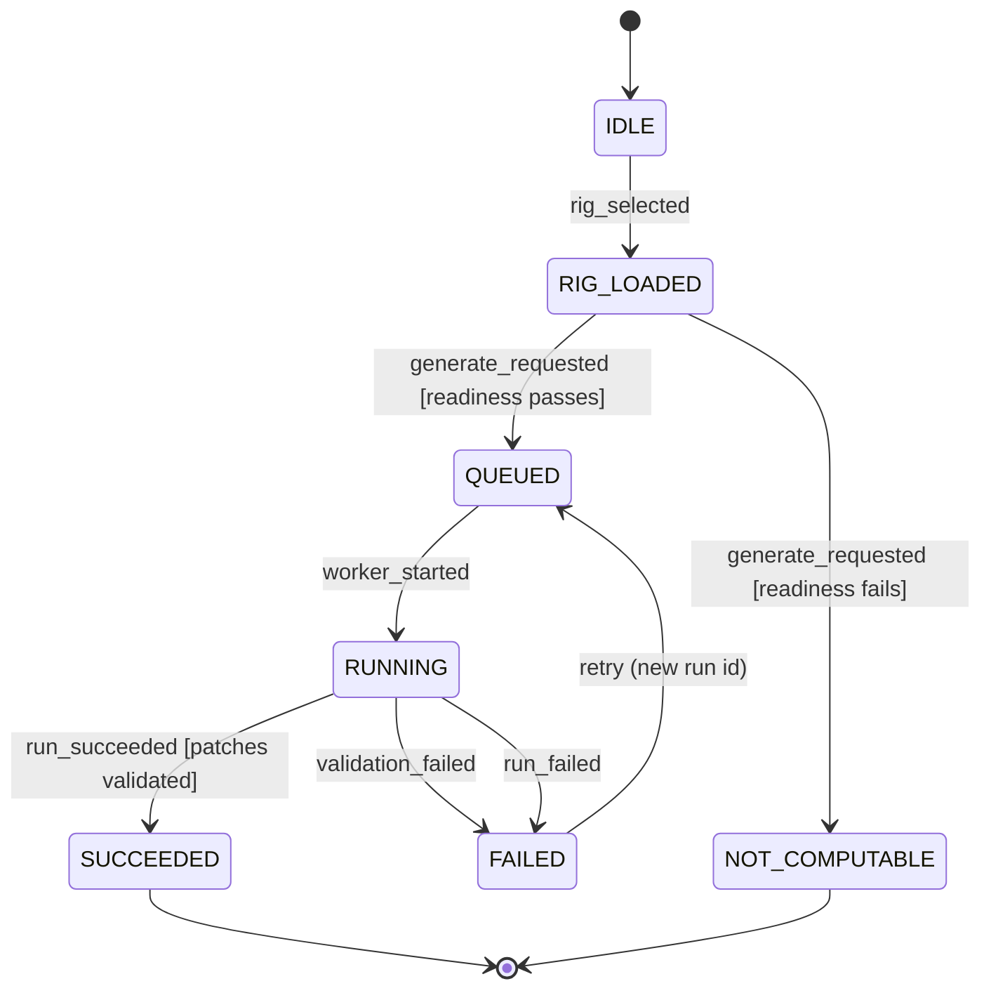
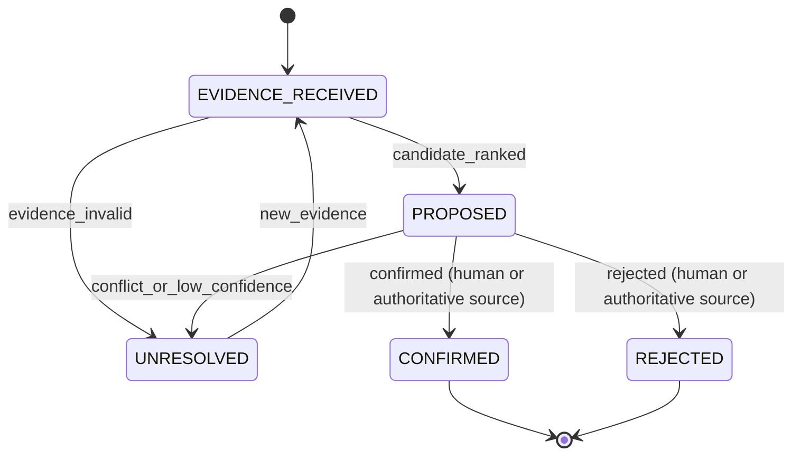

# Plan: 001-rig-intelligence

> **DRAFT, pending T001 confirmation.** An agent wrote this on 2026-11-03 from spec.md and the code on `main` at 3688037 (0.3.0-alpha.6). The owner has not approved it. T002 stays open until the owner confirms the spec (T001) and accepts this plan. If T001 changes spec.md, copy the carried sections again.

## Stack (as built)

- Backend: Python (CI runs 3.12), FastAPI, SQLAlchemy 2, Alembic migrations, Pydantic 2 (`backend/pyproject.toml`).
- Database: Postgres 15 (Neon in staging and production, a Postgres service in CI); unit tests use SQLite fixtures (`backend/tests/conftest.py`).
- Frontend: React 18, TypeScript, Vite, React Router (`frontend/package.json`).
- Edge: the Cloudflare Worker in `edge/api` fronts the API (spec 006).
- CI: `.github/workflows/ci.yml`, jobs `backend`, `frontend` and `frontend-e2e`. `just spec-dag` runs the task DAG check.

## Architecture

- **Readiness gate.** `backend/patches/inventory_gate.py` and `backend/canon/inventory.py` decide whether a rack can generate: at least one `USER_CONFIRMED` module and one confirmed catalog module (OQ-09). A failed gate answers `NOT_COMPUTABLE` and writes no run (FR-022).
- **Run lifecycle.** `backend/patches/routes.py` `run_generation` creates the `runs` row (`backend/runs/models.py`) and commits `queued`, `running`, then `succeeded`, `failed` or `validation_failed` (FR-018, FR-019). It has no state-machine module: the status is assigned inline.
- **Engine.** `backend/patches/engine.py` (seeded `random.Random`, `ModuleAnalyzer`, the patch rules) writes `ConnectionIR` and the generation IR with `generation_ir_hash` (`backend/core/ir.py`). Names come from `backend/core/naming.py`.
- **Validation.** `backend/patches/validation.py` resolves generic jacks, marks unknown facts `unresolved`, and fails a run on a contradiction (FR-016, FR-017).
- **Canonical compiler.** `backend/canon/compiler.py` `compile_patch` emits the graph, five-phase plan, report, variation, stage receipts and manifest (`backend/canon/contracts.py`). `backend/export/patchbook/design/dual_write.py` runs it for each validated patch and stores sealed `GeneratedPatchRecord` rows (Path A). Export of an older run uses the Path B fallback in `content_spine.py`.
- **Bridge.** `backend/runs/bridge.py` binds each run to `rig-rev-{content_hash}` and one `library-{source_run_id}`. `backend/canon/rig_metrics.py` and `rig_scores.py` write one `RigMetricsPacket` per rig revision.
- **Evidence boundary.** `backend/evidence/` stores uploads and owner decisions; `backend/intelligence/` (spec 005) ranks candidates and never confirms.
- **Overlay.** `PatchUserOverlayRecord` and `/overlays/{patch_ref}` (`backend/canon/models.py`, `backend/canon/routes.py`).

## Remaining work

- FR-028: no Abraxas feedback store. Deferred until a bridge sends feedback (research R7).
- FR-004: drop the Path B fallback once every exported run has sealed rows, or keep it as the documented legacy path (owner choice).
- T010: the run lifecycle has no handler for `rig_selected`, `retry` or the illegal pairs, and the module evidence disposition lifecycle has no implementation. T001 decides whether those rows are kept as the contract (then build them) or replaced (then edit the tables).
- Threat-model tasks 1 to 5 (spec.md, "Adversary threat model"): a production image scanner, a body-size cap before `upload.read()`, a provider response cap and host allowlist, a `context` field list with injection fixtures, and per-user rate limits.
- T090: converge the code against the confirmed spec.

## Verification

- `cd backend && pytest tests/unit/test_spec_001_transitions.py -q` (the run lifecycle rows that have code).
- `tests/api/test_generate_compiler_path.py` (compiler on the generation path), `tests/unit/test_canon_compiler.py`, `tests/unit/test_canon_contracts.py`.
- `just spec-dag`.

## What T001 settles for this spec

- Every `[INFERRED]` label in spec.md, including the Workflows skeleton (skills, owners, CI).
- The generation run lifecycle: keep `IDLE`, `RIG_LOADED` and the `retry` event as contract, or cut them to the `queued` to terminal path the code runs.
- The module evidence disposition lifecycle: keep its five states, or replace it with the spec 005 resolution machine (`backend/intelligence/resolution_machine.py`), which uses other states.
- OQ-01 (a one-word confirmation), OQ-09 (whether a case is required), and OQ-10 (provisional retention; the owner and a lawyer confirm).

## Carried forward from spec.md

The sections below are copied from [spec.md](spec.md) without change.

## Workflows

Status: INFERRED skeleton. Confirm before you plan.

- Governing workflows (skills): anti-slop-code, production-systems, google-developer-style.
- Owners: FORGE decomposes, a cloud agent implements, SCRIBE files the compact artifact.
- CI: reuse `.github/workflows/ci.yml` (jobs `backend` and `frontend`). Do not add a new CI path.

## Stateful behavior

This feature has two lifecycles:

- The generation run lifecycle, which is the primary contract.
- The module evidence disposition lifecycle, which feeds the run lifecycle through confirmed inventory.

### Generation run lifecycle

Initial state: `IDLE`. Final states: `SUCCEEDED`, `NOT_COMPUTABLE`.

`FAILED` is terminal for its run record because runs are append-only. The `retry` event creates a new run and does not reuse the failed one. [OBSERVED: docs/adr/0001-canonical-immutable-hierarchy.md]

#### States

| State | Meaning | Label |
|---|---|---|
| `IDLE` | No rig revision selected. | [INFERRED] |
| `RIG_LOADED` | A rig revision is selected and its confirmed inventory is loaded. | [INFERRED] (explicit revision selection: [OBSERVED: docs/adr/0001-canonical-immutable-hierarchy.md]) |
| `QUEUED` | A run row exists with status `queued`. | [OBSERVED: backend/runs/models.py] |
| `RUNNING` | A worker is executing compiler stages. | [INFERRED] |
| `SUCCEEDED` | Patches are validated and the generation receipt and manifest are sealed. | [INFERRED] |
| `FAILED` | The run stopped, and its stage receipts and any `ValidationReport` are retained. | [INFERRED] |
| `NOT_COMPUTABLE` | Readiness failed and a `NOT_COMPUTABLE` receipt was emitted. No run was queued. | [INFERRED] (label term: [OBSERVED: constitution]) |

#### Transitions

| from | event | guard | to | effect |
|---|---|---|---|---|
| IDLE | rig_selected | rig has a case and a rig revision is explicitly selected [INFERRED] | RIG_LOADED | load confirmed inventory of that revision only [OBSERVED: constitution] |
| RIG_LOADED | generate_requested | readiness passes [INFERRED] | QUEUED | create a run row with status `queued` bound to the rig revision and seed [OBSERVED: backend/runs/models.py] [INFERRED] |
| RIG_LOADED | generate_requested | readiness fails, for example unconfirmed or missing required facts [INFERRED] | NOT_COMPUTABLE | emit a `NOT_COMPUTABLE` receipt that names the failed condition; create no run, generation record or library (FR-022; OQ-06 resolved 2026-10-27) |
| QUEUED | worker_started | - | RUNNING | record a start `StageReceipt` [INFERRED] |
| RUNNING | run_succeeded | `ValidationReport` shows patches validated [OBSERVED: docs/PATCH_ENGINE.md] | SUCCEEDED | seal the generation receipt and `ArtifactManifest` and write the run's single library [OBSERVED: docs/adr/0001-canonical-immutable-hierarchy.md] |
| RUNNING | validation_failed | `ValidationReport` has blocking errors [INFERRED] | FAILED | keep the stage receipts and the `ValidationReport` [INFERRED] |
| RUNNING | run_failed | - | FAILED | keep the stage receipts [INFERRED] |
| FAILED | retry | the same rig revision is still selected [INFERRED] | QUEUED | create a new run with a new run ID and leave the failed run unchanged [OBSERVED: docs/adr/0001-canonical-immutable-hierarchy.md] |

#### Illegal transitions

- `QUEUED` -> `SUCCEEDED`, which skips `RUNNING`. [INFERRED]
- `FAILED` -> `SUCCEEDED`. A failed run is never re-marked as successful. [INFERRED]
- `FAILED` -> `RUNNING` on the same run ID. A retry must create a new run. [OBSERVED: docs/adr/0001-canonical-immutable-hierarchy.md]
- `SUCCEEDED` -> any state. Regeneration creates a new run. [OBSERVED: docs/adr/0001-canonical-immutable-hierarchy.md]
- `NOT_COMPUTABLE` -> any state. A new rig revision starts a new flow from `IDLE`. This draft corrects the skeleton, which allowed `NOT_COMPUTABLE` -> `SUCCEEDED` after a new revision. [INFERRED]
- `RUNNING` -> `QUEUED` in place. [INFERRED]
- Any transition that adds, removes, or edits patches of a run in `SUCCEEDED` or `FAILED`. [OBSERVED: docs/adr/0001-canonical-immutable-hierarchy.md]

### Module evidence disposition lifecycle [INFERRED]

This lifecycle enforces the rule that probabilistic systems propose and deterministic policy disposes. [OBSERVED: constitution]

Initial state: `EVIDENCE_RECEIVED`. Final states: `CONFIRMED`, `REJECTED`.

#### States

| State | Meaning | Label |
|---|---|---|
| `EVIDENCE_RECEIVED` | Provider or detection output is stored as evidence. | [OBSERVED: docs/adr/0001-canonical-immutable-hierarchy.md] |
| `PROPOSED` | The decision layer produced a ranked candidate with provenance. | [INFERRED] (ranking authority: [OBSERVED: constitution]) |
| `UNRESOLVED` | Evidence is missing, conflicting, malformed, or below confidence. | [OBSERVED: constitution] |
| `CONFIRMED` | A human or authoritative source confirmed the module, and a new rig revision is created. | [INFERRED] |
| `REJECTED` | A human or authoritative source rejected the module. | [INFERRED] |

#### Transitions

| from | event | guard | to | effect |
|---|---|---|---|---|
| EVIDENCE_RECEIVED | candidate_ranked | evidence is well-formed and provider version is compatible | PROPOSED | bind evidence hash, provider identity and version, decision-contract version, and policy version [OBSERVED: constitution] |
| EVIDENCE_RECEIVED | evidence_invalid | malformed, incompatible, or provider unavailable | UNRESOLVED | record the explicit unresolved reason [OBSERVED: constitution] |
| PROPOSED | conflict_or_low_confidence | confidence below policy threshold or a conflict is detected | UNRESOLVED | route to catalog lookup, retrieval, or human review [OBSERVED: constitution] |
| UNRESOLVED | new_evidence | new evidence is attached | EVIDENCE_RECEIVED | append the evidence and leave prior evidence unchanged [OBSERVED: constitution] |
| PROPOSED | confirmed | a human or authoritative source confirms | CONFIRMED | create a new rig revision that includes the module and record the disposition [INFERRED] |
| PROPOSED | rejected | a human or authoritative source rejects | REJECTED | record the disposition and leave canon unchanged [INFERRED] |

#### Illegal transitions

- `PROPOSED` -> `CONFIRMED` triggered by the decision layer itself. A module can't self-confirm. [OBSERVED: constitution]
- `EVIDENCE_RECEIVED` -> `CONFIRMED`, which skips proposal and disposition. [INFERRED]
- `UNRESOLVED` -> `REJECTED` based on low-confidence absence alone. Absence is not a negative fact. [OBSERVED: constitution]
- `CONFIRMED` -> any state that edits the existing rig revision in place. [OBSERVED: docs/adr/0001-canonical-immutable-hierarchy.md]

