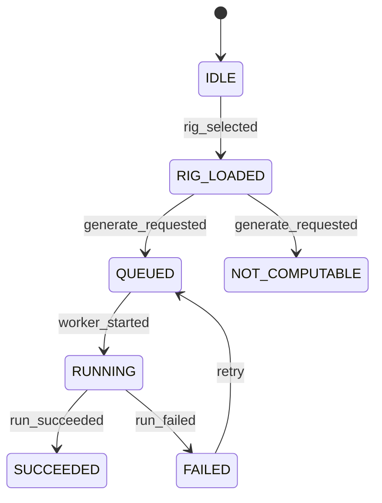

# 001: Rig intelligence and patch generation

Status: DRAFT skeleton. This is a deterministic extraction from existing docs. No paid model was used. Every requirement is INFERRED until the operator confirms it.

## Sources

- `docs/PATCH_ENGINE.md`
- `docs/ARCHITECTURE.md`
- `docs/DATA_MODEL.md`
- `docs/adr/0001-canonical-immutable-hierarchy.md`
- `docs/CANON.md`
- `backend/runs/models.py`
- `backend/racks/`

## What and why

Turn a user's rig (case + modules) into deterministic, validated patches with receipts.

## User stories

TODO: Extract these from the sources above, one per story, each with acceptance criteria.

## Workflows

Status: INFERRED skeleton. Confirm before you plan.

- Governing workflows (skills): anti-slop-code, production-systems, google-developer-style.
- Owners: FORGE decomposes, a cloud agent implements, SCRIBE files the compact artifact.
- CI: reuse `.github/workflows/ci.yml` (jobs `backend` and `frontend`). Do not add a new CI path.

## Stateful behavior

Initial state: `IDLE`. Final states: SUCCEEDED, NOT_COMPUTABLE.

| from | event | guard | to | effect |
|---|---|---|---|---|
| IDLE | rig_selected | rig has a case | RIG_LOADED | load inventory |
| RIG_LOADED | generate_requested | readiness passes | QUEUED | create a run row with status queued (backend/runs/models.py) |
| RIG_LOADED | generate_requested | readiness fails | NOT_COMPUTABLE | emit a NOT_COMPUTABLE receipt and dual-write it (CHANGELOG F3) |
| QUEUED | worker_started | - | RUNNING | - |
| RUNNING | run_succeeded | patches validated | SUCCEEDED | seal the generation receipt |
| RUNNING | run_failed | - | FAILED | keep the stage receipts |
| FAILED | retry | - | QUEUED | create a new run id |

Illegal transitions:

- QUEUED -> SUCCEEDED (skips RUNNING)
- NOT_COMPUTABLE -> SUCCEEDED without a new rig revision
- FAILED -> SUCCEEDED

TODO (NOT_COMPUTABLE from docs): confirm the full set of run status values in backend/runs/models.py. Only `queued` is observed as the default.
