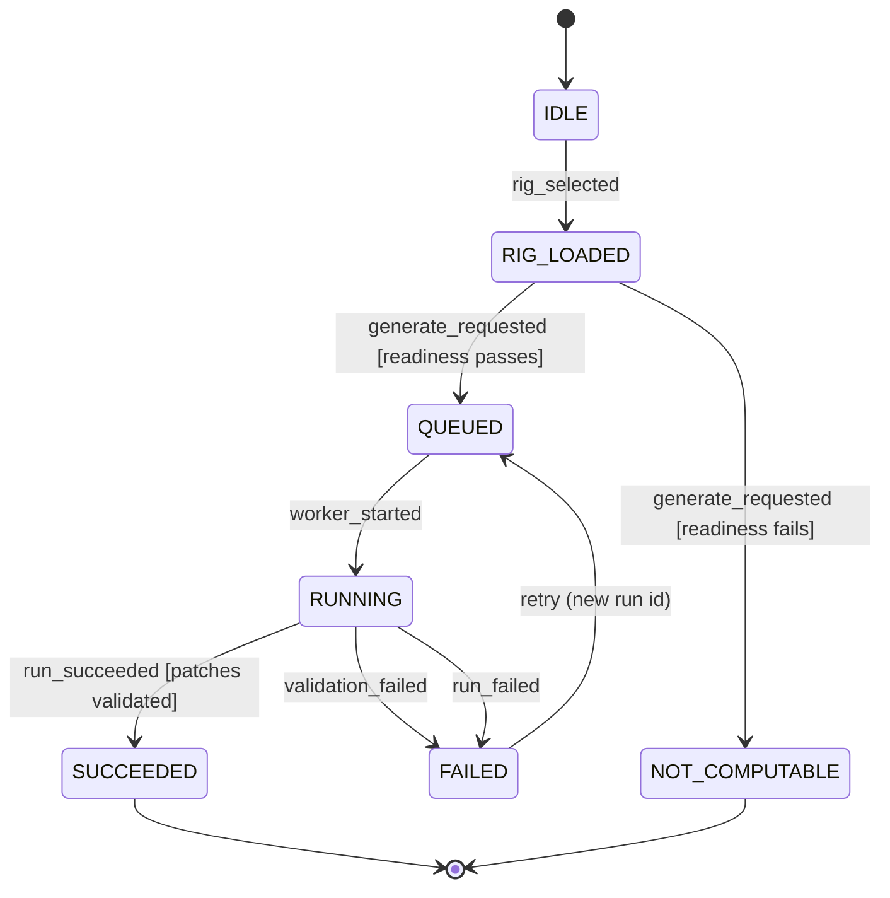
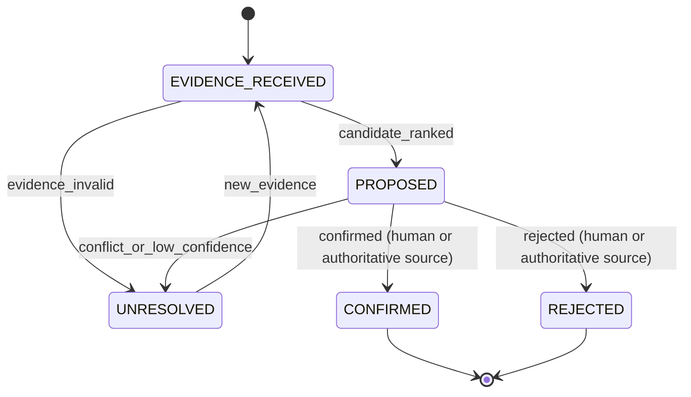

# 001: Rig intelligence and patch generation

Status: DRAFT (2026-10-16). Filled by Opus 5.5 via OpenRouter from the repo docs and code listed under Sources. Each claim is labeled `[OBSERVED: <file>]` or `[INFERRED]`. The operator must confirm every `[INFERRED]` item before planning.

- `[OBSERVED: <file>]` means a retained source states it.
- `[INFERRED]` means a rule derived it from observed inputs.

Every `[INFERRED]` item needs operator confirmation before planning. Unknowns are listed in [Open questions](#open-questions) as `NOT_COMPUTABLE`.

## Sources

Retained and read for this draft:

- `docs/PATCH_ENGINE.md`
- `docs/CANON.md`
- `docs/adr/0001-canonical-immutable-hierarchy.md`
- `backend/runs/models.py`
- `backend/runs/routes.py`
- PatchHive Constitution v1.0.0, cited as `constitution`

Listed in the skeleton but not present in the extraction input. Nothing in this spec is labeled `OBSERVED` from these files:

- `docs/ARCHITECTURE.md`
- `docs/DATA_MODEL.md`
- `backend/racks/`

## Summary

PatchHive turns a user's Eurorack rig into deterministic, validated patch artifacts that carry provenance receipts. The rig is a case plus modules, pinned to a specific rig revision.

- Fixed normalized input, schema and generator versions, layout profile, and seed must produce canonical-equivalent output. [OBSERVED: docs/CANON.md] [OBSERVED: constitution]
- Generation uses confirmed inventory only. [OBSERVED: constitution]
- Provider detection is evidence and cannot directly modify canonical truth. [OBSERVED: docs/adr/0001-canonical-immutable-hierarchy.md]
- Every run, library, patch, and receipt is append-only. Regeneration creates a new run. [OBSERVED: docs/adr/0001-canonical-immutable-hierarchy.md]

The goal is reproducible, auditable patch generation that never invents a module, jack, voltage, mode, or capability to make a patch work. [OBSERVED: constitution]

## Scope

In scope:

- Select a rig revision and load its confirmed inventory. [INFERRED]
- Check generation readiness and fail closed when readiness fails. [INFERRED]
- Run deterministic, rule-based patch generation for a rig revision and seed. [OBSERVED: docs/PATCH_ENGINE.md]
- Emit `PatchGraph`, the five-phase `PatchPlan`, `ValidationReport`, deterministic variation identity, `StageReceipt` records, and `ArtifactManifest` from the canonical compiler boundary. [OBSERVED: docs/PATCH_ENGINE.md]
- Track the lifecycle of generation runs and expose runs and their patches for reading. [OBSERVED: backend/runs/routes.py]
- Gate detected or proposed modules behind explicit confirmation before they enter canonical inventory. [OBSERVED: constitution] [OBSERVED: docs/adr/0001-canonical-immutable-hierarchy.md]
- Emit a `RigMetricsPacket` for every canonical rig. [OBSERVED: docs/CANON.md]
- Keep a mutable user overlay (notes, favorite, tried) separate from canon. [OBSERVED: docs/adr/0001-canonical-immutable-hierarchy.md]

## Non-goals

- Audio synthesis, recording, analysis, or sonic prediction. Waveform SVGs are symbolic approximations only. [OBSERVED: docs/PATCH_ENGINE.md]
- Hardware integration, including MIDI or CV activation and physical equipment control. [OBSERVED: docs/PATCH_ENGINE.md]
- Polyphonic or multi-voice patches. [OBSERVED: docs/PATCH_ENGINE.md]
- Sequence programming and temporal patterns. [OBSERVED: docs/PATCH_ENGINE.md]
- ML-assisted generation. It is an optional research track and is not part of this spec. [OBSERVED: docs/PATCH_ENGINE.md]
- Patch page and Patch Book compilation. The one-page publishing canon governs it, and a separate spec owns it. This spec must not produce anything that weakens that canon. [INFERRED] [OBSERVED: docs/CANON.md]
- Abraxas symbolic interpretation. Abraxas is authoritative over symbolic interpretation, so this spec only emits the read-only bridge packet. [OBSERVED: docs/CANON.md]

## User stories

### P1: Generate deterministic patches from a confirmed rig [OBSERVED: docs/PATCH_ENGINE.md]

As a rig owner, I want to generate patches from my rig so that I get patch ideas that use only modules I own.

Acceptance criteria:

1. **Given** a rig revision with confirmed inventory and a seed, **when** you generate patches twice with the same engine version and config, **then** both runs produce canonical-equivalent patches, names, and connections. [OBSERVED: docs/PATCH_ENGINE.md]
2. **Given** a rig revision with at least one VCO and one VCA, **when** you generate patches, **then** the result can include a subtractive voice patch. [OBSERVED: docs/PATCH_ENGINE.md]
3. **Given** a rig revision with no sequencer and fewer than two LFOs, **when** you generate patches, **then** the result contains no generative patch. [OBSERVED: docs/PATCH_ENGINE.md]
4. **Given** any generated patch, **when** you inspect its connections, **then** every connection references a module in the confirmed inventory of the source rig revision. [OBSERVED: constitution]
5. **Given** default config, **when** you generate patches, **then** the result contains no more than `max_patches` (default 20) patches and no feedback routes. [OBSERVED: docs/PATCH_ENGINE.md]

### P2: Fail closed when the rig is not ready [INFERRED]

As a rig owner, I want a clear `NOT_COMPUTABLE` result when generation cannot be grounded in my rig. That way, I am not shown fabricated patches.

Acceptance criteria:

1. **Given** a rig revision that fails readiness, **when** you request generation, **then** no run enters `QUEUED`. The system emits a `NOT_COMPUTABLE` receipt that names the failed readiness condition. [INFERRED]
2. **Given** a rig revision with unconfirmed modules, **when** you request generation, **then** unconfirmed modules are excluded or generation is blocked. They are never used as inventory. [OBSERVED: constitution]
3. **Given** a missing physical fact, such as an unknown jack, **when** generation needs that fact, **then** the system reports it as unresolved and does not substitute a guessed value. [OBSERVED: constitution]

### P3: Inspect runs and their patches [OBSERVED: backend/runs/routes.py]

As a rig owner, I want to list my rack's generation runs and open any run's patches so that I can review past results.

Acceptance criteria:

1. **Given** a rack ID of 1 or greater, **when** you list runs, **then** you receive the runs for that rack. [OBSERVED: backend/runs/routes.py]
2. **Given** a run ID that does not exist, **when** you request the run or its patches, **then** you receive a "Run not found" error. [OBSERVED: backend/runs/routes.py]
3. **Given** an existing run, **when** you request its patches, **then** you receive the total count and every patch that belongs to that run. [OBSERVED: backend/runs/routes.py]

### P4: Regenerate without rewriting history [OBSERVED: docs/adr/0001-canonical-immutable-hierarchy.md]

As a rig owner, I want to regenerate or retry so that I can get new results while earlier results stay intact.

Acceptance criteria:

1. **Given** a completed or failed run, **when** you regenerate or retry, **then** the system creates a new run with a new run ID. [OBSERVED: docs/adr/0001-canonical-immutable-hierarchy.md]
2. **Given** an earlier run, **when** a new run completes, **then** the earlier run's library, patches, receipts, and manifest are unchanged. [OBSERVED: docs/adr/0001-canonical-immutable-hierarchy.md]
3. **Given** any run, **when** you inspect its library, **then** the run owns exactly one library. [OBSERVED: docs/adr/0001-canonical-immutable-hierarchy.md]

### P5: Trace every patch to its provenance [OBSERVED: docs/PATCH_ENGINE.md]

As a reviewer, I want each patch to carry its generation provenance so that I can reproduce and debug it.

Acceptance criteria:

1. **Given** a generated patch, **when** you inspect its metadata, **then** it includes `generation_seed`, `generation_version`, and `engine_config`. [OBSERVED: docs/PATCH_ENGINE.md]
2. **Given** a completed run, **when** you inspect its artifacts, **then** it includes `StageReceipt` records and an `ArtifactManifest`. [OBSERVED: docs/PATCH_ENGINE.md]
3. **Given** a canon-affecting proposal, **when** it is dispositioned, **then** it binds to evidence identifiers or hashes, provider identity and version, decision-contract version, policy version, and disposition. [OBSERVED: constitution]

### P6: Confirm detected modules before they become inventory [OBSERVED: docs/adr/0001-canonical-immutable-hierarchy.md]

As a rig owner, I want detected modules to stay proposals until I confirm them, or until an authoritative source does. That way, my canonical rig reflects only verified hardware.

Acceptance criteria:

1. **Given** provider detection output, **when** the system ingests it, **then** the output is stored as evidence and the canonical rig does not change. [OBSERVED: docs/adr/0001-canonical-immutable-hierarchy.md]
2. **Given** a proposed module that policy requires confirming, **when** no confirmation has occurred, **then** canonicalization stays blocked. [OBSERVED: constitution]
3. **Given** a confirmed module, **when** it enters canon, **then** the system creates a new rig revision and does not edit the existing one. [INFERRED] [OBSERVED: docs/adr/0001-canonical-immutable-hierarchy.md]
4. **Given** low-confidence detection that finds no module, **when** the decision layer reports it, **then** the absence is not recorded as a negative fact. [OBSERVED: constitution]

### P7: Emit rig metrics for the Abraxas bridge [OBSERVED: docs/CANON.md]

As a downstream consumer, I want a deterministic `RigMetricsPacket` per canonical rig so that symbolic reasoning stays grounded in physical capability.

Acceptance criteria:

1. **Given** a canonical rig, **when** it is created or revised, **then** the system emits a `RigMetricsPacket` with every required field. [OBSERVED: docs/CANON.md]
2. **Given** identical queries, **when** Abraxas queries PatchHive, **then** responses are deterministic. [OBSERVED: docs/CANON.md]
3. **Given** Abraxas feedback, **when** PatchHive stores it, **then** it is stored as separate observational metadata and canon data is not changed. [OBSERVED: docs/CANON.md]

### P8: Annotate patches without touching canon [OBSERVED: docs/adr/0001-canonical-immutable-hierarchy.md]

As a rig owner, I want to add notes and mark patches as favorite or tried, without changing the generated patch.

Acceptance criteria:

1. **Given** a generated patch, **when** you edit its notes, favorite, or tried state, **then** the overlay changes and the generated patch and its hashes are unchanged. [OBSERVED: docs/adr/0001-canonical-immutable-hierarchy.md]

## Functional requirements

### Determinism

- **FR-001**: Patch generation must be deterministic for a fixed normalized rig input, schema version, generator version, layout profile, config, and seed. [OBSERVED: docs/CANON.md] [OBSERVED: constitution]
- **FR-002**: Patch generation must use only explicitly seeded pseudo-randomness. It must not use system randomness or time-based entropy. [OBSERVED: docs/PATCH_ENGINE.md]
- **FR-003**: Patch names must derive deterministically from the patch seed by hashing the seed and selecting from fixed word lists. [OBSERVED: docs/PATCH_ENGINE.md]
- **FR-004**: The canonical compiler boundary is authoritative. It must emit `PatchGraph`, a five-phase `PatchPlan`, `ValidationReport`, deterministic variation identity, `StageReceipt` records, and `ArtifactManifest`. [OBSERVED: docs/PATCH_ENGINE.md]

### Inventory and evidence

- **FR-005**: Generation must use confirmed inventory and capabilities of the selected rig revision only. [OBSERVED: constitution]
- **FR-006**: Provider detection, OCR, retrieval, classification, and community records must be stored as evidence. They must not mutate canonical inventory directly. [OBSERVED: constitution] [OBSERVED: docs/adr/0001-canonical-immutable-hierarchy.md]
- **FR-007**: Canonicalization of a proposed module must be blocked until the required human or authoritative-source confirmation occurs. [OBSERVED: constitution]
- **FR-008**: The decision layer may classify, rank, score, detect conflicts, and route. It must not self-confirm a module, invent a module, jack, voltage, mode, or capability, overwrite evidence, mutate canon, or bypass validators. [OBSERVED: constitution]
- **FR-009**: Canonical schemas must not depend on any provider-specific response type. [OBSERVED: constitution]

### Generation rules

- **FR-010**: Module analysis must classify modules by module type using case-insensitive substring matching. A module may belong to more than one class. [OBSERVED: docs/PATCH_ENGINE.md]
- **FR-011**: The engine must offer a patch type only when its feasibility rule passes. [OBSERVED: docs/PATCH_ENGINE.md]
  - Subtractive voice requires a VCO and a VCA.
  - Generative requires a sequencer or two or more LFOs.
  - Clock-Rhythm (percussion) requires a noise source or an envelope.
  - Texture-FX requires an FX module.
- **FR-012**: Generated patches must use the canonical category set: Voice, Clock-Rhythm, Generative, Texture-FX, and Utility. [OBSERVED: docs/PATCH_ENGINE.md] Implemented 2026-10-28 (OQ-03).
- **FR-013**: The engine must honor `max_patches` (default 20), `allow_feedback` (default false), and `prefer_simple` (default false). [OBSERVED: docs/PATCH_ENGINE.md]
- **FR-014**: Each connection must declare a source module and port, a destination module and port, and a cable type of `audio`, `cv`, `gate`, or `clock`. [OBSERVED: docs/PATCH_ENGINE.md]
- **FR-015**: Each `PatchPlan` must segment time into Prep, Threshold, Peak, Release, and Seal. [OBSERVED: docs/CANON.md]
- **FR-016**: A patch without a seal, or any other canonical failure mode, must be flagged in the `ValidationReport`. [OBSERVED: docs/CANON.md]
- **FR-017**: When a required physical fact is unknown, such as an actual port name or voltage range, the system must mark it unresolved. It must not invent or assume a value. [OBSERVED: constitution]

### Runs and lifecycle

- **FR-018**: Each generation attempt must create a run record bound to a rack. Its initial status is `queued`. [OBSERVED: backend/runs/models.py] Implemented 2026-10-27: `queued`, then `running`, then `succeeded`, or `failed` when generation raises; each step is committed. `validation_failed` is not produced yet, because generation has no blocking ValidationReport (FR-016, FR-019 remain open).
- **FR-019**: Run state transitions must follow the [transitions table](#transitions). Implementers treat that table as the contract. [INFERRED]
- **FR-020**: Regeneration and retry must create a new run. Existing runs, libraries, patches, stage receipts, manifests, and ledger entries are append-only. [OBSERVED: docs/adr/0001-canonical-immutable-hierarchy.md] Implemented 2026-10-27 for runs and generated patches: run reads return the ids recorded at generation and write nothing; a generated patch's name and description cannot be changed and it cannot be deleted (409 `GENERATED_PATCH_IS_APPEND_ONLY`), though the owner may set a display label (`name_override`) and visibility. Deleting a rack still cascades to its runs (OQ-02).
- **FR-021**: A run must own exactly one patch library. [OBSERVED: docs/adr/0001-canonical-immutable-hierarchy.md]
- **FR-022**: When readiness fails, the system must emit a `NOT_COMPUTABLE` receipt instead of creating a queued run. [INFERRED]
- **FR-023**: The system must let callers list runs by rack, read a run by ID, and read a run's patches. It must return "Run not found" for an unknown run ID. [OBSERVED: backend/runs/routes.py]

### Provenance

- **FR-024**: Each generated patch must store `generation_seed`, `generation_version`, and `engine_config`. [OBSERVED: docs/PATCH_ENGINE.md]
- **FR-025**: Canon-affecting proposals must bind to evidence identifiers or hashes, provider identity and version, decision-contract version, policy version, and disposition. [OBSERVED: constitution]
- **FR-026**: Each run must bind to the source rig revision it generated from. [INFERRED] [OBSERVED: docs/CANON.md]

### Bridge and overlay

- **FR-027**: The system must emit a `RigMetricsPacket` for every canonical rig with these fields: `rig_id`, `module_count`, `category_counts`, `modulation_budget`, `routing_flex_score`, `clock_coherence_score`, `chaos_headroom`, `learning_gradient_index`, and `performance_density_index`. [OBSERVED: docs/CANON.md]
- **FR-028**: Abraxas feedback must be stored as separate observational metadata. It must never retroactively alter canon. [OBSERVED: docs/CANON.md]
- **FR-029**: User notes, favorite, and tried state must live in a mutable overlay separate from canonical records. [OBSERVED: docs/adr/0001-canonical-immutable-hierarchy.md]

### Presentation limits

- **FR-030**: Any waveform visual must be labeled as an "approximation" or an "expected structural envelope". It must never be presented as an observed sound. [OBSERVED: docs/PATCH_ENGINE.md]
- **FR-031**: Nothing in this feature may weaken the one-page publishing law for page-fit, accessibility, signal, provenance, or standalone execution. [OBSERVED: constitution] [OBSERVED: docs/CANON.md]

## Key entities

- **User**: owns rigs. [OBSERVED: docs/adr/0001-canonical-immutable-hierarchy.md]
- **Rig**: a user's case and modules. [OBSERVED: docs/adr/0001-canonical-immutable-hierarchy.md]
- **RigRevision**: an append-only snapshot of a rig. Generation selects it explicitly. [OBSERVED: docs/adr/0001-canonical-immutable-hierarchy.md]
- **Rack**: the current persistence target that runs reference. [OBSERVED: backend/runs/models.py] For how Rack relates to Rig and RigRevision, see OQ-01.
- **GenerationRun (Run)**: one generation attempt with a status. It is append-only. [OBSERVED: backend/runs/models.py] [OBSERVED: docs/adr/0001-canonical-immutable-hierarchy.md]
- **PatchLibrary**: the single library owned by a run. [OBSERVED: docs/adr/0001-canonical-immutable-hierarchy.md]
- **GeneratedPatch / PatchSpec**: a name, category, connections, description, and generation seed. [OBSERVED: docs/PATCH_ENGINE.md]
- **Connection**: a typed cable between two module ports. [OBSERVED: docs/PATCH_ENGINE.md]
- **PatchEngineConfig**: generation limits and preferences. [OBSERVED: docs/PATCH_ENGINE.md]
- **PatchGraph, PatchPlan, ValidationReport, StageReceipt, ArtifactManifest**: compiler outputs. [OBSERVED: docs/PATCH_ENGINE.md]
- **Evidence record**: provider or detection output, which is never canon. [OBSERVED: constitution]
- **RigMetricsPacket**: the read-only Abraxas bridge object. [OBSERVED: docs/CANON.md]
- **SymbolicPatchEnvelope**: derived mechanically from `PatchGraph` and `PatchPlan`. [OBSERVED: docs/CANON.md]
- **User overlay**: notes, favorite, and tried state. It is mutable. [OBSERVED: docs/adr/0001-canonical-immutable-hierarchy.md]

## Authority boundaries, data, security, observability, and rollback

The constitution requires this section.

- **Authority**: PatchHive is authoritative over physical and functional truth. Abraxas is authoritative over symbolic interpretation. Bridges are read-only unless explicitly versioned. [OBSERVED: docs/CANON.md]
- **Data changes**: new runs, libraries, patches, receipts, and rig revisions are inserts only. Overlay edits are the only in-place updates. [OBSERVED: docs/adr/0001-canonical-immutable-hierarchy.md]
- **Security and privacy**: user overlay data and evidence such as rig photos may be personal. Retention and access rules are not stated in the sources. See OQ-10. [INFERRED]
- **Observability**: each run stage emits a `StageReceipt`. Failed runs keep their stage receipts. [OBSERVED: docs/PATCH_ENGINE.md] [INFERRED]
- **Rollback**: append-only history means rollback selects an earlier rig revision or run. It never deletes or rewrites records. [INFERRED] [OBSERVED: docs/adr/0001-canonical-immutable-hierarchy.md]

## Workflows

Status: INFERRED skeleton. Confirm before you plan.

- Governing workflows (skills): anti-slop-code, production-systems, google-developer-style.
- Owners: FORGE decomposes, a cloud agent implements, SCRIBE files the compact artifact.
- CI: reuse `.github/workflows/ci.yml` (jobs `backend` and `frontend`). Do not add a new CI path.

## Stateful behavior

This feature has two lifecycles:

- The generation run lifecycle, which is the primary contract.
- The module evidence disposition lifecycle, which feeds the run lifecycle through confirmed inventory.

### Generation run lifecycle

Initial state: `IDLE`. Final states: `SUCCEEDED`, `NOT_COMPUTABLE`.

`FAILED` is terminal for its run record because runs are append-only. The `retry` event creates a new run and does not reuse the failed one. [OBSERVED: docs/adr/0001-canonical-immutable-hierarchy.md]

#### States

| State | Meaning | Label |
|---|---|---|
| `IDLE` | No rig revision selected. | [INFERRED] |
| `RIG_LOADED` | A rig revision is selected and its confirmed inventory is loaded. | [INFERRED] (explicit revision selection: [OBSERVED: docs/adr/0001-canonical-immutable-hierarchy.md]) |
| `QUEUED` | A run row exists with status `queued`. | [OBSERVED: backend/runs/models.py] |
| `RUNNING` | A worker is executing compiler stages. | [INFERRED] |
| `SUCCEEDED` | Patches are validated and the generation receipt and manifest are sealed. | [INFERRED] |
| `FAILED` | The run stopped, and its stage receipts and any `ValidationReport` are retained. | [INFERRED] |
| `NOT_COMPUTABLE` | Readiness failed and a `NOT_COMPUTABLE` receipt was emitted. No run was queued. | [INFERRED] (label term: [OBSERVED: constitution]) |

#### Transitions

| from | event | guard | to | effect |
|---|---|---|---|---|
| IDLE | rig_selected | rig has a case and a rig revision is explicitly selected [INFERRED] | RIG_LOADED | load confirmed inventory of that revision only [OBSERVED: constitution] |
| RIG_LOADED | generate_requested | readiness passes [INFERRED] | QUEUED | create a run row with status `queued` bound to the rig revision and seed [OBSERVED: backend/runs/models.py] [INFERRED] |
| RIG_LOADED | generate_requested | readiness fails, for example unconfirmed or missing required facts [INFERRED] | NOT_COMPUTABLE | emit a `NOT_COMPUTABLE` receipt that names the failed condition; create no run, generation record or library (FR-022; OQ-06 resolved 2026-10-27) |
| QUEUED | worker_started | - | RUNNING | record a start `StageReceipt` [INFERRED] |
| RUNNING | run_succeeded | `ValidationReport` shows patches validated [OBSERVED: docs/PATCH_ENGINE.md] | SUCCEEDED | seal the generation receipt and `ArtifactManifest` and write the run's single library [OBSERVED: docs/adr/0001-canonical-immutable-hierarchy.md] |
| RUNNING | validation_failed | `ValidationReport` has blocking errors [INFERRED] | FAILED | keep the stage receipts and the `ValidationReport` [INFERRED] |
| RUNNING | run_failed | - | FAILED | keep the stage receipts [INFERRED] |
| FAILED | retry | the same rig revision is still selected [INFERRED] | QUEUED | create a new run with a new run ID and leave the failed run unchanged [OBSERVED: docs/adr/0001-canonical-immutable-hierarchy.md] |

#### Illegal transitions

- `QUEUED` -> `SUCCEEDED`, which skips `RUNNING`. [INFERRED]
- `FAILED` -> `SUCCEEDED`. A failed run is never re-marked as successful. [INFERRED]
- `FAILED` -> `RUNNING` on the same run ID. A retry must create a new run. [OBSERVED: docs/adr/0001-canonical-immutable-hierarchy.md]
- `SUCCEEDED` -> any state. Regeneration creates a new run. [OBSERVED: docs/adr/0001-canonical-immutable-hierarchy.md]
- `NOT_COMPUTABLE` -> any state. A new rig revision starts a new flow from `IDLE`. This draft corrects the skeleton, which allowed `NOT_COMPUTABLE` -> `SUCCEEDED` after a new revision. [INFERRED]
- `RUNNING` -> `QUEUED` in place. [INFERRED]
- Any transition that adds, removes, or edits patches of a run in `SUCCEEDED` or `FAILED`. [OBSERVED: docs/adr/0001-canonical-immutable-hierarchy.md]

### Module evidence disposition lifecycle [INFERRED]

This lifecycle enforces the rule that probabilistic systems propose and deterministic policy disposes. [OBSERVED: constitution]

Initial state: `EVIDENCE_RECEIVED`. Final states: `CONFIRMED`, `REJECTED`.

#### States

| State | Meaning | Label |
|---|---|---|
| `EVIDENCE_RECEIVED` | Provider or detection output is stored as evidence. | [OBSERVED: docs/adr/0001-canonical-immutable-hierarchy.md] |
| `PROPOSED` | The decision layer produced a ranked candidate with provenance. | [INFERRED] (ranking authority: [OBSERVED: constitution]) |
| `UNRESOLVED` | Evidence is missing, conflicting, malformed, or below confidence. | [OBSERVED: constitution] |
| `CONFIRMED` | A human or authoritative source confirmed the module, and a new rig revision is created. | [INFERRED] |
| `REJECTED` | A human or authoritative source rejected the module. | [INFERRED] |

#### Transitions

| from | event | guard | to | effect |
|---|---|---|---|---|
| EVIDENCE_RECEIVED | candidate_ranked | evidence is well-formed and provider version is compatible | PROPOSED | bind evidence hash, provider identity and version, decision-contract version, and policy version [OBSERVED: constitution] |
| EVIDENCE_RECEIVED | evidence_invalid | malformed, incompatible, or provider unavailable | UNRESOLVED | record the explicit unresolved reason [OBSERVED: constitution] |
| PROPOSED | conflict_or_low_confidence | confidence below policy threshold or a conflict is detected | UNRESOLVED | route to catalog lookup, retrieval, or human review [OBSERVED: constitution] |
| UNRESOLVED | new_evidence | new evidence is attached | EVIDENCE_RECEIVED | append the evidence and leave prior evidence unchanged [OBSERVED: constitution] |
| PROPOSED | confirmed | a human or authoritative source confirms | CONFIRMED | create a new rig revision that includes the module and record the disposition [INFERRED] |
| PROPOSED | rejected | a human or authoritative source rejects | REJECTED | record the disposition and leave canon unchanged [INFERRED] |

#### Illegal transitions

- `PROPOSED` -> `CONFIRMED` triggered by the decision layer itself. A module can't self-confirm. [OBSERVED: constitution]
- `EVIDENCE_RECEIVED` -> `CONFIRMED`, which skips proposal and disposition. [INFERRED]
- `UNRESOLVED` -> `REJECTED` based on low-confidence absence alone. Absence is not a negative fact. [OBSERVED: constitution]
- `CONFIRMED` -> any state that edits the existing rig revision in place. [OBSERVED: docs/adr/0001-canonical-immutable-hierarchy.md]

## Success criteria

These criteria are pass or fail. They contain no invented thresholds.

- **SC-001**: Re-running generation with identical normalized input, versions, config, and seed yields canonical-equivalent output in every tested case. [OBSERVED: docs/CANON.md]
- **SC-002**: No generated connection references a module or capability outside the confirmed inventory of the source rig revision. [OBSERVED: constitution]
- **SC-003**: Every generated patch has `generation_seed`, `generation_version`, and `engine_config`. Every completed run has stage receipts and a manifest. [OBSERVED: docs/PATCH_ENGINE.md]
- **SC-004**: No test path performs an illegal transition from either lifecycle. [INFERRED]
- **SC-005**: Regeneration never alters any byte of an earlier run's canonical records. [OBSERVED: docs/adr/0001-canonical-immutable-hierarchy.md]
- **SC-006**: Every readiness failure produces a `NOT_COMPUTABLE` receipt, and none produce a queued run. [INFERRED]
- **SC-007**: No product surface describes a waveform as an observed sound. [OBSERVED: docs/PATCH_ENGINE.md]

## Edge cases

- **The rig has no VCA**: the engine offers no subtractive voice. Other patch types depend on their own feasibility rules. [OBSERVED: docs/PATCH_ENGINE.md]
- **No patch type is feasible**: the run has zero patches. The resulting state is undefined. See OQ-07. [INFERRED]
- **The seed is omitted**: the engine accepts an optional seed. The derivation of a default seed is undefined. See OQ-05. [OBSERVED: docs/PATCH_ENGINE.md]
- **A module matches several classes**, for example both VCO and LFO: it may be used in more than one role. Whether one module can fill two roles in the same patch is undefined. [OBSERVED: docs/PATCH_ENGINE.md] [INFERRED]
- **Port names are generic**: the engine uses generic port names, such as "Audio Out" and "CV In", while real modules have specific names. This can conflict with the rule against inventing jacks. See OQ-04. [OBSERVED: docs/PATCH_ENGINE.md] [OBSERVED: constitution]
- **No electrical validation exists**: the engine assumes connections are electrically valid. Under fail-closed rules, unknown voltage compatibility must be marked unresolved. [OBSERVED: docs/PATCH_ENGINE.md] [OBSERVED: constitution]
- **A rack is deleted**: the rack is soft-deleted and hidden; its runs and patches are kept (OQ-02, resolved 2026-10-28).
- **A provider is unavailable during detection**: evidence moves to `UNRESOLVED` and is never an implicit pass. [OBSERVED: constitution]
- **A patch has no seal phase**: the failure is flagged and not blocked, per the bridge canon. See OQ-08. [OBSERVED: docs/CANON.md]

## Open questions

- **OQ-01** (NOT_COMPUTABLE): How does the persisted `Rack` and `rack_id` relate to `Rig` and `RigRevision` in the ADR hierarchy? Runs currently reference a rack, not a rig revision. `docs/DATA_MODEL.md` and `backend/racks/` were not available to resolve this.
- **OQ-02** (NOT_COMPUTABLE): `runs.rack_id` uses `ondelete="CASCADE"`, but ADR 0001 makes runs append-only. Which rule wins, and what is the deletion and retention policy?
  - Resolved 2026-10-28: append-only wins. Deleting a rack soft-deletes it (`racks.deleted_at`): it disappears from every list and read and can no longer generate or export, while its runs, patches and canonical records stay. `runs.rack_id` and `patches.rack_id` are RESTRICT (migration `20261028_rack_soft_delete`). Erasing a user's data on request is a separate admin operation, not yet built.
- **OQ-03** (NOT_COMPUTABLE): The canonical category set lists five categories. The `PatchSpec` comment lists nine: Voice, Modulation, Clock-Rhythm, Generative, Utility, Performance Macro, Texture-FX, Study, and Experimental-Feedback. Subtype labels such as Pad, Lead, Bass, and Drone also appear. Which set is canonical, and are subtypes a separate field?
  - Resolved 2026-10-28: the five in FR-012 are canonical (`core.ir.PatchCategory`, now the engine's only category type). Subtypes such as Pad, Lead, Bass and Drone are not categories; they go in a separate optional field once a generator produces them (none does yet). The `Study` padding that filled a run up to `max_patches` with invented "Audio Out" to "Audio In" cables is removed (FR-017): a rack that no rule fits gets fewer patches, or none. Older rows that already say `Study` are history and stay as they are.
- **OQ-04** (NOT_COMPUTABLE): Until a port-name database exists, can generic port names be used in canonical patches? Or must patches with unmapped ports be marked unresolved?
- **OQ-05** (NOT_COMPUTABLE): How is the seed chosen when the caller omits it, and how is that seed recorded for reproducibility?
  - Resolved 2026-10-27: an omitted seed becomes `settings.default_generation_seed`. The generate route records the seed it used, and the engine version, on the canonical generation run (`GenerationRunRecord.generation_seed`, `.generator_version`).
- **OQ-06** (NOT_COMPUTABLE): What is "CHANGELOG F3", and what are the two targets of the `NOT_COMPUTABLE` receipt dual-write? No retained source defines it.
  - Resolved 2026-10-27: "F3" is the legacy-to-canon generate dual-write (docs/evidence/F3_GENERATE_DUAL_WRITE_AUDIT.md). It applies only to runs that generate. A `NOT_COMPUTABLE` attempt writes no run and no canonical generation record or library; it keeps only the inventory revision that records what was checked (`backend/patches/routes.py`).
- **OQ-07** (NOT_COMPUTABLE): What is the full set of run status values? Only the default `queued` is observed in `backend/runs/models.py`. Also, what state results when generation yields zero patches?
  - Partly resolved 2026-10-27: generation now records `queued`, `running`, `succeeded` and `failed`. Zero patches from a computable rack still ends `succeeded`, and `validation_failed` waits on a blocking ValidationReport (OQ-08).
- **OQ-08** (NOT_COMPUTABLE): The bridge canon says failures are flagged and not blocked. The constitution requires fail-closed behavior at trust boundaries. Which validation findings block `SUCCEEDED`, and which are only flagged?
- **OQ-09** (NOT_COMPUTABLE): What are the readiness conditions, for example "rig has a case" and minimum confirmed inventory? No retained source lists them.
- **OQ-10** (NOT_COMPUTABLE): What are the privacy, retention, and access rules for evidence such as rig photos and OCR output, and for the user overlay?
- **OQ-11** (NOT_COMPUTABLE): What are the computation rules for `modulation_budget`, `routing_flex_score`, `clock_coherence_score`, `chaos_headroom`, `learning_gradient_index`, and `performance_density_index`? None are defined in the sources.
- **OQ-12** (NOT_COMPUTABLE): The read handlers in `backend/runs/routes.py` commit the database session. Can reading a run or listing runs mutate state? If yes, how does that comply with the append-only rule?
  - Resolved 2026-10-27: no. Run reads no longer commit or mint canon rows; a run with no recorded generation reports `export_bridge_ready=false` (`runs.bridge.recorded_run_bridge`).
- **OQ-13** (NOT_COMPUTABLE): Does this spec need an ADVERSARY threat model for the provider evidence boundary? The Workflows section currently lists none, and this draft does not add one.
