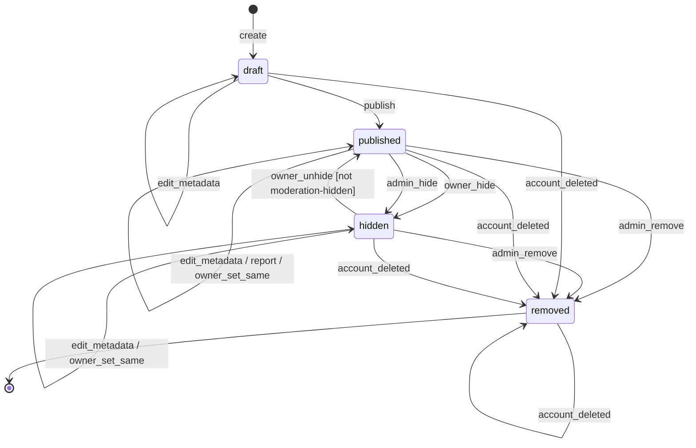

# Plan: 002-patch-book-publishing

An agent wrote this plan from spec.md and the code on `main` at 007b437 (0.3.0-alpha.8), on 2026-11-04. An agent also ran T001, under the owner's delegation; see [T001_CONFIRMATION_2026-11-04.md](T001_CONFIRMATION_2026-11-04.md). The owner has not read the spec, and approves this plan by merging it. D and O numbers below refer to that record.

Publishing stays off. Nothing here enables it.

## Stack (as built)

- Backend: Python 3.11 (`backend/Dockerfile`, CI), FastAPI, SQLAlchemy 2, Alembic migrations, Pydantic 2 (`backend/pyproject.toml`).
- Database: Postgres 15 (Neon in staging and production, a Postgres service in CI); unit tests use SQLite fixtures (`backend/tests/conftest.py`). The publishing tables have no migration (D13).
- Frontend: React 18, TypeScript, Vite, React Router (`frontend/package.json`). No page uses publishing; only its API types remain, in `frontend/src/types/api.ts`.
- Edge: the Cloudflare Worker in `edge/api` fronts the API (spec 006).
- CI: `.github/workflows/ci.yml`, jobs `backend`, `migrations`, `acceptance`, `backend-lint`, `frontend` and `frontend-e2e`. `just spec-dag` runs the task DAG check; no CI job runs it.

## Architecture

- **Design Engine.** `backend/export/patchbook/design/` composes a book: `content_spine.py` loads sealed compilations (Path A, from spec 001) or compiles on export (Path B). `layout_ir.py`, `diagram_svg.py` and the template families in `families/` lay out each page. `engine.py` draws the PDF, writes the pack, and runs `validate_book` (page counts, order, references, asset hashes, composition replay). `preflight.py` and `a11y.py` check page fit and accessibility. `ENABLE_PATCHBOOK_DESIGN_ENGINE` gates style recipes and the Studio, `ENABLE_CANON_EXPORT_FULFILLMENT` gates composing the pack after debit, and `ENABLE_PATCHBOOK_PUBLICATION_PROFILE` gates the multi-page profile (all off by default). Spec 002 owns the compile rules here; style recipes and the Studio belong to spec 008 (D4).
- **Composing.** One pass with no stored stage states, in the stages under "Composing a book" below (decision 37). `check_semantics` refuses a missing fact, `layout_patch_page` a page that doesn't fit, and `validate_book` a book that doesn't agree with itself. Any of them fails the whole export, and the credits come back.
- **Legacy export.** `backend/export/routes.py` and `backend/export/pdf.py`. The two-page legacy book is off (`ENABLE_LEGACY_PATCHBOOK_EXPORT`, #133).
- **Publishing.** `backend/publishing/routes.py`, `models.py` and `schemas.py` implement the publication lifecycle. `main.py` mounts the router only when `ENABLE_LEGACY_PUBLISHING` is on, so no publishing handler runs when it is off (OQ-5, D1). The owner PATCH and admin hide and remove lock the row (#197). Reports are rate-limited and deduplicated (#197). `_bound_to_validated_book` is the FR-048 guard and returns false until T033. `backend/account/deletion.py` also sets `removed` when an account closes (D2).
- **Moderation audit.** `AdminAuditLog` rows written by `_audit_moderation`.

## Work, in order

1. **T010: done 2026-11-06.** The publication table is checked against spec.md, with a test for every row.
2. **T090: done 2026-11-06.** Spec text corrected, and the code converged. See `tasks.md`.
3. **T038 to T041: only if publishing returns.** The threat model's remaining gaps. They gate T033.
4. **T033: only if the owner wants publishing back (O1).** Bind a publication export to a canon export whose pack passed `validate_book`. It also needs a migration for the publishing tables (D13), licence terms (O2) and retention (O3). Until then every publish answers 409 `PUBLICATION_BOOK_NOT_VALIDATED`.

## Answered, and still open

The owner answered these on 2026-11-04 ([decisions 37 and 38](../../docs/evidence/OWNER_DECISIONS_2026-11-04.md)):

| Item | Answer |
|---|---|
| O4: crossing, ambiguity and visual-diff thresholds (OQ-9) | `NOT_COMPUTABLE` until approved. |
| O5: publication profile against the one-page law (OQ-11) | The flag stays off. |
| O6: build the compile machines, or replace their tables | Not built. A patch that doesn't fit fails the whole export, and the credits come back. |
| O7: truncated source text (OQ-14) | The spec wins. |

These stay with the owner, with counsel on all three:

| Item | Default |
|---|---|
| O1: publishing back (OQ-6, T033) | Stays off. |
| O2: licence terms and `allow_remix` (OQ-12) | Deferred. No schema change. |
| O3: retention of reports and audit logs (OQ-13) | Undecided. Keep what is built. |

## Verification

- `cd backend && PYTHONPATH=. python -m pytest tests/unit/test_spec_002_transitions.py tests/unit/test_spec_002_report_limits_and_locks.py tests/api/test_publishing_api.py tests/api/test_account_deletion.py tests/unit/test_patchbook_validate_book.py tests/unit/test_patchbook_svg_goldens.py tests/unit/test_patchbook_page_fit.py tests/unit/test_patchbook_publication_dual.py tests/unit/test_spec_002_compose_stages.py -q`
- Row locks are a no-op on the SQLite fixtures. No test runs them on Postgres.
- `just spec-dag`.

## Carried forward from spec.md

The sections below are copied from [spec.md](spec.md) without change.

## Workflows

- Governing workflows (skills): anti-slop-code, production-systems, google-developer-style.
- Owners: FORGE decomposes, and a cloud agent implements.
- CI: reuse `.github/workflows/ci.yml` (jobs `backend` and `frontend`). Do not add a new CI path.

## Stateful behavior

This feature has one state machine and one pass:

- [Publication lifecycle machine](#publication-lifecycle-machine)
- [Composing a book](#composing-a-book), which has stages but no stored states

Implementers treat the transitions table as the contract. Any (state, event) pair it doesn't list is rejected, and the state doesn't change. [INFERRED] (constitution principle 9)

### Publication lifecycle machine

Initial state: `draft`. Final state: `removed`.

States:

- `draft`: created; not publicly readable. [OBSERVED: backend/publishing/models.py]
- `published`: readable at `/p/{slug}`; listed in the gallery when visibility is `public`. [OBSERVED: backend/publishing/models.py] [OBSERVED: docs/PUBLISHING_API.md]
- `hidden`: not publicly readable; can return to `published`. [OBSERVED: backend/publishing/models.py] [OBSERVED: docs/PUBLISHING_API.md]
- `removed`: terminal; not accessible. [OBSERVED: backend/publishing/models.py] [OBSERVED: PUBLISHING_IMPLEMENTATION.md]

Global guard: every event except `account_deleted` requires `ENABLE_LEGACY_PUBLISHING=true`. [OBSERVED: docs/FEATURE_FLAGS.md] Closing an account runs whether or not the flag is on, because a deleted account's text has to go either way. [OBSERVED: backend/account/deletion.py]

`visibility` (`unlisted` or `public`), `allow_download`, and `allow_remix` are attributes, not states. [OBSERVED: backend/publishing/models.py]

| from | event | guard | to | effect |
|---|---|---|---|---|
| `[*]` | `create` | caller owns the export; the flag is on; the export has no publication | `draft` | Assign a unique slug and store title, description, and settings. [OBSERVED: docs/PUBLISHING_API.md] [OBSERVED: backend/publishing/models.py] (see OQ-1) |
| `draft` | `publish` | caller is the owner; the flag is on; the export is bound to a book that passed validation | `published` | Set `published_at`, make the publication readable at `/p/{slug}`, and list it in the gallery if `public`. [INFERRED] (guard from FR-048) |
| `published` | `owner_hide` | caller is the owner; the flag is on | `hidden` | Remove public read and gallery listing; update `updated_at`. [OBSERVED: docs/PUBLISHING_API.md] |
| `hidden` | `owner_unhide` | caller is the owner; the flag is on; the publication wasn't hidden by moderation | `published` | Restore public read and update `updated_at`. [OBSERVED: docs/PUBLISHING_API.md] (moderation guard [INFERRED]; see OQ-2) |
| `published` | `admin_hide` | caller is an admin; the flag is on | `hidden` | Write an admin audit log entry with delta and reason; set `moderation_audit_id`. [OBSERVED: docs/PUBLISHING_API.md] [OBSERVED: backend/publishing/models.py] |
| `hidden` | `admin_hide` | caller is an admin; the flag is on; moderation hasn't already hidden it | `hidden` | Write an admin audit log entry with delta and reason; set `moderation_audit_id`, so the owner can no longer unhide it. An admin who acts after the owner's hide still ends with a hold. [T001 D6] |
| `published` | `admin_remove` | caller is an admin; the flag is on; a reason is provided | `removed` | Write an admin audit log entry; set `removed_reason` and `moderation_audit_id`. [OBSERVED: docs/PUBLISHING_API.md] [OBSERVED: PUBLISHING_IMPLEMENTATION.md] |
| `hidden` | `admin_remove` | caller is an admin; the flag is on; a reason is provided | `removed` | Write an admin audit log entry; set `removed_reason` and `moderation_audit_id`. [OBSERVED: docs/PUBLISHING_API.md] [OBSERVED: PUBLISHING_IMPLEMENTATION.md] |
| `draft` | `edit_metadata` | caller is the owner; the flag is on; only allowed fields change | `draft` | Update fields and `updated_at`. [OBSERVED: docs/PUBLISHING_API.md] (see OQ-4) |
| `published` | `edit_metadata` | caller is the owner; the flag is on; only allowed fields change | `published` | Update fields and `updated_at`. [OBSERVED: docs/PUBLISHING_API.md] (see OQ-4) |
| `hidden` | `edit_metadata` | caller is the owner; the flag is on; only allowed fields change | `hidden` | Update fields and `updated_at`. [OBSERVED: docs/PUBLISHING_API.md] (see OQ-4) |
| `published` | `report` | the flag is on; a reason is provided | `published` | Store a PublicationReport; status is unchanged. [OBSERVED: docs/PUBLISHING_API.md] (no status change [INFERRED]) |
| `published` | `owner_set_same` | caller is the owner; the flag is on; moderation hasn't acted on it | `published` | Nothing changes, and the request answers 200. [T001 D9] |
| `hidden` | `owner_set_same` | caller is the owner; the flag is on; moderation hasn't hidden it | `hidden` | Nothing changes, and the request answers 200. [T001 D9] |
| `draft` | `account_deleted` | the owner closed their account | `removed` | Set `removed_reason` to `ACCOUNT_DELETED`, replace the title, clear the description and cover, and turn off downloads. `moderation_audit_id` is left as it was. [T001 D2] |
| `published` | `account_deleted` | the owner closed their account | `removed` | Same effect. [T001 D2] |
| `hidden` | `account_deleted` | the owner closed their account | `removed` | Same effect. [T001 D2] |
| `removed` | `account_deleted` | the owner closed their account | `removed` | Same effect. The status doesn't change; the text is still cleared. [T001 D2] |

Illegal transitions:

- `removed` → any other state, including `edit_metadata` and `report`. [INFERRED]
- `draft` → `hidden`. [INFERRED]
- `draft` → `removed` through `admin_remove` (OQ-3). Only `account_deleted` removes a draft. [INFERRED]
- A second `admin_hide` on a publication moderation already hid. It would replace the audit link. [T001 D6]
- Any event except `account_deleted` while `ENABLE_LEGACY_PUBLISHING` is off. [OBSERVED: docs/FEATURE_FLAGS.md]
- An owner event from someone other than the owner, or an admin event from someone other than an admin. [OBSERVED: docs/PUBLISHING_API.md]
- An owner PATCH request that sets `status` to `draft` or `removed`. [OBSERVED: docs/PUBLISHING_API.md]
- A second `create` for an export that already has a publication. [OBSERVED: backend/publishing/models.py]
- `hidden` → `published` through `owner_unhide` when moderation hid the publication. [INFERRED] (see OQ-2)
- `report` on a `draft` or `hidden` publication. [INFERRED]
- Any transition triggered by a model or decision-layer component. [INFERRED] (constitution principle 4)

### Composing a book

The owner chose not to build the page and book compile machines (decision 37). The staged design stays in `docs/PATCH_BOOK_GENERATOR.md` sections 3 and 12, and no task builds it.

A book is composed in one pass, with no stored stage states. Any stage below that stops stops the whole export: the export ends `refunded`, the customer's credits come back, and a stage receipt keeps the code and remediation. No patch is dropped from a book, because a customer shouldn't pay for a book missing a patch. [OBSERVED: backend/canon/fulfillment.py, backend/export/patchbook/design/engine.py]

| stage | what it does | stops with |
|---|---|---|
| `load` | Reads the sealed patches for the run, or compiles them from the run's patches, and the name and jacks of each module on the source rig revision. | `EXPORT_NO_PATCHES`, `EXPORT_BRIDGE_HASH_MISMATCH` |
| `check` | Refuses a missing fact, a module not on the rig, or a failed validation report (FR-013, FR-014). | `PATCH_PAGE_REQUIRED_CONTENT_MISSING`, `PATCH_BOOK_REFERENCE_UNRESOLVED`, `PATCH_PAGE_GRAPH_MISMATCH` |
| `preflight` | Checks each page's regions, reading order, contrast, non-color encoding and font floor (FR-005, FR-008, FR-012). A warning passes and is recorded (OQ-7). | `PATCH_PAGE_REQUIRED_CONTENT_MISSING`, `PATCH_PAGE_NON_COLOR_ENCODING_FAILED`, `PATCH_PAGE_FONT_BELOW_MINIMUM`, `CONTRAST_BELOW_AA` |
| `draw` | Lays out and draws each page. The optional title block goes first if a page is full (FR-021). | `PATCH_PAGE_TEXT_OVERFLOW`, `PATCH_PAGE_DIAGRAM_OVERFLOW` |
| `validate_book` | Counts pages against the manifest, resolves references, checks asset hashes, and replays the composition hash. Writes `validation/book.json` (FR-016). | `PATCH_BOOK_PAGE_COUNT_MISMATCH`, `PATCH_BOOK_REFERENCE_UNRESOLVED`, `PATCH_BOOK_ASSET_HASH_MISMATCH` |
| `emit` | Writes a SHA-256 per file, reads each back, and checks that the required files exist. | `PATCH_BOOK_ASSET_HASH_MISMATCH`, `PACK_FILE_MISSING` |

A retry is another attempt at the same export. It must produce canonical-equivalent artifacts and must not create a conflicting immutable artifact, unless a module's name changed in the catalog between attempts, which changes the composition hash. [OBSERVED: docs/PATCH_BOOK_GENERATOR.md] (the rename [T001 D3, T090])

Composing never changes a source artifact. [OBSERVED: docs/PATCH_BOOK_GENERATOR.md]
