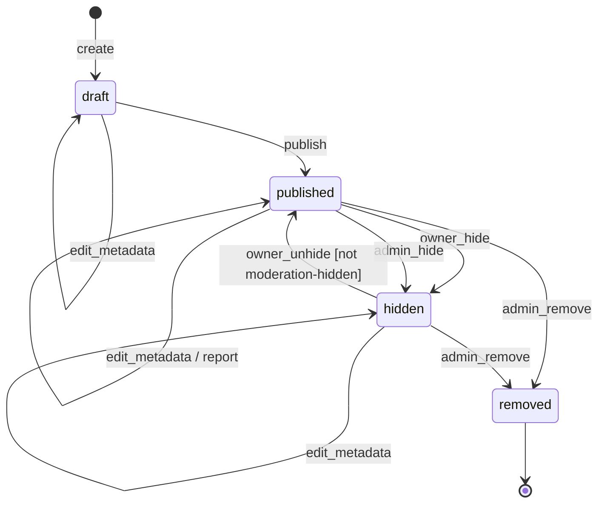
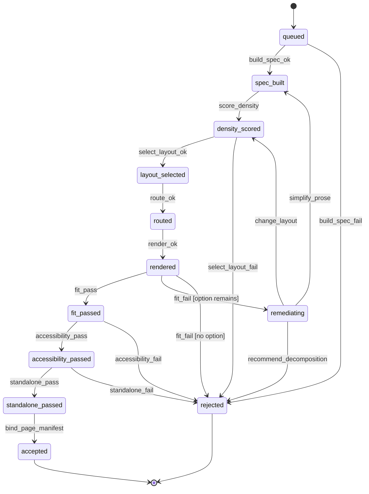
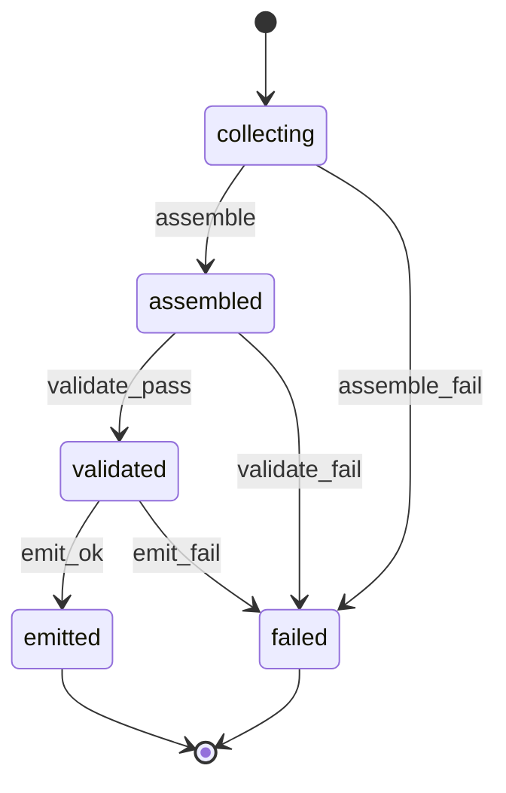

# Plan: 002-patch-book-publishing

An agent wrote this plan from spec.md and the code on `main` at 007b437 (0.3.0-alpha.8), on 2026-11-04. An agent also ran T001, under the owner's delegation; see [T001_CONFIRMATION_2026-11-04.md](T001_CONFIRMATION_2026-11-04.md). The owner has not read the spec, and approves this plan by merging it. D and O numbers below refer to that record.

Publishing stays off. Nothing here enables it.

## Stack (as built)

- Backend: Python 3.11 (`backend/Dockerfile`, CI), FastAPI, SQLAlchemy 2, Alembic migrations, Pydantic 2 (`backend/pyproject.toml`).
- Database: Postgres 15 (Neon in staging and production, a Postgres service in CI); unit tests use SQLite fixtures (`backend/tests/conftest.py`). The publishing tables have no migration (D13).
- Frontend: React 18, TypeScript, Vite, React Router (`frontend/package.json`). No page uses publishing; only its API types remain, in `frontend/src/types/api.ts`.
- Edge: the Cloudflare Worker in `edge/api` fronts the API (spec 006).
- CI: `.github/workflows/ci.yml`, jobs `backend`, `migrations`, `acceptance`, `backend-lint`, `frontend` and `frontend-e2e`. `just spec-dag` runs the task DAG check; no CI job runs it.

## Architecture

- **Design Engine.** `backend/export/patchbook/design/` composes a book: `content_spine.py` loads sealed compilations (Path A, from spec 001) or compiles on export (Path B). `layout_ir.py`, `diagram_svg.py` and the template families in `families/` lay out each page. `engine.py` draws the PDF, writes the pack, and runs `validate_book` (page counts, order, references, asset hashes, composition replay). `preflight.py` and `a11y.py` check page fit and accessibility. `ENABLE_PATCHBOOK_DESIGN_ENGINE` gates style recipes and the Studio, `ENABLE_CANON_EXPORT_FULFILLMENT` gates composing the pack after debit, and `ENABLE_PATCHBOOK_PUBLICATION_PROFILE` gates the multi-page profile (all off by default). Spec 002 owns the compile rules here; style recipes and the Studio belong to spec 008 (D4).
- **Compile machines.** The page and book machines in the tables below are the target, not built behavior. No stage states exist. `validate_book` is the one book-level stage, and a patch that does not fit fails the whole export (D3, O6).
- **Legacy export.** `backend/export/routes.py` and `backend/export/pdf.py`. The two-page legacy book is off (`ENABLE_LEGACY_PATCHBOOK_EXPORT`, #133).
- **Publishing.** `backend/publishing/routes.py`, `models.py` and `schemas.py` implement the publication lifecycle. `main.py` mounts the router only when `ENABLE_LEGACY_PUBLISHING` is on, so no publishing handler runs when it is off (OQ-5, D1). The owner PATCH and admin hide and remove lock the row (#197). Reports are rate-limited and deduplicated (#197). `_bound_to_validated_book` is the FR-048 guard and returns false until T033. `backend/account/deletion.py` also sets `removed` when an account closes (D2).
- **Moderation audit.** `AdminAuditLog` rows written by `_audit_moderation`.

## Work, in order

1. **T010: encode what can be encoded.** The publication table is done in `test_spec_002_transitions.py`. Still to add: a hidden read and draft and hidden rows in the gallery (record row 3), the `account_deleted` row (D2), the two owner no-ops (D9), and both `/me/exports` paths with the flag off (D1). The compile machines cannot be encoded until O6 is answered (D11).
2. **T090: correct the spec text.** D1, D2, D4, D5, D8, D9, D10 and D12, and record D13. T001 left spec.md unchanged, so these are still open. Copy the carried sections below again afterwards.
3. **T090: converge the code.**
   - An admin who acts second still ends with a hold (D6).
   - A missing fact is an error, not a placeholder (D7, FR-014).
   - Compilation FRs still Partial (spec.md table): FR-004 (colophon disclaimer at 8 pt), FR-007 (page stages and their receipts), FR-008, FR-009, FR-011, FR-012, FR-013, FR-015 (thresholds wait on O4), FR-018 (no README in the pack), FR-019, FR-021, FR-023, FR-024 (no `COMPILE_PATCH_PAGE` stage). FR-007, FR-021 and FR-024 depend on O6.
   - T090 cannot close until O6 is answered.
4. **Threat model tasks (spec.md, "Adversary threat model").** Slug length, `noindex` and `no-store`, download headers, SVG escaping, and `cover_image_url` validation. They are not yet in `tasks.md`. The rate limit exists only on the report route (#197). SVG escaping is a code defect and does not wait for T033. The others gate T033.
5. **T033: only if the owner wants publishing back (O1).** Bind a publication export to a canon export whose pack passed `validate_book`. It also needs a migration for the publishing tables (D13), licence terms (O2), retention (O3) and the threat model tasks. Until then every publish answers 409 `PUBLICATION_BOOK_NOT_VALIDATED`.
6. **Compile machines: only after O6.** Build the stage states, or replace the tables with what `validate_book` checks.

## Open, and the default this plan follows

The owner decides these, with counsel on O1 to O3. Merging this plan does not answer them.

| Item | Default |
|---|---|
| O1: publishing back (OQ-6, T033) | Stays off. |
| O2: licence terms and `allow_remix` (OQ-12) | Deferred. No schema change. |
| O3: retention of reports and audit logs (OQ-13) | Undecided. Keep what is built. |
| O4: crossing, ambiguity and visual-diff thresholds (OQ-9) | `NOT_COMPUTABLE` until measured and approved. |
| O5: publication profile against the one-page law (OQ-11) | Flag off, plates undrawn, failing by design. |
| O6: build the compile machines, or replace their tables | Build nothing now. A patch that does not fit keeps failing the whole export, with compensation. |
| O7: truncated source text (OQ-14) | Accept the spec. Carry the listed gaps at T090. |

## Verification

- `cd backend && PYTHONPATH=. python -m pytest tests/unit/test_spec_002_transitions.py tests/unit/test_spec_002_report_limits_and_locks.py tests/api/test_publishing_api.py tests/api/test_account_deletion.py tests/unit/test_patchbook_validate_book.py tests/unit/test_patchbook_svg_goldens.py tests/unit/test_patchbook_page_fit.py tests/unit/test_patchbook_publication_dual.py -q`
- Row locks are a no-op on the SQLite fixtures. No test runs them on Postgres.
- `just spec-dag`.

## Carried forward from spec.md

The sections below are copied from [spec.md](spec.md) without change. Their `[INFERRED]` labels and "Status: INFERRED skeleton" line are spec.md's wording; the T001 record gives each claim its status. D2, D6 and D9 apply to the publication table, D3, D10 and O6 to the page and book machines, and D8 to the Workflows section.

## Workflows

Status: INFERRED skeleton. Confirm before you plan.

- Governing workflows (skills): anti-slop-code, production-systems, google-developer-style.
- Owners: FORGE decomposes, a cloud agent implements, SCRIBE files the compact artifact.
- CI: reuse `.github/workflows/ci.yml` (jobs `backend` and `frontend`). Do not add a new CI path.

## Stateful behavior

This feature has three state machines:

- [Publication lifecycle machine](#publication-lifecycle-machine)
- [Page compilation machine (per patch)](#page-compilation-machine-per-patch)
- [Book compilation machine](#book-compilation-machine)

Implementers treat each transitions table as the contract. Any (state, event) pair that a table doesn't list is rejected, and the state doesn't change. [INFERRED] (constitution principle 9)

### Publication lifecycle machine

Initial state: `draft`. Final state: `removed`.

States:

- `draft`: created; not publicly readable. [OBSERVED: backend/publishing/models.py]
- `published`: readable at `/p/{slug}`; listed in the gallery when visibility is `public`. [OBSERVED: backend/publishing/models.py] [OBSERVED: docs/PUBLISHING_API.md]
- `hidden`: not publicly readable; can return to `published`. [OBSERVED: backend/publishing/models.py] [OBSERVED: docs/PUBLISHING_API.md]
- `removed`: terminal; not accessible. [OBSERVED: backend/publishing/models.py] [OBSERVED: PUBLISHING_IMPLEMENTATION.md]

Global guard: every event requires `ENABLE_LEGACY_PUBLISHING=true`. [OBSERVED: docs/FEATURE_FLAGS.md]

`visibility` (`unlisted` or `public`), `allow_download`, and `allow_remix` are attributes, not states. [OBSERVED: backend/publishing/models.py]

| from | event | guard | to | effect |
|---|---|---|---|---|
| `[*]` | `create` | caller owns the export; the flag is on; the export has no publication | `draft` | Assign a unique slug and store title, description, and settings. [OBSERVED: docs/PUBLISHING_API.md] [OBSERVED: backend/publishing/models.py] (see OQ-1) |
| `draft` | `publish` | caller is the owner; the flag is on; the export is bound to a book that passed validation | `published` | Set `published_at`, make the publication readable at `/p/{slug}`, and list it in the gallery if `public`. [INFERRED] (guard from FR-048) |
| `published` | `owner_hide` | caller is the owner; the flag is on | `hidden` | Remove public read and gallery listing; update `updated_at`. [OBSERVED: docs/PUBLISHING_API.md] |
| `hidden` | `owner_unhide` | caller is the owner; the flag is on; the publication wasn't hidden by moderation | `published` | Restore public read and update `updated_at`. [OBSERVED: docs/PUBLISHING_API.md] (moderation guard [INFERRED]; see OQ-2) |
| `published` | `admin_hide` | caller is an admin; the flag is on | `hidden` | Write an admin audit log entry with delta and reason; set `moderation_audit_id`. [OBSERVED: docs/PUBLISHING_API.md] [OBSERVED: backend/publishing/models.py] |
| `published` | `admin_remove` | caller is an admin; the flag is on; a reason is provided | `removed` | Write an admin audit log entry; set `removed_reason` and `moderation_audit_id`. [OBSERVED: docs/PUBLISHING_API.md] [OBSERVED: PUBLISHING_IMPLEMENTATION.md] |
| `hidden` | `admin_remove` | caller is an admin; the flag is on; a reason is provided | `removed` | Write an admin audit log entry; set `removed_reason` and `moderation_audit_id`. [OBSERVED: docs/PUBLISHING_API.md] [OBSERVED: PUBLISHING_IMPLEMENTATION.md] |
| `draft` | `edit_metadata` | caller is the owner; the flag is on; only allowed fields change | `draft` | Update fields and `updated_at`. [OBSERVED: docs/PUBLISHING_API.md] (see OQ-4) |
| `published` | `edit_metadata` | caller is the owner; the flag is on; only allowed fields change | `published` | Update fields and `updated_at`. [OBSERVED: docs/PUBLISHING_API.md] (see OQ-4) |
| `hidden` | `edit_metadata` | caller is the owner; the flag is on; only allowed fields change | `hidden` | Update fields and `updated_at`. [OBSERVED: docs/PUBLISHING_API.md] (see OQ-4) |
| `published` | `report` | the flag is on; a reason is provided | `published` | Store a PublicationReport; status is unchanged. [OBSERVED: docs/PUBLISHING_API.md] (no status change [INFERRED]) |

Illegal transitions:

- `removed` → any state, including `edit_metadata` and `report`. [INFERRED]
- `draft` → `hidden`. [INFERRED]
- `draft` → `removed`. This stays rejected until OQ-3 is resolved. [INFERRED]
- Any event while `ENABLE_LEGACY_PUBLISHING` is off. [OBSERVED: docs/FEATURE_FLAGS.md]
- An owner event from someone other than the owner, or an admin event from someone other than an admin. [OBSERVED: docs/PUBLISHING_API.md]
- An owner PATCH request that sets `status` to `draft` or `removed`. [OBSERVED: docs/PUBLISHING_API.md]
- A second `create` for an export that already has a publication. [OBSERVED: backend/publishing/models.py]
- `hidden` → `published` through `owner_unhide` when moderation hid the publication. [INFERRED] (see OQ-2)
- `report` on a `draft` or `hidden` publication. [INFERRED]
- Any transition triggered by a model or decision-layer component. [INFERRED] (constitution principle 4)

### Page compilation machine (per patch)

Initial state: `queued`. Final states: `accepted` and `rejected`. One patch always produces zero or one accepted page. [OBSERVED: docs/PATCH_BOOK_GENERATOR.md]

Each transition writes a stage receipt. A terminal state keeps all completed receipts and diagnostics. [OBSERVED: docs/PATCH_BOOK_GENERATOR.md]

States:

- `queued` [INFERRED]
- `spec_built` [OBSERVED: docs/PATCH_BOOK_GENERATOR.md] ("build PatchPageSpec")
- `density_scored` [OBSERVED: docs/PATCH_BOOK_GENERATOR.md]
- `layout_selected` [OBSERVED: docs/PATCH_BOOK_GENERATOR.md]
- `routed` [OBSERVED: docs/PATCH_BOOK_GENERATOR.md]
- `rendered` [OBSERVED: docs/PATCH_BOOK_GENERATOR.md]
- `fit_passed` [OBSERVED: docs/PATCH_BOOK_GENERATOR.md]
- `accessibility_passed` [OBSERVED: docs/PATCH_BOOK_GENERATOR.md]
- `standalone_passed` [OBSERVED: docs/PATCH_BOOK_GENERATOR.md] (section 12, `COMPILE_PATCH_PAGE` success conditions)
- `remediating` [INFERRED] (from section 2 remediation options)
- `accepted`: the page is bound into the page manifest. [OBSERVED: docs/PATCH_BOOK_GENERATOR.md]
- `rejected`: the patch is excluded from the book profile. [OBSERVED: docs/PATCH_BOOK_GENERATOR.md]

| from | event | guard | to | effect |
|---|---|---|---|---|
| `queued` | `build_spec_ok` | the inputs are present and their versions are compatible; semantic validation passes | `spec_built` | Write the PatchPageSpec with its canonical hash and a stage receipt. [OBSERVED: docs/PATCH_BOOK_GENERATOR.md] |
| `queued` | `build_spec_fail` | an input is missing, a version is incompatible, or semantic validation fails | `rejected` | Write a receipt with `PATCH_PAGE_REQUIRED_CONTENT_MISSING` or `PATCH_PAGE_GRAPH_MISMATCH` and remediation. [OBSERVED: docs/PATCH_BOOK_GENERATOR.md] (fail-closed guard [INFERRED], constitution principle 9) |
| `spec_built` | `score_density` | none | `density_scored` | Record text density and diagram density. [OBSERVED: docs/PATCH_BOOK_GENERATOR.md] |
| `density_scored` | `select_layout_ok` | an untried approved layout class supports the output profile | `layout_selected` | Record the selected layout deterministically. [OBSERVED: docs/PATCH_BOOK_GENERATOR.md] |
| `density_scored` | `select_layout_fail` | no approved layout class supports the page | `rejected` | Write `PATCH_PAGE_LAYOUT_NOT_SUPPORTED`. [OBSERVED: docs/PATCH_BOOK_GENERATOR.md] |
| `layout_selected` | `route_ok` | none | `routed` | Number routes to match the ordered connection list and place labels deterministically. [OBSERVED: docs/PATCH_BOOK_GENERATOR.md] |
| `routed` | `render_ok` | none | `rendered` | Write the canonical SVG asset and its hash. [OBSERVED: docs/PATCH_BOOK_GENERATOR.md] |
| `rendered` | `fit_pass` | PageFitReport status is `pass` | `fit_passed` | Write the PageFitReport. [OBSERVED: docs/PATCH_BOOK_GENERATOR.md] |
| `rendered` | `fit_fail` | status is `fail` or `warning`; a remediation option remains | `remediating` | Write the PageFitReport with error codes and remediation. [OBSERVED: docs/PATCH_BOOK_GENERATOR.md] (treating `warning` as not passing is [INFERRED]; see OQ-7) |
| `rendered` | `fit_fail` | status is `fail` or `warning`; no remediation option remains | `rejected` | Write the PageFitReport and the terminal error code. [OBSERVED: docs/PATCH_BOOK_GENERATOR.md] |
| `remediating` | `simplify_prose` | optional prose remains to compress; no connection, safety condition, or required mode is removed | `spec_built` | Rebuild the spec with compressed optional wording. [OBSERVED: docs/PATCH_BOOK_GENERATOR.md] |
| `remediating` | `change_layout` | an untried approved layout class remains | `density_scored` | Mark the current layout as tried. [OBSERVED: docs/PATCH_BOOK_GENERATOR.md] |
| `remediating` | `recommend_decomposition` | no other remediation remains | `rejected` | Record a decomposition recommendation. Create no patches. [OBSERVED: docs/PATCH_BOOK_GENERATOR.md] (no-create effect [INFERRED], FR-021) |
| `fit_passed` | `accessibility_pass` | grayscale, non-color encoding, reading order, contrast, and text equivalent checks pass | `accessibility_passed` | Write an accessibility receipt. [OBSERVED: docs/PATCH_BOOK_GENERATOR.md] |
| `fit_passed` | `accessibility_fail` | production output | `rejected` | Write `PATCH_PAGE_GRAYSCALE_FAILED` or `PATCH_PAGE_NON_COLOR_ENCODING_FAILED`. [OBSERVED: docs/PATCH_BOOK_GENERATOR.md] |
| `accessibility_passed` | `standalone_pass` | signal validation, required-content validation, and diagram legibility pass | `standalone_passed` | Write a standalone-execution receipt. [OBSERVED: docs/PATCH_BOOK_GENERATOR.md] |
| `accessibility_passed` | `standalone_fail` | any condition fails | `rejected` | Write `PATCH_PAGE_STANDALONE_EXECUTION_FAILED`. [OBSERVED: docs/PATCH_BOOK_GENERATOR.md] |
| `standalone_passed` | `bind_page_manifest` | none | `accepted` | Bind the page hash, the SVG asset hash, and the validation status. [OBSERVED: docs/PATCH_BOOK_GENERATOR.md] |

Remediation attempts run in a fixed, deterministic order, and each option is tried at most once, so the machine always terminates. [INFERRED] (constitution principle 1)

Illegal transitions:

- `accepted` or `rejected` → any state. [INFERRED]
- Skipping a stage, such as `rendered` → `accepted` or `layout_selected` → `rendered`. [OBSERVED: docs/PATCH_BOOK_GENERATOR.md] (stage order)
- `rendered` → `fit_passed` when the PageFitReport status is `warning`. [OBSERVED: docs/PATCH_BOOK_GENERATOR.md] ("Warnings never silently become passes")
- Any remediation that deletes a connection, safety condition, or required mode. [OBSERVED: docs/PATCH_BOOK_GENERATOR.md]
- A second accepted page for the same patch. [OBSERVED: docs/PATCH_BOOK_GENERATOR.md]
- Any transition that a model or decision-layer component triggers on its own authority. [INFERRED] (constitution principle 4)

### Book compilation machine

Initial state: `collecting`. Final states: `emitted` and `failed`. A terminal failure keeps all completed receipts and diagnostics. [OBSERVED: docs/PATCH_BOOK_GENERATOR.md] (state names [INFERRED])

States:

- `collecting`: page machines run for each patch in the book profile. [INFERRED]
- `assembled`: the PatchBookManifest, front matter, and back matter exist. [OBSERVED: docs/PATCH_BOOK_GENERATOR.md]
- `validated`: book validation passed. [OBSERVED: docs/PATCH_BOOK_GENERATOR.md]
- `emitted`: the export bundle is written and hash-verified. [OBSERVED: docs/PATCH_BOOK_GENERATOR.md]
- `failed`: terminal failure with receipts. [OBSERVED: docs/PATCH_BOOK_GENERATOR.md]

| from | event | guard | to | effect |
|---|---|---|---|---|
| `collecting` | `assemble` | every page machine is terminal; at least one page is accepted | `assembled` | Write the PatchBookManifest with stable page order. [OBSERVED: docs/PATCH_BOOK_GENERATOR.md] (the at-least-one guard is [INFERRED]; see OQ-8) |
| `collecting` | `assemble_fail` | no page is accepted | `failed` | Write a receipt that lists every rejected patch and its error. [INFERRED] |
| `assembled` | `validate_pass` | page counts match, references resolve, assets are hash-valid, and replay reproduces canonical JSON | `validated` | Write a book validation receipt. [OBSERVED: docs/PATCH_BOOK_GENERATOR.md] |
| `assembled` | `validate_fail` | any book check fails | `failed` | Write `PATCH_BOOK_PAGE_COUNT_MISMATCH`, `PATCH_BOOK_REFERENCE_UNRESOLVED`, or `PATCH_BOOK_ASSET_HASH_MISMATCH`. [OBSERVED: docs/PATCH_BOOK_GENERATOR.md] |
| `validated` | `emit_ok` | every bundle artifact is written and matches its checksum | `emitted` | Write `manifest/checksums.json`. [OBSERVED: docs/PATCH_BOOK_GENERATOR.md] |
| `validated` | `emit_fail` | an artifact is missing or its hash doesn't match | `failed` | Write `PATCH_BOOK_ASSET_HASH_MISMATCH`. [OBSERVED: docs/PATCH_BOOK_GENERATOR.md] |

A retry starts a new attempt for the same source run. The retry must produce canonical-equivalent artifacts and must not create a conflicting immutable artifact. [OBSERVED: docs/PATCH_BOOK_GENERATOR.md]

Illegal transitions:

- `emitted` or `failed` → any state within the same attempt. [INFERRED]
- `assembled` → `emitted` without validation. [OBSERVED: docs/PATCH_BOOK_GENERATOR.md]
- `assemble` while any page machine is non-terminal. [INFERRED]
- Changing any source artifact in any state. [OBSERVED: docs/PATCH_BOOK_GENERATOR.md]

