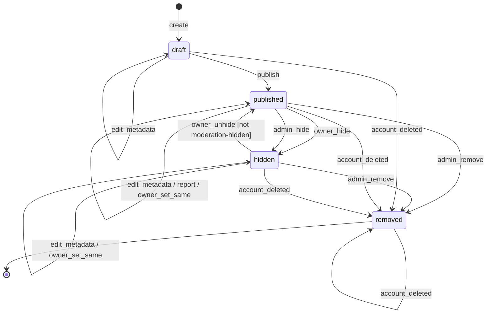

# 002: Patch-book compilation and publishing

Status: confirmed under the owner's delegation (T001, 2026-11-04) and converged at T090 (2026-11-06). An agent drafted it on 2026-10-16 from the repo docs and code listed under Sources. Each claim is labeled `[OBSERVED: <file>]`, `[INFERRED]`, or by the record that settled it: `[T001 D<n>]` is [the T001 record](T001_CONFIRMATION_2026-11-04.md), and a decision number is [the owner's decisions](../../docs/evidence/OWNER_DECISIONS_2026-11-04.md).

## Sources

- `docs/PATCH_BOOK_GENERATOR.md`
- `docs/PUBLISHING_API.md`
- `PUBLISHING_IMPLEMENTATION.md`
- `backend/publishing/models.py`
- `docs/FEATURE_FLAGS.md`
- PatchHive Constitution 1.0.0, which governs this spec.

The source extracts were truncated, and this spec wins over them (decision 38). What the generator doc has and this spec doesn't is listed under [Left to the generator doc](#left-to-the-generator-doc).

## Summary

This feature turns validated PatchHive patches into a Patch Book for a specific modular rig. The book is a deterministic, manifest-bound technical manual. The compiler emits PDF, SVG, JSON, and ZIP artifacts. Each published patch occupies exactly one standalone page that you can use at the rack without any other page. [OBSERVED: docs/PATCH_BOOK_GENERATOR.md]

This feature also specifies the historical publishing layer. That layer lets an owner publish an export as a read-only public page with gallery discovery, reporting, and admin moderation. It is disabled unless `ENABLE_LEGACY_PUBLISHING=true`, and it must not be presented as a current product capability. [OBSERVED: docs/PUBLISHING_API.md] [OBSERVED: docs/FEATURE_FLAGS.md]

**Why:** Performers need a reproducible, accessible, printable manual that agrees with their confirmed inventory and canonical patch artifacts. [OBSERVED: docs/PATCH_BOOK_GENERATOR.md] Publishing lets owners share those artifacts with provenance. Moderation keeps the public surface accountable. [OBSERVED: PUBLISHING_IMPLEMENTATION.md]

## Implementation status (2026-11-06)

Checked against the code at T090, after 0.3.0-alpha.13. Open gaps link to [research.md](research.md) and to the open tasks in [tasks.md](tasks.md). "Design Engine" means `backend/export/patchbook/design/`; "engine.py" below is `backend/export/patchbook/design/engine.py`. Totals: compilation 19 implemented, 3 partial, 2 not built by decision; publishing 19 implemented, 1 partial.

Until 2026-11-06 a paid book's PDF pages drew no diagram at all, and named modules by database id. The diagram went only to a separate SVG file in the pack. T090 fixed both.

| FR | Status | Evidence |
|---|---|---|
| FR-001 | Implemented | One execution page per patch. Overflow fails instead of continuing (#101) [OBSERVED: design/engine.py `layout_patch_page`]. Plate mode is under FR-016. |
| FR-002 | Implemented | No page has a QR code or companion link, so none can hold required content [OBSERVED: repo grep 2026-11-03]. |
| FR-003 | Implemented | Text wraps by measured width (#101). The legacy rig and patch PDFs wrap and continue on a new page (#133). |
| FR-004 | Implemented | Body, steps, cables, the cover and the colophon use the floor; the cover and colophon notices wrap at `body_size_pt()` (T035, T090) [OBSERVED: design/engine.py `_render_execution_pdf`]. |
| FR-005 | Implemented | Dash pattern, number and label per signal; preflight `COLOR_ONLY_DIAGRAMS` [OBSERVED: design/diagram_svg.py, design/a11y.py]. |
| FR-006 | Implemented | `validate_book` reloads the layout IR from disk and replays `composition_hash`; a mismatch fails `PATCH_BOOK_ASSET_HASH_MISMATCH` (#143, T030) [OBSERVED: design/engine.py `validate_book`]. Two runs give the same hash and the same receipt bytes [OBSERVED: tests/unit/test_patchbook_svg_goldens.py, test_patchbook_validate_book.py]. The replay re-hashes the stored IR; it does not recompile from source. |
| FR-007 | Implemented | The stages in [Composing a book](#composing-a-book) run in order. `validate_book` writes `validation/book.json`, kept on failure (#143). A stage that stops the export leaves a stage receipt with its code and remediation (T090) [OBSERVED: canon/fulfillment.py `_keep_failure_receipt`]. |
| FR-008 | Implemented | Every family's page holds all six regions in its layout IR, and preflight refuses one that doesn't. The PDF draws them: title and footer identity, intent, diagram, construction, operation (T090) [OBSERVED: design/engine.py `_lay_out`, design/a11y.py]. The category, difficulty and build time the generator doc lists under identity aren't printed. |
| FR-009 | Implemented | The three classes are typed, and each family has one default, so selection is deterministic. `instruction_first` draws the diagram last; the other two draw it first (T090) [OBSERVED: design/families/registry.py]. There's no fallback to another class (decision 37). |
| FR-010 | Implemented | Required content is never dropped; a page that can't hold it fails (#101). |
| FR-011 | Implemented | One geometry drawn as the SVG and on the PDF page. Each module's box lists its jacks with their cable numbers, and those numbers match the connection list. Arrows mark direction, five dash patterns and a legend mark signal type, and loops are drawn heavier, tagged `FB` and warned about (T090) [OBSERVED: design/diagram_svg.py `layout_diagram`]. |
| FR-012 | Partial | `CONTRAST_BELOW_AA`, `READING_ORDER_EMPTY`, a text companion with the page's own cable list and warnings, and per-page JSON. WCAG 2.2 AA can't be proven by these checks; the screen-reader and PDF pass is a human's [OBSERVED: design/a11y.py]. |
| FR-013 | Partial | Modules must be on the source rig revision, or `PATCH_BOOK_REFERENCE_UNRESOLVED`. The connection list and the diagram both read the sealed graph. Every validation report issue prints on the page, including a normal being broken, and a failed report stops the export (T090). Jacks can't be resolved against the rig, which holds no jacks; see FR-014. The catalog holds no required modes or normals, so nothing sets them. The page's only safety wording is the compiler's fixed text, and no check looks for other claims. |
| FR-014 | Implemented | A missing title, intent, step, cable, jack name or signal type stops the export with `PATCH_PAGE_REQUIRED_CONTENT_MISSING` (T090, D7) [OBSERVED: design/engine.py `check_semantics`]. Most catalog modules declare no jacks, so the generator's role names stay (spec 001 OQ-04). The page says so, naming those modules. Module names are read at export time, so a rename reaches later exports. |
| FR-015 | Partial | Overflow codes (#101), the font floor (#102), and one page per patch. Jack labels sit inside module boxes, so they can't land on a route. Cable-crossing and ambiguity limits stay `NOT_COMPUTABLE` until the owner approves measured numbers (decision 38). |
| FR-016 | Implemented | `validate_book` checks PDF pages drawn against the manifest, patches against patch pages, page order, references, per-diagram hashes and composition replay, and fails with the three `PATCH_BOOK_*` codes plus remediation (#143, T030) [OBSERVED: design/engine.py `validate_book`]. Plate mode (flag off by default) fails `PATCH_BOOK_PAGE_COUNT_MISMATCH` until plates are drawn (T031). The book has no table of contents or index to resolve. |
| FR-017 | Implemented | The manifest lists one entry per page: index, kind, page id, patch artifact id, page hash, SVG hash, status [OBSERVED: design/engine.py manifest `"pages"`]. The page number is the 0-based `index`. |
| FR-018 | Implemented | PDF, README, manifest with page entries, `checksums.json` with a SHA-256 per file (read back after writing), `validation/book.json`, page JSON, diagram SVGs, library index, LICENSE, companion (T090) [OBSERVED: design/engine.py]. The field is "can contain", and the source rig revision isn't copied in. |
| FR-019 | Implemented | Errors use the section 15 codes where a stage exists, and carry remediation. Preflight warnings are listed in `validation/book.json` and the manifest (T036, #138, #143). Four codes have no stage to raise them: `PATCH_PAGE_LAYOUT_NOT_SUPPORTED`, `PATCH_PAGE_GRAYSCALE_FAILED` and `PATCH_PAGE_STANDALONE_EXECUTION_FAILED` (decision 37), and `PATCH_PAGE_LABEL_COLLISION` (decision 38). |
| FR-020 | Implemented | Composition reads sealed compilations and writes only into the pack directory [INFERRED from design/engine.py]. |
| FR-021 | Implemented | The optional block goes first, then the whole export fails with a code and the credits come back (#101, decision 37) [OBSERVED: tests/unit/test_spec_002_compose_stages.py]. |
| FR-022 | Implemented | Cover and colophon are separate pages [OBSERVED: design/engine.py]. |
| FR-023 | Not built, by decision | Composing isn't broken into runes (decision 37). Its receipts carry `determinism_class` and `operation_version` [OBSERVED: canon/contracts.py]. |
| FR-024 | Not built, by decision | No `COMPILE_PATCH_PAGE` stage (decision 37). `check`, preflight, page fit and `validate_book` hold the conditions, apart from a standalone-execution check. |
| FR-030 | Implemented | The router is mounted only when the flag is set; the default is false [OBSERVED: backend/main.py:202, backend/core/config.py:62]. |
| FR-031 | Implemented | The publishing pages are deleted; the frontend keeps only API types in `frontend/src/types/api.ts`, and no page uses them [OBSERVED: repo grep 2026-11-03]. |
| FR-032 | Implemented | With the flag off no publishing handler runs and nothing changes. Nine of the eleven paths answer 404. `POST /api/me/exports` answers 405 and `GET /api/me/exports` lists paid exports, because the account router owns that path (D1). All of it is tested against an app built with the flag off [OBSERVED: backend/tests/unit/test_spec_002_transitions.py]. |
| FR-033 | Implemented | 403 `Export ownership mismatch` on export and publication create [OBSERVED: backend/publishing/routes.py:199,206,236]. |
| FR-034 | Implemented | `unique_publication_export`, and 400 on a second create [OBSERVED: backend/publishing/models.py:60, routes.py]. |
| FR-035 | Implemented | `slug` is unique [OBSERVED: backend/publishing/models.py:70]. |
| FR-036 | Implemented | `PublicationCreate.visibility` defaults to `unlisted`; the gallery excludes unlisted (#138, T034) [OBSERVED: backend/publishing/schemas.py:40, routes.py `list_gallery`]. |
| FR-037 | Implemented | `PublicationUpdate` has only the listed fields, and `status` takes only `published` or `hidden` [OBSERVED: backend/publishing/schemas.py]. |
| FR-038 | Implemented | Only lifecycle pairs are accepted (#101). An illegal pair answers 409 `INVALID_TRANSITION`, a removed row 409 `PUBLICATION_UNDER_MODERATION`, an unbound publish 409 `PUBLICATION_BOOK_NOT_VALIDATED`, and a report on a row that isn't public 404, so it looks like a missing row (D5). The owner PATCH and admin hide and remove lock the row first (#197), and every row of the table is tested (T010) [OBSERVED: routes.py `OWNER_TRANSITIONS`, tests/unit/test_spec_002_transitions.py]. |
| FR-039 | Implemented | The public payload has no email or database id; the publisher shows as "PatchHive User" [OBSERVED: backend/publishing/routes.py `get_publication`]. |
| FR-040 | Implemented | License and `run_id`, `generated_at`, `patch_count`, `manifest_hash` [OBSERVED: same]. |
| FR-041 | Implemented | 403 `Downloads disabled` when `allow_download` is false [OBSERVED: routes.py:410]. |
| FR-042 | Implemented | `limit` (1-50), `recent_days` (1-365) and `cursor` are checked; `export_type` is `Literal["patch", "rack"]`, so anything else is 422 (#138, T034) [OBSERVED: routes.py:423-424]. |
| FR-043 | Implemented | Read, download and report require `published`; the gallery also requires `public` [OBSERVED: same]. |
| FR-044 | Implemented | `ReportCreate` needs a reason (3-200 characters); details are optional. The route is rate-limited per client address (10 per hour, 429 `REPORT_RATE_LIMIT`) and a signed-in reporter gets one report per publication (#197) [OBSERVED: backend/publishing/schemas.py, routes.py:485,511]. Anonymous reports are bounded only by the rate limit. Retention is undecided. |
| FR-045 | Implemented | `_audit_moderation` writes actor, action, target, delta and reason, and sets `moderation_audit_id` and `removed_reason` [OBSERVED: backend/publishing/routes.py:622]. |
| FR-046 | Implemented | Reads filter to `published`, and a removed publication refuses any PATCH with 409 (#130) [OBSERVED: routes.py:284]. |
| FR-047 | Implemented | Separate `publication_exports` table [OBSERVED: backend/publishing/models.py]. |
| FR-048 | Partial | `draft` → `published` answers 409 `PUBLICATION_BOOK_NOT_VALIDATED` unless `_bound_to_validated_book` is true, and it always returns false, so nothing can publish (#143, T032) [OBSERVED: backend/publishing/routes.py:297, `_bound_to_validated_book`]. The guard fails closed. Binding a publication export to a validated pack does not exist (T033, OQ-6). |
| FR-049 | Implemented | Publishing imports no decision-layer code, and the only writers of a publication's status are its routes and account closure (T010) [OBSERVED: tests/unit/test_spec_002_transitions.py]. |

Known gap: no Alembic migration creates `publications`, `publication_exports` or `publication_reports`, so turning the flag on against a migrated database would fail at the first query (inferred, not run). T033 has to add one if publishing returns (D13).

## Scope

In scope:

- Composing a book in the stages under [Composing a book](#composing-a-book), then emitting the export bundle. [OBSERVED: backend/export/patchbook/design/engine.py]
- Receipts and the machine-readable error taxonomy. [OBSERVED: docs/PATCH_BOOK_GENERATOR.md]
- The feature-flagged publication lifecycle: create, publish, hide, unhide, edit, report, admin hide, and admin remove. [OBSERVED: docs/PUBLISHING_API.md]
- Public read, download gating, and the gallery. [OBSERVED: docs/PUBLISHING_API.md]

## Non-goals

- The paid export debit, credits ledger, Stripe webhooks, download tokens, and fulfillment worker retry and compensation. These belong to the canonical payment and export surface (`/api/canon/*`). This spec only requires that compilation never mutates source artifacts and that the compiler can be replayed safely. [INFERRED] (scope split, from docs/FEATURE_FLAGS.md and docs/PATCH_BOOK_GENERATOR.md section 17)
- Making legacy publishing a current product capability, or adding navigation to it. [OBSERVED: docs/PUBLISHING_API.md] [OBSERVED: docs/FEATURE_FLAGS.md]
- The per-patch page machine and book machine, per-patch rejection, other layouts as remediation, and decomposition recommendations. The generator doc's staged design isn't built (decision 37).
- Multi-page publication profiles and artistic dual-artifact packs (`ENABLE_PATCHBOOK_PUBLICATION_PROFILE`). The flag stays off (decision 38).
- The Style Studio and style recipes (`ENABLE_PATCHBOOK_DESIGN_ENGINE`; spec 008). The compile rules in `backend/export/patchbook/design/` are in scope (T001 D4).
- Patch generation, rig verification, and inventory confirmation. This feature consumes those outputs. [INFERRED]
- Decomposing a patch into new patches. The compiler cannot create or change patch artifacts. [INFERRED] (from docs/PATCH_BOOK_GENERATOR.md sections 2 and 16)

## User stories

### P1: Compile a standalone one-page patch [OBSERVED: docs/PATCH_BOOK_GENERATOR.md]

As a rig owner, I want each validated patch compiled into one complete page, so that I can build and perform the patch beside my hardware without turning pages.

Acceptance criteria:

1. **Given** a patch with a PatchGraph, a PatchPlan, a passing ValidationReport, module display metadata, a book profile, and theme tokens, **when** the book is composed, **then** the patch produces exactly one page. That page contains the identity header, diagram, intent, construction, operation, and footer identity regions. [OBSERVED: docs/PATCH_BOOK_GENERATOR.md]
2. **Given** a patch whose content exceeds the page, **when** the page is laid out, **then** the optional title block goes first. If the patch still doesn't fit, the whole export fails with a machine-readable error and remediation, and the customer's credits come back (decision 37). The compiler never truncates, clips, or uses an ellipsis on required content. [OBSERVED: docs/PATCH_BOOK_GENERATOR.md]
3. **Given** any page, **when** you render it in grayscale, **then** every cable and signal type stays distinguishable without color. [OBSERVED: docs/PATCH_BOOK_GENERATOR.md]
4. **Given** a print profile, **when** the page is drawn, **then** no body text is smaller than 9.5 pt. For a digital profile, no body text is smaller than the 14 px equivalent. [OBSERVED: docs/PATCH_BOOK_GENERATOR.md]
5. **Given** a patch that references a module or port missing from the source rig revision, **when** semantic validation runs, **then** the export fails with an error code. [OBSERVED: docs/PATCH_BOOK_GENERATOR.md]

### P2: Assemble and validate a Patch Book [OBSERVED: docs/PATCH_BOOK_GENERATOR.md]

As a rig owner, I want a book's pages assembled into a validated, manifest-bound book, so that the PDF, the manifest, and the assets agree.

Acceptance criteria:

1. **Given** a book's pages, **when** assembly completes, **then** each PatchBookManifest page entry binds a page number, the patch ID where applicable, the page hash, the SVG asset hash, and the validation status. [OBSERVED: docs/PATCH_BOOK_GENERATOR.md]
2. **Given** an assembled book, **when** book validation runs, **then** the patch count equals the patch-page count and the PDF page count equals the manifest page count. Every table of contents and index reference resolves, and every asset is present and hash-valid. [OBSERVED: docs/PATCH_BOOK_GENERATOR.md]
3. **Given** a book validation failure, **when** the compiler stops, **then** it keeps its receipt and diagnostics and reports `PATCH_BOOK_PAGE_COUNT_MISMATCH`, `PATCH_BOOK_REFERENCE_UNRESOLVED`, or `PATCH_BOOK_ASSET_HASH_MISMATCH`. [OBSERVED: docs/PATCH_BOOK_GENERATOR.md]
4. **Given** front matter or back matter, **when** the book is assembled, **then** those pages are never placed inside a patch's required content. [OBSERVED: docs/PATCH_BOOK_GENERATOR.md]

### P3: Reproduce a book deterministically [OBSERVED: docs/PATCH_BOOK_GENERATOR.md]

As an operator, I want a fixed source run to compile to canonical-equivalent output on every run, so that the canonical JSON and the hashes remain the reproducibility authority.

Acceptance criteria:

1. **Given** fixed normalized input, schema version, generator version, layout profile, and seed, **when** you compile twice, **then** both runs produce identical canonical JSON and stable SVG structure. [OBSERVED: docs/PATCH_BOOK_GENERATOR.md]
2. **Given** a compilation run, **when** it completes or fails, **then** the source patch, the rig revision, and the run artifacts are unchanged. [OBSERVED: docs/PATCH_BOOK_GENERATOR.md]
3. **Given** a compilation retry for the same source run, **when** the retry completes, **then** it creates no conflicting immutable artifact. [OBSERVED: docs/PATCH_BOOK_GENERATOR.md]

### P4: Publish an export (legacy, feature-flagged) [OBSERVED: docs/PUBLISHING_API.md]

As an export owner in an environment where `ENABLE_LEGACY_PUBLISHING=true`, I want to create a publication for my export, so that others can view it at a public slug.

Acceptance criteria:

1. **Given** you own an export and the flag is on, **when** you submit `POST /me/publications`, **then** the system creates a publication with a unique slug. [OBSERVED: docs/PUBLISHING_API.md] [OBSERVED: backend/publishing/models.py]
2. **Given** an export that you don't own, **when** you try to create an export or publication from it, **then** the system rejects the request. [OBSERVED: PUBLISHING_IMPLEMENTATION.md]
3. **Given** an export that already has a publication, **when** you create a second publication for it, **then** the system rejects the request. [OBSERVED: backend/publishing/models.py]
4. **Given** the flag is off, **when** you call any publishing endpoint, **then** the system rejects the request and changes no state. [INFERRED] (from docs/FEATURE_FLAGS.md; the response code is open question OQ-5)
5. **Given** an export that isn't bound to a book that passed validation, **when** you try to publish it, **then** the system rejects the publish request. [INFERRED] (constitution principles 9 and 10)

### P5: Read and download a publication [OBSERVED: docs/PUBLISHING_API.md]

As a public reader, I want to view a publication's provenance and license and download its artifacts when the owner allows it.

Acceptance criteria:

1. **Given** a published publication, **when** you request `GET /p/{slug}`, **then** the response includes the title, description, cover image, export type, license, provenance (run ID, generation time, patch count, manifest hash), and publisher display name. The response excludes email addresses and internal IDs. [OBSERVED: docs/PUBLISHING_API.md] [OBSERVED: PUBLISHING_IMPLEMENTATION.md]
2. **Given** `allow_download` is `false`, **when** you request `/p/{slug}/download/{artifact_type}`, **then** the system serves no artifact. [OBSERVED: docs/PUBLISHING_API.md] [OBSERVED: PUBLISHING_IMPLEMENTATION.md]
3. **Given** an unlisted publication, **when** you browse `/gallery/publications`, **then** the publication isn't listed. [OBSERVED: PUBLISHING_IMPLEMENTATION.md]
4. **Given** a removed publication, **when** you request its slug, **then** the system serves no content. [OBSERVED: PUBLISHING_IMPLEMENTATION.md]
5. **Given** a draft or hidden publication, **when** a non-owner requests its slug or the gallery, **then** the system serves no content. [INFERRED]

### P6: Manage my publication [OBSERVED: docs/PUBLISHING_API.md]

As a publication owner, I want to hide, unhide, and edit my publication.

Acceptance criteria:

1. **Given** you own a published publication, **when** you set `status` to `hidden` by using `PATCH /me/publications/{id}`, **then** the publication becomes hidden. [OBSERVED: docs/PUBLISHING_API.md]
2. **Given** you own a hidden publication that a moderator didn't hide, **when** you set `status` to `published`, **then** the publication becomes published. [OBSERVED: docs/PUBLISHING_API.md] (the moderation guard is [INFERRED]; see OQ-2)
3. **Given** a PATCH request that sets `status` to any value other than `published` or `hidden`, **when** the request is processed, **then** the system rejects it. [OBSERVED: docs/PUBLISHING_API.md]
4. **Given** a PATCH request from someone other than the owner, **when** the request is processed, **then** the system rejects it. [OBSERVED: docs/PUBLISHING_API.md]

### P7: Report and moderate a publication [OBSERVED: docs/PUBLISHING_API.md]

As a reader, I want to report a publication. As an admin, I want to hide or remove it with an audit record.

Acceptance criteria:

1. **Given** a readable publication, **when** you submit `POST /p/{slug}/report` with a reason, **then** the system stores a report and leaves the publication status unchanged. [OBSERVED: docs/PUBLISHING_API.md] (the status-unchanged behavior is [INFERRED])
2. **Given** you are an admin, **when** you hide or remove a publication, **then** the system writes an admin audit log entry with the actor, action, target, before and after delta, and reason. [OBSERVED: docs/PUBLISHING_API.md] [OBSERVED: PUBLISHING_IMPLEMENTATION.md]
3. **Given** you aren't an admin, **when** you call an admin moderation endpoint, **then** the system rejects the request. [OBSERVED: docs/PUBLISHING_API.md]
4. **Given** a removed publication, **when** anyone requests any transition, **then** the system rejects it. [INFERRED]

### P8: Keep legacy publishing contained [OBSERVED: docs/FEATURE_FLAGS.md]

As an operator, I want legacy publishing off by default and isolated, so that it doesn't leak into the canonical MVP.

Acceptance criteria:

1. **Given** default configuration, **when** the backend starts, **then** `ENABLE_LEGACY_PUBLISHING` is `false`. [OBSERVED: docs/FEATURE_FLAGS.md]
2. **Given** the active frontend, **when** you navigate the app, **then** no navigation leads to publishing pages. Those pages are deleted from the frontend. [OBSERVED: docs/FEATURE_FLAGS.md]
3. **Given** publication exports, **when** they are stored, **then** they are kept separate from paid MVP exports. [OBSERVED: backend/publishing/models.py]

## Functional requirements

### Compilation

- **FR-001**: Each published patch must occupy exactly one page. A patch must not continue onto another page, share a page, or rely on its facing page. [OBSERVED: docs/PATCH_BOOK_GENERATOR.md]
- **FR-002**: A QR code or online companion may extend a page, but it must not contain required execution information. [OBSERVED: docs/PATCH_BOOK_GENERATOR.md]
- **FR-003**: Required content must not be hidden, clipped, truncated, or replaced by an ellipsis. [OBSERVED: docs/PATCH_BOOK_GENERATOR.md] Implemented 2026-10-28 (#101) for the Design Engine execution PDF: titles, intents, steps and cables wrap by measured width (`layout_patch_page`), and long diagram labels wrap inside their node instead of being cut at 18 characters. Implemented 2026-10-29 (#133) for the legacy rig and patch PDFs: text wraps and continues on a new page.
- **FR-004**: Body text must not be smaller than 9.5 pt in print profiles or 14 px equivalent in digital profiles. [OBSERVED: docs/PATCH_BOOK_GENERATOR.md] Implemented 2026-10-28 (#102) for the Design Engine PDF: intent, steps and cables (required content) and cover and colophon text are drawn at `body_size_pt()`, the recipe minimum but never below 9.5 pt for print profiles or 10.5 pt (14 px) for digital ones. A recipe asking for less is raised, with a `BODY_SIZE_RAISED_TO_FLOOR` warning; any text run below the floor is an error. Captions, diagram labels, the title block and footers are not body text. The cover's and colophon's patent notices are drawn at the floor.
- **FR-005**: Color must not be the only way to encode a signal or cable. Pages must remain understandable in grayscale. [OBSERVED: docs/PATCH_BOOK_GENERATOR.md]
- **FR-006**: Fixed normalized input, schema version, generator version, layout profile, and seed must produce canonical-equivalent output. [OBSERVED: docs/PATCH_BOOK_GENERATOR.md]
- **FR-007**: Composing must run the stages in the order shown in [Composing a book](#composing-a-book). A stage that stops the export must keep what's completed and a receipt of the failure with its code and remediation. [OBSERVED: docs/PATCH_BOOK_GENERATOR.md] (one pass instead of per-page stages: decision 37)
- **FR-008**: Each patch page must contain these semantic regions: identity header, patch diagram, intent, construction, operation, and footer identity. A layout can move regions but must not omit required semantics. [OBSERVED: docs/PATCH_BOOK_GENERATOR.md]
- **FR-009**: The compiler must select a layout deterministically from three approved classes: `diagram_first`, `instruction_first`, and `performance_first`. Each family has one default class. Themes must not introduce unapproved semantic layouts. [OBSERVED: docs/PATCH_BOOK_GENERATOR.md] (one default, no fallback: decision 37)
- **FR-010**: Content budgets are profile inputs. The compiler can compress wording while preserving meaning. It must not delete a connection, safety condition, or required mode to achieve fit. [OBSERVED: docs/PATCH_BOOK_GENERATOR.md]
- **FR-011**: Diagrams must meet these requirements: [OBSERVED: docs/PATCH_BOOK_GENERATOR.md]
  - Diagrams are SVG first.
  - Diagrams show labeled source and destination ports.
  - Cable routes are numbered to match the ordered connection list.
  - Direction is marked wherever it is ambiguous.
  - Audio, CV, gate, trigger, and clock each have a distinct encoding that doesn't rely on color.
  - Feedback cycles are marked and carry a startup warning.
  - Node placement and edge routing are deterministic.
- **FR-012**: Pages must target WCAG 2.2 AA for digital surfaces and equivalent print legibility. Every page must have a text equivalent of the graph and a text-first companion in JSON or HTML. An accessibility failure the checks can see is a compilation failure for production output. [OBSERVED: docs/PATCH_BOOK_GENERATOR.md]
- **FR-013**: Semantic validation must check the following: [OBSERVED: docs/PATCH_BOOK_GENERATOR.md]
  - Patch, module, and port references resolve to the source rig revision.
  - Ordered connections exactly represent the PatchGraph.
  - Required modes and normal-break behavior are explicit.
  - Warnings match the ValidationReport.
  - Unsupported safety claims are absent.
  - The legacy patch book also refuses patches from another rig (`PATCH_BOOK_REFERENCE_UNRESOLVED`), and `POST /api/export/patchbook` is off by default (410) (#133).
- **FR-014**: Compilation must use only confirmed inventory and capabilities. A missing physical or functional fact must produce an explicit error. The compiler must not invent a substitute fact. A jack that isn't on file keeps the generator's role name (spec 001 OQ-04), and the page must say which modules that applies to. [INFERRED] (constitution principles 3 and 8)
- **FR-015**: Page-fit validation must confirm the following: [OBSERVED: docs/PATCH_BOOK_GENERATOR.md]
  - The patch produces exactly one rendered page.
  - No block overflows its region.
  - No element is clipped.
  - The minimum font size holds.
  - No labels collide.
  - Cable crossings and ambiguity stay within accepted thresholds, once the owner approves them. Until then they're `NOT_COMPUTABLE` (decision 38).
  - The footer and checksum remain visible.
- **FR-016**: Book validation must check the following: [OBSERVED: docs/PATCH_BOOK_GENERATOR.md]
  - Patch count equals patch-page count.
  - PDF page count equals manifest page count.
  - Every reference resolves.
  - Page order is stable.
  - Every asset is present and hash-valid.
  - Deterministic replay reproduces the canonical JSON.
- **FR-017**: Each manifest page entry must bind the page number, the patch ID where applicable, the page hash, the SVG asset hash, and the validation status. [OBSERVED: docs/PATCH_BOOK_GENERATOR.md]
- **FR-018**: The export bundle can contain the PDF, the manifests and checksums, the page SVG and JSON files, the diagram SVG files, the source library and rig revision, the validation reports, the license file, and a README. The PDF is a presentation artifact. Canonical JSON and hashes are the reproducibility authority. [OBSERVED: docs/PATCH_BOOK_GENERATOR.md]
- **FR-019**: Errors must be machine-readable, use the codes in section 15 of the generator spec where a stage exists to raise them, and include remediation. Warnings must never silently become passes: a warning lets the pack through and is recorded in the manifest and `validation/book.json` (OQ-7). [OBSERVED: docs/PATCH_BOOK_GENERATOR.md]
- **FR-020**: Page assembly must never change source artifacts. [OBSERVED: docs/PATCH_BOOK_GENERATOR.md]
- **FR-021**: When a page can't satisfy the constraints, the optional title block goes first. If required content still doesn't fit, the export fails with `PATCH_PAGE_TEXT_OVERFLOW` or `PATCH_PAGE_DIAGRAM_OVERFLOW` and remediation, and the paid export is compensated. No patch is dropped from a book, because a customer shouldn't pay for a book missing a patch (decision 37). The compiler must not create decomposed patches. [INFERRED] (from FR-020)
- **FR-022**: Front matter and back matter are exempt from the one-patch rule. They must never be inserted inside a patch's required content. [OBSERVED: docs/PATCH_BOOK_GENERATOR.md]
- **FR-023**: Any compiler rune must declare its input and output schemas, version, determinism class, permitted side effects, authority requirement, error taxonomy, and test vectors. Composing has no runes today (decision 37). [OBSERVED: docs/PATCH_BOOK_GENERATOR.md]
- **FR-024**: A book's page is drawn only when signal validation, required-content validation, and page-fit validation pass. `COMPILE_PATCH_PAGE` and its standalone-execution check aren't built (decision 37). [OBSERVED: docs/PATCH_BOOK_GENERATOR.md]

### Publishing

- **FR-030**: Publishing endpoints must be disabled unless `ENABLE_LEGACY_PUBLISHING=true`. The default is `false`. [OBSERVED: docs/FEATURE_FLAGS.md] [OBSERVED: docs/PUBLISHING_API.md]
- **FR-031**: Publishing must not appear in active navigation or be described as a current product capability. [OBSERVED: docs/PUBLISHING_API.md] [OBSERVED: docs/FEATURE_FLAGS.md]
- **FR-032**: When the flag is off, every publishing request must fail closed and change no state. No publishing handler runs. [INFERRED] (constitution principle 9)
- **FR-033**: The system must enforce export ownership for export and publication creation. [OBSERVED: PUBLISHING_IMPLEMENTATION.md]
- **FR-034**: An export can have at most one publication. [OBSERVED: backend/publishing/models.py]
- **FR-035**: Each publication slug must be unique. [OBSERVED: backend/publishing/models.py]
- **FR-036**: Visibility is either `unlisted` or `public`. The default is `unlisted`. The gallery must exclude unlisted publications. [OBSERVED: backend/publishing/models.py] [OBSERVED: PUBLISHING_IMPLEMENTATION.md]
- **FR-037**: Owner updates are limited to `title`, `description`, `visibility`, `allow_download`, `allow_remix`, `cover_image_url`, and `status`. Status can only be set to `published` or `hidden`. [OBSERVED: docs/PUBLISHING_API.md]
- **FR-038**: Publication status must change only through the [publication lifecycle transitions](#publication-lifecycle-machine). [OBSERVED: PUBLISHING_IMPLEMENTATION.md] ("immutable records (status transitions only)"; see OQ-4) Creation starts in `draft`. Anything the table doesn't list changes nothing and is refused, as the implementation status table lists.
- **FR-039**: Public payloads must exclude email addresses and internal IDs. [OBSERVED: PUBLISHING_IMPLEMENTATION.md]
- **FR-040**: The public read must include the license and provenance (`run_id`, `generated_at`, `patch_count`, `manifest_hash`). [OBSERVED: docs/PUBLISHING_API.md]
- **FR-041**: Artifact downloads (`pdf`, `svg`, `zip`) must be served only when `allow_download` is `true`. [OBSERVED: docs/PUBLISHING_API.md]
- **FR-042**: The gallery must be sorted by recency. It accepts `limit` (1–50), `cursor` (an ISO datetime), `export_type` (`patch` or `rack`), and `recent_days` (1–365). [OBSERVED: docs/PUBLISHING_API.md] [OBSERVED: PUBLISHING_IMPLEMENTATION.md]
- **FR-043**: The gallery and public read must serve only publications in the `published` state. The gallery must also require `public` visibility. [INFERRED]
- **FR-044**: Readers can report a publication with a required reason and optional details. [OBSERVED: docs/PUBLISHING_API.md] [OBSERVED: backend/publishing/models.py]
- **FR-045**: Admin hide and admin remove require admin privileges. Each action writes an audit log entry with the actor, action type, target, before and after delta, and reason. Removal stores `removed_reason` and links `moderation_audit_id`. [OBSERVED: docs/PUBLISHING_API.md] [OBSERVED: PUBLISHING_IMPLEMENTATION.md] [OBSERVED: backend/publishing/models.py]
- **FR-046**: A removed publication must not be accessible. [OBSERVED: PUBLISHING_IMPLEMENTATION.md] Implemented 2026-10-29 (#130): a removed publication refuses any PATCH, metadata included.
- **FR-047**: Publication exports must stay separate from paid MVP exports. [OBSERVED: backend/publishing/models.py]
- **FR-048**: A publish transition requires an export bound to a PatchBookManifest that passed book validation. [INFERRED] (constitution principles 9 and 10; see OQ-6)
- **FR-049**: No probabilistic or decision-layer component can change a publication's status, perform moderation, or accept a compiled page. [INFERRED] (constitution principle 4)

## Key entities

- **PatchPageSpec**: a versioned semantic description of one patch page, in the generator doc. Not built (decision 37): a page is laid out directly from the sealed plan and graph. [OBSERVED: docs/PATCH_BOOK_GENERATOR.md]
- **PageFitReport**: the fit and accessibility verdict for a page, in the generator doc. Not built (decision 37): preflight and the page-fit check stop the export instead. [OBSERVED: docs/PATCH_BOOK_GENERATOR.md]
- **PatchBookManifest**: the book-level binding of pages, assets, versions, and the canonical hash. [OBSERVED: docs/PATCH_BOOK_GENERATOR.md]
- **Stage receipt**: the record a stage writes. `validate_book` writes one, and a stage that stops an export writes one with its failure. [OBSERVED: docs/PATCH_BOOK_GENERATOR.md]
- **Export bundle**: the set of PDF, SVG, JSON, and ZIP artifacts for a book. [OBSERVED: docs/PATCH_BOOK_GENERATOR.md]
- **PublicationExport**: a historical sharing export with an owner, a patch or rack, a license, a run ID, a manifest hash, and artifact URLs. [OBSERVED: backend/publishing/models.py]
- **Publication**: a slugged, status-bearing publication of exactly one export. [OBSERVED: backend/publishing/models.py]
- **PublicationReport**: a reader report against a publication. [OBSERVED: backend/publishing/models.py]
- **AdminAuditLog**: a moderation audit record with actor, action, target, delta, and reason. [OBSERVED: PUBLISHING_IMPLEMENTATION.md]

## Adversary threat model: public publishing surfaces

Scope: the unauthenticated read, download, gallery and report endpoints in `backend/publishing/routes.py` (decision on OQ-15, provisional, owner to confirm; see [the decision record](../../docs/evidence/JEV_DECISIONS_2026-11-01.md)). Code was read on `main` at 176779e, before #197 and #280, so the line numbers are out of date. They're in `backend/publishing/routes.py` unless a path is given. This is a legacy surface: the router mounts only when `ENABLE_LEGACY_PUBLISHING=true`, which defaults to false (`backend/main.py:202-205`, `backend/core/config.py:62`, `docs/FEATURE_FLAGS.md:8`). Moving a draft to `published` also needs a validated book, and `_bound_to_validated_book` always returns False today (`287-289,303-308`). So no publication can reach `published` through the API now. The risks below apply once either gate opens.

| # | Adversary and attack | Existing mitigation | Gap |
|---|---|---|---|
| P1 | Slug enumeration: guess or crawl `/p/{slug}` to find publications | The slug is the title slug plus 8 hex characters from `uuid4` (`backend/publishing/utils.py:7-14`), about 32 random bits, and is unique in the database (`backend/publishing/models.py:70`). Only `published` rows resolve, and any other status returns the same 404 as a missing slug (`340-346`). | 32 bits is guessable by a patient crawler against a public host, and the title part is readable. Only the report route has a rate limit (#197). 404s are not logged or throttled. |
| P2 | Unlisted leakage: an `unlisted` publication shows up in a listing or index | The gallery filters `visibility == "public"` and `status == "published"` (`418-423`). Cards carry only slug, title, description, cover and type (`440-449`). The public read returns a fixed publisher label and no avatar (`350-353`). The gallery cursor is a timestamp, not an id (`452-456`). | `/p/{slug}` serves an unlisted publication to anyone with the link, which is intended, but no `X-Robots-Tag` or `noindex` is set, so a shared link can be indexed. Public JSON includes `run_id` and `manifest_hash` (`369-374`). Hidden or removed items return 404, but no `Cache-Control` is set in this file, so a cache could keep serving an old copy. The cursor is the previous `published_at`, so rows sharing a timestamp can be skipped (correctness, not leakage). |
| P3 | Report spam: flood `/p/{slug}/report` to bury the moderator queue or harass a publisher | Only a `published` publication can be reported (`469-472`). Reason is 3-200 characters and details at most 2000 (`backend/publishing/schemas.py:117-121`). The reporter id is stored when logged in (`476`). | The route allows 10 reports an hour per address, and a signed-in reporter gets one report per publication (#197). Anonymous reports are bounded only by that limit, with no CAPTCHA and no cap per publication. Reports trigger no automatic action, so spam cannot auto-hide a publication, but it can flood the queue. Retention of reports and audit rows is undecided. |
| P4 | Hotlinked downloads: embed `/api/p/{slug}/download/*` on another site to burn bandwidth | Downloads need `published` status and `allow_download` (`392-401`). The type is limited to `pdf`, `svg`, `zip` (`47,389-390`). The file path comes from the stored export record, not from the URL (`403`), so the URL gives no path traversal. | No referer check, signed URL, or per-IP or per-slug bandwidth limit. The response is a bare `FileResponse` (`407`) with no `Content-Disposition` or `X-Content-Type-Options`. Large zips are served from the app process. Artifacts live under `settings.export_dir` and nothing here removes them when a publication is removed (`50-69`). |
| P5 | Malicious content: a publisher plants hostile content in title, description, cover URL or the artifacts to reach readers | Title is capped at 200 and description at 2000 characters (`backend/publishing/schemas.py:38-39`). Artifacts are generated server-side from the owner's own rack or patch (`77-175`), and export creation checks ownership (`185-201`). An admin can hide or remove with an audit row (`485-575`). | `cover_image_url` is an unvalidated string (`backend/publishing/schemas.py:43,54`), so it can point to a tracking pixel on a third-party host, an `http:` URL, or a `javascript:` or `data:` URL if a client renders it unsafely. An SVG served from `/api/p/{slug}/download/svg` opens as a document, so names have to be escaped in it; they are (#280, `tests/api/test_svg_export_escaping.py`). Title and description escaping is the client's job and is not tested here. |

The gaps that remain are T038 to T041 in [tasks.md](tasks.md). They gate T033, and none has any effect while publishing is off.

## Workflows

- Governing workflows (skills): anti-slop-code, production-systems, google-developer-style.
- Owners: FORGE decomposes, and a cloud agent implements.
- CI: reuse `.github/workflows/ci.yml` (jobs `backend` and `frontend`). Do not add a new CI path.

## Stateful behavior

This feature has one state machine and one pass:

- [Publication lifecycle machine](#publication-lifecycle-machine)
- [Composing a book](#composing-a-book), which has stages but no stored states

Implementers treat the transitions table as the contract. Any (state, event) pair it doesn't list is rejected, and the state doesn't change. [INFERRED] (constitution principle 9)

### Publication lifecycle machine

Initial state: `draft`. Final state: `removed`.

States:

- `draft`: created; not publicly readable. [OBSERVED: backend/publishing/models.py]
- `published`: readable at `/p/{slug}`; listed in the gallery when visibility is `public`. [OBSERVED: backend/publishing/models.py] [OBSERVED: docs/PUBLISHING_API.md]
- `hidden`: not publicly readable; can return to `published`. [OBSERVED: backend/publishing/models.py] [OBSERVED: docs/PUBLISHING_API.md]
- `removed`: terminal; not accessible. [OBSERVED: backend/publishing/models.py] [OBSERVED: PUBLISHING_IMPLEMENTATION.md]

Global guard: every event except `account_deleted` requires `ENABLE_LEGACY_PUBLISHING=true`. [OBSERVED: docs/FEATURE_FLAGS.md] Closing an account runs whether or not the flag is on, because a deleted account's text has to go either way. [OBSERVED: backend/account/deletion.py]

`visibility` (`unlisted` or `public`), `allow_download`, and `allow_remix` are attributes, not states. [OBSERVED: backend/publishing/models.py]

| from | event | guard | to | effect |
|---|---|---|---|---|
| `[*]` | `create` | caller owns the export; the flag is on; the export has no publication | `draft` | Assign a unique slug and store title, description, and settings. [OBSERVED: docs/PUBLISHING_API.md] [OBSERVED: backend/publishing/models.py] (see OQ-1) |
| `draft` | `publish` | caller is the owner; the flag is on; the export is bound to a book that passed validation | `published` | Set `published_at`, make the publication readable at `/p/{slug}`, and list it in the gallery if `public`. [INFERRED] (guard from FR-048) |
| `published` | `owner_hide` | caller is the owner; the flag is on | `hidden` | Remove public read and gallery listing; update `updated_at`. [OBSERVED: docs/PUBLISHING_API.md] |
| `hidden` | `owner_unhide` | caller is the owner; the flag is on; the publication wasn't hidden by moderation | `published` | Restore public read and update `updated_at`. [OBSERVED: docs/PUBLISHING_API.md] (moderation guard [INFERRED]; see OQ-2) |
| `published` | `admin_hide` | caller is an admin; the flag is on | `hidden` | Write an admin audit log entry with delta and reason; set `moderation_audit_id`. [OBSERVED: docs/PUBLISHING_API.md] [OBSERVED: backend/publishing/models.py] |
| `hidden` | `admin_hide` | caller is an admin; the flag is on; moderation hasn't already hidden it | `hidden` | Write an admin audit log entry with delta and reason; set `moderation_audit_id`, so the owner can no longer unhide it. An admin who acts after the owner's hide still ends with a hold. [T001 D6] |
| `published` | `admin_remove` | caller is an admin; the flag is on; a reason is provided | `removed` | Write an admin audit log entry; set `removed_reason` and `moderation_audit_id`. [OBSERVED: docs/PUBLISHING_API.md] [OBSERVED: PUBLISHING_IMPLEMENTATION.md] |
| `hidden` | `admin_remove` | caller is an admin; the flag is on; a reason is provided | `removed` | Write an admin audit log entry; set `removed_reason` and `moderation_audit_id`. [OBSERVED: docs/PUBLISHING_API.md] [OBSERVED: PUBLISHING_IMPLEMENTATION.md] |
| `draft` | `edit_metadata` | caller is the owner; the flag is on; only allowed fields change | `draft` | Update fields and `updated_at`. [OBSERVED: docs/PUBLISHING_API.md] (see OQ-4) |
| `published` | `edit_metadata` | caller is the owner; the flag is on; only allowed fields change | `published` | Update fields and `updated_at`. [OBSERVED: docs/PUBLISHING_API.md] (see OQ-4) |
| `hidden` | `edit_metadata` | caller is the owner; the flag is on; only allowed fields change | `hidden` | Update fields and `updated_at`. [OBSERVED: docs/PUBLISHING_API.md] (see OQ-4) |
| `published` | `report` | the flag is on; a reason is provided | `published` | Store a PublicationReport; status is unchanged. [OBSERVED: docs/PUBLISHING_API.md] (no status change [INFERRED]) |
| `published` | `owner_set_same` | caller is the owner; the flag is on; moderation hasn't acted on it | `published` | Nothing changes, and the request answers 200. [T001 D9] |
| `hidden` | `owner_set_same` | caller is the owner; the flag is on; moderation hasn't hidden it | `hidden` | Nothing changes, and the request answers 200. [T001 D9] |
| `draft` | `account_deleted` | the owner closed their account | `removed` | Set `removed_reason` to `ACCOUNT_DELETED`, replace the title, clear the description and cover, and turn off downloads. `moderation_audit_id` is left as it was. [T001 D2] |
| `published` | `account_deleted` | the owner closed their account | `removed` | Same effect. [T001 D2] |
| `hidden` | `account_deleted` | the owner closed their account | `removed` | Same effect. [T001 D2] |
| `removed` | `account_deleted` | the owner closed their account | `removed` | Same effect. The status doesn't change; the text is still cleared. [T001 D2] |

Illegal transitions:

- `removed` → any other state, including `edit_metadata` and `report`. [INFERRED]
- `draft` → `hidden`. [INFERRED]
- `draft` → `removed` through `admin_remove` (OQ-3). Only `account_deleted` removes a draft. [INFERRED]
- A second `admin_hide` on a publication moderation already hid. It would replace the audit link. [T001 D6]
- Any event except `account_deleted` while `ENABLE_LEGACY_PUBLISHING` is off. [OBSERVED: docs/FEATURE_FLAGS.md]
- An owner event from someone other than the owner, or an admin event from someone other than an admin. [OBSERVED: docs/PUBLISHING_API.md]
- An owner PATCH request that sets `status` to `draft` or `removed`. [OBSERVED: docs/PUBLISHING_API.md]
- A second `create` for an export that already has a publication. [OBSERVED: backend/publishing/models.py]
- `hidden` → `published` through `owner_unhide` when moderation hid the publication. [INFERRED] (see OQ-2)
- `report` on a `draft` or `hidden` publication. [INFERRED]
- Any transition triggered by a model or decision-layer component. [INFERRED] (constitution principle 4)

### Composing a book

The owner chose not to build the page and book compile machines (decision 37). The staged design stays in `docs/PATCH_BOOK_GENERATOR.md` sections 3 and 12, and no task builds it.

A book is composed in one pass, with no stored stage states. Any stage below that stops stops the whole export: the export ends `refunded`, the customer's credits come back, and a stage receipt keeps the code and remediation. No patch is dropped from a book, because a customer shouldn't pay for a book missing a patch. [OBSERVED: backend/canon/fulfillment.py, backend/export/patchbook/design/engine.py]

| stage | what it does | stops with |
|---|---|---|
| `load` | Reads the sealed patches for the run, or compiles them from the run's patches, and the name and jacks of each module on the source rig revision. | `EXPORT_NO_PATCHES`, `EXPORT_BRIDGE_HASH_MISMATCH` |
| `check` | Refuses a missing fact, a module not on the rig, or a failed validation report (FR-013, FR-014). | `PATCH_PAGE_REQUIRED_CONTENT_MISSING`, `PATCH_BOOK_REFERENCE_UNRESOLVED`, `PATCH_PAGE_GRAPH_MISMATCH` |
| `preflight` | Checks each page's regions, reading order, contrast, non-color encoding and font floor (FR-005, FR-008, FR-012). A warning passes and is recorded (OQ-7). | `PATCH_PAGE_REQUIRED_CONTENT_MISSING`, `PATCH_PAGE_NON_COLOR_ENCODING_FAILED`, `PATCH_PAGE_FONT_BELOW_MINIMUM`, `CONTRAST_BELOW_AA` |
| `draw` | Lays out and draws each page. The optional title block goes first if a page is full (FR-021). | `PATCH_PAGE_TEXT_OVERFLOW`, `PATCH_PAGE_DIAGRAM_OVERFLOW` |
| `validate_book` | Counts pages against the manifest, resolves references, checks asset hashes, and replays the composition hash. Writes `validation/book.json` (FR-016). | `PATCH_BOOK_PAGE_COUNT_MISMATCH`, `PATCH_BOOK_REFERENCE_UNRESOLVED`, `PATCH_BOOK_ASSET_HASH_MISMATCH` |
| `emit` | Writes a SHA-256 per file, reads each back, and checks that the required files exist. | `PATCH_BOOK_ASSET_HASH_MISMATCH`, `PACK_FILE_MISSING` |

A retry is another attempt at the same export. It must produce canonical-equivalent artifacts and must not create a conflicting immutable artifact, unless a module's name changed in the catalog between attempts, which changes the composition hash. [OBSERVED: docs/PATCH_BOOK_GENERATOR.md] (the rename [T001 D3, T090])

Composing never changes a source artifact. [OBSERVED: docs/PATCH_BOOK_GENERATOR.md]

## Success criteria

- **SC-001**: Every page in a test library passes the checks in [Composing a book](#composing-a-book), and no patch has more than one page. [OBSERVED: docs/PATCH_BOOK_GENERATOR.md]
- **SC-002**: Compiling a fixed source run twice produces identical canonical JSON and stable SVG structure. [OBSERVED: docs/PATCH_BOOK_GENERATOR.md]
- **SC-003**: For every emitted book, the patch count equals the patch-page count and the PDF page count equals the manifest page count. [OBSERVED: docs/PATCH_BOOK_GENERATOR.md]
- **SC-004**: Golden fixtures cover beginner, dense, feedback, performance, missing-data, long-label, grayscale, A4, and Letter cases. [OBSERVED: docs/PATCH_BOOK_GENERATOR.md] Visual diff thresholds are `NOT_COMPUTABLE` until approved (decision 38). Today's fixtures cover dense, feedback, missing-data and long-label pages, and every page is US Letter.
- **SC-005**: Publishing tests pass for export ownership, unlisted gallery exclusion, removed-publication inaccessibility, public payload redaction, download gating, and moderation audit logging. [OBSERVED: PUBLISHING_IMPLEMENTATION.md]
- **SC-006**: With default configuration, every publishing endpoint fails closed and changes no state. [INFERRED]
- **SC-007**: Every illegal transition in the publication table has a test that confirms the request is rejected and the state is unchanged, and every stage of [Composing a book](#composing-a-book) has a test that stops there. [INFERRED]

## Edge cases

- A patch reference that resolves to an older rig revision fails semantic validation. [OBSERVED: docs/PATCH_BOOK_GENERATOR.md]
- A feedback cycle is marked on the diagram and carries a startup warning on the page. The warning comes from the graph, so no cycle can go without one. [T090]
- Every page is US Letter today, so no patch fits one size and not another. [OBSERVED: backend/export/patchbook/design/engine.py]
- Long module or port labels can't be truncated. They wrap inside their box, and a box that makes the page too tall fails the export. [T090]
- A missing jack, voltage, or mode fact produces an explicit error, never a placeholder. [INFERRED] (constitution principle 3)
- The feature flag turns off while publications exist. Public reads stop, and stored state is unchanged. [INFERRED]
- An owner and an admin act on the same publication at the same time. The admin ends with the hold whichever commits first, and a stale owner request is rejected. [T001 D6] (see OQ-10)
- A report targets a hidden or removed publication. The system rejects it. [INFERRED]
- A publication's source patch or rack is deleted. The export keeps its provenance because the patch and rack references are set to null. [OBSERVED: backend/publishing/models.py]

## Open questions

- **OQ-1**: `POST /me/publications` returns `status: "published"`, but the model defaults to `draft`. Does create publish immediately, or does it create a draft? NOT_COMPUTABLE. [OBSERVED: docs/PUBLISHING_API.md] [OBSERVED: backend/publishing/models.py] **Answered (checked 2026-11-01):** Creates a draft; owner publishes via PATCH (#101).
  - Resolved 2026-10-29 from the code: create makes a `draft`; the owner publishes it with `PATCH` (#101; research R6).
- **OQ-2**: Can an owner unhide a publication that an admin hid? The sources don't say. NOT_COMPUTABLE. **Answered (checked 2026-11-01):** No. Admin hide sets moderation_audit_id; owner status change then gets 409 PUBLICATION_UNDER_MODERATION.
  - Resolved 2026-10-29 from the code: no. An admin hide sets `moderation_audit_id`, and an owner status change then gets 409 `PUBLICATION_UNDER_MODERATION` (research R6).
- **OQ-3**: Can an admin remove a draft? NOT_COMPUTABLE. **Answered (checked 2026-11-01):** No. Admin remove accepts only published/hidden; draft gets 409 INVALID_TRANSITION.
  - Resolved 2026-10-29 from the code: no. Admin remove accepts `published` or `hidden` only; a draft gets 409 `INVALID_TRANSITION` (research R6).
- **OQ-4**: "Immutable records (status transitions only)" conflicts with owner metadata edits. Which fields are mutable after publish? NOT_COMPUTABLE. [OBSERVED: PUBLISHING_IMPLEMENTATION.md] **Answered (checked 2026-11-01):** FR-037 fields stay editable in draft/published/hidden; a removed publication refuses any PATCH (#130).
  - Resolved 2026-10-29 from the code: the FR-037 fields stay editable in `draft`, `published` and `hidden`. A removed publication refuses any edit (#130; research R6).
- **OQ-5**: Which response code do publishing endpoints return when the flag is off? NOT_COMPUTABLE. **Answered (checked 2026-11-01):** 404, because the router isn't mounted when ENABLE_LEGACY_PUBLISHING is false, so no handler runs and no state changes (`backend/main.py`; research R6). The two `/me/exports` paths are the exception: the account router owns them, so they answer 405 and 200 (T001 D1).
- **OQ-6**: Must a publication export bind to a validated PatchBookManifest, given that it is isolated from paid MVP exports? NOT_COMPUTABLE. **Decided 2026-11-01 by Jev (owner-delegated):** `keep_off` (confidence 0.8) (a lawyer must confirm): Leave _bound_to_validated_book()=False; publish always 409 PUBLICATION_BOOK_NOT_VALIDATED (current state, T032 done). Cost 0; no gallery. Repo recommendation now. See [the decision record](../../docs/evidence/JEV_DECISIONS_2026-11-01.md). Whether publishing comes back at all is T033, and stays with the owner and counsel.
- **OQ-7**: Does a PageFitReport `warning` ever allow acceptance, and under which policy? NOT_COMPUTABLE. **Decided 2026-11-01 by Jev (owner-delegated):** `non_blocking_recorded` (confidence 0.88): Warnings pass but are recorded in manifest and validation/book.json (already built, T036). No code change. See [the decision record](../../docs/evidence/JEV_DECISIONS_2026-11-01.md).
- **OQ-8**: Is a book with zero accepted patch pages valid? NOT_COMPUTABLE. **Answered (checked 2026-11-01):** No. Design Engine fails EXPORT_NO_PATCHES; legacy route returns 404.
  - Resolved 2026-10-29 from the code: no. The Design Engine fails `EXPORT_NO_PATCHES`, and the legacy route returns 404 (research R6).
- **OQ-9**: Cable-crossing, ambiguity, and visual-diff thresholds aren't specified. NOT_COMPUTABLE. **Decided 2026-11-01 by Jev (owner-delegated):** `measured_thresholds` (confidence 0.89): Implement crossing count and label-box overlap checks, set thresholds from measurement over existing fixtures (e.g. max crossings per page, zero label overlaps) and a pixel-diff tolerance. Needs owner to approve numbers; effort M. See [the decision record](../../docs/evidence/JEV_DECISIONS_2026-11-01.md). **Owner, 2026-11-04 (decision 38):** the thresholds stay `NOT_COMPUTABLE` until approved.
- **OQ-10**: How are concurrent owner and admin transitions ordered? NOT_COMPUTABLE. **Decided 2026-11-01 by Jev (owner-delegated):** `row_lock` (confidence 0.66): SELECT ... FOR UPDATE on the publication row in owner and admin handlers; admin then wins by ordering, and the owner path re-checks moderation_audit_id after the lock. Effort S, no migration; needs Postgres (no-op on SQLite). See [the decision record](../../docs/evidence/JEV_DECISIONS_2026-11-01.md). Implemented 2026-11-01 (T037): the owner PATCH and admin hide and remove load the row with `FOR UPDATE`; the owner path reads the moderation state after the lock. T090 added the other order: an admin who acts after the owner's hide still ends with a hold (D6). No test runs the lock on Postgres.
- **OQ-11**: `ENABLE_PATCHBOOK_PUBLICATION_PROFILE` enables multi-page publications. How does it reconcile with the one-page publishing law? NOT_COMPUTABLE. [OBSERVED: docs/FEATURE_FLAGS.md] **Decided 2026-11-01 by Jev (owner-delegated):** `keep_off_deferred` (confidence 0.77): Leave flag off, plates undrawn, validation failing by design (T031). Decision postponed; zero cost. See [the decision record](../../docs/evidence/JEV_DECISIONS_2026-11-01.md). **Owner, 2026-11-04 (decision 38):** the flag stays off.
- **OQ-12**: The legal effect and enforcement of the `CC BY-NC 4.0` default license and of `allow_remix` are unknown. NOT_COMPUTABLE. [OBSERVED: backend/publishing/models.py] **Decided 2026-11-01 by Jev (owner-delegated):** `owner_picks_license` (confidence 0.39) (provisional: low confidence, owner to confirm; a lawyer must confirm): Add a license choice (e.g. CC BY-NC, CC BY-NC-ND, all-rights-reserved) mapped from allow_remix (remix=false -> ND). Medium effort; schema change; clearer intent. See [the decision record](../../docs/evidence/JEV_DECISIONS_2026-11-01.md).
- **OQ-13**: Report rate limits, anonymous reporting rules, and data retention for reports and audit logs aren't specified. NOT_COMPUTABLE. **Decided 2026-11-01 by Jev (owner-delegated):** `limit_and_require_dedupe` (confidence 0.34) (provisional: low confidence, owner to confirm; a lawyer must confirm): Keep anonymous reports but add per-IP/per-user rate limit and dedupe per (publication, reporter); retention still undecided. Effort S-M. See [the decision record](../../docs/evidence/JEV_DECISIONS_2026-11-01.md).
  - Implemented 2026-11-01 (T037): anonymous reports stay; the report route allows 10 an hour per client address (429 `REPORT_RATE_LIMIT`, in-process like the sign-in limit); a signed-in reporter's repeat report of the same publication answers 200 `already_reported` and stores nothing. Anonymous reports are limited but not de-duplicated (no reporter identity, no schema change). **Report and audit-log retention is still undecided** (research R6; owner and lawyer).
- **OQ-14**: The source extracts were truncated. Requirements in the missing text are NOT_COMPUTABLE until the operator supplies them. **Owner, 2026-11-04 (decision 38):** the spec wins over the truncated extracts. This replaces Jev's `operator_supplies` of 2026-11-01. See [Left to the generator doc](#left-to-the-generator-doc).
- **OQ-15**: Confirm the Workflows section, including whether ADVERSARY threat-models the public read, download, and report surfaces. NOT_COMPUTABLE. **Decided 2026-11-01 by Jev (owner-delegated):** `threat_model_now` (confidence 0.43) (provisional: low confidence, owner to confirm): Write a one-page threat model for /p/{slug}, download, gallery and report (enumeration of slugs, unlisted leakage, report spam, hotlinked downloads, malicious uploaded content). Effort S; doc only. **Done (provisional):** see "Adversary threat model: public publishing surfaces". See [the decision record](../../docs/evidence/JEV_DECISIONS_2026-11-01.md).

## Left to the generator doc

`docs/PATCH_BOOK_GENERATOR.md` is in this repo and isn't cut off. It has these, and this spec doesn't require them (T001 O7, decision 38):

- Invariant 8: decorative art may not reduce technical legibility.
- The content budget numbers (section 7).
- The layout area targets (section 6).
- The typeface rules (section 9).
- Tagged PDF (section 10).
