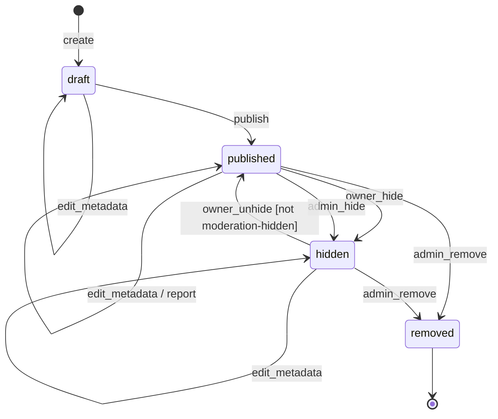
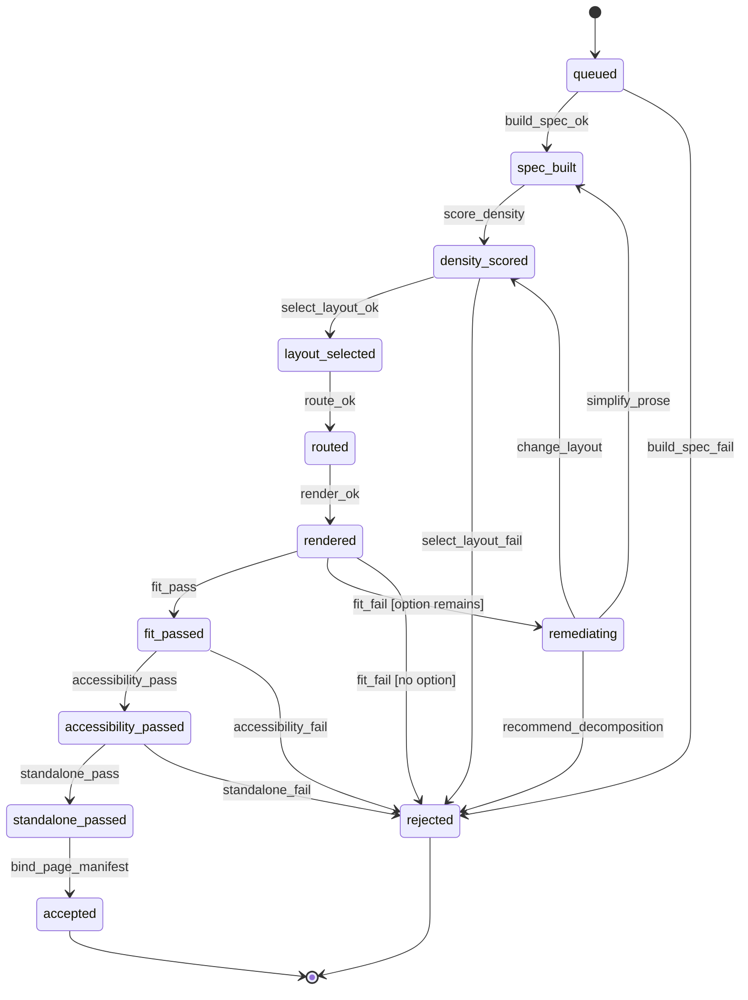
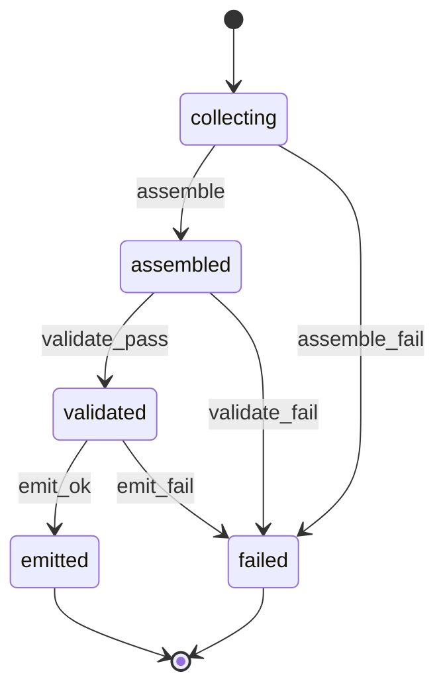

# 002: Patch-book compilation and publishing

Status: DRAFT (2026-10-16). Filled by Opus 5.5 via OpenRouter from the repo docs and code listed under Sources. Each claim is labeled `[OBSERVED: <file>]` or `[INFERRED]`. The operator must confirm every `[INFERRED]` item before planning.

## Sources

- `docs/PATCH_BOOK_GENERATOR.md`
- `docs/PUBLISHING_API.md`
- `PUBLISHING_IMPLEMENTATION.md`
- `backend/publishing/models.py`
- `docs/FEATURE_FLAGS.md`
- PatchHive Constitution 1.0.0, which governs this spec.

The source extracts were truncated. Requirements that depend on missing source text are listed under [Open questions](#open-questions).

## Summary

This feature turns validated PatchHive patches into a Patch Book for a specific modular rig. The book is a deterministic, manifest-bound technical manual. The compiler emits PDF, SVG, JSON, and ZIP artifacts. Each published patch occupies exactly one standalone page that you can use at the rack without any other page. [OBSERVED: docs/PATCH_BOOK_GENERATOR.md]

This feature also specifies the historical publishing layer. That layer lets an owner publish an export as a read-only public page with gallery discovery, reporting, and admin moderation. It is disabled unless `ENABLE_LEGACY_PUBLISHING=true`, and it must not be presented as a current product capability. [OBSERVED: docs/PUBLISHING_API.md] [OBSERVED: docs/FEATURE_FLAGS.md]

**Why:** Performers need a reproducible, accessible, printable manual that agrees with their confirmed inventory and canonical patch artifacts. [OBSERVED: docs/PATCH_BOOK_GENERATOR.md] Publishing lets owners share those artifacts with provenance. Moderation keeps the public surface accountable. [OBSERVED: PUBLISHING_IMPLEMENTATION.md]

## Scope

In scope:

- Compiling patch pages through the staged pipeline: build the page spec, score density, select a layout, route cables, render SVG, validate fit and accessibility, and bind the page manifest. [OBSERVED: docs/PATCH_BOOK_GENERATOR.md]
- Assembling and validating the book, then emitting the export bundle. [OBSERVED: docs/PATCH_BOOK_GENERATOR.md]
- Stage receipts and the machine-readable error taxonomy. [OBSERVED: docs/PATCH_BOOK_GENERATOR.md]
- The feature-flagged publication lifecycle: create, publish, hide, unhide, edit, report, admin hide, and admin remove. [OBSERVED: docs/PUBLISHING_API.md]
- Public read, download gating, and the gallery. [OBSERVED: docs/PUBLISHING_API.md]

## Non-goals

- The paid export debit, credits ledger, Stripe webhooks, download tokens, and fulfillment worker retry and compensation. These belong to the canonical payment and export surface (`/api/canon/*`). This spec only requires that compilation never mutates source artifacts and that the compiler can be replayed safely. [INFERRED] (scope split, from docs/FEATURE_FLAGS.md and docs/PATCH_BOOK_GENERATOR.md section 17)
- Making legacy publishing a current product capability, or adding navigation to it. [OBSERVED: docs/PUBLISHING_API.md] [OBSERVED: docs/FEATURE_FLAGS.md]
- Multi-page publication profiles and artistic dual-artifact packs (`ENABLE_PATCHBOOK_PUBLICATION_PROFILE`). See open question OQ-11. [INFERRED]
- The Style Studio and Design Engine (`ENABLE_PATCHBOOK_DESIGN_ENGINE`). [INFERRED]
- Patch generation, rig verification, and inventory confirmation. This feature consumes those outputs. [INFERRED]
- Decomposing a patch into new patches. The compiler can recommend decomposition, but it cannot create or change patch artifacts. [INFERRED] (from docs/PATCH_BOOK_GENERATOR.md sections 2 and 16)

## User stories

### P1: Compile a standalone one-page patch [OBSERVED: docs/PATCH_BOOK_GENERATOR.md]

As a rig owner, I want each validated patch compiled into one complete page, so that I can build and perform the patch beside my hardware without turning pages.

Acceptance criteria:

1. **Given** a patch with a PatchGraph, a PatchPlan, a passing ValidationReport, module display metadata, a book profile, and theme tokens, **when** compilation runs, **then** the patch produces exactly one accepted page. That page contains the identity header, diagram, intent, construction, operation, and footer identity regions. [OBSERVED: docs/PATCH_BOOK_GENERATOR.md]
2. **Given** a patch whose content exceeds the page, **when** fit validation fails, **then** the compiler simplifies optional prose or selects another approved layout. If neither works, the compiler rejects the patch from the book profile with a machine-readable error and remediation. The compiler never truncates, clips, or uses an ellipsis on required content. [OBSERVED: docs/PATCH_BOOK_GENERATOR.md]
3. **Given** any accepted page, **when** you render it in grayscale, **then** every cable and signal type stays distinguishable without color. [OBSERVED: docs/PATCH_BOOK_GENERATOR.md]
4. **Given** a print profile, **when** the page is accepted, **then** no body text is smaller than 9.5 pt. For a digital profile, no body text is smaller than the 14 px equivalent. [OBSERVED: docs/PATCH_BOOK_GENERATOR.md]
5. **Given** a patch that references a module or port missing from the source rig revision, **when** semantic validation runs, **then** compilation fails with an error code and no page is accepted. [OBSERVED: docs/PATCH_BOOK_GENERATOR.md]

### P2: Assemble and validate a Patch Book [OBSERVED: docs/PATCH_BOOK_GENERATOR.md]

As a rig owner, I want accepted pages assembled into a validated, manifest-bound book, so that the PDF, the manifest, and the assets agree.

Acceptance criteria:

1. **Given** a set of accepted pages, **when** assembly completes, **then** each PatchBookManifest page entry binds a page number, the patch ID where applicable, the page hash, the SVG asset hash, and the validation status. [OBSERVED: docs/PATCH_BOOK_GENERATOR.md]
2. **Given** an assembled book, **when** book validation runs, **then** the patch count equals the patch-page count and the PDF page count equals the manifest page count. Every table of contents and index reference resolves, and every asset is present and hash-valid. [OBSERVED: docs/PATCH_BOOK_GENERATOR.md]
3. **Given** a book validation failure, **when** the compiler stops, **then** it keeps every completed stage receipt and diagnostic and reports `PATCH_BOOK_PAGE_COUNT_MISMATCH`, `PATCH_BOOK_REFERENCE_UNRESOLVED`, or `PATCH_BOOK_ASSET_HASH_MISMATCH`. [OBSERVED: docs/PATCH_BOOK_GENERATOR.md]
4. **Given** front matter or back matter, **when** the book is assembled, **then** those pages are never placed inside a patch's required content. [OBSERVED: docs/PATCH_BOOK_GENERATOR.md]

### P3: Reproduce a book deterministically [OBSERVED: docs/PATCH_BOOK_GENERATOR.md]

As an operator, I want a fixed source run to compile to canonical-equivalent output on every run, so that the canonical JSON and the hashes remain the reproducibility authority.

Acceptance criteria:

1. **Given** fixed normalized input, schema version, generator version, layout profile, and seed, **when** you compile twice, **then** both runs produce identical canonical JSON and stable SVG structure. [OBSERVED: docs/PATCH_BOOK_GENERATOR.md]
2. **Given** a compilation run, **when** it completes or fails, **then** the source patch, the rig revision, and the run artifacts are unchanged. [OBSERVED: docs/PATCH_BOOK_GENERATOR.md]
3. **Given** a compilation retry for the same source run, **when** the retry completes, **then** it creates no conflicting immutable artifact. [OBSERVED: docs/PATCH_BOOK_GENERATOR.md]

### P4: Publish an export (legacy, feature-flagged) [OBSERVED: docs/PUBLISHING_API.md]

As an export owner in an environment where `ENABLE_LEGACY_PUBLISHING=true`, I want to create a publication for my export, so that others can view it at a public slug.

Acceptance criteria:

1. **Given** you own an export and the flag is on, **when** you submit `POST /me/publications`, **then** the system creates a publication with a unique slug. [OBSERVED: docs/PUBLISHING_API.md] [OBSERVED: backend/publishing/models.py]
2. **Given** an export that you don't own, **when** you try to create an export or publication from it, **then** the system rejects the request. [OBSERVED: PUBLISHING_IMPLEMENTATION.md]
3. **Given** an export that already has a publication, **when** you create a second publication for it, **then** the system rejects the request. [OBSERVED: backend/publishing/models.py]
4. **Given** the flag is off, **when** you call any publishing endpoint, **then** the system rejects the request and changes no state. [INFERRED] (from docs/FEATURE_FLAGS.md; the response code is open question OQ-5)
5. **Given** an export that isn't bound to a book that passed validation, **when** you try to publish it, **then** the system rejects the publish request. [INFERRED] (constitution principles 9 and 10)

### P5: Read and download a publication [OBSERVED: docs/PUBLISHING_API.md]

As a public reader, I want to view a publication's provenance and license and download its artifacts when the owner allows it.

Acceptance criteria:

1. **Given** a published publication, **when** you request `GET /p/{slug}`, **then** the response includes the title, description, cover image, export type, license, provenance (run ID, generation time, patch count, manifest hash), and publisher display name. The response excludes email addresses and internal IDs. [OBSERVED: docs/PUBLISHING_API.md] [OBSERVED: PUBLISHING_IMPLEMENTATION.md]
2. **Given** `allow_download` is `false`, **when** you request `/p/{slug}/download/{artifact_type}`, **then** the system serves no artifact. [OBSERVED: docs/PUBLISHING_API.md] [OBSERVED: PUBLISHING_IMPLEMENTATION.md]
3. **Given** an unlisted publication, **when** you browse `/gallery/publications`, **then** the publication isn't listed. [OBSERVED: PUBLISHING_IMPLEMENTATION.md]
4. **Given** a removed publication, **when** you request its slug, **then** the system serves no content. [OBSERVED: PUBLISHING_IMPLEMENTATION.md]
5. **Given** a draft or hidden publication, **when** a non-owner requests its slug or the gallery, **then** the system serves no content. [INFERRED]

### P6: Manage my publication [OBSERVED: docs/PUBLISHING_API.md]

As a publication owner, I want to hide, unhide, and edit my publication.

Acceptance criteria:

1. **Given** you own a published publication, **when** you set `status` to `hidden` by using `PATCH /me/publications/{id}`, **then** the publication becomes hidden. [OBSERVED: docs/PUBLISHING_API.md]
2. **Given** you own a hidden publication that a moderator didn't hide, **when** you set `status` to `published`, **then** the publication becomes published. [OBSERVED: docs/PUBLISHING_API.md] (the moderation guard is [INFERRED]; see OQ-2)
3. **Given** a PATCH request that sets `status` to any value other than `published` or `hidden`, **when** the request is processed, **then** the system rejects it. [OBSERVED: docs/PUBLISHING_API.md]
4. **Given** a PATCH request from someone other than the owner, **when** the request is processed, **then** the system rejects it. [OBSERVED: docs/PUBLISHING_API.md]

### P7: Report and moderate a publication [OBSERVED: docs/PUBLISHING_API.md]

As a reader, I want to report a publication. As an admin, I want to hide or remove it with an audit record.

Acceptance criteria:

1. **Given** a readable publication, **when** you submit `POST /p/{slug}/report` with a reason, **then** the system stores a report and leaves the publication status unchanged. [OBSERVED: docs/PUBLISHING_API.md] (the status-unchanged behavior is [INFERRED])
2. **Given** you are an admin, **when** you hide or remove a publication, **then** the system writes an admin audit log entry with the actor, action, target, before and after delta, and reason. [OBSERVED: docs/PUBLISHING_API.md] [OBSERVED: PUBLISHING_IMPLEMENTATION.md]
3. **Given** you aren't an admin, **when** you call an admin moderation endpoint, **then** the system rejects the request. [OBSERVED: docs/PUBLISHING_API.md]
4. **Given** a removed publication, **when** anyone requests any transition, **then** the system rejects it. [INFERRED]

### P8: Keep legacy publishing contained [OBSERVED: docs/FEATURE_FLAGS.md]

As an operator, I want legacy publishing off by default and isolated, so that it doesn't leak into the canonical MVP.

Acceptance criteria:

1. **Given** default configuration, **when** the backend starts, **then** `ENABLE_LEGACY_PUBLISHING` is `false`. [OBSERVED: docs/FEATURE_FLAGS.md]
2. **Given** the active frontend, **when** you navigate the app, **then** no navigation leads to publishing pages. Those pages stay quarantined under `frontend/src/legacy/`. [OBSERVED: docs/FEATURE_FLAGS.md]
3. **Given** publication exports, **when** they are stored, **then** they are kept separate from paid MVP exports. [OBSERVED: backend/publishing/models.py]

## Functional requirements

### Compilation

- **FR-001**: Each published patch must occupy exactly one page. A patch must not continue onto another page, share a page, or rely on its facing page. [OBSERVED: docs/PATCH_BOOK_GENERATOR.md]
- **FR-002**: A QR code or online companion may extend a page, but it must not contain required execution information. [OBSERVED: docs/PATCH_BOOK_GENERATOR.md]
- **FR-003**: Required content must not be hidden, clipped, truncated, or replaced by an ellipsis. [OBSERVED: docs/PATCH_BOOK_GENERATOR.md] Implemented 2026-10-28 for the Design Engine execution PDF: titles, intents, steps and cables wrap by measured width (`layout_patch_page`), and long diagram labels wrap inside their node instead of being cut at 18 characters.
- **FR-004**: Body text must not be smaller than 9.5 pt in print profiles or 14 px equivalent in digital profiles. [OBSERVED: docs/PATCH_BOOK_GENERATOR.md]
- **FR-005**: Color must not be the only way to encode a signal or cable. Pages must remain understandable in grayscale. [OBSERVED: docs/PATCH_BOOK_GENERATOR.md]
- **FR-006**: Fixed normalized input, schema version, generator version, layout profile, and seed must produce canonical-equivalent output. [OBSERVED: docs/PATCH_BOOK_GENERATOR.md]
- **FR-007**: Compilation must run the pipeline stages in the order shown in [Page compilation machine](#page-compilation-machine-per-patch) and write a receipt for each stage. A terminal failure must keep all completed receipts and diagnostics. [OBSERVED: docs/PATCH_BOOK_GENERATOR.md]
- **FR-008**: Each patch page must contain these semantic regions: identity header, patch diagram, intent, construction, operation, and footer identity. A layout can move regions but must not omit required semantics. [OBSERVED: docs/PATCH_BOOK_GENERATOR.md]
- **FR-009**: The compiler must select a layout deterministically from three approved classes: `diagram_first`, `instruction_first`, and `performance_first`. Themes must not introduce unapproved semantic layouts. [OBSERVED: docs/PATCH_BOOK_GENERATOR.md]
- **FR-010**: Content budgets are profile inputs. The compiler can compress wording while preserving meaning. It must not delete a connection, safety condition, or required mode to achieve fit. [OBSERVED: docs/PATCH_BOOK_GENERATOR.md]
- **FR-011**: Diagrams must meet these requirements: [OBSERVED: docs/PATCH_BOOK_GENERATOR.md]
  - Diagrams are SVG first.
  - Diagrams show labeled source and destination ports.
  - Cable routes are numbered to match the ordered connection list.
  - Direction is marked wherever it is ambiguous.
  - Audio, CV, gate, trigger, and clock each have a distinct encoding that doesn't rely on color.
  - Feedback cycles are marked and carry a startup warning.
  - Node placement and edge routing are deterministic.
- **FR-012**: Pages must target WCAG 2.2 AA for digital surfaces and equivalent print legibility. Every page must have a text equivalent of the graph and a text-first companion in JSON or HTML. An accessibility failure is a compilation failure for production output. [OBSERVED: docs/PATCH_BOOK_GENERATOR.md]
- **FR-013**: Semantic validation must check the following: [OBSERVED: docs/PATCH_BOOK_GENERATOR.md]
  - Patch, module, and port references resolve to the source rig revision.
  - Ordered connections exactly represent the PatchGraph.
  - Required modes and normal-break behavior are explicit.
  - Warnings match the ValidationReport.
  - Unsupported safety claims are absent.
- **FR-014**: Compilation must use only confirmed inventory and capabilities. A missing physical or functional fact must produce an explicit error. The compiler must not invent a substitute fact. [INFERRED] (constitution principles 3 and 8)
- **FR-015**: Page-fit validation must confirm the following: [OBSERVED: docs/PATCH_BOOK_GENERATOR.md]
  - The patch produces exactly one rendered page.
  - No block overflows its region.
  - No element is clipped.
  - The minimum font size holds.
  - No labels collide.
  - Cable crossings and ambiguity stay within accepted thresholds.
  - The footer and checksum remain visible.
- **FR-016**: Book validation must check the following: [OBSERVED: docs/PATCH_BOOK_GENERATOR.md]
  - Patch count equals patch-page count.
  - PDF page count equals manifest page count.
  - Every reference resolves.
  - Page order is stable.
  - Every asset is present and hash-valid.
  - Deterministic replay reproduces the canonical JSON.
- **FR-017**: Each manifest page entry must bind the page number, the patch ID where applicable, the page hash, the SVG asset hash, and the validation status. [OBSERVED: docs/PATCH_BOOK_GENERATOR.md]
- **FR-018**: The export bundle can contain the PDF, the manifests and checksums, the page SVG and JSON files, the diagram SVG files, the source library and rig revision, the validation reports, the license file, and a README. The PDF is a presentation artifact. Canonical JSON and hashes are the reproducibility authority. [OBSERVED: docs/PATCH_BOOK_GENERATOR.md]
- **FR-019**: Errors must be machine-readable, use the codes in section 15 of the generator spec, and include remediation. Warnings must never silently become passes. [OBSERVED: docs/PATCH_BOOK_GENERATOR.md]
- **FR-020**: Page assembly must never change source artifacts. [OBSERVED: docs/PATCH_BOOK_GENERATOR.md]
- **FR-021**: When a page can't satisfy the constraints, the compiler must simplify optional prose, choose another approved layout, recommend decomposition, or reject the patch from the selected book profile. [OBSERVED: docs/PATCH_BOOK_GENERATOR.md] The compiler must only recommend decomposition. It must not create the decomposed patches. [INFERRED] (from FR-020) Implemented 2026-10-28 in part: when a page is full, the optional title block goes first; if required content still does not fit, the export fails with `PATCH_PAGE_TEXT_OVERFLOW` (or `PATCH_PAGE_DIAGRAM_OVERFLOW` for a label) and remediation, and the paid export is compensated. Rejecting only the one patch from the book, and alternative layouts, are not built yet.
- **FR-022**: Front matter and back matter are exempt from the one-patch rule. They must never be inserted inside a patch's required content. [OBSERVED: docs/PATCH_BOOK_GENERATOR.md]
- **FR-023**: Each compiler rune must declare its input and output schemas, version, determinism class, permitted side effects, authority requirement, error taxonomy, and test vectors. [OBSERVED: docs/PATCH_BOOK_GENERATOR.md]
- **FR-024**: `COMPILE_PATCH_PAGE` succeeds only when signal validation, required-content validation, diagram legibility, page-fit validation, and standalone execution all pass. [OBSERVED: docs/PATCH_BOOK_GENERATOR.md]

### Publishing

- **FR-030**: Publishing endpoints must be disabled unless `ENABLE_LEGACY_PUBLISHING=true`. The default is `false`. [OBSERVED: docs/FEATURE_FLAGS.md] [OBSERVED: docs/PUBLISHING_API.md]
- **FR-031**: Publishing must not appear in active navigation or be described as a current product capability. [OBSERVED: docs/PUBLISHING_API.md] [OBSERVED: docs/FEATURE_FLAGS.md]
- **FR-032**: When the flag is off, every publishing request must fail closed and change no state. [INFERRED] (constitution principle 9)
- **FR-033**: The system must enforce export ownership for export and publication creation. [OBSERVED: PUBLISHING_IMPLEMENTATION.md]
- **FR-034**: An export can have at most one publication. [OBSERVED: backend/publishing/models.py]
- **FR-035**: Each publication slug must be unique. [OBSERVED: backend/publishing/models.py]
- **FR-036**: Visibility is either `unlisted` or `public`. The default is `unlisted`. The gallery must exclude unlisted publications. [OBSERVED: backend/publishing/models.py] [OBSERVED: PUBLISHING_IMPLEMENTATION.md]
- **FR-037**: Owner updates are limited to `title`, `description`, `visibility`, `allow_download`, `allow_remix`, `cover_image_url`, and `status`. Status can only be set to `published` or `hidden`. [OBSERVED: docs/PUBLISHING_API.md]
- **FR-038**: Publication status must change only through the [publication lifecycle transitions](#publication-lifecycle-machine). [OBSERVED: PUBLISHING_IMPLEMENTATION.md] ("immutable records (status transitions only)"; see OQ-4) Implemented 2026-10-28: creation starts in `draft`; owner, admin and report actions accept only the pairs in the lifecycle table and answer 409 `INVALID_TRANSITION` otherwise, with no state change.
- **FR-039**: Public payloads must exclude email addresses and internal IDs. [OBSERVED: PUBLISHING_IMPLEMENTATION.md]
- **FR-040**: The public read must include the license and provenance (`run_id`, `generated_at`, `patch_count`, `manifest_hash`). [OBSERVED: docs/PUBLISHING_API.md]
- **FR-041**: Artifact downloads (`pdf`, `svg`, `zip`) must be served only when `allow_download` is `true`. [OBSERVED: docs/PUBLISHING_API.md]
- **FR-042**: The gallery must be sorted by recency. It accepts `limit` (1–50), `cursor` (an ISO datetime), `export_type` (`patch` or `rack`), and `recent_days` (1–365). [OBSERVED: docs/PUBLISHING_API.md] [OBSERVED: PUBLISHING_IMPLEMENTATION.md]
- **FR-043**: The gallery and public read must serve only publications in the `published` state. The gallery must also require `public` visibility. [INFERRED]
- **FR-044**: Readers can report a publication with a required reason and optional details. [OBSERVED: docs/PUBLISHING_API.md] [OBSERVED: backend/publishing/models.py]
- **FR-045**: Admin hide and admin remove require admin privileges. Each action writes an audit log entry with the actor, action type, target, before and after delta, and reason. Removal stores `removed_reason` and links `moderation_audit_id`. [OBSERVED: docs/PUBLISHING_API.md] [OBSERVED: PUBLISHING_IMPLEMENTATION.md] [OBSERVED: backend/publishing/models.py]
- **FR-046**: A removed publication must not be accessible. [OBSERVED: PUBLISHING_IMPLEMENTATION.md]
- **FR-047**: Publication exports must stay separate from paid MVP exports. [OBSERVED: backend/publishing/models.py]
- **FR-048**: A publish transition requires an export bound to a PatchBookManifest that passed book validation. [INFERRED] (constitution principles 9 and 10; see OQ-6)
- **FR-049**: No probabilistic or decision-layer component can change a publication's status, perform moderation, or accept a compiled page. [INFERRED] (constitution principle 4)

## Key entities

- **PatchPageSpec**: a versioned semantic description of one patch page. It covers identity, intent, construction, operation, indexing, and the canonical hash. [OBSERVED: docs/PATCH_BOOK_GENERATOR.md]
- **PageFitReport**: the fit and accessibility verdict for a page. Its status is `pass`, `warning`, or `fail`. It also lists overflows, clipping, and remediation. [OBSERVED: docs/PATCH_BOOK_GENERATOR.md]
- **PatchBookManifest**: the book-level binding of pages, assets, versions, and the canonical hash. [OBSERVED: docs/PATCH_BOOK_GENERATOR.md]
- **Stage receipt**: the record each pipeline stage writes. A terminal failure keeps all completed receipts. [OBSERVED: docs/PATCH_BOOK_GENERATOR.md]
- **Export bundle**: the set of PDF, SVG, JSON, and ZIP artifacts for a book. [OBSERVED: docs/PATCH_BOOK_GENERATOR.md]
- **PublicationExport**: a historical sharing export with an owner, a patch or rack, a license, a run ID, a manifest hash, and artifact URLs. [OBSERVED: backend/publishing/models.py]
- **Publication**: a slugged, status-bearing publication of exactly one export. [OBSERVED: backend/publishing/models.py]
- **PublicationReport**: a reader report against a publication. [OBSERVED: backend/publishing/models.py]
- **AdminAuditLog**: a moderation audit record with actor, action, target, delta, and reason. [OBSERVED: PUBLISHING_IMPLEMENTATION.md]

## Workflows

Status: INFERRED skeleton. Confirm before you plan.

- Governing workflows (skills): anti-slop-code, production-systems, google-developer-style.
- Owners: FORGE decomposes, a cloud agent implements, SCRIBE files the compact artifact.
- CI: reuse `.github/workflows/ci.yml` (jobs `backend` and `frontend`). Do not add a new CI path.

## Stateful behavior

This feature has three state machines:

- [Publication lifecycle machine](#publication-lifecycle-machine)
- [Page compilation machine (per patch)](#page-compilation-machine-per-patch)
- [Book compilation machine](#book-compilation-machine)

Implementers treat each transitions table as the contract. Any (state, event) pair that a table doesn't list is rejected, and the state doesn't change. [INFERRED] (constitution principle 9)

### Publication lifecycle machine

Initial state: `draft`. Final state: `removed`.

States:

- `draft`: created; not publicly readable. [OBSERVED: backend/publishing/models.py]
- `published`: readable at `/p/{slug}`; listed in the gallery when visibility is `public`. [OBSERVED: backend/publishing/models.py] [OBSERVED: docs/PUBLISHING_API.md]
- `hidden`: not publicly readable; can return to `published`. [OBSERVED: backend/publishing/models.py] [OBSERVED: docs/PUBLISHING_API.md]
- `removed`: terminal; not accessible. [OBSERVED: backend/publishing/models.py] [OBSERVED: PUBLISHING_IMPLEMENTATION.md]

Global guard: every event requires `ENABLE_LEGACY_PUBLISHING=true`. [OBSERVED: docs/FEATURE_FLAGS.md]

`visibility` (`unlisted` or `public`), `allow_download`, and `allow_remix` are attributes, not states. [OBSERVED: backend/publishing/models.py]

| from | event | guard | to | effect |
|---|---|---|---|---|
| `[*]` | `create` | caller owns the export; the flag is on; the export has no publication | `draft` | Assign a unique slug and store title, description, and settings. [OBSERVED: docs/PUBLISHING_API.md] [OBSERVED: backend/publishing/models.py] (see OQ-1) |
| `draft` | `publish` | caller is the owner; the flag is on; the export is bound to a book that passed validation | `published` | Set `published_at`, make the publication readable at `/p/{slug}`, and list it in the gallery if `public`. [INFERRED] (guard from FR-048) |
| `published` | `owner_hide` | caller is the owner; the flag is on | `hidden` | Remove public read and gallery listing; update `updated_at`. [OBSERVED: docs/PUBLISHING_API.md] |
| `hidden` | `owner_unhide` | caller is the owner; the flag is on; the publication wasn't hidden by moderation | `published` | Restore public read and update `updated_at`. [OBSERVED: docs/PUBLISHING_API.md] (moderation guard [INFERRED]; see OQ-2) |
| `published` | `admin_hide` | caller is an admin; the flag is on | `hidden` | Write an admin audit log entry with delta and reason; set `moderation_audit_id`. [OBSERVED: docs/PUBLISHING_API.md] [OBSERVED: backend/publishing/models.py] |
| `published` | `admin_remove` | caller is an admin; the flag is on; a reason is provided | `removed` | Write an admin audit log entry; set `removed_reason` and `moderation_audit_id`. [OBSERVED: docs/PUBLISHING_API.md] [OBSERVED: PUBLISHING_IMPLEMENTATION.md] |
| `hidden` | `admin_remove` | caller is an admin; the flag is on; a reason is provided | `removed` | Write an admin audit log entry; set `removed_reason` and `moderation_audit_id`. [OBSERVED: docs/PUBLISHING_API.md] [OBSERVED: PUBLISHING_IMPLEMENTATION.md] |
| `draft` | `edit_metadata` | caller is the owner; the flag is on; only allowed fields change | `draft` | Update fields and `updated_at`. [OBSERVED: docs/PUBLISHING_API.md] (see OQ-4) |
| `published` | `edit_metadata` | caller is the owner; the flag is on; only allowed fields change | `published` | Update fields and `updated_at`. [OBSERVED: docs/PUBLISHING_API.md] (see OQ-4) |
| `hidden` | `edit_metadata` | caller is the owner; the flag is on; only allowed fields change | `hidden` | Update fields and `updated_at`. [OBSERVED: docs/PUBLISHING_API.md] (see OQ-4) |
| `published` | `report` | the flag is on; a reason is provided | `published` | Store a PublicationReport; status is unchanged. [OBSERVED: docs/PUBLISHING_API.md] (no status change [INFERRED]) |

Illegal transitions:

- `removed` → any state, including `edit_metadata` and `report`. [INFERRED]
- `draft` → `hidden`. [INFERRED]
- `draft` → `removed`. This stays rejected until OQ-3 is resolved. [INFERRED]
- Any event while `ENABLE_LEGACY_PUBLISHING` is off. [OBSERVED: docs/FEATURE_FLAGS.md]
- An owner event from someone other than the owner, or an admin event from someone other than an admin. [OBSERVED: docs/PUBLISHING_API.md]
- An owner PATCH request that sets `status` to `draft` or `removed`. [OBSERVED: docs/PUBLISHING_API.md]
- A second `create` for an export that already has a publication. [OBSERVED: backend/publishing/models.py]
- `hidden` → `published` through `owner_unhide` when moderation hid the publication. [INFERRED] (see OQ-2)
- `report` on a `draft` or `hidden` publication. [INFERRED]
- Any transition triggered by a model or decision-layer component. [INFERRED] (constitution principle 4)

### Page compilation machine (per patch)

Initial state: `queued`. Final states: `accepted` and `rejected`. One patch always produces zero or one accepted page. [OBSERVED: docs/PATCH_BOOK_GENERATOR.md]

Each transition writes a stage receipt. A terminal state keeps all completed receipts and diagnostics. [OBSERVED: docs/PATCH_BOOK_GENERATOR.md]

States:

- `queued` [INFERRED]
- `spec_built` [OBSERVED: docs/PATCH_BOOK_GENERATOR.md] ("build PatchPageSpec")
- `density_scored` [OBSERVED: docs/PATCH_BOOK_GENERATOR.md]
- `layout_selected` [OBSERVED: docs/PATCH_BOOK_GENERATOR.md]
- `routed` [OBSERVED: docs/PATCH_BOOK_GENERATOR.md]
- `rendered` [OBSERVED: docs/PATCH_BOOK_GENERATOR.md]
- `fit_passed` [OBSERVED: docs/PATCH_BOOK_GENERATOR.md]
- `accessibility_passed` [OBSERVED: docs/PATCH_BOOK_GENERATOR.md]
- `standalone_passed` [OBSERVED: docs/PATCH_BOOK_GENERATOR.md] (section 12, `COMPILE_PATCH_PAGE` success conditions)
- `remediating` [INFERRED] (from section 2 remediation options)
- `accepted`: the page is bound into the page manifest. [OBSERVED: docs/PATCH_BOOK_GENERATOR.md]
- `rejected`: the patch is excluded from the book profile. [OBSERVED: docs/PATCH_BOOK_GENERATOR.md]

| from | event | guard | to | effect |
|---|---|---|---|---|
| `queued` | `build_spec_ok` | the inputs are present and their versions are compatible; semantic validation pass
es | `spec_built` | Write the PatchPageSpec with its canonical hash and a stage receipt. [OBSERVED: docs/PATCH_BOOK_GENERATOR.md] |
| `queued` | `build_spec_fail` | an input is missing, a version is incompatible, or semantic validation fails | `rejected` | Write a receipt with `PATCH_PAGE_REQUIRED_CONTENT_MISSING` or `PATCH_PAGE_GRAPH_MISMATCH` and remediation. [OBSERVED: docs/PATCH_BOOK_GENERATOR.md] (fail-closed guard [INFERRED], constitution principle 9) |
| `spec_built` | `score_density` | none | `density_scored` | Record text density and diagram density. [OBSERVED: docs/PATCH_BOOK_GENERATOR.md] |
| `density_scored` | `select_layout_ok` | an untried approved layout class supports the output profile | `layout_selected` | Record the selected layout deterministically. [OBSERVED: docs/PATCH_BOOK_GENERATOR.md] |
| `density_scored` | `select_layout_fail` | no approved layout class supports the page | `rejected` | Write `PATCH_PAGE_LAYOUT_NOT_SUPPORTED`. [OBSERVED: docs/PATCH_BOOK_GENERATOR.md] |
| `layout_selected` | `route_ok` | none | `routed` | Number routes to match the ordered connection list and place labels deterministically. [OBSERVED: docs/PATCH_BOOK_GENERATOR.md] |
| `routed` | `render_ok` | none | `rendered` | Write the canonical SVG asset and its hash. [OBSERVED: docs/PATCH_BOOK_GENERATOR.md] |
| `rendered` | `fit_pass` | PageFitReport status is `pass` | `fit_passed` | Write the PageFitReport. [OBSERVED: docs/PATCH_BOOK_GENERATOR.md] |
| `rendered` | `fit_fail` | status is `fail` or `warning`; a remediation option remains | `remediating` | Write the PageFitReport with error codes and remediation. [OBSERVED: docs/PATCH_BOOK_GENERATOR.md] (treating `warning` as not passing is [INFERRED]; see OQ-7) |
| `rendered` | `fit_fail` | status is `fail` or `warning`; no remediation option remains | `rejected` | Write the PageFitReport and the terminal error code. [OBSERVED: docs/PATCH_BOOK_GENERATOR.md] |
| `remediating` | `simplify_prose` | optional prose remains to compress; no connection, safety condition, or required mode is removed | `spec_built` | Rebuild the spec with compressed optional wording. [OBSERVED: docs/PATCH_BOOK_GENERATOR.md] |
| `remediating` | `change_layout` | an untried approved layout class remains | `density_scored` | Mark the current layout as tried. [OBSERVED: docs/PATCH_BOOK_GENERATOR.md] |
| `remediating` | `recommend_decomposition` | no other remediation remains | `rejected` | Record a decomposition recommendation. Create no patches. [OBSERVED: docs/PATCH_BOOK_GENERATOR.md] (no-create effect [INFERRED], FR-021) |
| `fit_passed` | `accessibility_pass` | grayscale, non-color encoding, reading order, contrast, and text equivalent checks pass | `accessibility_passed` | Write an accessibility receipt. [OBSERVED: docs/PATCH_BOOK_GENERATOR.md] |
| `fit_passed` | `accessibility_fail` | production output | `rejected` | Write `PATCH_PAGE_GRAYSCALE_FAILED` or `PATCH_PAGE_NON_COLOR_ENCODING_FAILED`. [OBSERVED: docs/PATCH_BOOK_GENERATOR.md] |
| `accessibility_passed` | `standalone_pass` | signal validation, required-content validation, and diagram legibility pass | `standalone_passed` | Write a standalone-execution receipt. [OBSERVED: docs/PATCH_BOOK_GENERATOR.md] |
| `accessibility_passed` | `standalone_fail` | any condition fails | `rejected` | Write `PATCH_PAGE_STANDALONE_EXECUTION_FAILED`. [OBSERVED: docs/PATCH_BOOK_GENERATOR.md] |
| `standalone_passed` | `bind_page_manifest` | none | `accepted` | Bind the page hash, the SVG asset hash, and the validation status. [OBSERVED: docs/PATCH_BOOK_GENERATOR.md] |

Remediation attempts run in a fixed, deterministic order, and each option is tried at most once, so the machine always terminates. [INFERRED] (constitution principle 1)

Illegal transitions:

- `accepted` or `rejected` → any state. [INFERRED]
- Skipping a stage, such as `rendered` → `accepted` or `layout_selected` → `rendered`. [OBSERVED: docs/PATCH_BOOK_GENERATOR.md] (stage order)
- `rendered` → `fit_passed` when the PageFitReport status is `warning`. [OBSERVED: docs/PATCH_BOOK_GENERATOR.md] ("Warnings never silently become passes")
- Any remediation that deletes a connection, safety condition, or required mode. [OBSERVED: docs/PATCH_BOOK_GENERATOR.md]
- A second accepted page for the same patch. [OBSERVED: docs/PATCH_BOOK_GENERATOR.md]
- Any transition that a model or decision-layer component triggers on its own authority. [INFERRED] (constitution principle 4)

### Book compilation machine

Initial state: `collecting`. Final states: `emitted` and `failed`. A terminal failure keeps all completed receipts and diagnostics. [OBSERVED: docs/PATCH_BOOK_GENERATOR.md] (state names [INFERRED])

States:

- `collecting`: page machines run for each patch in the book profile. [INFERRED]
- `assembled`: the PatchBookManifest, front matter, and back matter exist. [OBSERVED: docs/PATCH_BOOK_GENERATOR.md]
- `validated`: book validation passed. [OBSERVED: docs/PATCH_BOOK_GENERATOR.md]
- `emitted`: the export bundle is written and hash-verified. [OBSERVED: docs/PATCH_BOOK_GENERATOR.md]
- `failed`: terminal failure with receipts. [OBSERVED: docs/PATCH_BOOK_GENERATOR.md]

| from | event | guard | to | effect |
|---|---|---|---|---|
| `collecting` | `assemble` | every page machine is terminal; at least one page is accepted | `assembled` | Write the PatchBookManifest with stable page order. [OBSERVED: docs/PATCH_BOOK_GENERATOR.md] (the at-least-one guard is [INFERRED]; see OQ-8) |
| `collecting` | `assemble_fail` | no page is accepted | `failed` | Write a receipt that lists every rejected patch and its error. [INFERRED] |
| `assembled` | `validate_pass` | page counts match, references resolve, assets are hash-valid, and replay reproduces canonical JSON | `validated` | Write a book validation receipt. [OBSERVED: docs/PATCH_BOOK_GENERATOR.md] |
| `assembled` | `validate_fail` | any book check fails | `failed` | Write `PATCH_BOOK_PAGE_COUNT_MISMATCH`, `PATCH_BOOK_REFERENCE_UNRESOLVED`, or `PATCH_BOOK_ASSET_HASH_MISMATCH`. [OBSERVED: docs/PATCH_BOOK_GENERATOR.md] |
| `validated` | `emit_ok` | every bundle artifact is written and matches its checksum | `emitted` | Write `manifest/checksums.json`. [OBSERVED: docs/PATCH_BOOK_GENERATOR.md] |
| `validated` | `emit_fail` | an artifact is missing or its hash doesn't match | `failed` | Write `PATCH_BOOK_ASSET_HASH_MISMATCH`. [OBSERVED: docs/PATCH_BOOK_GENERATOR.md] |

A retry starts a new attempt for the same source run. The retry must produce canonical-equivalent artifacts and must not create a conflicting immutable artifact. [OBSERVED: docs/PATCH_BOOK_GENERATOR.md]

Illegal transitions:

- `emitted` or `failed` → any state within the same attempt. [INFERRED]
- `assembled` → `emitted` without validation. [OBSERVED: docs/PATCH_BOOK_GENERATOR.md]
- `assemble` while any page machine is non-terminal. [INFERRED]
- Changing any source artifact in any state. [OBSERVED: docs/PATCH_BOOK_GENERATOR.md]

## Success criteria

- **SC-001**: Every accepted page in a test library passes page-fit, accessibility, and standalone-execution validation, and no patch has more than one accepted page. [OBSERVED: docs/PATCH_BOOK_GENERATOR.md]
- **SC-002**: Compiling a fixed source run twice produces identical canonical JSON and stable SVG structure. [OBSERVED: docs/PATCH_BOOK_GENERATOR.md]
- **SC-003**: For every emitted book, the patch count equals the patch-page count and the PDF page count equals the manifest page count. [OBSERVED: docs/PATCH_BOOK_GENERATOR.md]
- **SC-004**: Golden fixtures cover beginner, dense, feedback, performance, missing-data, long-label, grayscale, A4, and Letter cases. [OBSERVED: docs/PATCH_BOOK_GENERATOR.md] Visual diff thresholds are NOT_COMPUTABLE (OQ-9).
- **SC-005**: Publishing tests pass for export ownership, unlisted gallery exclusion, removed-publication inaccessibility, public payload redaction, download gating, and moderation audit logging. [OBSERVED: PUBLISHING_IMPLEMENTATION.md]
- **SC-006**: With default configuration, every publishing endpoint fails closed and changes no state. [INFERRED]
- **SC-007**: Every illegal transition in the three tables has a test that confirms the request is rejected and the state is unchanged. [INFERRED]

## Edge cases

- A patch reference that resolves to an older rig revision fails semantic validation. [OBSERVED: docs/PATCH_BOOK_GENERATOR.md]
- A feedback cycle without a startup warning fails page validation. [OBSERVED: docs/PATCH_BOOK_GENERATOR.md]
- A patch that fits US Letter but not A5 is rejected only from the A5 profile. [OBSERVED: docs/PATCH_BOOK_GENERATOR.md]
- Long module or port labels can't be truncated. They trigger remediation or rejection. [OBSERVED: docs/PATCH_BOOK_GENERATOR.md]
- A missing jack, voltage, or mode fact produces an explicit error, never a placeholder. [INFERRED] (constitution principle 3)
- The feature flag turns off while publications exist. Public reads stop, and stored state is unchanged. [INFERRED]
- An owner and an admin act on the same publication at the same time. The admin transition wins, and a stale owner request is rejected. [INFERRED] (see OQ-10)
- A report targets a hidden or removed publication. The system rejects it. [INFERRED]
- A publication's source patch or rack is deleted. The export keeps its provenance because the patch and rack references are set to null. [OBSERVED: backend/publishing/models.py]

## Open questions

- **OQ-1**: `POST /me/publications` returns `status: "published"`, but the model defaults to `draft`. Does create publish immediately, or does it create a draft? NOT_COMPUTABLE. [OBSERVED: docs/PUBLISHING_API.md] [OBSERVED: backend/publishing/models.py]
- **OQ-2**: Can an owner unhide a publication that an admin hid? The sources don't say. NOT_COMPUTABLE.
- **OQ-3**: Can an admin remove a draft? NOT_COMPUTABLE.
- **OQ-4**: "Immutable records (status transitions only)" conflicts with owner metadata edits. Which fields are mutable after publish? NOT_COMPUTABLE. [OBSERVED: PUBLISHING_IMPLEMENTATION.md]
- **OQ-5**: Which response code do publishing endpoints return when the flag is off? NOT_COMPUTABLE.
- **OQ-6**: Must a publication export bind to a validated PatchBookManifest, given that it is isolated from paid MVP exports? NOT_COMPUTABLE.
- **OQ-7**: Does a PageFitReport `warning` ever allow acceptance, and under which policy? NOT_COMPUTABLE.
- **OQ-8**: Is a book with zero accepted patch pages valid? NOT_COMPUTABLE.
- **OQ-9**: Cable-crossing, ambiguity, and visual-diff thresholds aren't specified. NOT_COMPUTABLE.
- **OQ-10**: How are concurrent owner and admin transitions ordered? NOT_COMPUTABLE.
- **OQ-11**: `ENABLE_PATCHBOOK_PUBLICATION_PROFILE` enables multi-page publications. How does it reconcile with the one-page publishing law? NOT_COMPUTABLE. [OBSERVED: docs/FEATURE_FLAGS.md]
- **OQ-12**: The legal effect and enforcement of the `CC BY-NC 4.0` default license and of `allow_remix` are unknown. NOT_COMPUTABLE. [OBSERVED: backend/publishing/models.py]
- **OQ-13**: Report rate limits, anonymous reporting rules, and data retention for reports and audit logs aren't specified. NOT_COMPUTABLE.
- **OQ-14**: The source extracts were truncated. Requirements in the missing text are NOT_COMPUTABLE until the operator supplies them.
- **OQ-15**: Confirm the Workflows section, including whether ADVERSARY threat-models the public read, download, and report surfaces. NOT_COMPUTABLE.
