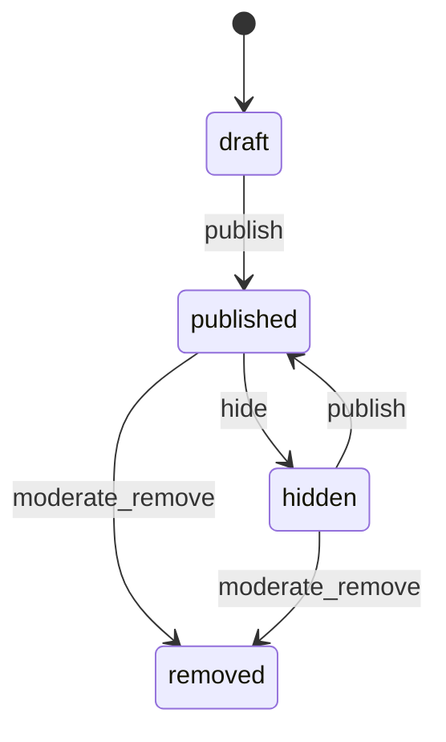

# 002: Patch-book compilation and publishing

Status: DRAFT skeleton. This is a deterministic extraction from existing docs. No paid model was used. Every requirement is INFERRED until the operator confirms it.

## Sources

- `docs/PATCH_BOOK_GENERATOR.md`
- `docs/PUBLISHING_API.md`
- `PUBLISHING_IMPLEMENTATION.md`
- `backend/publishing/models.py`
- `docs/FEATURE_FLAGS.md`

## What and why

Compile validated patches into Patch Books (PDF/SVG/JSON/ZIP) and optionally publish them behind a feature flag with moderation.

## User stories

TODO: Extract these from the sources above, one per story, each with acceptance criteria.

## Workflows

Status: INFERRED skeleton. Confirm before you plan.

- Governing workflows (skills): anti-slop-code, production-systems, google-developer-style.
- Owners: FORGE decomposes, a cloud agent implements, SCRIBE files the compact artifact.
- CI: reuse `.github/workflows/ci.yml` (jobs `backend` and `frontend`). Do not add a new CI path.

## Stateful behavior

Initial state: `draft`. Final states: removed.

| from | event | guard | to | effect |
|---|---|---|---|---|
| draft | publish | owner, flag on, compile receipts green | published | make it publicly readable |
| published | hide | owner | hidden | - |
| hidden | publish | owner | published | - |
| published | moderate_remove | admin | removed | write an admin audit log entry |
| hidden | moderate_remove | admin | removed | write an admin audit log entry |

Illegal transitions:

- removed -> any
- draft -> hidden
- publish while the feature flag is off

OBSERVED: the status values draft/published/hidden/removed come from backend/publishing/models.py:72. The compiler stage pipeline (PATCH_BOOK_GENERATOR.md section 3) needs its own stage-receipt machine. TODO.
