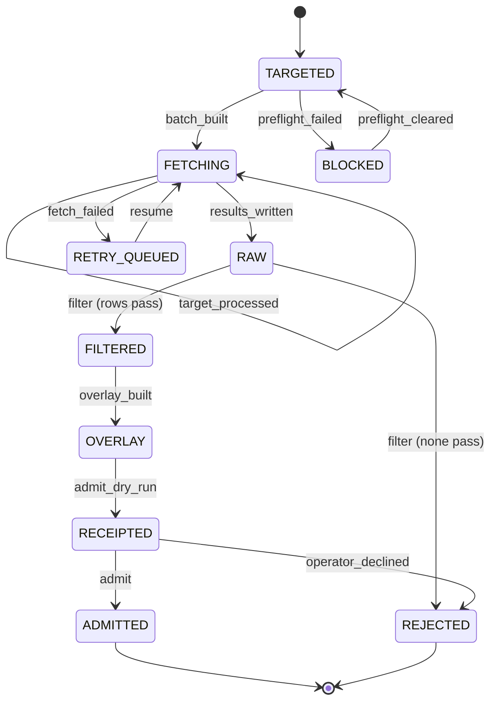

# Plan: 003-catalog-dataset-pipeline

An agent wrote this plan on 2026-11-03 and finished it on 2026-11-04 (T002) from spec.md, the [T001 record](T001_CONFIRMATION_2026-11-04.md) and the code on `main` at 007b437 (0.3.0-alpha.8). The agent confirmed the spec under the owner's delegation. The owner has not read it and approves by merging. Where the sections carried from spec.md disagree with the T001 record, the record wins until T090 amends spec.md. "Row" below means a row of that record.

## Stack (as built)

- Backend: Python 3.11 (`backend/Dockerfile`, and the CI jobs `backend`, `migrations` and `acceptance`), FastAPI, SQLAlchemy 2, Alembic migrations, Pydantic 2 (`backend/pyproject.toml`). `db-load.yml`, `db-migrate.yml` and `backend-lint` run 3.12.
- Database: Postgres 15 (Neon in staging and production, a `postgres:15.13` service in CI); unit tests use SQLite fixtures (`backend/tests/conftest.py`).
- Frontend: React 18, TypeScript, Vite, React Router (`frontend/package.json`).
- Edge: the Cloudflare Worker in `edge/api` fronts the API (spec 006).
- CI: `.github/workflows/ci.yml`, jobs `backend`, `migrations`, `acceptance`, `backend-lint`, `frontend` and `frontend-e2e`. `just spec-dag` runs the task DAG check; no workflow runs it.

## Architecture

- **Fetch.** `data/synth-catalog/catalog_scrape.py` is the shared router: free HTTP first, then a paid backend only with a key and an unexpired approval in `data/synth-catalog/receipts/fetch-approvals.json` (T040). It applies the transport limits (content type, 10 MiB, public redirects only) and the ModularGrid deny list. `scripts/hermes_hp_enrich_firecrawl.py` targets official product pages. `scripts/catalog_maker_crawl.py` crawls maker sites and refuses a shared homepage (D6). Firecrawl's proxy tier defaults to `auto` until the owner decides (row 30).
- **Evidence.** Fetch output stays `EVIDENCE_ONLY` under `data/synth-catalog/hermes-research/`. The loader does not read scrape results. Builders (`scripts/build_maker_overlays.py`, `build_category_overlay.py`, `build_reattribution.py`) turn crawl data into overlays that are reviewed and committed.
- **Overlays and manifests.** Versioned files in `data/synth-catalog/overlays/` (HP, category, power, retirements) and `data/synth-catalog/provenance/` (maker corrections). Not editing an applied version is a review convention; no check enforces it yet (row 5).
- **Loader.** `data/synth-catalog/population.py` `build_plan` and `populate`: insert-if-absent, fill-null, reviewed corrections (D4), retirements (D3), `hp_source` markers, cases through `plan_cases`, and a plan bound to `plan_hash` and `inputs_hash`. `scripts/import_catalog_population.py` runs it locally. `.github/workflows/db-load.yml` (through `scripts/catalog_actions_load.py`) runs a dry run, then an apply that must match the reviewed hashes.
- **Read side.** `backend/modules/catalog_routes.py` serves `module_catalog` (live rows only). `backend/racks/validation.py` blocks placement of an HP that needs reverification and warns on a retired module.
- **Batch lifecycle.** A description of the process, not code (OQ-9). Scripts and `db-load.yml` run the steps. Only the row lifecycle is enforced in code and encoded in tests.

`data-model.md` and `contracts/README.md` stay stubs: this plan adds no API route, and only the rollback below may add a table, which T090 would record there.

## Remaining work

### T010: transition tests

`backend/tests/unit/test_spec_003_transitions.py` already covers the row lifecycle and the hash binding. T010 closes when it also covers these two conflicts, which no committed test names:

- `not_nullable`: a `null` action on a NOT NULL field (row 28).
- `identity_mismatch` from `_schedule_catalog` (row 20).

The batch machine stays out of these tests (row 1). The seed state has nothing to test until its wording settles (rows 22, 36), and that does not hold T010.

### T090: converge code and spec

Spec text first, in one PR, no code:

1. Mark the batch table as a process description, and drop REJECTED as a state (rows 1, 6).
2. Amend FR-002 to "paid backends need keys" (row 2), narrow FR-003 and SC-005 to paid fetches (row 10), and narrow FR-029 to the admission FRs (row 16).
3. Add the `SEEDED` row and retire the "sealed" wording (row 22). Final wording follows counsel (row 36).
4. Amend line 372 (row 28), and drop SCRIBE and ADVERSARY from Workflows (row 24).
5. Clear the stale text the T001 record lists.

Then code, each in its own PR with tests:

6. A budget or key refusal is recorded as a refusal, not `not_found`, and `--resume` retries it (row 3).
7. Mark Frap refused in `maker-sources.json` (row 27).
8. Remove the writers that bypass the loader: the three `scripts/apply_*` scripts and the admin importers (rows 8, 26). If one is in use, stop and ask the owner.
9. A filter step and a residual targets file (rows 4, 11).
10. A check that an applied overlay does not change (row 5).
11. A lasting copy of each load receipt (row 12).
12. Rollback by run: retire the run's inserted rows and restore archived values, deleting nothing (row 13).
13. A threat-model section in spec 003 and a catalog injection test (row 19).
14. The other Partial FRs in spec.md's status table: FR-016 (store the incoming observation), FR-023 (`source_reference` on `module_catalog`), FR-025 (mark an inferred category), FR-026 (`is_available` on the canonical row), FR-034 (update the tags when a maker page confirms a lead).

### Other open work

- **T031.** PR #253 ran the offline pass and PR #250 settled nine two-category rows; 619 live rows still have no category on a load from committed inputs. The rest waits on rows 29 and 33.
- **T039.** The rows still marked `legacy_unsourced`, then removal of `UNSOURCED_HP_OVERLAYS`. Waits on rows 34 and 35.
- **006 T101b.** An owner-only GitHub setting: `production` and `staging` have no protection rules today (row 12). T090 cannot close it.

### Held for the owner

Open calls. This plan does not decide them, and nothing above assumes an answer. Defaults are in the T001 record.

- Rows 29, 30: no maker page or feed reads until the permission basis and proxy tier are signed off (PR #254).
- Rows 31, 32: the video and power-supply rows stay held.
- Row 33: no paid catalog fetch; no approval entry covers a catalog brand.
- Rows 34, 35: the legacy HP values and Akemie's Castle stay as they are.
- Rows 36, 37: counsel, on keeping the scraped names and on whether the paged catalog API is bulk publication. Build no export meanwhile.

## Verification

- `cd backend && PYTHONPATH=. pytest tests/unit/test_spec_003_transitions.py tests/test_catalog_corrections.py tests/test_catalog_scrape_router.py tests/test_catalog_transport_limits.py tests/test_crawl_shared_homepages.py tests/test_maker_crawl.py tests/unit/test_003_source_scope.py -q`.
- `tests/test_catalog_population.py`: needs the throwaway Postgres at `127.0.0.1:5432` (it skips otherwise) and takes minutes. CI runs it.
- A `db-load.yml` dry run on staging before any apply, with a go-ahead for each apply.
- `just spec-dag`.

## What T001 settled

- Every remaining `[INFERRED]` line is classified in the [T001 record](T001_CONFIRMATION_2026-11-04.md). The labels stay in spec.md until T090 clears them.
- Workflows skeleton: skills and CI confirmed, owners amended (rows 23, 24).
- D5 stands: T090 removes the other writers (row 26).
- FR-002: amend the text (row 2).
- FR-031 stands: the pre-apply checksum cannot restore anything and `catalog_value_archive` holds no inserts, so a rollback path is still owed (row 13).
- OQ-1 is still open (row 34).

## Carried forward from spec.md

The sections below are copied from [spec.md](spec.md) without change. The T001 record classifies their `[INFERRED]` lines.

## Workflows

Status: INFERRED skeleton. Confirm before you plan.

- Governing workflows (skills): anti-slop-code, production-systems, google-developer-style.
- Owners: FORGE decomposes, a cloud agent implements, SCRIBE files the compact artifact, ADVERSARY reviews the threat model.
- CI: reuse `.github/workflows/ci.yml` (jobs `backend` and `frontend`). Do not add a new CI path.

## Stateful behavior

The state machine is the per-batch lifecycle of a target batch. Each row in a batch also carries an evidence status, such as `OBSERVED`, `NOT_COMPUTABLE`, `CONFLICTED`, or `REJECTED`. Row statuses are attributes, not batch states.

### States

| State | Meaning | Label |
|---|---|---|
| `TARGETED` | The targets file exists with `{brand, name, slug}` rows. | [OBSERVED: scripts/hermes_hp_enrich_firecrawl.py] |
| `BLOCKED` | A fail-closed precondition is missing, such as credentials or budget approval. No request is sent. | [INFERRED] from the required-key exit in [OBSERVED: scripts/hermes_hp_enrich_firecrawl.py] |
| `FETCHING` | Scrape requests are in progress, with a checkpoint after each target. | [OBSERVED: scripts/hermes_hp_enrich_firecrawl.py] |
| `RETRY_QUEUED` | The run was interrupted or failed. A partial results file and a residual set remain. | [INFERRED] |
| `RAW` | `*-results.json` is written for all targets. Every row is `EVIDENCE_ONLY`. | [OBSERVED: scripts/hermes_hp_enrich_firecrawl.py] |
| `FILTERED` | `*.filtered.json` holds only rows with a complete provenance packet. | [INFERRED] |
| `OVERLAY` | `overlays/*-vN.json` is an immutable, versioned proposal. | [INFERRED] |
| `RECEIPTED` | The dry-run receipt is written. The database is unchanged. | [OBSERVED: data/synth-catalog/README.md] |
| `ADMITTED` | Rows are materialized into the database with provenance. | [OBSERVED: data/synth-catalog/README.md] |
| `REJECTED` | The batch was declined or no row passed the filter. Nothing is admitted. | [INFERRED] |

Initial state: `TARGETED`. Final states: `ADMITTED`, `REJECTED`.

### Transitions

| from | event | guard | to | effect |
|---|---|---|---|---|
| TARGETED | batch_built | targets file written AND budget approval recorded AND credentials present | FETCHING | Call Firecrawl/Hermes (paid, budget-gated) [INFERRED] |
| TARGETED | preflight_failed | credentials missing OR no budget approval | BLOCKED | Exit before any request is sent [OBSERVED: scripts/hermes_hp_enrich_firecrawl.py] (key check); budget check [INFERRED] |
| BLOCKED | preflight_cleared | credentials present AND budget approval recorded | TARGETED | None [INFERRED] |
| FETCHING | target_processed | more targets remain | FETCHING | Checkpoint the results file [OBSERVED: scripts/hermes_hp_enrich_firecrawl.py] |
| FETCHING | results_written | all targets processed | RAW | Write `*-results.json` [OBSERVED: scripts/hermes_hp_enrich_firecrawl.py] |
| FETCHING | fetch_failed | run interrupted or provider unavailable | RETRY_QUEUED | Keep the checkpoint and write a residual-N targets file [INFERRED] |
| RETRY_QUEUED | resume | budget approval recorded AND credentials present | FETCHING | Skip slugs already in the results file [OBSERVED: scripts/hermes_hp_enrich_firecrawl.py] |
| RAW | filter | at least one row has a complete provenance packet AND a known access basis | FILTERED | Write `*.filtered.json` and a residual-N targets file for `not_found` rows, and mark disagreements `CONFLICTED` [INFERRED] |
| RAW | filter | no row passes | REJECTED | Write the rejection reasons [INFERRED] |
| FILTERED | overlay_built | - | OVERLAY | Write `overlays/*-vN.json`, content-hashed [INFERRED] |
| OVERLAY | admit_dry_run | receipt path provided | RECEIPTED | Write the receipt with no database change [OBSERVED: data/synth-catalog/README.md] |
| RECEIPTED | admit | operator yes AND receipt binds the current overlay hash (Actions apply names the dry run's `plan_hash` and `inputs_hash`, FR-020) | ADMITTED | Materialize into the database: catalog dedupe by slug, full modules skip existing `(brand, name)`, and non-null HP is never overwritten [OBSERVED: data/synth-catalog/README.md] [OBSERVED: backend/DATA_SOURCES.md] |
| RECEIPTED | operator_declined | operator no | REJECTED | Keep the receipt and overlay for audit [INFERRED] |

### Illegal transitions

- `RAW` -> `ADMITTED`. [INFERRED]
- `FETCHING`, `RAW`, `FILTERED`, or `OVERLAY` -> `ADMITTED` without passing `RECEIPTED`. [INFERRED]
- Any value without a source -> `ADMITTED` (never invent). [OBSERVED: data/synth-catalog/README.md]
- `TARGETED` or `RETRY_QUEUED` -> `FETCHING` without budget approval. [INFERRED]
- `BLOCKED` -> `FETCHING` directly. [INFERRED]
- `RECEIPTED` -> `ADMITTED` when the overlay changed after the receipt was written. [INFERRED]
- `REJECTED` -> `ADMITTED`. [INFERRED]
- `ADMITTED` -> any state that overwrites a non-null HP, except a reviewed correction (D4, FR-038). [OBSERVED: backend/DATA_SOURCES.md]
- Any row with `access_basis` of `unknown` -> bulk publication. [OBSERVED: docs/EXTERNAL_SOURCE_POLICY.md]

Sealed seed path: the Synth Catalog Research seed is already research output. It reuses the `OVERLAY` -> `RECEIPTED` -> `ADMITTED` steps, with the seed file acting as the overlay [INFERRED]. For confirmation, see Open questions.

### Row lifecycle (admitted rows)

The batch machine above admits rows. Each admitted row then has its own lifecycle, set only by committed manifests the loader applies (D3, D4).

| State | Meaning | Label |
|---|---|---|
| `LIVE` | Admitted and visible in browse, search and counts. | [OBSERVED: data/synth-catalog/population.py] |
| `FLAGGED` | A value awaits a maker-page check (`needs_reverify`); an HP flag blocks placement (FR-035). | [OBSERVED: backend/racks/validation.py] |
| `TOMBSTONED` | Retired: hidden from browse, search, counts and materialization; readable by slug. | [OBSERVED: backend/modules/catalog_routes.py] |

Initial state: `LIVE`. Final state: `TOMBSTONED` (no un-tombstoning yet).

| from | event | guard | to | effect |
|---|---|---|---|---|
| LIVE | flag | provenance manifest action `flag` or `null` on a NOT NULL field | FLAGGED | Archive the value; set `needs_reverify` |
| FLAGGED | correct | correction entry matches the stored value (`only_if_value`) AND cites a maker page | LIVE | Archive the old value; write the new one; clear `needs_reverify` once every flagged field is corrected (research R8); an HP correction lifts the FR-035 block |
| LIVE | correct | as above | LIVE | Archive the old value; write the new one |
| LIVE | retire | retirement manifest names the row with a reason and evidence (an `https://` `evidence_url`; otherwise `retirement_needs_evidence`) | TOMBSTONED | Set `tombstoned_at` and reason (catalog), `status = tombstoned` (modules) |
| FLAGGED | retire | as above | TOMBSTONED | As above |

Illegal transitions:

- Any state -> deleted. Rows are never deleted.
- `LIVE` or `FLAGGED` -> a changed value without a correction entry that names the old value and a maker page.
- `TOMBSTONED` -> `LIVE` (needs its own decision and manifest).
- `TOMBSTONED` -> any flag or correction. A manifest entry naming a retired row is refused and counted in the receipt (research R9).
- A correction applied when the stored value is no longer `only_if_value` (the value changed since review).

Privacy: catalog data is public product specs. Keep any private source material out of the repo, and store row refs only.

## Addendum: catalog corrections and one loader (2026-10-29)

Scoped plan for T032–T033, both done. Decisions: D4, D5 in spec.md; evidence in research.md R1–R2.

Stack (unchanged):
- **Loader:** Python, `data/synth-catalog/population.py`, plain SQL through SQLAlchemy `text()`.
- **Database:** Postgres 15 (Neon); loads through `db-load.yml` (dry run, then apply bound to `plan_hash` and `inputs_hash`).
- **Placement guard:** `backend/racks/validation.py`.

**T032 (D5)**
- Delete `scripts/seed_catalog_from_synth.py`, `backend/scripts/seed_catalog_from_synth.py` and `backend/tests/unit/test_seeder_catalog.py`.
- Nothing calls them; the registry reads `module_catalog` (#114).

**T033 (D4, FR-038)**
- `ARCHIVE_ACTIONS` gains `correct`. An entry needs `field`, `only_if_value`, `value` and `evidence_url`. A corrected HP must lie in 1–84 (FR-038, widened 2026-10-30; extraction keeps 1–42 under FR-007).
- `_schedule_provenance` archives the current value as for every action. A follow-up `UPDATE` sets the field to `value` only where the archived copy (action `correct`) equals the current value, so a re-run, or a value changed since review, writes nothing. The archive row keeps the evidence URL in `source_tag`.
- `hp_needs_reverify` blocks only while an `hp` flag row exists and no `hp` correct row does.
- New manifest `provenance/maker-corrections-v1.json`, appended to `PROVENANCE_MANIFESTS` (now through v6).
- Row lifecycle transition `FLAGGED -correct-> LIVE` (spec.md, Row lifecycle).

Verification:
- unit tests for the action (match, mismatch, re-run, validation) and the guard;
- the Postgres population test;
- a staging dry run showing exactly the CHICANE updates, then apply, a rerun with no changes, and a prod dry run for review.
