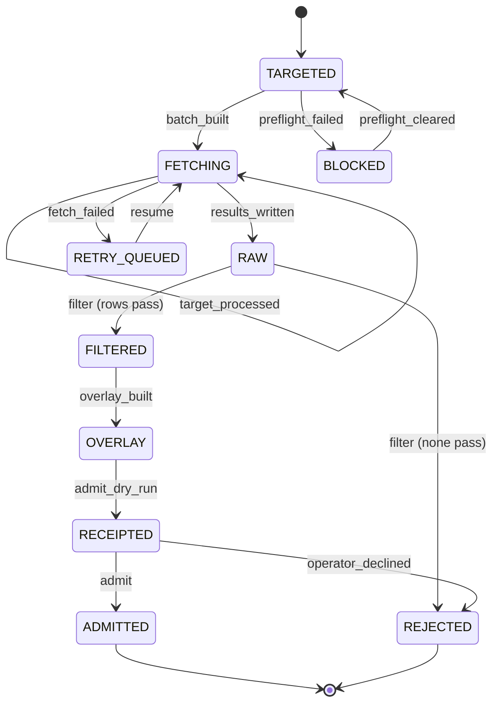

# Plan: 003-catalog-dataset-pipeline

> **DRAFT, pending T001 confirmation.** An agent wrote this on 2026-11-03 from spec.md and the code on `main` at 3688037 (0.3.0-alpha.6). The owner has not approved it. T002 stays open until the owner confirms the spec (T001) and accepts this plan. If T001 changes spec.md, copy the carried sections again.

## Stack (as built)

- Backend: Python (CI runs 3.12), FastAPI, SQLAlchemy 2, Alembic migrations, Pydantic 2 (`backend/pyproject.toml`).
- Database: Postgres 15 (Neon in staging and production, a Postgres service in CI); unit tests use SQLite fixtures (`backend/tests/conftest.py`).
- Frontend: React 18, TypeScript, Vite, React Router (`frontend/package.json`).
- Edge: the Cloudflare Worker in `edge/api` fronts the API (spec 006).
- CI: `.github/workflows/ci.yml`, jobs `backend`, `frontend` and `frontend-e2e`. `just spec-dag` runs the task DAG check.

## Architecture

- **Fetch.** `data/synth-catalog/catalog_scrape.py` is the shared router: free HTTP first, then a paid backend only with a key and an unexpired approval in `data/synth-catalog/receipts/fetch-approvals.json` (T040). It applies the transport limits (content type, 10 MiB, public redirects only) and the ModularGrid deny list. `scripts/hermes_hp_enrich_firecrawl.py` targets official product pages. `scripts/catalog_maker_crawl.py` crawls maker sites and refuses a shared homepage (D6).
- **Evidence.** Fetch output stays `EVIDENCE_ONLY` under `data/synth-catalog/hermes-research/`. Nothing there is loaded.
- **Overlays and manifests.** Versioned files in `data/synth-catalog/overlays/` (HP, category, power, retirements) and `data/synth-catalog/provenance/` (maker corrections). They are never edited in place.
- **Loader.** `data/synth-catalog/population.py` `build_plan` and `populate`: insert-if-absent, fill-null, reviewed corrections (D4), retirements (D3), `hp_source` markers, and a plan bound to `plan_hash` and `inputs_hash`. `scripts/import_catalog_population.py` runs it locally. `.github/workflows/db-load.yml` runs a dry run, then an apply that must match the reviewed hashes.
- **Read side.** `backend/modules/catalog_routes.py` serves `module_catalog` (live rows only). `backend/racks/validation.py` blocks placement of an HP that needs reverification and warns on a retired module.

## Remaining work

- Partial and Missing FRs (spec.md table): FR-002, FR-010, FR-014 to FR-018, FR-023 to FR-026, FR-029, FR-034 Partial; FR-017 (residual targets) and FR-031 (rollback) Missing.
- D5 drift: the admin importers and three `scripts/apply_*` scripts still write catalog rows (spec.md, under the status table).
- T031: rebuild the maker-crawl page cache, only when a change needs the crawl re-parsed, under an approved cap.
- T039: the rows still marked `legacy_unsourced`, then removal of `UNSOURCED_HP_OVERLAYS`.
- T090: converge the code against the confirmed spec.

## Verification

- `cd backend && pytest tests/unit/test_spec_003_transitions.py tests/test_catalog_population.py tests/test_catalog_corrections.py -q`.
- `tests/test_catalog_scrape_router.py`, `tests/test_catalog_transport_limits.py`, `tests/test_crawl_shared_homepages.py`.
- A `db-load.yml` dry run on staging before any apply.
- `just spec-dag`.

## What T001 settles for this spec

- Every remaining `[INFERRED]` label in spec.md, in one sitting (OQ-8 `one_sitting`), including the Workflows skeleton.
- D5: remove the importers and `apply_*` scripts that bypass the loader, or amend D5.
- FR-002: amend it to "paid backends need keys", or make the job refuse without credentials.
- FR-031: whether a rollback path is required, or the pre-apply dump checksum plus `catalog_value_archive` is enough.
- OQ-1: provisional; the owner confirms what happens to the legacy HP values no maker page confirms.

## Carried forward from spec.md

The sections below are copied from [spec.md](spec.md) without change.

## Workflows

Status: INFERRED skeleton. Confirm before you plan.

- Governing workflows (skills): anti-slop-code, production-systems, google-developer-style.
- Owners: FORGE decomposes, a cloud agent implements, SCRIBE files the compact artifact, ADVERSARY reviews the threat model.
- CI: reuse `.github/workflows/ci.yml` (jobs `backend` and `frontend`). Do not add a new CI path.

## Stateful behavior

The state machine is the per-batch lifecycle of a target batch. Each row in a batch also carries an evidence status, such as `OBSERVED`, `NOT_COMPUTABLE`, `CONFLICTED`, or `REJECTED`. Row statuses are attributes, not batch states.

### States

| State | Meaning | Label |
|---|---|---|
| `TARGETED` | The targets file exists with `{brand, name, slug}` rows. | [OBSERVED: scripts/hermes_hp_enrich_firecrawl.py] |
| `BLOCKED` | A fail-closed precondition is missing, such as credentials or budget approval. No request is sent. | [INFERRED] from the required-key exit in [OBSERVED: scripts/hermes_hp_enrich_firecrawl.py] |
| `FETCHING` | Scrape requests are in progress, with a checkpoint after each target. | [OBSERVED: scripts/hermes_hp_enrich_firecrawl.py] |
| `RETRY_QUEUED` | The run was interrupted or failed. A partial results file and a residual set remain. | [INFERRED] |
| `RAW` | `*-results.json` is written for all targets. Every row is `EVIDENCE_ONLY`. | [OBSERVED: scripts/hermes_hp_enrich_firecrawl.py] |
| `FILTERED` | `*.filtered.json` holds only rows with a complete provenance packet. | [INFERRED] |
| `OVERLAY` | `overlays/*-vN.json` is an immutable, versioned proposal. | [INFERRED] |
| `RECEIPTED` | The dry-run receipt is written. The database is unchanged. | [OBSERVED: data/synth-catalog/README.md] |
| `ADMITTED` | Rows are materialized into the database with provenance. | [OBSERVED: data/synth-catalog/README.md] |
| `REJECTED` | The batch was declined or no row passed the filter. Nothing is admitted. | [INFERRED] |

Initial state: `TARGETED`. Final states: `ADMITTED`, `REJECTED`.

### Transitions

| from | event | guard | to | effect |
|---|---|---|---|---|
| TARGETED | batch_built | targets file written AND budget approval recorded AND credentials present | FETCHING | Call Firecrawl/Hermes (paid, budget-gated) [INFERRED] |
| TARGETED | preflight_failed | credentials missing OR no budget approval | BLOCKED | Exit before any request is sent [OBSERVED: scripts/hermes_hp_enrich_firecrawl.py] (key check); budget check [INFERRED] |
| BLOCKED | preflight_cleared | credentials present AND budget approval recorded | TARGETED | None [INFERRED] |
| FETCHING | target_processed | more targets remain | FETCHING | Checkpoint the results file [OBSERVED: scripts/hermes_hp_enrich_firecrawl.py] |
| FETCHING | results_written | all targets processed | RAW | Write `*-results.json` [OBSERVED: scripts/hermes_hp_enrich_firecrawl.py] |
| FETCHING | fetch_failed | run interrupted or provider unavailable | RETRY_QUEUED | Keep the checkpoint and write a residual-N targets file [INFERRED] |
| RETRY_QUEUED | resume | budget approval recorded AND credentials present | FETCHING | Skip slugs already in the results file [OBSERVED: scripts/hermes_hp_enrich_firecrawl.py] |
| RAW | filter | at least one row has a complete provenance packet AND a known access basis | FILTERED | Write `*.filtered.json` and a residual-N targets file for `not_found` rows, and mark disagreements `CONFLICTED` [INFERRED] |
| RAW | filter | no row passes | REJECTED | Write the rejection reasons [INFERRED] |
| FILTERED | overlay_built | - | OVERLAY | Write `overlays/*-vN.json`, content-hashed [INFERRED] |
| OVERLAY | admit_dry_run | receipt path provided | RECEIPTED | Write the receipt with no database change [OBSERVED: data/synth-catalog/README.md] |
| RECEIPTED | admit | operator yes AND receipt binds the current overlay hash (Actions apply names the dry run's `plan_hash` and `inputs_hash`, FR-020) | ADMITTED | Materialize into the database: catalog dedupe by slug, full modules skip existing `(brand, name)`, and non-null HP is never overwritten [OBSERVED: data/synth-catalog/README.md] [OBSERVED: backend/DATA_SOURCES.md] |
| RECEIPTED | operator_declined | operator no | REJECTED | Keep the receipt and overlay for audit [INFERRED] |

### Illegal transitions

- `RAW` -> `ADMITTED`. [INFERRED]
- `FETCHING`, `RAW`, `FILTERED`, or `OVERLAY` -> `ADMITTED` without passing `RECEIPTED`. [INFERRED]
- Any value without a source -> `ADMITTED` (never invent). [OBSERVED: data/synth-catalog/README.md]
- `TARGETED` or `RETRY_QUEUED` -> `FETCHING` without budget approval. [INFERRED]
- `BLOCKED` -> `FETCHING` directly. [INFERRED]
- `RECEIPTED` -> `ADMITTED` when the overlay changed after the receipt was written. [INFERRED]
- `REJECTED` -> `ADMITTED`. [INFERRED]
- `ADMITTED` -> any state that overwrites a non-null HP, except a reviewed correction (D4, FR-038). [OBSERVED: backend/DATA_SOURCES.md]
- Any row with `access_basis` of `unknown` -> bulk publication. [OBSERVED: docs/EXTERNAL_SOURCE_POLICY.md]

Sealed seed path: the Synth Catalog Research seed is already research output. It reuses the `OVERLAY` -> `RECEIPTED` -> `ADMITTED` steps, with the seed file acting as the overlay [INFERRED]. For confirmation, see Open questions.

### Row lifecycle (admitted rows)

The batch machine above admits rows. Each admitted row then has its own lifecycle, set only by committed manifests the loader applies (D3, D4).

| State | Meaning | Label |
|---|---|---|
| `LIVE` | Admitted and visible in browse, search and counts. | [OBSERVED: data/synth-catalog/population.py] |
| `FLAGGED` | A value awaits a maker-page check (`needs_reverify`); an HP flag blocks placement (FR-035). | [OBSERVED: backend/racks/validation.py] |
| `TOMBSTONED` | Retired: hidden from browse, search, counts and materialization; readable by slug. | [OBSERVED: backend/modules/catalog_routes.py] |

Initial state: `LIVE`. Final state: `TOMBSTONED` (no un-tombstoning yet).

| from | event | guard | to | effect |
|---|---|---|---|---|
| LIVE | flag | provenance manifest action `flag` or `null` on a NOT NULL field | FLAGGED | Archive the value; set `needs_reverify` |
| FLAGGED | correct | correction entry matches the stored value (`only_if_value`) AND cites a maker page | LIVE | Archive the old value; write the new one; clear `needs_reverify` once every flagged field is corrected (research R8); an HP correction lifts the FR-035 block |
| LIVE | correct | as above | LIVE | Archive the old value; write the new one |
| LIVE | retire | retirement manifest names the row with a reason and evidence (an `https://` `evidence_url`; otherwise `retirement_needs_evidence`) | TOMBSTONED | Set `tombstoned_at` and reason (catalog), `status = tombstoned` (modules) |
| FLAGGED | retire | as above | TOMBSTONED | As above |

Illegal transitions:

- Any state -> deleted. Rows are never deleted.
- `LIVE` or `FLAGGED` -> a changed value without a correction entry that names the old value and a maker page.
- `TOMBSTONED` -> `LIVE` (needs its own decision and manifest).
- `TOMBSTONED` -> any flag or correction. A manifest entry naming a retired row is refused and counted in the receipt (research R9).
- A correction applied when the stored value is no longer `only_if_value` (the value changed since review).

Privacy: catalog data is public product specs. Keep any private source material out of the repo, and store row refs only.

## Addendum: catalog corrections and one loader (2026-10-29)

Scoped plan for T032–T033. Decisions: D4, D5 in spec.md; evidence in research.md R1–R2.

Stack (unchanged):
- **Loader:** Python, `data/synth-catalog/population.py`, plain SQL through SQLAlchemy `text()`.
- **Database:** Postgres 15 (Neon); loads through `db-load.yml` (dry run, then apply bound to `plan_hash`).
- **Placement guard:** `backend/racks/validation.py`.

**T032 (D5)**
- Delete `scripts/seed_catalog_from_synth.py`, `backend/scripts/seed_catalog_from_synth.py` and `backend/tests/unit/test_seeder_catalog.py`.
- Nothing calls them; the registry reads `module_catalog` (#114).

**T033 (D4, FR-038)**
- `ARCHIVE_ACTIONS` gains `correct`. An entry needs `field`, `only_if_value`, `value` and `evidence_url`. HP values must lie in 1–42 (FR-007).
- `_schedule_provenance` archives the current value as for every action. A follow-up `UPDATE` sets the field to `value` only where the archived copy (action `correct`) equals the current value, so a re-run, or a value changed since review, writes nothing. The archive row keeps the evidence URL in `source_tag`.
- `hp_needs_reverify` blocks only while an `hp` flag row exists and no `hp` correct row does.
- New manifest `provenance/maker-corrections-v1.json`, appended to `PROVENANCE_MANIFESTS`.
- Row lifecycle transition `FLAGGED -correct-> LIVE` (spec.md, Row lifecycle).

Verification:
- unit tests for the action (match, mismatch, re-run, validation) and the guard;
- the Postgres population test;
- a staging dry run showing exactly the CHICANE updates, then apply, a rerun with no changes, and a prod dry run for review.
