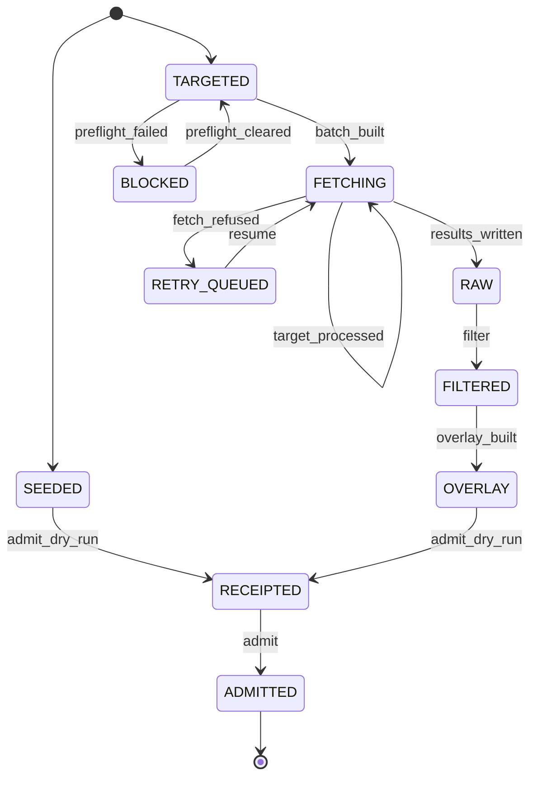

# 003: Catalog dataset pipeline (scrape, enrich, admit)

Status: CONFIRMED by an agent under the owner's delegation (T001, 2026-11-04), and converged with the code at T090 (2026-11-06). Written from the repo docs and code listed under Sources. Labels mark where a claim came from: `[OBSERVED: <file>]`, or `[INFERRED]` where the [T001 record](T001_CONFIRMATION_2026-11-04.md) classifies it.

**Changed by [spec 009](../009-photo-to-patchbook/spec.md) (2026-11-07).** The catalog is now the reference a Reading matches against, and the search used to fix a misread Module. It is no longer a public product to browse: the Modules, Products and Cases pages leave the product (decision 58, [ADR-007](../../docs/adr/ADR-007-photo-first-product.md), superseding ADR-006). Nothing in this pipeline changes, and anonymous reads of the catalog API stay as decision 39 left them.

## Owner decisions (2026-10-27)

Recorded after the T001 review. These are confirmed and override the `[INFERRED]` text below where they differ. The other open questions are still open, so T001 stays open.

- **D1 ModularGrid-derived identity layer: keep as discovery leads only.** `seed-phase2-v1.json` is ModularGrid-derived: its 703 brand names and 376 module identities came from a browser scrape. It is not "sealed research" (see `backend/DATA_SOURCES.md`, corrected 2026-10-17). Its spec values were already archived or nulled on 2026-10-17. What remains:
  - Brand names and module identities stay, with `access_basis = unknown` and evidence status `CATALOG_OBSERVED`.
  - The scraped module descriptions are removed.
  - These rows are never bulk-published. Policy: unknown access basis blocks bulk publication.
  - A row becomes canonical only after a manufacturer page or manual confirms it.
  - A module whose HP still carries `needs_reverify` cannot be placed in a rig until it is re-verified.
- **D2 Automated enrichment: manufacturer pages and manuals only.**
  - The fetch job targets official manufacturer product pages and manuals (`access_basis = official_publication`).
  - Retailer pages (Perfect Circuit, Thomann and others) are allowed only as one-off manual lookups, recorded as `RETAILER_OBSERVED` (`access_basis = manual_research`). They are never canonical and never bulk-crawled.
  - ModularGrid is never fetched.
  - **Update 2026-11-04 (`docs/evidence/OWNER_DECISIONS_2026-11-04.md`, option C).** `official_publication` covers facts only (name, HP, power, depth, category), under the conditions in [EXTERNAL_SOURCE_POLICY.md](../../docs/EXTERNAL_SOURCE_POLICY.md). A maker who opts out, or whose terms forbid automated access, is set to `unknown` and left out. **Update 2026-11-08 (decision 65).** `official_publication` also covers descriptions, manuals and pictures on a maker's own site, so they no longer need `maker_permission` first.

## Owner decisions (2026-10-28)

D3 and D6 were confirmed by the owner during the 2026-10-28 catalog work (#116, #119, #120). D4, D5, D7 and D8 follow the recommendations in [research.md](research.md), adopted when the owner asked on 2026-10-29 for the open decisions to be researched and handled as recommended. All override the `[INFERRED]` text below where they differ.

- **D3 Retire, never delete.** A catalog row that is wrong (filed under another maker's brand, or not a module) is tombstoned through a committed retirement manifest that names each row, its reason and its evidence. Tombstoned rows leave browse, search and counts, stay readable by slug, and are never materialized (FR-036). A rack that already holds one is warned, not changed.
- **D4 Reviewed corrections may overwrite.** A stored value that a maker page shows to be wrong may be replaced only through a committed correction manifest. Each entry names the wrong value it replaces (`only_if_value`), the new value, and the maker page that states it. The old value is archived first (FR-038). This relaxes the earlier rule that an admitted non-null HP is never overwritten.
- **D5 One loader.** The catalog loader (`data/synth-catalog/population.py`) is the only writer of catalog rows. `seed_catalog_from_synth.py` (both copies) is deleted: no automation ran it, it overwrote HP, category and source, and it invented defaults (HP 10, type VCO).
- **D6 A crawl never takes another maker's homepage.** A brand whose resolved homepage another brand owns is refused before crawling (FR-037).
- **D7 A refused site stays refused (2026-10-29).** Frap Tools' host accepts no TCP connection from the crawl network (ports 80 and 443, observed 2026-10-29), and Tiptop answers every request with a CAPTCHA. Neither is fetched through a paid renderer or proxy from another network. Both are excluded until the maker supplies data or access (research R3).
  - **Update 2026-11-04 (`docs/evidence/OWNER_DECISIONS_2026-11-04.md`).** A page that answers 401, 403 or 451, and a robots.txt that answers 401 or 403, are refusals too and never reach a paid backend. On a page, 429, 5xx and timeouts are load, not refusal, and stay eligible for a paid retry. Stricter than that decision (added in #254): a robots.txt that gives any other answer but 200 or 404, or no answer, stops every fetch of that host for the run. A refused connection cannot be told from a timeout (the router sees status 0 for both). So on robots.txt either one stops the host, while on a page either one stays eligible for a paid retry. A host that refuses every connection stays excluded by name as well, as Frap is.
- **D8 Jumper-dependent power is stored per setting (2026-10-29).** A module whose draw depends on a jumper gets one +12 V / −12 V / +5 V set per setting, each with its source page (`power_configs`). The single draw columns stay unknown for it (FR-022). This is not implemented yet: the committed crawl keeps only one value per page, so the settings must be read from the maker pages again under an approved cap (research R4, R5; tasks T034, T035).

## Sources

- `data/synth-catalog/README.md`
- `data/synth-catalog/PATCHHIVE_INTEGRATION.md`
- `docs/EXTERNAL_SOURCE_POLICY.md`
- `backend/DATA_SOURCES.md`
- `docs/PRODUCT_DATABASE_COMPLETENESS_ROADMAP.md` (listed, but its content was not in the extracted excerpt, so nothing here cites it)
- `scripts/hermes_hp_enrich_firecrawl.py` (excerpt truncated after the checkpoint summary)
- `scripts/build_case_catalog_seed.py` (listed, but its content was not in the extracted excerpt, so nothing here cites it)

## Summary

PatchHive's curated catalog is small: 25 brands, 32 full-spec modules, and 7 cases [OBSERVED: backend/DATA_SOURCES.md]. A scrape-derived seed (D1) names about 700 to 767 brands and 29 major brands in detail [OBSERVED: data/synth-catalog/PATCHHIVE_INTEGRATION.md]. Most Phase 2 rows have no HP [OBSERVED: backend/DATA_SOURCES.md].

This feature grows the module and case catalog from external sources. It does the following:

1. Scrapes evidence from official manufacturer product pages and manuals (D2; retailers are manual lookups only).
2. Filters that evidence against the provenance packet.
3. Builds a versioned overlay.
4. Writes a dry-run receipt.
5. Admits rows into PatchHive only after the operator approves.

The pipeline never invents a spec. A missing value stays null or `NOT_COMPUTABLE` [OBSERVED: data/synth-catalog/README.md] [OBSERVED: scripts/hermes_hp_enrich_firecrawl.py].

## Why

- No external source directly becomes canonical truth. Every imported field must keep its provenance, access basis, observation time, and review status [OBSERVED: docs/EXTERNAL_SOURCE_POLICY.md].
- Full rack placement needs HP. Sparse HP limits the catalog to discovery only [OBSERVED: backend/DATA_SOURCES.md].
- Constitution principles 2, 3, 6, and 9 apply here. Evidence is not canon, unknown stays unknown, provenance is mandatory, and the pipeline fails closed at trust boundaries.

## Implementation status (2026-11-06)

Checked against the code at T090, after 0.3.0-alpha.15, with #335, #340 and #338. Open gaps link to [research.md](research.md) and to the open tasks in [tasks.md](tasks.md) (T031, T039, T092). Totals: 32 implemented, 8 partial, 0 missing.

| FR | Status | Evidence |
|---|---|---|
| FR-001 | Implemented | `--targets` file of `{brand, name, slug}` and `--limit` [OBSERVED: scripts/hermes_hp_enrich_firecrawl.py]. |
| FR-002 | Implemented | Free HTTP first; paid backends only with a key, else a `skipped_no_key` receipt [OBSERVED: data/synth-catalog/catalog_scrape.py] (#66). A target left unread is `refused`, not `not_found`, and `--resume` retries it (#335) [OBSERVED: scripts/hermes_hp_enrich_firecrawl.py]. Only the maker crawl's model step needs `OPENROUTER_API_KEY` [OBSERVED: scripts/catalog_maker_crawl.py]. |
| FR-003 | Implemented | A paid fetch needs an unexpired, in-cap entry in `receipts/fetch-approvals.json`, else `skipped_no_approval`; the maker crawl also checks before a non-dry-run (T040, OQ-3, #196) [OBSERVED: data/synth-catalog/catalog_scrape.py `_reserve_paid`, `check_paid_approval`; scripts/catalog_maker_crawl.py; backend/tests/test_catalog_scrape_router.py]. Free fetches are unchanged, so a free run still starts without an approval. |
| FR-004 | Implemented | Only `official` candidate URLs, `candidates[:6]`, retailer fallback removed (T022, D2) [OBSERVED: scripts/hermes_hp_enrich_firecrawl.py] (#65). The crawler never fetches resellers [OBSERVED: scripts/catalog_maker_crawl.py header]. |
| FR-005 | Implemented | Candidate lists contain no search URLs, and `catalogsearch`, `search_dir.html` and `/search?` URLs are skipped [OBSERVED: scripts/hermes_hp_enrich_firecrawl.py]. The crawler uses search only to resolve a brand homepage, never to extract values [INFERRED from scripts/catalog_maker_crawl.py]. |
| FR-006 | Implemented | A page with no HP match returns `not_found` with `access_basis = None` [OBSERVED: scripts/hermes_hp_enrich_firecrawl.py]. Retailer values exist only as one-off lookups, `RETAILER_OBSERVED` [OBSERVED: data/synth-catalog/overlays/module-catalog-hp-retailer-v1.json] (#180). ModularGrid is on the router deny list [OBSERVED: catalog_scrape.py `DENY_HOSTS`]. |
| FR-007 | Implemented | `extract_hp` reads up to 104, then `process_one` discards anything outside 1 to 42 [OBSERVED: scripts/hermes_hp_enrich_firecrawl.py]. |
| FR-008 | Implemented | `--sleep` delay (default 0.35 s) and a per-host delay in the router. The tier defaults to `basic`; `PATCHHIVE_FIRECRAWL_PROXY` accepts `basic`, `stealth`, `auto` and rejects other values, and a non-basic tier needs an approvals entry naming it. A bot check, a 401, 403 or 451 page and a 401 or 403 robots.txt never reach a paid backend, including through `render`, which makes one free GET first. Any other robots.txt answer but 200 or 404, or none, stops the host for the run [OBSERVED: catalog_scrape.py `_wait`, `firecrawl_proxy_tier`, `_reserve_paid`, `_refusal`, `_robots_allow`, `fetch`; backend/tests/test_catalog_scrape_router.py] (#65, #254). |
| FR-009 | Implemented | The results file is rewritten after each target; `--resume` skips slugs already present [OBSERVED: scripts/hermes_hp_enrich_firecrawl.py]. |
| FR-010 | Implemented | Page text goes only in the model's user message, a model value needs a verbatim match, and the HP scrape is a regex [OBSERVED: scripts/catalog_maker_crawl.py `verbatim`, scripts/hermes_hp_enrich_firecrawl.py], with injection tests in `backend/tests/unit/test_003_untrusted_pages.py` (#335). See the threat model. |
| FR-011 | Implemented | `default_transport`: content-type allowlist (`MIME_NOT_ALLOWED`), 10 MiB cap before and during read (`BODY_TOO_LARGE`), non-public redirects refused; paid API replies go through the same transport [OBSERVED: catalog_scrape.py, backend/tests/test_catalog_transport_limits.py] (#103). |
| FR-012 | Implemented | Found rows carry `hp`, `source_url`, `provenance = OBSERVED`, `source_authority = MANUFACTURER_PRIMARY`, `admission_status = EVIDENCE_ONLY`, `rights_status = RIGHTS_UNKNOWN`, plus `access_basis = official_publication` [OBSERVED: scripts/hermes_hp_enrich_firecrawl.py]. Only `MANUFACTURER_PRIMARY` can now be produced (D2). |
| FR-013 | Implemented | `hp = None`, `NOT_COMPUTABLE`, `status = not_found` [OBSERVED: scripts/hermes_hp_enrich_firecrawl.py]. |
| FR-014 | Implemented | `scripts/filter_fetch_results.py` excludes a row missing any field a fetch row records (#335). The loader also checks each overlay: an HP entry needs a maker `https://` source (`hp_overlay_unsourced`), and a retirement or correction an `https://` evidence page [OBSERVED: population.py `_hp_entry_sourced`]. The four older `*.filtered.json` files came from outside the repo scripts. |
| FR-015 | Partial | Lead rows are tagged `access_basis = unknown` / `CATALOG_OBSERVED` (FR-033), and the filter excludes any basis other than `official_publication` (#335). No bulk-publication gate, because no surface is treated as bulk publication or bulk export [INFERRED: grep of backend/export and backend/modules]. Anonymous reads leave these rows out (FR-033); whether those reads count as bulk publication is with counsel (owner decision 39). |
| FR-016 | Partial | The filter keeps rows that disagree and marks them `CONFLICTED` (#335) [OBSERVED: scripts/filter_fetch_results.py]. In the loader, a disagreement with a stored value is a counted conflict (`conflicts_total`, first 50 listed) and the stored value is kept [OBSERVED: population.py `Plan.conflict`] (#103). The loader does not store the incoming observation (T092). |
| FR-017 | Implemented | `scripts/filter_fetch_results.py` writes a residual targets file for `not_found` and `refused` rows, in the format `--targets` reads (#335). |
| FR-018 | Implemented | Files are versioned, `applied-inputs.sha256` records each input's SHA-256, a test fails if one changes, and receipts list each hash (#340) [OBSERVED: scripts/freeze_catalog_inputs.py, backend/tests/unit/test_003_applied_inputs.py]. `inputs_hash` also blocks an apply after an edit (#198). |
| FR-019 | Implemented | `populate()` is a dry run unless `apply` is set, writes a receipt only if `receipt_path` is given, and the local script has `--dry-run` [OBSERVED: population.py `populate`, scripts/import_catalog_population.py]. The script's default `--receipt` path means it always writes one. |
| FR-020 | Implemented | `db-load.yml`: dry run by default, apply needs the reviewed `plan_hash` and `inputs_hash` or writes nothing [OBSERVED: .github/workflows/db-load.yml, population.py `populate`, backend/tests/test_catalog_population.py] (#103, #198). Approval is a manual `workflow_dispatch`. The environments have no protection rule until the owner sets 006 T101b (T001 row 12). |
| FR-021 | Implemented | Catalog insert is `WHERE NOT EXISTS (slug)`; a same-slug row with another brand or name is an `identity_mismatch` conflict; modules insert is `WHERE NOT EXISTS (brand, name)` (OQ-6) [OBSERVED: population.py `_schedule_catalog`, `_schedule_module`]. |
| FR-022 | Implemented | Loader fills nulls only; a full module without HP is a conflict (`hp_required`) [OBSERVED: population.py `_schedule_module`, `_schedule_fill`]. A jumper-dependent rail stays unknown and settings go in `power_configs` (D8, T034) [OBSERVED: population.py `_schedule_power_configs`, backend/racks/validation.py `placement_draws`] (#166). |
| FR-023 | Partial | `source = SynthCatalogResearch` is set on both tables, and `modules.source_reference` is set. `module_catalog` has no `source_reference` column, so catalog rows carry the source name only [OBSERVED: population.py `_schedule_catalog`, backend/modules/catalog.py]. |
| FR-024 | Partial | A stored HP is never overwritten except by a reviewed correction, and later HP overlays must cite a maker page [OBSERVED: population.py `_schedule_hp`, `_hp_entry_sourced`] (#132, #152). The unsourced v1 overlay still loads (`UNSOURCED_HP_OVERLAYS`) with `hp_source = legacy_unsourced` (T039 open: 17 rows). |
| FR-025 | Partial | `map_category` maps research categories and keeps `category_raw` in the seed; category overlay entries carry `basis` [OBSERVED: scripts/build_synth_catalog_seed.py, overlays/module-catalog-category-v1.json] (#115). The database has no field marking a category as inferred. |
| FR-026 | Partial | Modules have no price or stock columns, and case prices live in `case_prices` [OBSERVED: backend/cases/models.py `CasePrice`]. `module_catalog.is_available` (default `available`) is a volatile availability field on the canonical row [OBSERVED: population.py `_schedule_catalog`]. |
| FR-027 | Implemented | An HP overlay needs a maker source; retailer lookups only set `hp_source = retailer_observed` and never fill HP (FR-039) [OBSERVED: population.py `_schedule_hp_source_markers`, `_hp_entry_sourced`] (#132, #180). |
| FR-028 | Implemented | A rerun plans nothing; the plan hash ignores the planning clock [OBSERVED: backend/tests/test_catalog_population.py `test_population_dry_run_then_apply_is_idempotent`; backend/tests/unit/test_spec_003_transitions.py `test_plan_hash_binds_the_reviewed_plan_and_ignores_the_clock`]. |
| FR-029 | Implemented | Cases load through the same `populate()` dry run, `plan_hash` and `inputs_hash` (insert-if-absent, fill-null, `validate_record`) [OBSERVED: population.py `plan_cases`, `case_receipt`, backend/integrations/case_catalog_populator.py] (#103). |
| FR-030 | Implemented | Receipts carry `run_id`, `started_at`, `finished_at`, `plan_hash`, `inputs_hash`, insert, update, unmatched and conflict counts [OBSERVED: population.py `populate`, `receipt_for`] (#103). |
| FR-031 | Partial | `db-load.yml` with `rollback_run_id` retires what a run inserted and restores what it changed, through a dry run and a plan hash, and deletes nothing (decision 40, #340) [OBSERVED: data/synth-catalog/catalog_rollback.py, data/synth-catalog/load_runs.py, backend/tests/test_catalog_rollback.py]. Partial because case writes are reported, not undone, and `power_configs` and `manufacturers` rows stay in place: none of those tables has a retired state. Loads before migration `20261106_catalog_load_runs` recorded nothing and can't be rolled back. |
| FR-032 | Implemented | Fetch output is `EVIDENCE_ONLY` and `build_plan` reads only seeds, overlays, provenance and the T034/T035 receipts, never `hermes-research/` results [OBSERVED: population.py `build_plan`]. Admission goes through a reviewed commit and an apply bound to the hashes. Process-backed [INFERRED]. |
| FR-033 | Implemented | All 376 `catalog_modules` in the seed carry `unknown` / `CATALOG_OBSERVED` and none has a description (checked by parsing the seed) [OBSERVED: data/synth-catalog/seed-phase2-v1.json, backend/data/synth-catalog/seed-phase2-v1.json, backend/tests/unit/test_003_source_scope.py]. Columns from migration `20261027_catalog_lead_tags`; the UI marks leads "Unverified lead" [OBSERVED: frontend/src/pages/Modules.tsx] (#65). The 3 `full_spec_modules` keep descriptions: the seed notes call them hand-curated. The export clause has no surface to test [INFERRED]. Anonymous reads leave `unknown` rows out, a signed-in reader sees them, and a placed module keeps rendering [OBSERVED: `KNOWN_BASIS` and `MODULE_KNOWN_BASIS` in backend/modules/catalog.py, backend/tests/api/test_catalog_known_basis.py]. The load tags `CatalogCandidate` and `SynthCatalogResearch` rows that had no basis, and clears ModularGrid URLs from `modulargrid_url` and `modules.source_reference` (decisions 52 and 53) [OBSERVED: docs/evidence/CATALOG_ACCESS_BASIS_2026-11-05.md]. |
| FR-034 | Partial | A lead's HP can be set only by a maker-cited overlay or correction [OBSERVED: population.py `_hp_entry_sourced`]. `_schedule_lead_promotions` moves a lead to `official_publication` / `MANUFACTURER_CONFIRMED` once a reviewed entry cites the maker's page, and archives the old values [OBSERVED: population.py, overlays/lead-promotions-v1.json, overlays/lead-promotions-v2.json]. 298 leads have no such entry yet (`docs/evidence/CATALOG_LEAD_PROMOTION_2026-11-05.md`, `docs/evidence/CATALOG_LEAD_SEARCH_2026-11-05.md`). |
| FR-035 | Implemented | `hp_needs_reverify` rejects with `MODULE_HP_NEEDS_REVERIFY` on an `hp` `flag` row and lifts on a `keep` or `correct` row [OBSERVED: backend/racks/validation.py] (T021, #65). |
| FR-036 | Implemented | `_schedule_retirement` tombstones both tables and never deletes; browse, search, counts and batch materialization use `LIVE`; a slug lookup answers and materializing returns `CATALOG_ROW_TOMBSTONED`; a rack gets `MODULE_TOMBSTONED` [OBSERVED: population.py, backend/modules/catalog_routes.py, backend/racks/validation.py, overlays/catalog-retirements-v1.json, -v2.json] (#116, #120, #122). Evidence is required (#198). |
| FR-037 | Implemented | Every brand is resolved first, a shared host is recorded as `shared_homepage` with owner and candidate, and a partial rerun reads earlier refusals [OBSERVED: scripts/catalog_maker_crawl.py `guard_shared_homepages`, backend/tests/test_crawl_shared_homepages.py] (#119, T030). |
| FR-038 | Implemented | `correct` action: needs `only_if_value`, `value` and an `https://` page; archive first; write only while the stored value equals `only_if_value`; HP band 1 to 84; clears `needs_reverify` (T033, T036) [OBSERVED: population.py `_correction_problem`, `_correct_row`, provenance/maker-corrections-v1.json to v6.json, backend/tests/test_catalog_corrections.py] (#125, #135). |
| FR-039 | Implemented | `module-catalog-hp-retailer-v1.json` holds URL, quote and `RETAILER_OBSERVED`; a matching retailer value sets `retailer_observed`, a disagreement leaves `legacy_unsourced`; migration `20261030_catalog_hp_source` [OBSERVED: population.py `_schedule_hp_source_markers`, overlays/module-catalog-hp-retailer-v1.json, backend/tests/unit/test_hp_retailer_marker.py] (#180). |
| FR-040 | Implemented | The brand record and every crawl row carry the basis, and an unlisted value is refused on load. A brand set to `unknown` is not resolved or crawled, the router refuses its known hosts for every script, and the overlay builders take the basis from `maker-sources.json` and leave that brand out [OBSERVED: catalog_scrape.py `permission_basis`, `left_out_hosts`, `_block_reason`; catalog_maker_crawl.py `resolve_brand`, `crawl_brand`; build_maker_overlays.py; build_reattribution.py; backend/tests/test_maker_crawl.py, test_build_maker_overlays.py, test_catalog_tombstones.py, test_catalog_scrape_router.py] (#254). An opt-out does not reach rows already in committed overlays: those need a retirement manifest (D3). No bulk-publication surface exists to gate yet (FR-015). |

## Scope

In scope:

- Building target batches of catalog rows that need enrichment, starting with HP [OBSERVED: scripts/hermes_hp_enrich_firecrawl.py].
- Scraping official manufacturer product pages and manuals for HP evidence (D2). The retailer fallback was removed in T022 (2026-10-27).
- Writing raw, checkpointed result files that can resume [OBSERVED: scripts/hermes_hp_enrich_firecrawl.py].
- Filtering, overlay versioning, and residual retry batches [OBSERVED: scripts/filter_fetch_results.py, scripts/freeze_catalog_inputs.py].
- Running a dry-run admission with a receipt, followed by the real admission [OBSERVED: data/synth-catalog/README.md].
- Admitting the Synth Catalog Research seed, as discovery leads (D1), into `module_catalog` and `modules` [OBSERVED: backend/DATA_SOURCES.md].
- Filling null catalog HP from manufacturer-curated matches without overwriting non-null HP [OBSERVED: backend/DATA_SOURCES.md].
- Running the same pipeline for the case catalog seed [INFERRED].

## Non-goals

- Unauthorized HTML scraping of ModularGrid, unrestricted database replication, or bulk panel-image copying [OBSERVED: docs/EXTERNAL_SOURCE_POLICY.md].
- Treating retailer copy or community records as canonical engineering evidence [OBSERVED: docs/EXTERNAL_SOURCE_POLICY.md].
- Storing volatile commerce fields (price, stock, sale state, SKU, affiliate links) in canonical technical records [OBSERVED: docs/EXTERNAL_SOURCE_POLICY.md].
- Audio capture, DSP, synthesis emulation, and hardware control [OBSERVED: docs/EXTERNAL_SOURCE_POLICY.md].
- Catalog browsing UI, source filters, and new-user seeding (integration Phases B and C) [OBSERVED: data/synth-catalog/PATCHHIVE_INTEGRATION.md].
- Letting any model or provider self-confirm, invent, or mutate canonical inventory (constitution, decision-intelligence boundary).

## User stories

### P1: Admit the seed with a receipt [OBSERVED: data/synth-catalog/README.md]

As the operator, I want to dry-run the Synth Catalog Research import and get a receipt before anything reaches the database. That way, I approve exactly what lands.

**Scenario 1: Dry-run with a receipt path**

- **Given** `seed-phase2-v1.json` and its sources packet exist.
- **When** you run the importer in dry-run mode with a receipt path.
- **Then** the importer writes a receipt and leaves the database unchanged.

**Scenario 2: Dry-run without a receipt path**

- **Given** a dry-run without a receipt path.
- **When** the run completes.
- **Then** the importer writes no receipt file [OBSERVED: data/synth-catalog/README.md].

**Scenario 3: Real import after approval**

- **Given** the operator approves the receipt.
- **When** you run the real import.
- **Then** catalog rows are deduped by slug, and full modules skip any existing `(brand, name)` from any source [OBSERVED: data/synth-catalog/README.md].

### P1: Never invent a spec [OBSERVED: data/synth-catalog/README.md]

As a PatchHive user, I want every catalog value to trace back to a source. That way, rig planning never relies on made-up HP, power, or depth.

**Scenario 1: Value missing from research**

- **Given** research did not record HP, power, or depth for a row.
- **When** the row is admitted.
- **Then** that field stays null.

**Scenario 2: Scrape finds no HP**

- **Given** a scrape finds no HP on any candidate URL.
- **When** the result is written.
- **Then** the row has `hp = null`, `status = not_found`, and `provenance = NOT_COMPUTABLE` [OBSERVED: scripts/hermes_hp_enrich_firecrawl.py].

### P2: Scrape HP evidence from product pages [OBSERVED: scripts/hermes_hp_enrich_firecrawl.py]

As the operator, I want a batch job that collects HP evidence from official pages. That way, null HP rows gain sourced candidates.

**Scenario 1: Candidate ordering and attempt cap**

- **Given** a targets file of `{brand, name, slug}` rows.
- **When** the batch runs.
- **Then** the job tries official URL patterns only, with at most 6 attempts per target (D2).

**Scenario 2: Search pages**

- **Given** a candidate URL is a search page.
- **When** the job evaluates it.
- **Then** the job rejects it and extracts no HP.

**Scenario 3: HP outside the module band**

- **Given** an extracted HP is outside the band of 1 to 42.
- **When** the job evaluates it.
- **Then** the job discards it and tries the next candidate.

**Scenario 4: HP found**

- **Given** the job finds an HP.
- **When** it writes the result.
- **Then** the row carries `source_url`, `source_authority`, `admission_status = EVIDENCE_ONLY`, and `rights_status = RIGHTS_UNKNOWN`.

### P2: Resume a partial fetch [OBSERVED: scripts/hermes_hp_enrich_firecrawl.py]

As the operator, I want an interrupted batch to resume without paying for targets it already processed.

**Scenario 1: Checkpoint per target**

- **Given** a batch is running.
- **When** each target finishes.
- **Then** the job checkpoints the results file.

**Scenario 2: Resume**

- **Given** a results file exists.
- **When** you run the job with resume.
- **Then** it skips slugs already present.

### P2: Enrich null HP from curated matches [OBSERVED: backend/DATA_SOURCES.md]

As the operator, I want null catalog HP filled only from manufacturer-curated matches.

**Scenario 1: Curated match exists**

- **Given** a catalog row with null HP and a manufacturer-curated match.
- **When** you run HP enrichment.
- **Then** the job copies the HP, and it may refine a UTIL category to a specific category.

**Scenario 2: HP already set**

- **Given** a catalog row with non-null HP.
- **When** you run HP enrichment.
- **Then** the HP stays unchanged.

### P3: Filter evidence through the provenance packet [INFERRED]

As the operator, I want raw scrape results filtered before they reach an overlay. That way, only complete, policy-valid evidence is proposed.

**Scenario 1: Packet field missing**

- **Given** a raw row is missing any required provenance packet field [OBSERVED: docs/EXTERNAL_SOURCE_POLICY.md].
- **When** the filter runs.
- **Then** the row is excluded from the filtered output, and the filter records the reason.

**Scenario 2: Access basis unknown or disputed**

- **Given** a row's access basis is `unknown` or disputed.
- **When** the filter runs.
- **Then** the row is blocked from bulk publication [OBSERVED: docs/EXTERNAL_SOURCE_POLICY.md].

**Scenario 3: Sources disagree**

- **Given** two sources disagree on a field.
- **When** the filter runs.
- **Then** both observations are kept, and the field is marked `CONFLICTED` rather than resolved silently [OBSERVED: docs/EXTERNAL_SOURCE_POLICY.md].

### P3: Retry residual targets [INFERRED]

As the operator, I want unresolved targets queued as a new residual batch. That way, coverage can improve without reprocessing resolved rows.

**Scenario 1: Unresolved targets**

- **Given** a raw results file with `not_found` rows.
- **When** filtering completes.
- **Then** a residual targets file lists only those rows.

### P4: Case catalog through the same pipeline [INFERRED]

As the operator, I want case records (total HP, rows, power capacity) [OBSERVED: backend/DATA_SOURCES.md] admitted through the same receipted path.

**Scenario 1: Case seed admission**

- **Given** a case seed is built.
- **When** it is admitted.
- **Then** it follows the same dry-run, receipt, and operator-approval steps as modules.

## Workflows

Confirmed at T001 (rows 23, 24).

- Governing workflows (skills): anti-slop-code, production-systems, google-developer-style.
- Owners: FORGE owns the plan and tasks, and a cloud agent implements (`Zero-State-LLC/agent-context` `DECISIONS.md`). Whoever reviews a PR that changes the fetch path also reviews it against the threat model below, and the owner merges.
- CI: reuse `.github/workflows/ci.yml`. Do not add a new CI path.

## Stateful behavior

The batch table below describes the process, and no code holds these states: scripts and `db-load.yml` run the steps (OQ-9). Only the row lifecycle further down is enforced in code and encoded in tests. Each row in a batch also carries an evidence status, such as `OBSERVED`, `NOT_COMPUTABLE`, `CONFLICTED`, or `REJECTED`. Row statuses are attributes, not batch states.

### States

| State | Meaning | Label |
|---|---|---|
| `TARGETED` | The targets file exists with `{brand, name, slug}` rows. | [OBSERVED: scripts/hermes_hp_enrich_firecrawl.py] |
| `BLOCKED` | A paid backend has no key or approval. `catalog_maker_crawl.py` exits before sending anything; the other callers read what free fetches allow and record the stop (`status = refused`). | [OBSERVED: data/synth-catalog/catalog_scrape.py, scripts/catalog_maker_crawl.py] |
| `FETCHING` | Scrape requests are in progress, with a checkpoint after each target. | [OBSERVED: scripts/hermes_hp_enrich_firecrawl.py] |
| `RETRY_QUEUED` | A key or budget stop left targets unread. The results file marks them `refused`, and `--resume` retries them. | [OBSERVED: scripts/hermes_hp_enrich_firecrawl.py] |
| `RAW` | `*-results.json` is written for all targets. Every row is `EVIDENCE_ONLY`. | [OBSERVED: scripts/hermes_hp_enrich_firecrawl.py] |
| `FILTERED` | `*.filtered.json` holds only rows with a complete provenance packet. | [OBSERVED: scripts/filter_fetch_results.py] |
| `OVERLAY` | `overlays/*-vN.json` is a versioned proposal whose hash is frozen in `applied-inputs.sha256`. | [OBSERVED: scripts/freeze_catalog_inputs.py] |
| `SEEDED` | A seed file is a discovery lead (D1), not research output that is sealed. It has no fetch or filter step. Its final wording follows counsel (T001 row 36). | [OBSERVED: data/synth-catalog/population.py `build_plan`] |
| `RECEIPTED` | The dry-run receipt is written. The database is unchanged. | [OBSERVED: data/synth-catalog/README.md] |
| `ADMITTED` | Rows are materialized into the database with provenance. | [OBSERVED: data/synth-catalog/README.md] |

Initial states: `TARGETED`, `SEEDED`. Final state: `ADMITTED`. A batch that is declined, or has no row that passes, is simply not applied, and no record says so (OQ-9).

### Transitions

| from | event | guard | to | effect |
|---|---|---|---|---|
| TARGETED | batch_built | targets file written | FETCHING | Free fetches first. A paid backend needs a key and an unexpired approval (FR-002, FR-003) [OBSERVED: data/synth-catalog/catalog_scrape.py] |
| TARGETED | preflight_failed | the maker crawl has no approval, or no model key | BLOCKED | Exit before any request is sent [OBSERVED: scripts/catalog_maker_crawl.py] |
| BLOCKED | preflight_cleared | key and approval present | TARGETED | None [OBSERVED: scripts/catalog_maker_crawl.py] |
| FETCHING | target_processed | more targets remain | FETCHING | Checkpoint the results file [OBSERVED: scripts/hermes_hp_enrich_firecrawl.py] |
| FETCHING | results_written | all targets processed | RAW | Write `*-results.json` [OBSERVED: scripts/hermes_hp_enrich_firecrawl.py] |
| FETCHING | fetch_refused | a key or budget stop left a target unread | RETRY_QUEUED | Record `status = refused` with the reason, and keep the checkpoint [OBSERVED: scripts/hermes_hp_enrich_firecrawl.py] |
| RETRY_QUEUED | resume | `--resume` | FETCHING | Skip slugs already in the results file, except refused ones [OBSERVED: scripts/hermes_hp_enrich_firecrawl.py] |
| RAW | filter | at least one row has a complete provenance packet AND a known access basis | FILTERED | Write `*.filtered.json` and a residual targets file for `not_found` and `refused` rows, and mark disagreements `CONFLICTED` [OBSERVED: scripts/filter_fetch_results.py] |
| FILTERED | overlay_built | reviewed and committed | OVERLAY | Write `overlays/*-vN.json` and record its hash [OBSERVED: scripts/freeze_catalog_inputs.py] |
| OVERLAY | admit_dry_run | - | RECEIPTED | Write the receipt with no database change [OBSERVED: data/synth-catalog/README.md] |
| SEEDED | admit_dry_run | - | RECEIPTED | As above [OBSERVED: data/synth-catalog/population.py] |
| RECEIPTED | admit | operator yes AND receipt binds the current overlay hash (Actions apply names the dry run's `plan_hash` and `inputs_hash`, FR-020) | ADMITTED | Materialize into the database: catalog dedupe by slug, full modules skip existing `(brand, name)`, and non-null HP is never overwritten [OBSERVED: data/synth-catalog/README.md] [OBSERVED: backend/DATA_SOURCES.md] |

### Illegal transitions

- `RAW` -> `ADMITTED`. [INFERRED]
- `FETCHING`, `RAW`, `FILTERED`, or `OVERLAY` -> `ADMITTED` without passing `RECEIPTED`. [INFERRED]
- Any value without a source -> `ADMITTED` (never invent). [OBSERVED: data/synth-catalog/README.md]
- `TARGETED` or `RETRY_QUEUED` -> `FETCHING` without budget approval. [INFERRED]
- `BLOCKED` -> `FETCHING` directly. [INFERRED]
- `RECEIPTED` -> `ADMITTED` when the overlay changed after the receipt was written. [INFERRED]

- `ADMITTED` -> any state that overwrites a non-null HP, except a reviewed correction (D4, FR-038). [OBSERVED: backend/DATA_SOURCES.md]
- Any row with `access_basis` of `unknown` -> bulk publication. [OBSERVED: docs/EXTERNAL_SOURCE_POLICY.md]

### Row lifecycle (admitted rows)

The batch machine above admits rows. Each admitted row then has its own lifecycle, set only by committed manifests the loader applies (D3, D4).

| State | Meaning | Label |
|---|---|---|
| `LIVE` | Admitted and visible in browse, search and counts. | [OBSERVED: data/synth-catalog/population.py] |
| `FLAGGED` | A value awaits a maker-page check (`needs_reverify`); an HP flag blocks placement (FR-035). | [OBSERVED: backend/racks/validation.py] |
| `TOMBSTONED` | Retired: hidden from browse, search, counts and materialization; readable by slug. | [OBSERVED: backend/modules/catalog_routes.py] |

Initial state: `LIVE`. Final state: `TOMBSTONED` (no un-tombstoning yet).

| from | event | guard | to | effect |
|---|---|---|---|---|
| LIVE | flag | provenance manifest action `flag`, or `null` on a nullable field (on a NOT NULL field it is refused as `not_nullable`, research R1) | FLAGGED | Archive the value; set `needs_reverify` |
| FLAGGED | correct | correction entry matches the stored value (`only_if_value`) AND cites a maker page | LIVE | Archive the old value; write the new one; clear `needs_reverify` once every flagged field is corrected (research R8); an HP correction lifts the FR-035 block |
| LIVE | correct | as above | LIVE | Archive the old value; write the new one |
| LIVE | retire | retirement manifest names the row with a reason and evidence (an `https://` `evidence_url`; otherwise `retirement_needs_evidence`) | TOMBSTONED | Set `tombstoned_at` and reason (catalog), `status = tombstoned` (modules) |
| FLAGGED | retire | as above | TOMBSTONED | As above |

Illegal transitions:

- Any state -> deleted. Rows are never deleted.
- `LIVE` or `FLAGGED` -> a changed value without a correction entry that names the old value and a maker page.
- `TOMBSTONED` -> `LIVE` (needs its own decision and manifest).
- `TOMBSTONED` -> any flag or correction. A manifest entry naming a retired row is refused and counted in the receipt (research R9).
- A correction applied when the stored value is no longer `only_if_value` (the value changed since review).

Privacy: catalog data is public product specs. Keep any private source material out of the repo, and store row refs only.

## Functional requirements

### Targeting and fetch

- **FR-001**: The fetch job MUST read targets from a file of `{brand, name, slug}` rows and MUST support a limit [OBSERVED: scripts/hermes_hp_enrich_firecrawl.py].
- **FR-002**: A paid backend MUST have provider credentials. Without them, the fetch job MUST read what free fetches allow and MUST record each target it could not read as `refused`, never as `not_found` [OBSERVED: data/synth-catalog/catalog_scrape.py, scripts/hermes_hp_enrich_firecrawl.py].
- **FR-003**: A paid fetch MUST NOT start or resume without a recorded budget approval (OQ-3). Free fetches need none [OBSERVED: data/synth-catalog/catalog_scrape.py].
- **FR-004**: The fetch job MUST fetch only official manufacturer product URLs and manuals, and MUST cap attempts at 6 per target (D2). It MUST NOT fetch retailer or community-catalog pages.
- **FR-005**: The fetch job MUST NOT use or extract from search-result pages [OBSERVED: scripts/hermes_hp_enrich_firecrawl.py].
- **FR-006**: The fetch job MUST record only values found on the official candidate pages for that target; a page with no HP match yields `not_found` with no `access_basis`. A retailer value MAY be recorded only from a one-off manual lookup, as `RETAILER_OBSERVED` with `access_basis = manual_research` (D2).
- **FR-007**: The fetch job MUST discard extracted HP outside the band of 1 to 42 [OBSERVED: scripts/hermes_hp_enrich_firecrawl.py].
- **FR-008**: The fetch job MUST rate-limit requests with a delay between scrapes [OBSERVED: scripts/hermes_hp_enrich_firecrawl.py]. Paid fetches through Firecrawl use its `basic` proxy tier. A `stealth` or `auto` tier (`PATCHHIVE_FIRECRAWL_PROXY`) is used only under an unexpired `receipts/fetch-approvals.json` entry that covers the run's brands and names that tier (`proxy_tier`); without one the Firecrawl call is skipped and recorded (`skipped_no_approval`, or `skipped_proxy_unapproved` when no approvals file is set). A proxy changes where a fetch comes from, never what may be fetched: a page that answers with a bot check is recorded as a refusal and is never sent to a paid backend (D7). A page that answers 401, 403 or 451, and a robots.txt that answers 401 or 403, are refusals in the same way. A robots.txt that gives any other answer but 200 or 404, or no answer, stops every fetch of that host for the run, free or paid, with the reason recorded. context.dev documents no proxy option.
- **FR-009**: The fetch job MUST checkpoint results after each target and MUST support resume by slug [OBSERVED: scripts/hermes_hp_enrich_firecrawl.py].
- **FR-010**: The pipeline MUST treat scraped page content as untrusted data, never as instructions [OBSERVED: docs/EXTERNAL_SOURCE_POLICY.md].
- **FR-011**: The pipeline MUST validate MIME types, redirects, and content size of fetched pages [OBSERVED: docs/EXTERNAL_SOURCE_POLICY.md]. Implemented 2026-10-28 in the direct transport (`catalog_scrape.default_transport`): a content-type allowlist (pages, XML/sitemaps, JSON, text, gzip), a 10 MiB body cap checked before and while reading, and response headers kept. Refusals answer `x-patchhive-refused: MIME_NOT_ALLOWED` or `BODY_TOO_LARGE`.

### Result rows

- **FR-012**: Every found row MUST record `hp`, `source_url`, `provenance = OBSERVED`, and `source_authority` (`MANUFACTURER_PRIMARY`, `RETAILER_DISTRIBUTOR`, or `COMMUNITY_CATALOG`). It MUST also record `admission_status = EVIDENCE_ONLY` and `rights_status = RIGHTS_UNKNOWN` [OBSERVED: scripts/hermes_hp_enrich_firecrawl.py].
- **FR-013**: Every unresolved row MUST record `hp = null`, `provenance = NOT_COMPUTABLE`, and `status = not_found`. The pipeline MUST NOT convert this absence into a negative fact [OBSERVED: scripts/hermes_hp_enrich_firecrawl.py] (constitution decision boundary).
- **FR-040**: Every maker-crawl row MUST record `permission_basis`, from `maker-sources.json` (`permission_basis.default`, or the brand's own entry). `unknown`, which marks a maker who opted out or whose terms forbid automated access, blocks bulk publication (EXTERNAL_SOURCE_POLICY release gates). The crawl MUST NOT fetch such a maker, and the overlay builders MUST leave it out and MUST NOT give it an `official_publication` basis.

### Filter, overlay, and receipt

- **FR-014**: The filter MUST exclude rows missing any field of the provenance packet a fetch row records: `hp`, `source_url`, `provenance`, `source_authority`, `admission_status`, `rights_status` and `access_basis`. The full packet in `docs/EXTERNAL_SOURCE_POLICY.md` also names fields no fetch row holds yet, such as `license_status` and `content_hash`.
- **FR-015**: The filter MUST block bulk publication of rows with an unknown or disputed access basis [OBSERVED: docs/EXTERNAL_SOURCE_POLICY.md].
- **FR-016**: The filter MUST keep all conflicting observations and mark the field `CONFLICTED` [OBSERVED: docs/EXTERNAL_SOURCE_POLICY.md]. Implemented 2026-10-28 in part: every conflict is counted (`conflicts_total` in the receipt); the receipt lists the first 50.
- **FR-017**: The filter MUST emit a residual targets file for unresolved rows [OBSERVED: scripts/filter_fetch_results.py].
- **FR-018**: The pipeline MUST write overlays as versioned, content-hashed files and MUST NOT edit them in place [OBSERVED: data/synth-catalog/applied-inputs.sha256].
- **FR-019**: A dry-run MUST write a receipt only when a receipt path is given and MUST NOT change the database [OBSERVED: data/synth-catalog/README.md].

### Admission

- **FR-020**: Admission MUST require explicit operator approval of a receipt that binds the current overlay [INFERRED]. Implemented 2026-10-28: a dry run reports `plan_hash` (statements and parameters, without the planning clock); the Actions apply requires that hash (`plan_hash` input) and writes nothing if the plan has changed since review. Extended 2026-11-01 (OQ-9): the Actions apply also requires the dry run's `inputs_hash` (`inputs_hash` input) and writes nothing if the committed seeds, overlays, provenance or case seed have changed since review, even when the planned writes have not.
- **FR-021**: Admission MUST dedupe catalog rows by slug and MUST skip full modules whose `(brand, name)` already exists from any source [OBSERVED: data/synth-catalog/README.md].
- **FR-022**: Admission MUST keep HP, power, and depth null when no source recorded them [OBSERVED: data/synth-catalog/README.md].
- **FR-023**: Admitted Synth Catalog Research rows MUST carry `source = SynthCatalogResearch` and a `source_reference` [OBSERVED: backend/DATA_SOURCES.md].
- **FR-024**: HP enrichment MUST copy HP only from a manufacturer-curated match and MUST NOT overwrite non-null HP [OBSERVED: backend/DATA_SOURCES.md].
- **FR-025**: The pipeline MUST map free-text research categories to the PatchHive taxonomy and MUST label the mapping inferred [OBSERVED: backend/DATA_SOURCES.md].
- **FR-026**: The pipeline MUST store volatile commerce observations separately from canonical specs [OBSERVED: docs/EXTERNAL_SOURCE_POLICY.md].
- **FR-027**: The pipeline MUST NOT treat retailer-only values for safety-critical or patch-validity fields as confirmed without official confirmation [OBSERVED: docs/EXTERNAL_SOURCE_POLICY.md].
- **FR-028**: The same import files MUST produce the same database state [OBSERVED: backend/DATA_SOURCES.md].
- **FR-029**: The case catalog seed MUST follow the admission requirements, FR-019 through FR-028. It has one seed file, so the filter and overlay requirements do not apply to it (T001 row 16).

### Observability, rollback, and authority

- **FR-030**: Each import MUST record a run ID, timestamps, and imported, skipped, and processed counts [OBSERVED: backend/DATA_SOURCES.md]. Implemented 2026-10-28: receipts carry `run_id` (the Actions run), `started_at`, `finished_at`, `plan_hash`, `inputs_hash` (seeds, overlays, provenance, cases) and `conflicts_total`.
- **FR-031**: Rollback MUST be possible per run, using the run ID and receipt, without deleting rows that predate the run (decision 40). A rollback MUST retire what the run inserted and restore what it changed, and it deletes nothing (D3). A field changed since the run MUST be left alone and reported. Case tables have no retired state, so a run's case writes are reported, not undone [OBSERVED: data/synth-catalog/catalog_rollback.py].
- **FR-033**: ModularGrid-derived catalog rows MUST carry `access_basis = unknown` and evidence status `CATALOG_OBSERVED`, MUST NOT carry ModularGrid-derived descriptions, and MUST be excluded from any bulk publication or export (D1). They MAY be listed one by one in the catalog UI to a signed-in reader, marked "Unverified lead" (owner decisions, 2026-10-27 and decision 39 of `docs/evidence/OWNER_DECISIONS_2026-11-04.md`). Anonymous reads of the catalog, the registry and `modules` MUST leave out rows whose `access_basis` is `unknown`, and any `modules` row with the same brand and name. A module already placed on a rack MUST keep rendering. A NULL `access_basis` is not `unknown` here. Whether catalog reads count as bulk publication is a question for counsel. The tags live on `module_catalog.access_basis` and `module_catalog.evidence_status` (migration `20261027_catalog_lead_tags`).
- **FR-034**: A ModularGrid-derived row MUST become canonical only through manufacturer or manual confirmation recorded with its source URL (D1).
- **FR-035**: Rack placement MUST refuse a module whose HP is flagged `needs_reverify` until it is re-verified (D1). The guard rejects with `MODULE_HP_NEEDS_REVERIFY` when the archive holds an `hp` row with action `flag`; a module whose HP was confirmed (`keep`) stays placeable.
- **FR-036**: A wrong catalog row MUST be retired by tombstone, never deleted, through a committed retirement manifest (`overlays/catalog-retirements-vN.json`) that gives each row a reason and evidence (D3). Browse, search, counts and batch materialization MUST skip tombstoned rows; a lookup by slug MAY still answer; materializing one MUST fail with `CATALOG_ROW_TOMBSTONED`. A rack holding one MUST be warned (`MODULE_TOMBSTONED`) and MUST NOT be changed. An applied manifest MUST NOT be rewritten; later retirements go in a new version. Implemented 2026-10-28 (#116, #120, #122).
- **FR-037**: The crawler MUST resolve every brand before crawling any, and MUST refuse a homepage another brand owns: the brand named in the host owns it, else the one brand resolved by a maker adapter or the curated list; with no owner, every brand on the host is refused. Refusals MUST be recorded in the receipt, and a partial rerun MUST still see earlier refusals (D6). Implemented 2026-10-28 (#119).
- **FR-038**: A stored value MAY be corrected only through a committed correction manifest under `provenance/` (D4). Each entry MUST name the field, the wrong value (`only_if_value`), the new value and the maker page that states it. The loader MUST archive the old value before writing the new one and MUST skip the entry when the stored value differs from `only_if_value`. A corrected HP MUST lie between 1 and 84 HP, the widest case row (owner decision 2026-10-30: a reviewed maker quote may state a module wider than the FR-007 extraction band, as Doepfer's A-155 is at 50 HP; extraction keeps 1 to 42), and lifts the FR-035 placement block for that row.
- **FR-039**: A row whose stored HP carries `hp_source = legacy_unsourced` MAY be moved to `hp_source = retailer_observed` when a one-off manual retailer lookup (D2, FR-006) quotes the same HP on a retailer product page for that exact module (owner decision 2026-11-01). The lookup MUST NOT fill or change HP, MUST be recorded in `overlays/module-catalog-hp-retailer-v1.json` with its URL, quote and `evidence_status = RETAILER_OBSERVED`, and MUST NOT come from a host that blocked the request or from a community catalog. A retailer page that disagrees leaves `legacy_unsourced`. A maker source clears either marker. `retailer_observed` is not maker confirmation (FR-027): it records that two independent copies agree.
- **FR-032**: No provider or model output MAY move a row past `EVIDENCE_ONLY` without the deterministic filter and operator admission (constitution principle 4) [INFERRED].

## Key entities

- **Target batch**: A numbered list of `{brand, name, slug}` rows to enrich [OBSERVED: scripts/hermes_hp_enrich_firecrawl.py].
- **Scrape result row**: Per-target evidence with HP, source URL, source authority, epistemic status, admission status, and rights status [OBSERVED: scripts/hermes_hp_enrich_firecrawl.py].
- **Provenance packet**: The field-level record of source, access basis, license status, timestamps, content hash, and review state [OBSERVED: docs/EXTERNAL_SOURCE_POLICY.md].
- **Filtered result set**: Rows that passed the provenance filter [INFERRED].
- **Residual targets file**: Unresolved rows queued for retry [INFERRED].
- **Overlay**: A versioned proposal of catalog changes [INFERRED].
- **Admission receipt**: The dry-run or import record that the operator approves [OBSERVED: data/synth-catalog/README.md].
- **Synth catalog seed and sources packet**: The seed's lead rows (D1) and their access-basis policy [OBSERVED: data/synth-catalog/README.md].
- **Catalog row (`module_catalog`)**: A lightweight browse record [OBSERVED: backend/DATA_SOURCES.md].
- **Full module (`modules`)**: A curated full-spec record [OBSERVED: backend/DATA_SOURCES.md].
- **Case record**: Case HP, rows, and power capacity [OBSERVED: backend/DATA_SOURCES.md].
- **Budget approval**: The operator's authorization for a paid fetch [INFERRED].

## Success criteria

- **SC-001**: Every admitted non-null HP, power, or depth value traces to a `source_url` or `source_reference` [OBSERVED: data/synth-catalog/README.md].
- **SC-002**: No admission run changes a previously non-null HP [OBSERVED: backend/DATA_SOURCES.md].
- **SC-003**: Two admissions of the same overlay produce the same database state, and the second run admits zero new rows [OBSERVED: backend/DATA_SOURCES.md].
- **SC-004**: Every applied batch has a lasting receipt in `catalog_load_runs`, bound to the reviewed `plan_hash` and `inputs_hash`. A protected environment for the approval is 006 T101b, which only the owner can set [OBSERVED: data/synth-catalog/load_runs.py].
- **SC-005**: No paid fetch is sent without a key and a budget approval [OBSERVED: backend/tests/test_catalog_scrape_router.py].
- **SC-006**: A resumed batch sends no request for a slug already present in the results file [OBSERVED: scripts/hermes_hp_enrich_firecrawl.py].
- **SC-007**: Coverage claims bind to an exact registry snapshot and reference universe [OBSERVED: docs/EXTERNAL_SOURCE_POLICY.md]. Target coverage percentages are NOT_COMPUTABLE (see Open questions).

## Edge cases

- **Wrong HP on a page.** A page mentions several HP values, for example related products or a 1U tile. The first pattern match may be wrong, so treat it as evidence only and leave it subject to conflict review [INFERRED].
- **Unicode module names.** Names such as Instruo's need ASCII slug mapping before URL candidates are built [OBSERVED: scripts/hermes_hp_enrich_firecrawl.py].
- **Different official spelling.** Official pages that spell the name differently are still allowed. Retailer pages without the name are skipped [OBSERVED: scripts/hermes_hp_enrich_firecrawl.py].
- **Official and retailer disagree.** Apply the field-level hierarchy and mark the field `CONFLICTED` if it stays unresolved [OBSERVED: docs/EXTERNAL_SOURCE_POLICY.md].
- **Revision mismatch.** A manual covers a different revision than the catalog row. It applies only to the revisions it documents [OBSERVED: docs/EXTERNAL_SOURCE_POLICY.md].
- **Duplicate candidate URLs.** Remove duplicates while preserving order [OBSERVED: scripts/hermes_hp_enrich_firecrawl.py].
- **Short or empty response.** A response shorter than 80 characters or a failed scrape moves to the next candidate [OBSERVED: scripts/hermes_hp_enrich_firecrawl.py].
- **Slug collision.** Slugs are built from brand plus name and `module_catalog.slug` is globally unique, so the same module name under two brands gets two slugs. A row whose slug matches a stored row with a different brand or name is reported as an `identity_mismatch` conflict, not merged (OQ-6) [OBSERVED: data/synth-catalog/population.py].
- **Mid-batch credential or budget failure.** The target is recorded as `refused`, the checkpoint stays, and `--resume` retries it [OBSERVED: scripts/hermes_hp_enrich_firecrawl.py].
- **Prompt injection.** Scraped markdown containing instruction-like text is never passed as trusted commands [OBSERVED: docs/EXTERNAL_SOURCE_POLICY.md].
- **Phase 2 rows without HP.** These rows are admitted for discovery, but rack placement still needs HP later [OBSERVED: backend/DATA_SOURCES.md].

## Security, privacy, and authority boundaries

- Provider credentials come from the environment and never enter the repo or logs [OBSERVED: scripts/hermes_hp_enrich_firecrawl.py] [OBSERVED: docs/EXTERNAL_SOURCE_POLICY.md].
- Private source material stays out of the repo. Store row refs only [INFERRED].
- The threat model below covers untrusted page content, redirects and payload size.
- The scraper and any model only propose. The deterministic filter and the operator dispose (constitution principles 4 and 5) [INFERRED].

## Threat model

Scoped to what the pipeline takes from outside the repo. The other columns of `module_catalog` are public product facts, so the concern is a wrong value reaching a Rig, or a fetch that shouldn't have happened.

| Threat | What stops it | Test |
|---|---|---|
| A page tells a model or a script what to store | Page text only ever goes in the model's user message. A model value needs a verbatim match on the page. `extract_hp` is a regex with a band check. Nothing reads a fetch row as an instruction. | `backend/tests/unit/test_003_untrusted_pages.py` |
| A page states a wrong value | Fetch rows stay `EVIDENCE_ONLY`, and the loader reads no fetch results. A value reaches the database only through a reviewed, committed overlay and an apply bound to its hashes. | `test_003_untrusted_pages.py`, `backend/tests/test_catalog_population.py` |
| A redirect reaches a private host, or a page is huge or the wrong type | Public redirects only, a content-type allowlist and a 10 MiB cap, on free and paid replies alike. | `backend/tests/test_catalog_transport_limits.py` |
| A site that refused us is reached another way | A 401, 403 or 451, a robots refusal and a bot check never go to a paid backend. Frap and Tiptop are never resolved (D7). | `backend/tests/test_catalog_scrape_router.py`, `backend/tests/test_maker_crawl.py` |
| Spend beyond what was approved | A paid fetch needs a key and an unexpired approval naming the brand, within its cap. A non-basic proxy tier must be named too. | `test_catalog_scrape_router.py` |
| An overlay changes after review | The apply names the reviewed `plan_hash` and `inputs_hash`, and an edited input fails a test. | `test_catalog_population.py`, `backend/tests/unit/test_003_applied_inputs.py` |
| A writer bypasses the loader | `population.py` is the only writer (D5), and the admin import routes are gone. | `backend/tests/api/test_p0_security.py` |

Not covered: a maker page that is itself wrong and looks right, which review has to catch, and the environment rule on who may start an apply (006 T101b).

## Open questions

Decisions and checks 2026-11-01 ([record](../../docs/evidence/JEV_DECISIONS_2026-11-01.md)):

- OQ-1 (What should happen to the 57 legacy HP values that no maker page confirms (now 40 retailer_observed, 17 still legacy_unsourced), so UNSOURCED_HP_OVERLAYS can be retired?): **Decided 2026-11-01 by Jev (owner-delegated):** `ask_makers` (confidence 0.49) (provisional: low confidence, owner to confirm): Email ADDAC, Befaco, Instruo, Cwejman, Make Noise, Intellijel, Doepfer for spec sheets; keep the rows marked until a maker source arrives, then re-source via a new hp overlay. Slow, no data risk, T039 stays open indefinitely. See [the decision record](../../docs/evidence/JEV_DECISIONS_2026-11-01.md).
- OQ-2 (Which value is correct for the nine maker-vs-v1 HP disagreements nobody has hand-checked: Akemie's Castle (18 vs 38), Befaco Hexmix VCA (12 vs 14), Intellijel Quadrax (12 vs 14), Rubicon 2 (14 vs 20), Erica Fusion VCO (16 vs 24), Doepfer A-110-1 (8 vs 10), Joranalogue Generate 3 (16 vs 12), Qu-Bit Chord V2 and Data Bender (12 vs 14)?): **Decided 2026-11-01 by Jev (owner-delegated):** `hand_check_then_correct` (confidence 0.92): Read each maker page or manual (free, robots respected), then add `correct` entries (FR-038) for any wrong stored value, with a quote. Slowest (1-2 h) but resolves each properly. See [the decision record](../../docs/evidence/JEV_DECISIONS_2026-11-01.md). Done 2026-11-02 (`overlays/module-catalog-hp-v7.json`): eight checked against the maker page or manual, and each states the value staging and production already hold (Hexmix VCA 14, Quadrax 14, Rubicon 2 20, Fusion VCO 24, A-110-1 10, Generate 3 12, Chord v2 14, Data Bender 14), so v1 was wrong and no `correct` entry is needed; v7 quotes each. Akemie's Castle stays unconfirmed: its product page states no width, its manual host answered with a bot check, and staging's tables disagree: `module_catalog` holds 18 (v1, filled before the #152 precedence fix) while `modules` holds 38 and a fresh load gives 38 (the maker-crawl overlay v2). Correcting 18 to 38 needs a maker quote (FR-038): ALM's spec sheet or an owner decision.
- OQ-3 (How is a paid-fetch budget approval recorded and enforced so the crawler cannot start or resume without it (FR-003)?): **Decided 2026-11-01 by Jev (owner-delegated):** `approvals_file` (confidence 0.92): Commit `data/synth-catalog/receipts/fetch-approvals.json` (cap in credits and fetches, brands, expiry, approver). The crawler refuses any non-dry-run paid fetch without a matching unexpired entry and checks the ledger against it. Small code change, auditable in git. See [the decision record](../../docs/evidence/JEV_DECISIONS_2026-11-01.md).
- OQ-4 (Does the sealed Synth Catalog Research seed enter the lifecycle at OVERLAY, or at its own entry state?): **Decided 2026-11-01 by Jev (owner-delegated):** `separate_seed_state` (confidence 0.68) (a lawyer must confirm): Add SEEDED/SEALED state with its own guard (seed files immutable, hash pinned) and no FETCHING/FILTERED upstream. More precise, adds a state to implement and test. See [the decision record](../../docs/evidence/JEV_DECISIONS_2026-11-01.md).
- OQ-5 (Does the '3 consecutive scrubbed runs' verification apply to every admission?): **Decided 2026-11-01 by Jev (owner-delegated):** `replace_with_plan_hash` (confidence 0.86): Declare the existing dry-run, plan_hash-bound apply (plus a rerun-changes-nothing check) the verification ritual; mark the 3-run text as research-campaign history. No code. See [the decision record](../../docs/evidence/JEV_DECISIONS_2026-11-01.md).
- OQ-6 (Should catalog dedupe change from slug to (brand, slug) to avoid cross-brand collisions?): **Answered (checked 2026-11-01):** No change needed. The slug is built from brand plus name, and module_catalog.slug is globally unique; a second row whose normalized brand+name matches but whose brand or name differs is reported as an `identity_mismatch` conflict, not merged. The committed dry-run receipts show no such conflict. The spec's INFERRED slug-collision edge case is the only text to update (FR-021 wording).
- OQ-7 (What are the catalog coverage targets (roadmap targets were NOT_COMPUTABLE)?): **Decided 2026-11-01 by Jev (owner-delegated):** `keep_not_computable` (confidence 1.0): Report raw counts only and keep percentages NOT_COMPUTABLE until a universe is chosen. Matches SC-007 and the roadmap wording; no new claim risk. See [the decision record](../../docs/evidence/JEV_DECISIONS_2026-11-01.md).
- OQ-8 (Does the operator confirm the remaining [INFERRED] claims in spec 003 so T001/T002 (plan.md) can close?): **Decided 2026-11-01 by Jev (owner-delegated):** `one_sitting` (confidence 0.94): Walk the remaining INFERRED items in one owner session (R6 recommendation), then write plan.md from the confirmed spec and tick T001/T002. See [the decision record](../../docs/evidence/JEV_DECISIONS_2026-11-01.md).
- OQ-9 (Should the batch lifecycle (TARGETED to ADMITTED) be implemented as a code state machine, or should the spec be amended to describe the scripts as they are?): **Decided 2026-11-01 by Jev (owner-delegated):** `enforce_inputs_hash` (confidence 0.77): Minimum code: make apply compare the dry-run's inputs_hash as well as plan_hash and require evidence on retirements. Closes the two real gaps without a full machine. See [the decision record](../../docs/evidence/JEV_DECISIONS_2026-11-01.md). Implemented 2026-11-01: an Actions apply must name both the `plan_hash` and the `inputs_hash` of the reviewed dry run (FR-020), and a retirement entry without an `https://` `evidence_url` is a `retirement_needs_evidence` conflict that tombstones nothing. Every row of the committed retirement manifests (v1, v2) already cites one.
- OQ-10 (Is retailer scraping permitted?): **Answered (checked 2026-11-01):** RESOLVED by D2: no automated retailer crawling; retailer values only from one-off manual lookups (FR-006, FR-039).
- OQ-11 (Which document wins on ModularGrid-derived data and what access basis do scraped rows carry?): **Answered (checked 2026-11-01):** RESOLVED by D1/D2: the seed is a discovery lead (access_basis = unknown), maker-page rows carry official_publication (FR-033). Thomann coverage likewise: manual lookups only.
- OQ-12 (What file conventions do overlays, provenance manifests and receipts follow?): **Answered (checked 2026-11-01):** RESOLVED 2026-10-29: versioned files under overlays/, provenance/, receipts/; an applied version is never rewritten (FR-018, FR-036).
- OQ-13 (How does the case seed pipeline behave and how many brands exist?): **Answered (checked 2026-11-01):** RESOLVED 2026-10-29: case seed imports via case_catalog_populator.import_records (insert-if-absent, fill-null; plan hash covers it, #103). Observed 703 registry manufacturers and 355 brands with live rows.

- **DECIDED (T038, decision 30): the unsourced v1 HP values.** The owner chose triage. 17 are still `legacy_unsourced`: retry maker pages by plain GET, then the owner's drafted emails, and with no reply in about 4 weeks they stay marked and T039 closes.

- **PARTLY RESOLVED (2026-10-29): Fetch cost and budget.** Observed cost: the full v2 maker crawl used 2,569 paid fetches, about 1,116 context.dev and 33 Firecrawl credits (`receipts/scrape-ledger.json`); the T026 pass used 10 credits. Caps so far are approved in chat and written into `SCRAPING_ARCHITECTURE.md`. The approvals receipt the router checks before a paid fetch (FR-003) is `receipts/fetch-approvals.json` (T040); it ships with no active entries, so a new paid run needs an owner-approved entry committed first.
- **RESOLVED (D2): Retailer scraping permission.** There is no automated retailer crawling. Retailer values come only from one-off manual lookups.
- **RESOLVED (D1, D2): Conflict between documents.** Automated fetching is limited to official manufacturer pages and manuals. The ModularGrid-derived seed is a discovery lead, not curated canon.
- **RESOLVED (D2): Access basis for scraped rows.** Maker-page rows carry `access_basis = official_publication`; ModularGrid-derived leads carry `unknown` (FR-033).
- **RESOLVED (D2): Thomann coverage.** No retailer is crawled; Thomann values come only from one-off manual lookups.
- **RESOLVED (2026-10-29): File conventions.** Observed in `data/synth-catalog/`:
  - `overlays/catalog-additions-vN.json` (insert-if-absent rows);
  - `module-power-depth-vN.json` (fill-null specs);
  - `module-catalog-hp-vN.json`;
  - `module-catalog-category-vN.json`;
  - `catalog-retirements-vN.json` (tombstones);
  - `maker-review-v1.json` (renames);
  - `provenance/*.json` (archive-then-null, flag, keep, relabel or correct, one batch each);
  - `receipts/*.json` (dry-run and apply receipts, the spend ledger).

  Every overlay is versioned, and an applied version is never rewritten (FR-018, FR-036).
- **RESOLVED (2026-10-29): Case pipeline behavior.** The loader imports `data/cases/seed-v1.json` through `integrations.case_catalog_populator.import_records`: insert-if-absent and fill-null, rejected records counted. The plan hash covers the case writes (FR-020; #103).
- **NOT_COMPUTABLE: Roadmap targets.** `docs/PRODUCT_DATABASE_COMPLETENESS_ROADMAP.md` content was not in the excerpt. Coverage targets are unknown.
- **RESOLVED (2026-10-29): Brand count.** Observed on prod: 703 registry manufacturers; 355 brands with live catalog rows after the tombstones.
- **ANSWERED (OQ-4): Seed path.** A seed has its own entry state, `SEEDED`.
- **ANSWERED (OQ-5): Verification ritual.** A dry run, an apply bound to its `plan_hash`, and a rerun that changes nothing replace the three scrubbed runs.
- **ANSWERED (OQ-6): Slug dedupe.** No change: a slug is built from brand plus name and is globally unique.
