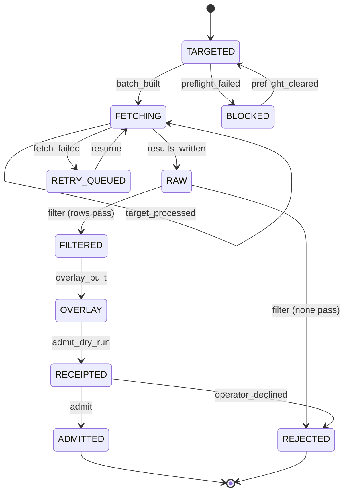

# 003: Catalog dataset pipeline (scrape, enrich, admit)

Status: DRAFT (2026-10-16). Filled by Opus 5.5 via OpenRouter from the repo docs and code listed under Sources. Each claim is labeled `[OBSERVED: <file>]` or `[INFERRED]`. The operator must confirm every `[INFERRED]` item before planning.

## Owner decisions (2026-10-27)

Recorded after the T001 review. These are confirmed and override the `[INFERRED]` text below where they differ. The other open questions are still open, so T001 stays open.

- **D1 ModularGrid-derived identity layer: keep as discovery leads only.** `seed-phase2-v1.json` is ModularGrid-derived: its 703 brand names and 376 module identities came from a browser scrape. It is not "sealed research" (see `backend/DATA_SOURCES.md`, corrected 2026-10-17). Its spec values were already archived or nulled on 2026-10-17. What remains:
  - Brand names and module identities stay, with `access_basis = unknown` and evidence status `CATALOG_OBSERVED`.
  - The scraped module descriptions are removed.
  - These rows are never bulk-published. Policy: unknown access basis blocks bulk publication.
  - A row becomes canonical only after a manufacturer page or manual confirms it.
  - A module whose HP still carries `needs_reverify` cannot be placed in a rig until it is re-verified.
- **D2 Automated enrichment: manufacturer pages and manuals only.**
  - The fetch job targets official manufacturer product pages and manuals (`access_basis = official_publication`).
  - Retailer pages (Perfect Circuit, Thomann and others) are allowed only as one-off manual lookups, recorded as `RETAILER_OBSERVED` (`access_basis = manual_research`). They are never canonical and never bulk-crawled.
  - ModularGrid is never fetched.

## Sources

- `data/synth-catalog/README.md`
- `data/synth-catalog/PATCHHIVE_INTEGRATION.md`
- `docs/EXTERNAL_SOURCE_POLICY.md`
- `backend/DATA_SOURCES.md`
- `docs/PRODUCT_DATABASE_COMPLETENESS_ROADMAP.md` (listed, but its content was not in the extracted excerpt, so nothing here cites it)
- `scripts/hermes_hp_enrich_firecrawl.py` (excerpt truncated after the checkpoint summary)
- `scripts/build_case_catalog_seed.py` (listed, but its content was not in the extracted excerpt, so nothing here cites it)

## Summary

PatchHive's curated catalog is small: 25 brands, 32 full-spec modules, and 7 cases [OBSERVED: backend/DATA_SOURCES.md]. Sealed research covers about 700 to 767 brands and 29 major brands in detail [OBSERVED: data/synth-catalog/PATCHHIVE_INTEGRATION.md]. Most Phase 2 rows have no HP [OBSERVED: backend/DATA_SOURCES.md].

This feature grows the module and case catalog from external sources. It does the following:

1. Scrapes evidence from official manufacturer product pages and manuals (D2; retailers are manual lookups only).
2. Filters that evidence against the provenance packet.
3. Builds a versioned overlay.
4. Writes a dry-run receipt.
5. Admits rows into PatchHive only after the operator approves.

The pipeline never invents a spec. A missing value stays null or `NOT_COMPUTABLE` [OBSERVED: data/synth-catalog/README.md] [OBSERVED: scripts/hermes_hp_enrich_firecrawl.py].

## Why

- No external source directly becomes canonical truth. Every imported field must keep its provenance, access basis, observation time, and review status [OBSERVED: docs/EXTERNAL_SOURCE_POLICY.md].
- Full rack placement needs HP. Sparse HP limits the catalog to discovery only [OBSERVED: backend/DATA_SOURCES.md].
- Constitution principles 2, 3, 6, and 9 apply here. Evidence is not canon, unknown stays unknown, provenance is mandatory, and the pipeline fails closed at trust boundaries.

## Scope

In scope:

- Building target batches of catalog rows that need enrichment, starting with HP [OBSERVED: scripts/hermes_hp_enrich_firecrawl.py].
- Scraping official manufacturer product pages and manuals for HP evidence (D2). The current script also falls back to retailer product-detail pages [OBSERVED: scripts/hermes_hp_enrich_firecrawl.py]; T022 removes that fallback.
- Writing raw, checkpointed result files that can resume [OBSERVED: scripts/hermes_hp_enrich_firecrawl.py].
- Filtering, overlay versioning, and residual retry batches [INFERRED].
- Running a dry-run admission with a receipt, followed by the real admission [OBSERVED: data/synth-catalog/README.md].
- Admitting the sealed Synth Catalog Research seed into `module_catalog` and `modules` [OBSERVED: backend/DATA_SOURCES.md].
- Filling null catalog HP from manufacturer-curated matches without overwriting non-null HP [OBSERVED: backend/DATA_SOURCES.md].
- Running the same pipeline for the case catalog seed [INFERRED].

## Non-goals

- Unauthorized HTML scraping of ModularGrid, unrestricted database replication, or bulk panel-image copying [OBSERVED: docs/EXTERNAL_SOURCE_POLICY.md].
- Treating retailer copy or community records as canonical engineering evidence [OBSERVED: docs/EXTERNAL_SOURCE_POLICY.md].
- Storing volatile commerce fields (price, stock, sale state, SKU, affiliate links) in canonical technical records [OBSERVED: docs/EXTERNAL_SOURCE_POLICY.md].
- Audio capture, DSP, synthesis emulation, and hardware control [OBSERVED: docs/EXTERNAL_SOURCE_POLICY.md].
- Catalog browsing UI, source filters, and new-user seeding (integration Phases B and C) [OBSERVED: data/synth-catalog/PATCHHIVE_INTEGRATION.md].
- Letting any model or provider self-confirm, invent, or mutate canonical inventory (constitution, decision-intelligence boundary).

## User stories

### P1: Admit sealed research with a receipt [OBSERVED: data/synth-catalog/README.md]

As the operator, I want to dry-run the Synth Catalog Research import and get a receipt before anything reaches the database. That way, I approve exactly what lands.

**Scenario 1: Dry-run with a receipt path**

- **Given** `seed-phase2-v1.json` and its sources packet exist.
- **When** you run the importer in dry-run mode with a receipt path.
- **Then** the importer writes a receipt and leaves the database unchanged.

**Scenario 2: Dry-run without a receipt path**

- **Given** a dry-run without a receipt path.
- **When** the run completes.
- **Then** the importer writes no receipt file [OBSERVED: data/synth-catalog/README.md].

**Scenario 3: Real import after approval**

- **Given** the operator approves the receipt.
- **When** you run the real import.
- **Then** catalog rows are deduped by slug, and full modules skip any existing `(brand, name)` from any source [OBSERVED: data/synth-catalog/README.md].

### P1: Never invent a spec [OBSERVED: data/synth-catalog/README.md]

As a PatchHive user, I want every catalog value to trace back to a source. That way, rig planning never relies on made-up HP, power, or depth.

**Scenario 1: Value missing from research**

- **Given** research did not record HP, power, or depth for a row.
- **When** the row is admitted.
- **Then** that field stays null.

**Scenario 2: Scrape finds no HP**

- **Given** a scrape finds no HP on any candidate URL.
- **When** the result is written.
- **Then** the row has `hp = null`, `status = not_found`, and `provenance = NOT_COMPUTABLE` [OBSERVED: scripts/hermes_hp_enrich_firecrawl.py].

### P2: Scrape HP evidence from product pages [OBSERVED: scripts/hermes_hp_enrich_firecrawl.py]

As the operator, I want a batch job that collects HP evidence from official pages first and retailer pages second. That way, null HP rows gain sourced candidates.

**Scenario 1: Candidate ordering and attempt cap**

- **Given** a targets file of `{brand, name, slug}` rows.
- **When** the batch runs.
- **Then** the job tries official URL patterns before retailer product-detail patterns, with at most 6 attempts per target.

**Scenario 2: Search pages**

- **Given** a candidate URL is a search page.
- **When** the job evaluates it.
- **Then** the job rejects it and extracts no HP.

**Scenario 3: HP outside the module band**

- **Given** an extracted HP is outside the band of 1 to 42.
- **When** the job evaluates it.
- **Then** the job discards it and tries the next candidate.

**Scenario 4: HP found**

- **Given** the job finds an HP.
- **When** it writes the result.
- **Then** the row carries `source_url`, `source_authority`, `admission_status = EVIDENCE_ONLY`, and `rights_status = RIGHTS_UNKNOWN`.

### P2: Resume a partial fetch [OBSERVED: scripts/hermes_hp_enrich_firecrawl.py]

As the operator, I want an interrupted batch to resume without paying for targets it already processed.

**Scenario 1: Checkpoint per target**

- **Given** a batch is running.
- **When** each target finishes.
- **Then** the job checkpoints the results file.

**Scenario 2: Resume**

- **Given** a results file exists.
- **When** you run the job with resume.
- **Then** it skips slugs already present.

### P2: Enrich null HP from curated matches [OBSERVED: backend/DATA_SOURCES.md]

As the operator, I want null catalog HP filled only from manufacturer-curated matches.

**Scenario 1: Curated match exists**

- **Given** a catalog row with null HP and a manufacturer-curated match.
- **When** you run HP enrichment.
- **Then** the job copies the HP, and it may refine a UTIL category to a specific category.

**Scenario 2: HP already set**

- **Given** a catalog row with non-null HP.
- **When** you run HP enrichment.
- **Then** the HP stays unchanged.

### P3: Filter evidence through the provenance packet [INFERRED]

As the operator, I want raw scrape results filtered before they reach an overlay. That way, only complete, policy-valid evidence is proposed.

**Scenario 1: Packet field missing**

- **Given** a raw row is missing any required provenance packet field [OBSERVED: docs/EXTERNAL_SOURCE_POLICY.md].
- **When** the filter runs.
- **Then** the row is excluded from the filtered output, and the filter records the reason.

**Scenario 2: Access basis unknown or disputed**

- **Given** a row's access basis is `unknown` or disputed.
- **When** the filter runs.
- **Then** the row is blocked from bulk publication [OBSERVED: docs/EXTERNAL_SOURCE_POLICY.md].

**Scenario 3: Sources disagree**

- **Given** two sources disagree on a field.
- **When** the filter runs.
- **Then** both observations are kept, and the field is marked `CONFLICTED` rather than resolved silently [OBSERVED: docs/EXTERNAL_SOURCE_POLICY.md].

### P3: Retry residual targets [INFERRED]

As the operator, I want unresolved targets queued as a new residual batch. That way, coverage can improve without reprocessing resolved rows.

**Scenario 1: Unresolved targets**

- **Given** a raw results file with `not_found` rows.
- **When** filtering completes.
- **Then** a residual targets file lists only those rows.

### P4: Case catalog through the same pipeline [INFERRED]

As the operator, I want case records (total HP, rows, power capacity) [OBSERVED: backend/DATA_SOURCES.md] admitted through the same receipted path.

**Scenario 1: Case seed admission**

- **Given** a case seed is built.
- **When** it is admitted.
- **Then** it follows the same dry-run, receipt, and operator-approval steps as modules.

## Workflows

Status: INFERRED skeleton. Confirm before you plan.

- Governing workflows (skills): anti-slop-code, production-systems, google-developer-style.
- Owners: FORGE decomposes, a cloud agent implements, SCRIBE files the compact artifact, ADVERSARY reviews the threat model.
- CI: reuse `.github/workflows/ci.yml` (jobs `backend` and `frontend`). Do not add a new CI path.

## Stateful behavior

The state machine is the per-batch lifecycle of a target batch. Each row in a batch also carries an evidence status, such as `OBSERVED`, `NOT_COMPUTABLE`, `CONFLICTED`, or `REJECTED`. Row statuses are attributes, not batch states.

### States

| State | Meaning | Label |
|---|---|---|
| `TARGETED` | The targets file exists with `{brand, name, slug}` rows. | [OBSERVED: scripts/hermes_hp_enrich_firecrawl.py] |
| `BLOCKED` | A fail-closed precondition is missing, such as credentials or budget approval. No request is sent. | [INFERRED] from the required-key exit in [OBSERVED: scripts/hermes_hp_enrich_firecrawl.py] |
| `FETCHING` | Scrape requests are in progress, with a checkpoint after each target. | [OBSERVED: scripts/hermes_hp_enrich_firecrawl.py] |
| `RETRY_QUEUED` | The run was interrupted or failed. A partial results file and a residual set remain. | [INFERRED] |
| `RAW` | `*-results.json` is written for all targets. Every row is `EVIDENCE_ONLY`. | [OBSERVED: scripts/hermes_hp_enrich_firecrawl.py] |
| `FILTERED` | `*.filtered.json` holds only rows with a complete provenance packet. | [INFERRED] |
| `OVERLAY` | `overlays/*-vN.json` is an immutable, versioned proposal. | [INFERRED] |
| `RECEIPTED` | The dry-run receipt is written. The database is unchanged. | [OBSERVED: data/synth-catalog/README.md] |
| `ADMITTED` | Rows are materialized into the database with provenance. | [OBSERVED: data/synth-catalog/README.md] |
| `REJECTED` | The batch was declined or no row passed the filter. Nothing is admitted. | [INFERRED] |

Initial state: `TARGETED`. Final states: `ADMITTED`, `REJECTED`.

### Transitions

| from | event | guard | to | effect |
|---|---|---|---|---|
| TARGETED | batch_built | targets file written AND budget approval recorded AND credentials present | FETCHING | Call Firecrawl/Hermes (paid, budget-gated) [INFERRED] |
| TARGETED | preflight_failed | credentials missing OR no budget approval | BLOCKED | Exit before any request is sent [OBSERVED: scripts/hermes_hp_enrich_firecrawl.py] (key check); budget check [INFERRED] |
| BLOCKED | preflight_cleared | credentials present AND budget approval recorded | TARGETED | None [INFERRED] |
| FETCHING | target_processed | more targets remain | FETCHING | Checkpoint the results file [OBSERVED: scripts/hermes_hp_enrich_firecrawl.py] |
| FETCHING | results_written | all targets processed | RAW | Write `*-results.json` [OBSERVED: scripts/hermes_hp_enrich_firecrawl.py] |
| FETCHING | fetch_failed | run interrupted or provider unavailable | RETRY_QUEUED | Keep the checkpoint and write a residual-N targets file [INFERRED] |
| RETRY_QUEUED | resume | budget approval recorded AND credentials present | FETCHING | Skip slugs already in the results file [OBSERVED: scripts/hermes_hp_enrich_firecrawl.py] |
| RAW | filter | at least one row has a complete provenance packet AND a known access basis | FILTERED | Write `*.filtered.json` and a residual-N targets file for `not_found` rows, and mark disagreements `CONFLICTED` [INFERRED] |
| RAW | filter | no row passes | REJECTED | Write the rejection reasons [INFERRED] |
| FILTERED | overlay_built | - | OVERLAY | Write `overlays/*-vN.json`, content-hashed [INFERRED] |
| OVERLAY | admit_dry_run | receipt path provided | RECEIPTED | Write the receipt with no database change [OBSERVED: data/synth-catalog/README.md] |
| RECEIPTED | admit | operator yes AND receipt binds the current overlay hash | ADMITTED | Materialize into the database: catalog dedupe by slug, full modules skip existing `(brand, name)`, and non-null HP is never overwritten [OBSERVED: data/synth-catalog/README.md] [OBSERVED: backend/DATA_SOURCES.md] |
| RECEIPTED | operator_declined | operator no | REJECTED | Keep the receipt and overlay for audit [INFERRED] |

### Illegal transitions

- `RAW` -> `ADMITTED`. [INFERRED]
- `FETCHING`, `RAW`, `FILTERED`, or `OVERLAY` -> `ADMITTED` without passing `RECEIPTED`. [INFERRED]
- Any value without a source -> `ADMITTED` (never invent). [OBSERVED: data/synth-catalog/README.md]
- `TARGETED` or `RETRY_QUEUED` -> `FETCHING` without budget approval. [INFERRED]
- `BLOCKED` -> `FETCHING` directly. [INFERRED]
- `RECEIPTED` -> `ADMITTED` when the overlay changed after the receipt was written. [INFERRED]
- `REJECTED` -> `ADMITTED`. [INFERRED]
- `ADMITTED` -> any state that overwrites a non-null HP. [OBSERVED: backend/DATA_SOURCES.md]
- Any row with `access_basis` of `unknown` -> bulk publication. [OBSERVED: docs/EXTERNAL_SOURCE_POLICY.md]

Sealed seed path: the Synth Catalog Research seed is already research output. It reuses the `OVERLAY` -> `RECEIPTED` -> `ADMITTED` steps, with the seed file acting as the overlay [INFERRED]. For confirmation, see Open questions.

Privacy: catalog data is public product specs. Keep any private source material out of the repo, and store row refs only.

## Functional requirements

### Targeting and fetch

- **FR-001**: The fetch job MUST read targets from a file of `{brand, name, slug}` rows and MUST support a limit [OBSERVED: scripts/hermes_hp_enrich_firecrawl.py].
- **FR-002**: The fetch job MUST refuse to start without provider credentials [OBSERVED: scripts/hermes_hp_enrich_firecrawl.py].
- **FR-003**: The fetch job MUST NOT start or resume without a recorded budget approval [INFERRED].
- **FR-004**: The fetch job MUST fetch only official manufacturer product URLs and manuals, and MUST cap attempts at 6 per target (D2). It MUST NOT fetch retailer or community-catalog pages.
- **FR-005**: The fetch job MUST NOT use or extract from search-result pages [OBSERVED: scripts/hermes_hp_enrich_firecrawl.py].
- **FR-006**: The fetch job MUST skip pages that do not mention the module name. A retailer value MAY be recorded only from a one-off manual lookup, as `RETAILER_OBSERVED` with `access_basis = manual_research` (D2).
- **FR-007**: The fetch job MUST discard extracted HP outside the band of 1 to 42 [OBSERVED: scripts/hermes_hp_enrich_firecrawl.py].
- **FR-008**: The fetch job MUST rate-limit requests with a delay between scrapes [OBSERVED: scripts/hermes_hp_enrich_firecrawl.py].
- **FR-009**: The fetch job MUST checkpoint results after each target and MUST support resume by slug [OBSERVED: scripts/hermes_hp_enrich_firecrawl.py].
- **FR-010**: The pipeline MUST treat scraped page content as untrusted data, never as instructions [OBSERVED: docs/EXTERNAL_SOURCE_POLICY.md].
- **FR-011**: The pipeline MUST validate MIME types, redirects, and content size of fetched pages [OBSERVED: docs/EXTERNAL_SOURCE_POLICY.md].

### Result rows

- **FR-012**: Every found row MUST record `hp`, `source_url`, `provenance = OBSERVED`, and `source_authority` (`MANUFACTURER_PRIMARY`, `RETAILER_DISTRIBUTOR`, or `COMMUNITY_CATALOG`). It MUST also record `admission_status = EVIDENCE_ONLY` and `rights_status = RIGHTS_UNKNOWN` [OBSERVED: scripts/hermes_hp_enrich_firecrawl.py].
- **FR-013**: Every unresolved row MUST record `hp = null`, `provenance = NOT_COMPUTABLE`, and `status = not_found`. The pipeline MUST NOT convert this absence into a negative fact [OBSERVED: scripts/hermes_hp_enrich_firecrawl.py] (constitution decision boundary).

### Filter, overlay, and receipt

- **FR-014**: The filter MUST exclude rows missing any field of the required provenance packet [OBSERVED: docs/EXTERNAL_SOURCE_POLICY.md].
- **FR-015**: The filter MUST block bulk publication of rows with an unknown or disputed access basis [OBSERVED: docs/EXTERNAL_SOURCE_POLICY.md].
- **FR-016**: The filter MUST keep all conflicting observations and mark the field `CONFLICTED` [OBSERVED: docs/EXTERNAL_SOURCE_POLICY.md].
- **FR-017**: The filter MUST emit a residual targets file for unresolved rows [INFERRED].
- **FR-018**: The pipeline MUST write overlays as versioned, content-hashed files and MUST NOT edit them in place [INFERRED].
- **FR-019**: A dry-run MUST write a receipt only when a receipt path is given and MUST NOT change the database [OBSERVED: data/synth-catalog/README.md].

### Admission

- **FR-020**: Admission MUST require explicit operator approval of a receipt that binds the current overlay [INFERRED].
- **FR-021**: Admission MUST dedupe catalog rows by slug and MUST skip full modules whose `(brand, name)` already exists from any source [OBSERVED: data/synth-catalog/README.md].
- **FR-022**: Admission MUST keep HP, power, and depth null when no source recorded them [OBSERVED: data/synth-catalog/README.md].
- **FR-023**: Admitted Synth Catalog Research rows MUST carry `source = SynthCatalogResearch` and a `source_reference` [OBSERVED: backend/DATA_SOURCES.md].
- **FR-024**: HP enrichment MUST copy HP only from a manufacturer-curated match and MUST NOT overwrite non-null HP [OBSERVED: backend/DATA_SOURCES.md].
- **FR-025**: The pipeline MUST map free-text research categories to the PatchHive taxonomy and MUST label the mapping inferred [OBSERVED: backend/DATA_SOURCES.md].
- **FR-026**: The pipeline MUST store volatile commerce observations separately from canonical specs [OBSERVED: docs/EXTERNAL_SOURCE_POLICY.md].
- **FR-027**: The pipeline MUST NOT treat retailer-only values for safety-critical or patch-validity fields as confirmed without official confirmation [OBSERVED: docs/EXTERNAL_SOURCE_POLICY.md].
- **FR-028**: The same import files MUST produce the same database state [OBSERVED: backend/DATA_SOURCES.md].
- **FR-029**: The case catalog seed MUST follow FR-014 through FR-028 [INFERRED].

### Observability, rollback, and authority

- **FR-030**: Each import MUST record a run ID, timestamps, and imported, skipped, and processed counts [OBSERVED: backend/DATA_SOURCES.md].
- **FR-031**: Rollback MUST be possible per run, using the run ID and receipt, without deleting rows that predate the run [INFERRED].
- **FR-033**: ModularGrid-derived catalog rows MUST carry `access_basis = unknown` and evidence status `CATALOG_OBSERVED`, MUST NOT carry ModularGrid-derived descriptions, and MUST be excluded from any bulk publication or export (D1).
- **FR-034**: A ModularGrid-derived row MUST become canonical only through manufacturer or manual confirmation recorded with its source URL (D1).
- **FR-035**: Rack placement MUST refuse a module whose HP is flagged `needs_reverify` until it is re-verified (D1).
- **FR-032**: No provider or model output MAY move a row past `EVIDENCE_ONLY` without the deterministic filter and operator admission (constitution principle 4) [INFERRED].

## Key entities

- **Target batch**: A numbered list of `{brand, name, slug}` rows to enrich [OBSERVED: scripts/hermes_hp_enrich_firecrawl.py].
- **Scrape result row**: Per-target evidence with HP, source URL, source authority, epistemic status, admission status, and rights status [OBSERVED: scripts/hermes_hp_enrich_firecrawl.py].
- **Provenance packet**: The field-level record of source, access basis, license status, timestamps, content hash, and review state [OBSERVED: docs/EXTERNAL_SOURCE_POLICY.md].
- **Filtered result set**: Rows that passed the provenance filter [INFERRED].
- **Residual targets file**: Unresolved rows queued for retry [INFERRED].
- **Overlay**: A versioned proposal of catalog changes [INFERRED].
- **Admission receipt**: The dry-run or import record that the operator approves [OBSERVED: data/synth-catalog/README.md].
- **Synth catalog seed and sources packet**: The sealed research rows and their access-basis policy [OBSERVED: data/synth-catalog/README.md].
- **Catalog row (`module_catalog`)**: A lightweight browse record [OBSERVED: backend/DATA_SOURCES.md].
- **Full module (`modules`)**: A curated full-spec record [OBSERVED: backend/DATA_SOURCES.md].
- **Case record**: Case HP, rows, and power capacity [OBSERVED: backend/DATA_SOURCES.md].
- **Budget approval**: The operator's authorization for a paid fetch [INFERRED].

## Success criteria

- **SC-001**: Every admitted non-null HP, power, or depth value traces to a `source_url` or `source_reference` [OBSERVED: data/synth-catalog/README.md].
- **SC-002**: No admission run changes a previously non-null HP [OBSERVED: backend/DATA_SOURCES.md].
- **SC-003**: Two admissions of the same overlay produce the same database state, and the second run admits zero new rows [OBSERVED: backend/DATA_SOURCES.md].
- **SC-004**: Every `ADMITTED` batch has a matching receipt and operator approval [INFERRED].
- **SC-005**: No fetch request is sent in `BLOCKED` or without budget approval [INFERRED].
- **SC-006**: A resumed batch sends no request for a slug already present in the results file [OBSERVED: scripts/hermes_hp_enrich_firecrawl.py].
- **SC-007**: Coverage claims bind to an exact registry snapshot and reference universe [OBSERVED: docs/EXTERNAL_SOURCE_POLICY.md]. Target coverage percentages are NOT_COMPUTABLE (see Open questions).

## Edge cases

- **Wrong HP on a page.** A page mentions several HP values, for example related products or a 1U tile. The first pattern match may be wrong, so treat it as evidence only and leave it subject to conflict review [INFERRED].
- **Unicode module names.** Names such as Instruo's need ASCII slug mapping before URL candidates are built [OBSERVED: scripts/hermes_hp_enrich_firecrawl.py].
- **Different official spelling.** Official pages that spell the name differently are still allowed. Retailer pages without the name are skipped [OBSERVED: scripts/hermes_hp_enrich_firecrawl.py].
- **Official and retailer disagree.** Apply the field-level hierarchy and mark the field `CONFLICTED` if it stays unresolved [OBSERVED: docs/EXTERNAL_SOURCE_POLICY.md].
- **Revision mismatch.** A manual covers a different revision than the catalog row. It applies only to the revisions it documents [OBSERVED: docs/EXTERNAL_SOURCE_POLICY.md].
- **Duplicate candidate URLs.** Remove duplicates while preserving order [OBSERVED: scripts/hermes_hp_enrich_firecrawl.py].
- **Short or empty response.** A response shorter than 80 characters or a failed scrape moves to the next candidate [OBSERVED: scripts/hermes_hp_enrich_firecrawl.py].
- **Slug collision.** The same slug from two brands collides under slug-only catalog dedupe [INFERRED].
- **Mid-batch credential or budget failure.** The batch keeps its checkpoint and moves to `RETRY_QUEUED` [INFERRED].
- **Prompt injection.** Scraped markdown containing instruction-like text is never passed as trusted commands [OBSERVED: docs/EXTERNAL_SOURCE_POLICY.md].
- **Phase 2 rows without HP.** These rows are admitted for discovery, but rack placement still needs HP later [OBSERVED: backend/DATA_SOURCES.md].

## Security, privacy, and authority boundaries

- Provider credentials come from the environment and never enter the repo or logs [OBSERVED: scripts/hermes_hp_enrich_firecrawl.py] [OBSERVED: docs/EXTERNAL_SOURCE_POLICY.md].
- Private source material stays out of the repo. Store row refs only [INFERRED].
- ADVERSARY reviews the threat model, including untrusted page content, redirects, and payload size [INFERRED].
- The scraper and any model only propose. The deterministic filter and the operator dispose (constitution principles 4 and 5) [INFERRED].

## Open questions

- **NOT_COMPUTABLE: Fetch cost and budget.** The per-batch Firecrawl cost, the budget ceiling, and where budget approval is recorded are not stated in the sources.
- **RESOLVED (D2): Retailer scraping permission.** There is no automated retailer crawling. Retailer values come only from one-off manual lookups.
- **RESOLVED (D1, D2): Conflict between documents.** Automated fetching is limited to official manufacturer pages and manuals. The ModularGrid-derived seed is a discovery lead, not curated canon.
- **NOT_COMPUTABLE: Access basis for scraped rows.** Policy lists allowed values, but none is assigned to Firecrawl output.
- **NOT_COMPUTABLE: Thomann coverage.** The script docstring names Thomann, but the extracted URL patterns show none.
- **NOT_COMPUTABLE: File conventions.** The schemas and naming for residual-N targets files, `*.filtered.json`, and `overlays/*-vN.json` do not appear in the sources.
- **NOT_COMPUTABLE: Case pipeline behavior.** `scripts/build_case_catalog_seed.py` content was not in the excerpt, so case pipeline behavior is unconfirmed.
- **NOT_COMPUTABLE: Roadmap targets.** `docs/PRODUCT_DATABASE_COMPLETENESS_ROADMAP.md` content was not in the excerpt. Coverage targets are unknown.
- **NOT_COMPUTABLE: Brand count.** Sources differ: about 700, 767, and "~700+".
- **Seed path.** Confirm that the sealed seed enters at `OVERLAY`, or define a separate entry state.
- **Verification ritual.** Confirm whether the "3-consecutive scrubbed runs" verification [OBSERVED: data/synth-catalog/PATCHHIVE_INTEGRATION.md] applies to every admission.
- **Slug dedupe.** Confirm whether catalog dedupe should become `(brand, slug)` to avoid cross-brand collisions.
