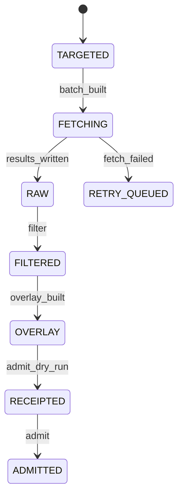

# 003: Catalog dataset pipeline (scrape, enrich, admit)

Status: DRAFT skeleton. This is a deterministic extraction from existing docs. No paid model was used. Every requirement is INFERRED until the operator confirms it.

## Sources

- `data/synth-catalog/README.md`
- `data/synth-catalog/PATCHHIVE_INTEGRATION.md`
- `docs/EXTERNAL_SOURCE_POLICY.md`
- `backend/DATA_SOURCES.md`
- `docs/PRODUCT_DATABASE_COMPLETENESS_ROADMAP.md`
- `scripts/hermes_hp_enrich_firecrawl.py`
- `scripts/build_case_catalog_seed.py`

## What and why

Grow the module/case catalog from external sources with provenance, never inventing specs, and admit it into PatchHive with receipts.

## User stories

TODO: Extract these from the sources above, one per story, each with acceptance criteria.

## Workflows

Status: INFERRED skeleton. Confirm before you plan.

- Governing workflows (skills): anti-slop-code, production-systems, google-developer-style.
- Owners: FORGE decomposes, a cloud agent implements, SCRIBE files the compact artifact, ADVERSARY reviews the threat model.
- CI: reuse `.github/workflows/ci.yml` (jobs `backend` and `frontend`). Do not add a new CI path.

## Stateful behavior

Initial state: `TARGETED`. Final states: ADMITTED.

| from | event | guard | to | effect |
|---|---|---|---|---|
| TARGETED | batch_built | targets file written | FETCHING | call Firecrawl/Hermes (paid, budget-gated) |
| FETCHING | results_written | - | RAW | write *-results.json |
| RAW | filter | provenance packet complete | FILTERED | write *.filtered.json |
| FILTERED | overlay_built | - | OVERLAY | write overlays/*-vN.json |
| OVERLAY | admit_dry_run | - | RECEIPTED | write the receipt |
| RECEIPTED | admit | operator yes | ADMITTED | materialize into the DB |
| FETCHING | fetch_failed | - | RETRY_QUEUED | write a residual-N targets file |

Illegal transitions:

- RAW -> ADMITTED
- any value without a source -> ADMITTED (never invent)
- FETCHING without budget approval

Privacy: catalog data is public product specs. Keep any private source material out of the repo and store row refs only.
