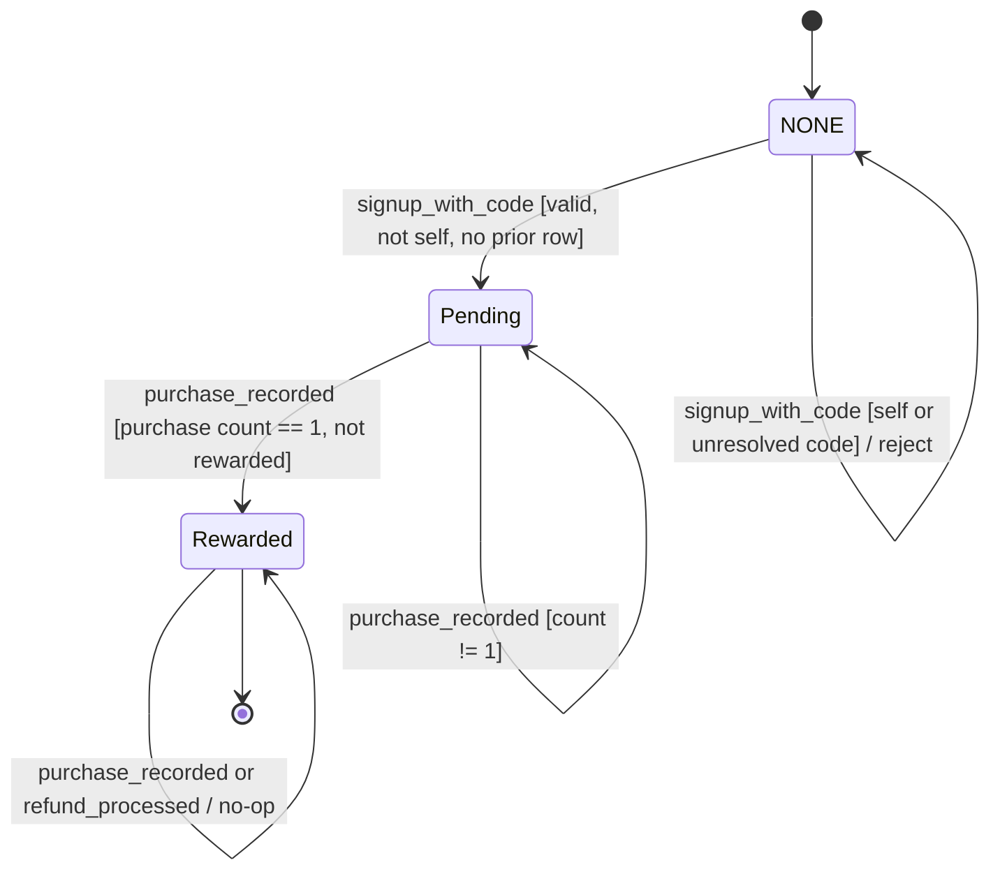
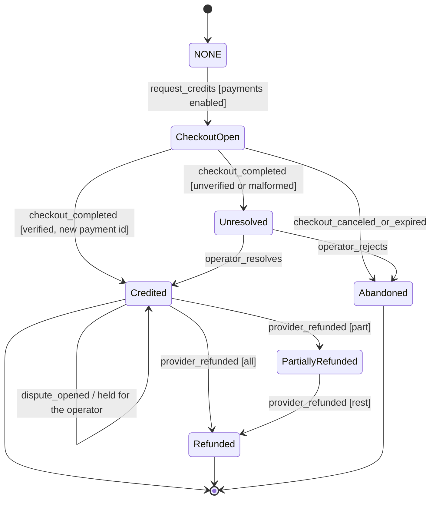
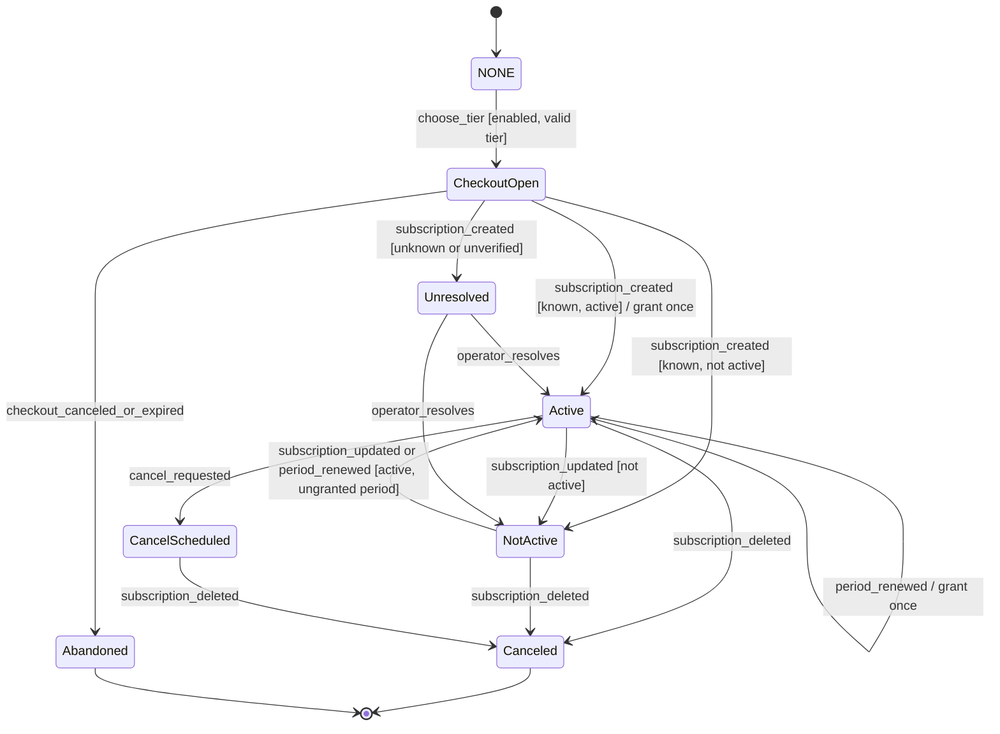

# Plan: 004-commerce

> **DRAFT, pending T001 confirmation.** An agent wrote this on 2026-11-03 from spec.md and the code on `main` at 3688037 (0.3.0-alpha.6). The owner has not approved it. T002 stays open until the owner confirms the spec (T001) and accepts this plan. If T001 changes spec.md, copy the carried sections again.

## Stack (as built)

- Backend: Python (CI runs 3.12), FastAPI, SQLAlchemy 2, Alembic migrations, Pydantic 2 (`backend/pyproject.toml`).
- Database: Postgres 15 (Neon in staging and production, a Postgres service in CI); unit tests use SQLite fixtures (`backend/tests/conftest.py`).
- Frontend: React 18, TypeScript, Vite, React Router (`frontend/package.json`).
- Edge: the Cloudflare Worker in `edge/api` fronts the API (spec 006).
- CI: `.github/workflows/ci.yml`, jobs `backend`, `frontend` and `frontend-e2e`. `just spec-dag` runs the task DAG check.

## Architecture

- **Canonical ledger.** `canonical_credit_ledger` (`backend/canon/models.py`) is append-only, enforced by a Postgres trigger (#139). The entry types are `purchase`, `debit`, `reversal`, `grant` and `refund`. `GET /api/canon/credits/balance` is the one balance (`backend/canon/routes.py`, `backend/canon/exports.py`).
- **Webhook intake.** `receive_stripe_webhook` (`backend/canon/exports.py`) verifies the signature (constant-time HMAC over every `v1`, 300 s tolerance, livemode gate). `process_stripe_event` (`backend/canon/webhook_events.py`) then dispatches by type and gives every event a disposition: `processed`, `duplicate`, `unresolved` with a reason code, or `ignored`.
- **Machine B.** `backend/canon/checkout.py`: credit checkout behind `ENABLE_CREDIT_CHECKOUT` and `checkout_gate`, one provider customer per user, payments unique on the provider ids, refunds and disputes (OQ-2), and operator resolve (T048b).
- **Machine C.** `backend/canon/subscriptions.py`: subscription checkout behind `ENABLE_SUBSCRIPTION_CHECKOUT`, a record synced by `customer.subscription.*`, a period grant on `invoice.paid`, and cancel at period end. `backend/canon/entitlements.py` resolves the tier from the subscription and spends the STUDIO fair-use entitlement (T050).
- **Machine A.** `backend/monetization/referrals.py`: append-only referral rows. A reward comes only from a provider-verified first purchase (`record_purchase(payment_verified=True)`), behind `ENABLE_REFERRALS`.
- **Operator.** Admin reject and resolve for unresolved events (`backend/canon/webhook_events.py`, `backend/canon/checkout.py`), each with an audit record.
- **Defaults.** `STRIPE_TEST_MODE=true`, `ALLOW_PRODUCTION_PAYMENTS=false`, both checkout flags off (`backend/core/config.py`). `validate_stripe_mode_startup_policy` refuses live mode outside production.

## Remaining work

- FRs still Partial (spec.md table): FR-002 ("demo mode only" is undefined), FR-008 (only the canonical ledger has a database guard), FR-021 (nothing at the database stops a referral code from changing), FR-029 (no database guard on referral rows).
- Machine C: the proposed correction in spec.md, and its five questions.
- T046 to T050 are built but stay unticked until T001 and OQ-1. T051 is the live-payments step, and it needs explicit authority.
- T090: converge the code against the confirmed spec.

## Verification

- `cd backend && pytest tests/unit/test_spec_004_transitions.py -q`, which covers Machines A, B and C as the code reads them.
- `tests/unit/test_commerce_subscriptions.py`, `tests/unit/test_commerce_operator_resolve.py`, `tests/unit/test_commerce_webhook_processor.py`.
- The Postgres acceptance tests in `tests/acceptance/` (append-only trigger, concurrent referral reward).
- `just spec-dag`.

## What T001 settles for this spec

- Every `[INFERRED]` label in spec.md, including the Workflows skeleton.
- The Machine C correction: the grant trigger and its five questions (spec.md, after the Machine C diagram).
- OQ-1 (prices and credit counts) and OQ-13 (sales terms): provisional; the owner and a lawyer confirm.
- FR-008: whether "the credits ledger" means the canonical ledger alone, or also the legacy `credits_ledger`, `referrals` and `subscription_period_grants`.
- FR-002: what "demo mode only" means for FREE.

## Carried forward from spec.md

The sections below are copied from [spec.md](spec.md) without change.

## Workflows

Status: INFERRED skeleton. Confirm before you plan.

- Governing workflows (skills): anti-slop-code, production-systems, google-developer-style.
- Owners: FORGE decomposes, a cloud agent implements, SCRIBE files the compact artifact, ADVERSARY reviews the threat model.
- CI: reuse `.github/workflows/ci.yml` (jobs `backend` and `frontend`). Do not add a new CI path.

## Stateful behavior

This spec defines three machines. Implementers treat each transitions table as the contract. A label in the `effect` cell marks the provenance of each row.

### Machine A: Referral (per referred user)

The effective state is derived from append-only rows. The state is `Rewarded` if any `Rewarded` row exists for the referred user. Otherwise, the state is `Pending` if a `Pending` row exists. Otherwise, the state is `NONE`. [OBSERVED: backend/monetization/referrals.py]

States:

- `NONE`. No referral exists. [OBSERVED: REFERRAL_IMPLEMENTATION.md]
- `Pending`. A referral is recorded, and the user has not been rewarded. [OBSERVED: REFERRAL_IMPLEMENTATION.md]
- `Rewarded`. The referrer has been rewarded once. [OBSERVED: REFERRAL_IMPLEMENTATION.md]

The initial state is `NONE`. The final state is `Rewarded`.

`Pending` can be permanently non-rewardable. This happens when the first purchase happened without triggering a reward, so the purchase count is already greater than 1. [INFERRED] See EC-3.

| from | event | guard | to | effect |
|---|---|---|---|---|
| NONE | signup_with_code | The code resolves to a user. The referrer is not the referred user. No `Pending` or `Rewarded` row exists. | Pending | Set `referred_by`. Append a `Pending` row. [OBSERVED: REFERRAL_IMPLEMENTATION.md] |
| NONE | signup_with_code | The referrer is the referred user. | NONE | Reject with an error. Write no row. [OBSERVED: backend/monetization/referrals.py] |
| NONE | signup_with_code | The code does not resolve. | NONE | Write no referral row. The signup outcome is unresolved. See OQ-6. [INFERRED] |
| Pending | purchase_recorded | The `Purchase` count is exactly 1. The referrer is not the referred user. No `Rewarded` row exists. | Rewarded | In one atomic unit, append a `Grant` of +3 to the referrer with `referral_id` and the note `Referral reward: <referred_user_id>`. Append a `Rewarded` row with `first_purchase_id` and `rewarded_at`. [OBSERVED: backend/monetization/referrals.py] Atomicity is [INFERRED]. |
| Pending | purchase_recorded | The `Purchase` count is not 1. | Pending | No reward. [OBSERVED: backend/monetization/referrals.py] |
| Pending | signup_with_code | Any. | Pending | Reject with "already recorded." [OBSERVED: backend/monetization/referrals.py] |
| Rewarded | purchase_recorded | Any. | Rewarded | No operation. [OBSERVED: backend/monetization/referrals.py] |
| Rewarded | refund_processed | Any. | Rewarded | No revocation. [OBSERVED: REFERRAL_IMPLEMENTATION.md] |
| Rewarded | signup_with_code | Any. | Rewarded | Reject with "already rewarded." [OBSERVED: backend/monetization/referrals.py] |

Illegal transitions:

- `Rewarded` to `Rewarded` with a second `Grant`. This is a double reward. [OBSERVED: REFERRAL_IMPLEMENTATION.md]
- `Pending` to `Rewarded` on a purchase that is not the first purchase. [OBSERVED: backend/monetization/referrals.py]
- `NONE` to `Pending` for a self-referral. [OBSERVED: REFERRAL_IMPLEMENTATION.md]
- `Rewarded` to `NONE` or `Rewarded` to `Pending` for any reason, including refund. [OBSERVED: REFERRAL_IMPLEMENTATION.md]
- Any update or delete of a referral row or a ledger entry. Both are append-only. [OBSERVED: REFERRAL_IMPLEMENTATION.md] The ledger rule is [INFERRED].
- A reward triggered by a client-submitted purchase that has no verified provider confirmation. [INFERRED]

### Machine B: One-time credit purchase (per checkout)

States:

- `NONE`. No checkout exists. [OBSERVED: STRIPE_INTEGRATION_PROMPT.md]
- `CheckoutOpen`. The provider session exists, and the user is at checkout. [OBSERVED: STRIPE_INTEGRATION_PROMPT.md]
- `Credited`. A payment record and a `Purchase` entry exist. [OBSERVED: STRIPE_INTEGRATION_PROMPT.md]
- `Abandoned`. The user canceled, or the session expired. [INFERRED] A cancel URL appears in STRIPE_INTEGRATION_PROMPT.md.
- `Unresolved`. A provider event could not be safely applied. [INFERRED] This follows constitution principle 9.
- `PartiallyRefunded` and `Refunded`. The provider refunded part or all of a credited payment. [OBSERVED: canon/checkout.py] Decided by OQ-2.

The initial state is `NONE`. The final states are `Credited` and `Abandoned`. `Unresolved` is not a final state. Only an operator action, defined in OQ-5, can exit it.

| from | event | guard | to | effect |
|---|---|---|---|---|
| NONE | request_credits | Payments are enabled. The user is signed in. The quantity is valid. | CheckoutOpen | Get or create the provider customer. Create a payment session that carries the user, the credit count, and the purchase type. [OBSERVED: STRIPE_INTEGRATION_PROMPT.md] |
| NONE | request_credits | Payments are disabled. | NONE | Refuse the request. Create no session. [INFERRED] |
| CheckoutOpen | checkout_completed | The event is verified. The user resolves. The payment identifier is present and unseen. | Credited | Append a payment record. Record the `Purchase` (+N) through the purchase-recording path, which evaluates Machine A. [OBSERVED: STRIPE_INTEGRATION_PROMPT.md] Routing through Machine A is [INFERRED]. See FR-028. |
| CheckoutOpen | checkout_completed | The event is unverified, the metadata is malformed, the user is unknown, or the payment identifier is missing. | Unresolved | Grant nothing. Retain the event for review. [INFERRED] |
| CheckoutOpen | checkout_canceled_or_expired | Any. | Abandoned | Write no ledger entry. [INFERRED] |
| Credited | checkout_completed | The payment identifier has already been processed. | Credited | No operation. This is idempotent. [OBSERVED: STRIPE_INTEGRATION_PROMPT.md] |
| Unresolved | operator_resolves | The operator verifies the identity and the payment. | Credited | Same effect as the verified completion. [INFERRED] |
| Unresolved | operator_rejects | Any. | Abandoned | Grant nothing. [INFERRED] |
| Credited or PartiallyRefunded | provider_refunded | The cumulative refunded amount is higher than any applied. | PartiallyRefunded, or Refunded when fully refunded | Append one `Refund` entry for `floor(credits * refunded / amount)` less earlier reversals, capped at the current balance. Any spent remainder is held as `Unresolved` for the operator. [OBSERVED: canon/checkout.py] Decided by OQ-2. |
| PartiallyRefunded or Refunded | provider_refunded | The cumulative amount was already applied. | Unchanged | No operation. This is idempotent. [OBSERVED: canon/checkout.py] Decided by OQ-2. |
| Credited | dispute_opened | Any. | Credited | No reversal. Hold the event as `Unresolved` for the operator. [OBSERVED: canon/checkout.py] Decided by OQ-2. |

Illegal transitions:

- `Credited` to `Credited` with a second `Purchase` for the same payment identifier. [OBSERVED: STRIPE_INTEGRATION_PROMPT.md]
- A refund reversal for a payment that was never credited, or one that takes a balance below zero. [OBSERVED: canon/checkout.py] Decided by OQ-2.
- `NONE` or `CheckoutOpen` to `Credited` without a verified provider confirmation, including through a client call. [INFERRED]
- `Abandoned` to `Credited`. A new checkout is required. [INFERRED]
- `Unresolved` to `Credited` without operator action. [INFERRED]

### Machine C: Subscription (per subscription)

States:

- `NONE`. No subscription exists. [OBSERVED: STRIPE_INTEGRATION_PROMPT.md]
- `CheckoutOpen`. The subscription checkout session exists. [OBSERVED: STRIPE_INTEGRATION_PROMPT.md]
- `Active`. The provider status is `active`. [OBSERVED: STRIPE_INTEGRATION_PROMPT.md]
- `CancelScheduled`. The subscription is active and flagged to cancel at the period end. [OBSERVED: STRIPE_INTEGRATION_PROMPT.md]
- `NotActive`. The provider status is a value other than `active` and `canceled`, such as `past_due`. [OBSERVED: STRIPE_INTEGRATION_PROMPT.md] Whether PatchHive should distinguish the provider statuses further is NOT_COMPUTABLE. See OQ-4.
- `Canceled`. The provider reported deletion. [OBSERVED: STRIPE_INTEGRATION_PROMPT.md]
- `Abandoned`. The user left checkout. [INFERRED]
- `Unresolved`. The customer is unknown, the price maps to no tier, or the event is unverified. [INFERRED]

The initial state is `NONE`. The final states are `Canceled` and `Abandoned`. `Unresolved` exits only through operator action. [INFERRED]

| from | event | guard | to | effect |
|---|---|---|---|---|
| NONE | choose_tier | Payments are enabled. The tier is CORE, PRO, or STUDIO. | CheckoutOpen | Get or create the provider customer. Create a subscription session that carries the user and the tier. [OBSERVED: STRIPE_INTEGRATION_PROMPT.md] |
| NONE | choose_tier | The tier is invalid, or payments are disabled. | NONE | Refuse the request. [OBSERVED: STRIPE_INTEGRATION_PROMPT.md] The invalid-tier rule is OBSERVED. The disabled rule is [INFERRED]. |
| CheckoutOpen | checkout_canceled_or_expired | Any. | Abandoned | Write no record. [INFERRED] |
| CheckoutOpen | subscription_created | Verified. The customer is known. The price maps to a tier. The status is `active`. | Active | Record the subscription. Grant the tier entitlement for the current period once. [OBSERVED: STRIPE_INTEGRATION_PROMPT.md] Once per period is [INFERRED]. |
| CheckoutOpen | subscription_created | Verified. The customer is known. The tier is known. The status is not `active`. | NotActive | Record the subscription. Grant nothing. [OBSERVED: STRIPE_INTEGRATION_PROMPT.md] |
| CheckoutOpen, Active, NotActive, CancelScheduled | subscription_created or subscription_updated | The event is unverified, the customer is unknown, or the price maps to no tier. | Unresolved | Grant nothing. Retain the event. [INFERRED] The observed code returns silently. |
| Active | subscription_updated | Same period. The status is `active`. | Active | Sync the fields. Grant nothing. [INFERRED] The observed code grants again. See FR-016. |
| Active, NotActive | period_renewed | A new period starts. The status is `active`. | Active | Sync the period. Grant the entitlement for the new period once. [INFERRED] |
| Active | subscription_updated | The status is not `active`. | NotActive | Sync the fields. Grant nothing. [OBSERVED: STRIPE_INTEGRATION_PROMPT.md] |
| NotActive | subscription_updated | The status is `active` in a period that has not been granted yet. | Active | Sync the fields. Grant once for the period. [INFERRED] |
| Active | cancel_requested | The user owns the subscription. | CancelScheduled | Set cancel-at-period-end at the provider and locally. [OBSERVED: STRIPE_INTEGRATION_PROMPT.md] |
| Active, NotActive, CancelScheduled | subscription_deleted | Verified. | Canceled | Set the status to `canceled`. Keep the granted credits. [OBSERVED: STRIPE_INTEGRATION_PROMPT.md] Keeping credits is [INFERRED]. |
| Unresolved | operator_resolves | The operator has mapped the customer and the tier. | Active or NotActive | Apply the event as verified. [INFERRED] |

Illegal transitions:

- A second credit grant for the same subscription and the same billing period. [INFERRED]
- `Canceled` to `Active`. Resubscribing starts a new subscription from `NONE`. [INFERRED]
- Any grant for an unknown tier or an unknown customer. [INFERRED]
- A tier change derived from client input instead of the provider price. [INFERRED]

The proposed Machine C correction that follows this table in spec.md is not carried forward: it is not settled. If the owner approves it at T001, copy it here in place of the Machine C table.
