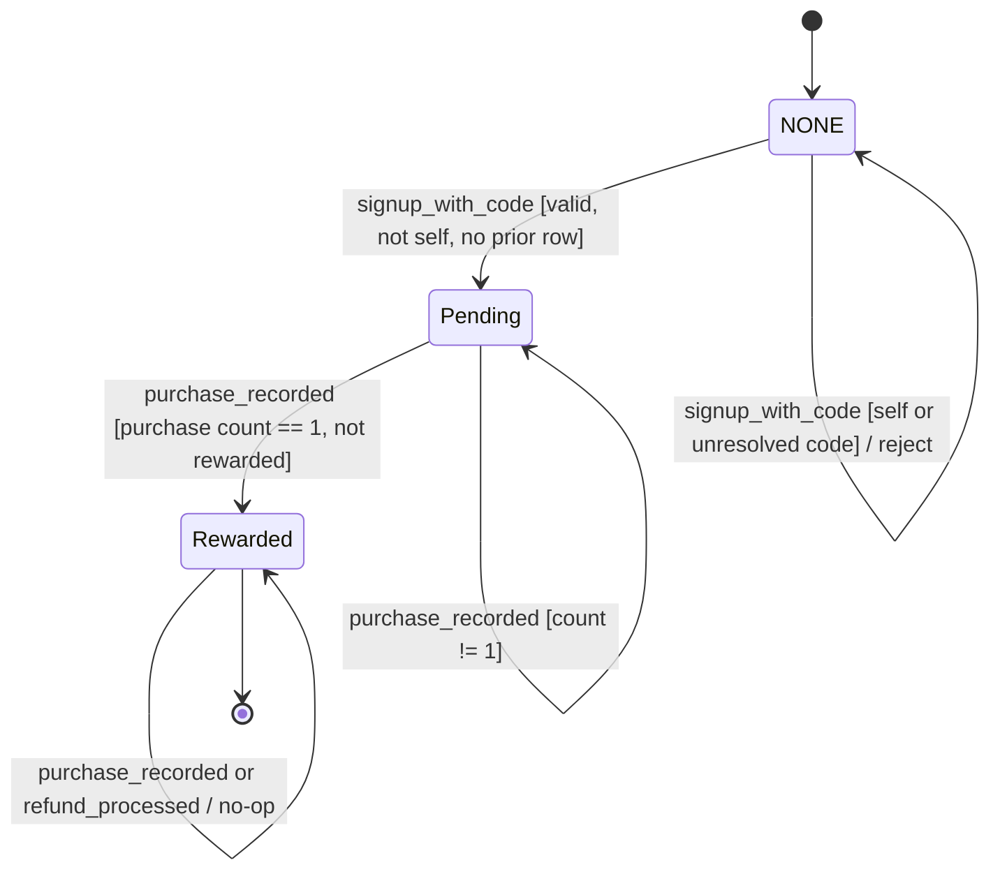
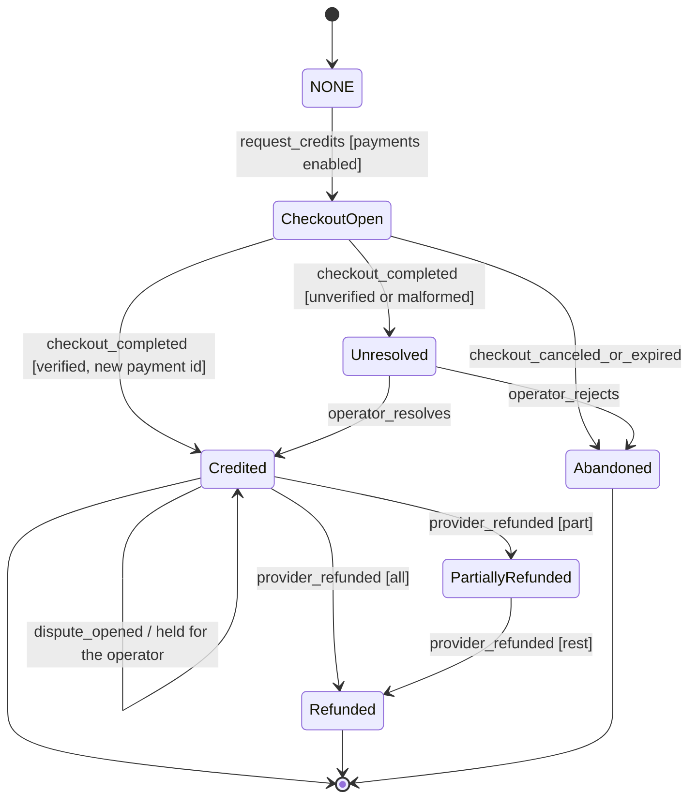
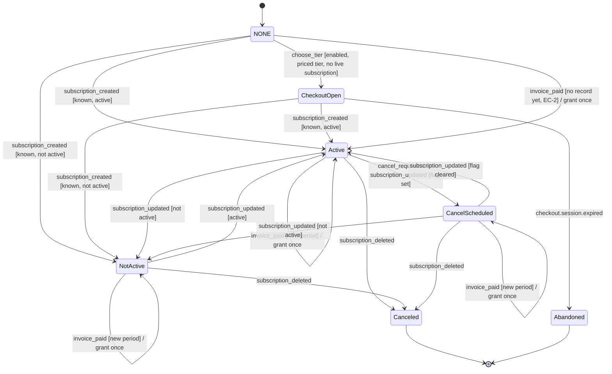

# Plan: 004-commerce

An agent wrote and finished this plan on 2026-11-04, under the owner's delegation, from spec.md, [the T001 record](T001_CONFIRMATION_2026-11-04.md) and the code on `main` at 007b437 (0.3.0-alpha.8). The owner has not read the spec or this plan, and approves both by merging the PR. Payments stay in test mode.

## Stack (as built)

- Backend: Python 3.11 (`backend/Dockerfile`; the CI test jobs run 3.11 and `backend-lint` runs 3.12), FastAPI, SQLAlchemy 2, Alembic migrations, Pydantic 2 (`backend/pyproject.toml`).
- Database: Postgres 15 (Neon in staging and production, a Postgres service in CI); unit tests use SQLite fixtures (`backend/tests/conftest.py`).
- Frontend: React 18, TypeScript, Vite, React Router (`frontend/package.json`).
- Edge: the Cloudflare Worker in `edge/api` fronts the API (spec 006).
- CI: `.github/workflows/ci.yml`, jobs `backend`, `migrations`, `acceptance`, `backend-lint`, `frontend` and `frontend-e2e`. `just spec-dag` runs the task DAG check.

## Architecture

- **Canonical ledger.** `canonical_credit_ledger` (`backend/canon/models.py`) is append-only, enforced by a Postgres trigger (#139). The entry types are `purchase`, `debit`, `reversal`, `grant` and `refund`. `GET /api/canon/credits/balance` is the balance spending uses (`backend/canon/routes.py`, `backend/canon/exports.py`).
- **Legacy tables.** `credits_ledger` holds the `Purchase` rows Machine A counts (`backend/monetization/models.py`). `credit_ledger_entries` and `account_referrals` serve the `/api/me` routes (`backend/account/models.py`); see D7 and D8a in the T001 record.
- **Webhook intake.** `receive_stripe_webhook` (`backend/canon/exports.py`) verifies the signature (constant-time HMAC over every `v1`, 300 s tolerance, livemode gate) and refuses what it cannot verify, storing nothing. `process_stripe_event` (`backend/canon/webhook_events.py`) then dispatches by type and gives every stored event a disposition: `processed`, `duplicate`, `unresolved` with a reason code, or `ignored`.
- **Machine B.** `backend/canon/checkout.py`: credit checkout behind `ENABLE_CREDIT_CHECKOUT` and `checkout_gate`, one provider customer per user, payments unique on the provider ids, refunds and disputes (OQ-2), and operator resolve (T048b).
- **Machine C.** `backend/canon/subscriptions.py`: subscription checkout behind `ENABLE_SUBSCRIPTION_CHECKOUT`, a record synced by `customer.subscription.*`, a period grant on `invoice.paid`, and cancel at period end. `backend/canon/entitlements.py` resolves the tier from the subscription and spends the STUDIO fair-use entitlement (T050).
- **Machine A.** `backend/monetization/referrals.py`: append-only referral rows. A reward comes only from a provider-verified first purchase (`record_purchase(payment_verified=True)`). Referral signup and the summaries sit behind `ENABLE_REFERRALS`.
- **Operator.** Admin reject and resolve for unresolved events (`backend/canon/webhook_events.py`, `backend/canon/checkout.py`), each with an audit record. Resolve is Machine B only.
- **Defaults.** `STRIPE_TEST_MODE=true`, `ALLOW_PRODUCTION_PAYMENTS=false`, both checkout flags off (`backend/core/config.py`). `validate_stripe_mode_startup_policy` refuses live mode outside production.

## What T001 settled

[The T001 record](T001_CONFIRMATION_2026-11-04.md) classifies every checklist claim and `[INFERRED]` line. An agent confirmed them under the owner's delegation, not the owner by reading them.

- Machine C grants on `invoice.paid`. The corrected table is below and in spec.md.
- Workflows: the governing skills and the CI reuse stand; the owners line is drift (D10).
- FR-008: this plan reads "the credits ledger" as the canonical ledger, and treats the other tables as drift (D5).

## Remaining work

In this order. Tasks stay open until their checks pass; nothing below activates payments.

1. **T010.** Finish the transitions tests against the corrected Machine C table, and update the "decided deviation" comment in `backend/tests/unit/test_spec_004_transitions.py`. Add a test for each behavior the record says only a probe covered: D3, the referral code that does not resolve (OQ-6), the first-event rows of Machine C, SC-006 and SC-007.
2. **T090.** Converge against the record's DRIFT list.
   - Code changes: D4 (a rejection closes the checkout), D5 (guards or retire the legacy tables), D6 (a guard on the referral code), D7 (`/api/me/credits`), D8a (the Account page's referral summary) and D8b (the frontend for buying, subscribing, cancelling and the STUDIO allowance).
   - Spec text: D1, D2, D3, D9, D10, D11 and D12.
3. **Owner and counsel.** The record's OPEN list, O1 to O12, each with a recommended default. O8 to O11 may add code to T090 once decided.
4. **T046 to T053.** The code exists and stays unticked. T046 needs an owner-confirmed OQ-1 (O1), T047, T048b, T049, T050 and T053 follow from T046, and T048 also waits on O9.
5. **T051.** Payment activation, last: it needs the adversarial review of the provider path and explicit owner authority.

Also still undefined: `data-model.md` and `contracts/README.md` are TODO stubs. No task names them; `docs/DATA_MODEL.md` and the code are the sources for now.

## Verification

- `cd backend && pytest tests/unit/test_spec_004_transitions.py -q`, which covers Machines A, B and C as the code reads them.
- `tests/unit/test_commerce_subscriptions.py`, `tests/unit/test_commerce_credit_checkout.py`, `tests/unit/test_commerce_operator_resolve.py`, `tests/unit/test_commerce_webhook_processor.py`, `tests/unit/test_commerce_purchase_refunds.py`.
- `cd backend && python -m pytest tests/acceptance -q`, which needs Postgres (CI job `acceptance`): append-only trigger, concurrent checkout, grant, refund and referral paths, and the refusing downgrades.
- `just spec-dag`.

## Carried forward from spec.md

The sections below are copied from [spec.md](spec.md) without change.

## Workflows

Status: INFERRED skeleton. Confirm before you plan.

- Governing workflows (skills): anti-slop-code, production-systems, google-developer-style.
- Owners: FORGE decomposes, a cloud agent implements, SCRIBE files the compact artifact, ADVERSARY reviews the threat model.
- CI: reuse `.github/workflows/ci.yml` (jobs `backend` and `frontend`). Do not add a new CI path.

## Stateful behavior

This spec defines three machines. Implementers treat each transitions table as the contract. A label in the `effect` cell marks the provenance of each row.

### Machine A: Referral (per referred user)

The effective state is derived from append-only rows. The state is `Rewarded` if any `Rewarded` row exists for the referred user. Otherwise, the state is `Pending` if a `Pending` row exists. Otherwise, the state is `NONE`. [OBSERVED: backend/monetization/referrals.py]

States:

- `NONE`. No referral exists. [OBSERVED: REFERRAL_IMPLEMENTATION.md]
- `Pending`. A referral is recorded, and the user has not been rewarded. [OBSERVED: REFERRAL_IMPLEMENTATION.md]
- `Rewarded`. The referrer has been rewarded once. [OBSERVED: REFERRAL_IMPLEMENTATION.md]

The initial state is `NONE`. The final state is `Rewarded`.

`Pending` can be permanently non-rewardable. This happens when the first purchase happened without triggering a reward, so the purchase count is already greater than 1. [INFERRED] See EC-3.

| from | event | guard | to | effect |
|---|---|---|---|---|
| NONE | signup_with_code | The code resolves to a user. The referrer is not the referred user. No `Pending` or `Rewarded` row exists. | Pending | Set `referred_by`. Append a `Pending` row. [OBSERVED: REFERRAL_IMPLEMENTATION.md] |
| NONE | signup_with_code | The referrer is the referred user. | NONE | Reject with an error. Write no row. [OBSERVED: backend/monetization/referrals.py] |
| NONE | signup_with_code | The code does not resolve. | NONE | Write no referral row. The signup outcome is unresolved. See OQ-6. [INFERRED] |
| Pending | purchase_recorded | The `Purchase` count is exactly 1. The referrer is not the referred user. No `Rewarded` row exists. | Rewarded | In one atomic unit, append a `Grant` of +3 to the referrer with `referral_id` and the note `Referral reward: <referred_user_id>`. Append a `Rewarded` row with `first_purchase_id` and `rewarded_at`. [OBSERVED: backend/monetization/referrals.py] Atomicity is [INFERRED]. |
| Pending | purchase_recorded | The `Purchase` count is not 1. | Pending | No reward. [OBSERVED: backend/monetization/referrals.py] |
| Pending | signup_with_code | Any. | Pending | Reject with "already recorded." [OBSERVED: backend/monetization/referrals.py] |
| Rewarded | purchase_recorded | Any. | Rewarded | No operation. [OBSERVED: backend/monetization/referrals.py] |
| Rewarded | refund_processed | Any. | Rewarded | No revocation. [OBSERVED: REFERRAL_IMPLEMENTATION.md] |
| Rewarded | signup_with_code | Any. | Rewarded | Reject with "already rewarded." [OBSERVED: backend/monetization/referrals.py] |

Illegal transitions:

- `Rewarded` to `Rewarded` with a second `Grant`. This is a double reward. [OBSERVED: REFERRAL_IMPLEMENTATION.md]
- `Pending` to `Rewarded` on a purchase that is not the first purchase. [OBSERVED: backend/monetization/referrals.py]
- `NONE` to `Pending` for a self-referral. [OBSERVED: REFERRAL_IMPLEMENTATION.md]
- `Rewarded` to `NONE` or `Rewarded` to `Pending` for any reason, including refund. [OBSERVED: REFERRAL_IMPLEMENTATION.md]
- Any update or delete of a referral row or a ledger entry. Both are append-only. [OBSERVED: REFERRAL_IMPLEMENTATION.md] The ledger rule is [INFERRED].
- A reward triggered by a client-submitted purchase that has no verified provider confirmation. [INFERRED]

### Machine B: One-time credit purchase (per checkout)

States:

- `NONE`. No checkout exists. [OBSERVED: STRIPE_INTEGRATION_PROMPT.md]
- `CheckoutOpen`. The provider session exists, and the user is at checkout. [OBSERVED: STRIPE_INTEGRATION_PROMPT.md]
- `Credited`. A payment record and a `Purchase` entry exist. [OBSERVED: STRIPE_INTEGRATION_PROMPT.md]
- `Abandoned`. The user canceled, or the session expired. [INFERRED] A cancel URL appears in STRIPE_INTEGRATION_PROMPT.md.
- `Unresolved`. A provider event could not be safely applied. [INFERRED] This follows constitution principle 9.
- `PartiallyRefunded` and `Refunded`. The provider refunded part or all of a credited payment. [OBSERVED: canon/checkout.py] Decided by OQ-2.

The initial state is `NONE`. The final states are `Credited` and `Abandoned`. `Unresolved` is not a final state. Only an operator action, defined in OQ-5, can exit it.

| from | event | guard | to | effect |
|---|---|---|---|---|
| NONE | request_credits | Payments are enabled. The user is signed in. The quantity is valid. | CheckoutOpen | Get or create the provider customer. Create a payment session that carries the user, the credit count, and the purchase type. [OBSERVED: STRIPE_INTEGRATION_PROMPT.md] |
| NONE | request_credits | Payments are disabled. | NONE | Refuse the request. Create no session. [INFERRED] |
| CheckoutOpen | checkout_completed | The event is verified. The user resolves. The payment identifier is present and unseen. | Credited | Append a payment record. Record the `Purchase` (+N) through the purchase-recording path, which evaluates Machine A. [OBSERVED: STRIPE_INTEGRATION_PROMPT.md] Routing through Machine A is [INFERRED]. See FR-028. |
| CheckoutOpen | checkout_completed | The event is unverified, the metadata is malformed, the user is unknown, or the payment identifier is missing. | Unresolved | Grant nothing. Retain the event for review. [INFERRED] |
| CheckoutOpen | checkout_canceled_or_expired | Any. | Abandoned | Write no ledger entry. [INFERRED] |
| Credited | checkout_completed | The payment identifier has already been processed. | Credited | No operation. This is idempotent. [OBSERVED: STRIPE_INTEGRATION_PROMPT.md] |
| Unresolved | operator_resolves | The operator verifies the identity and the payment. | Credited | Same effect as the verified completion. [INFERRED] |
| Unresolved | operator_rejects | Any. | Abandoned | Grant nothing. [INFERRED] |
| Credited or PartiallyRefunded | provider_refunded | The cumulative refunded amount is higher than any applied. | PartiallyRefunded, or Refunded when fully refunded | Append one `Refund` entry for `floor(credits * refunded / amount)` less earlier reversals, capped at the current balance. Any spent remainder is held as `Unresolved` for the operator. [OBSERVED: canon/checkout.py] Decided by OQ-2. |
| PartiallyRefunded or Refunded | provider_refunded | The cumulative amount was already applied. | Unchanged | No operation. This is idempotent. [OBSERVED: canon/checkout.py] Decided by OQ-2. |
| Credited | dispute_opened | Any. | Credited | No reversal. Hold the event as `Unresolved` for the operator. [OBSERVED: canon/checkout.py] Decided by OQ-2. |

Illegal transitions:

- `Credited` to `Credited` with a second `Purchase` for the same payment identifier. [OBSERVED: STRIPE_INTEGRATION_PROMPT.md]
- A refund reversal for a payment that was never credited, or one that takes a balance below zero. [OBSERVED: canon/checkout.py] Decided by OQ-2.
- `NONE` or `CheckoutOpen` to `Credited` without a verified provider confirmation, including through a client call. [INFERRED]
- `Abandoned` to `Credited`. A new checkout is required. [INFERRED]
- `Unresolved` to `Credited` without operator action. [INFERRED]

### Machine C: Subscription (per subscription)

Corrected 2026-11-04 at T001. The earlier table granted on `subscription_created`, `subscription_updated` and `period_renewed`. The code grants only on `invoice.paid`, once per billing period, and `customer.subscription.*` events only sync the record (`backend/canon/subscriptions.py`; T049 #219, T050 #224). That follows OQ-4 `A_stripe_mapping` and [research 2026-11-01](../../docs/evidence/COMMERCE_BLOCKERS_RESEARCH_2026-11-01.md) §3. An agent made this correction under the owner's delegation, and the owner accepts it by merging; see [the T001 record](T001_CONFIRMATION_2026-11-04.md). Rows marked OPEN state what the code does today. They are not settled.

The code stores the provider status, not these states. The states below map to it the same way as `_c_state` in `backend/tests/unit/test_spec_004_transitions.py`.

States:

- `NONE`. No subscription exists.
- `CheckoutOpen`. The subscription checkout session exists. This is a `SubscriptionCheckoutRecord` reservation, not a subscription record.
- `Active`. The provider status is `active`, and `cancel_at_period_end` is false.
- `CancelScheduled`. The provider status is `active`, and `cancel_at_period_end` is true.
- `NotActive`. The provider status is any other value except `canceled`, such as `past_due`.
- `Canceled`. The provider status is `canceled`.
- `Abandoned`. The user left checkout. The reservation expired, and no subscription record exists.
- `Unresolved`. The disposition of a stored event, not a state of the subscription record: the customer is unknown, the price maps to no tier, or the payload is malformed.

The initial state is `NONE`. The final states are `Canceled` and `Abandoned`. An event's `Unresolved` disposition exits only through operator action.

Every row below is [OBSERVED: backend/canon/subscriptions.py, backend/canon/checkout.py, backend/canon/webhook_events.py].

| from | event | guard | to | effect |
|---|---|---|---|---|
| NONE | choose_tier | `ENABLE_SUBSCRIPTION_CHECKOUT` and `checkout_gate` pass; the tier is CORE, PRO, or STUDIO and has a configured price; the user has no live subscription. | CheckoutOpen | Get or create the provider customer. Create a `subscription`-mode session for the tier's price. Write a reservation and no subscription record. A repeat for the same tier reuses the open session. |
| NONE | choose_tier | Disabled, invalid tier, no configured price (503 `SUBSCRIPTION_PRICE_MISSING`), a live subscription exists (409 `SUBSCRIPTION_EXISTS`), or another tier's session is open (409 `SUBSCRIPTION_CHECKOUT_OPEN`). | NONE | Refuse the request. |
| CheckoutOpen | checkout_canceled_or_expired (`checkout.session.expired`) | The session has an open reservation. | Abandoned | Mark the reservation expired. Write no subscription record. |
| NONE, CheckoutOpen | subscription_created (`customer.subscription.created`), or subscription_updated with no record yet (EC-2) | Verified. The customer is known. One item whose price maps to a tier. A provider status. | The state the status and flag map to | Record the subscription (tier from the provider price, status, period, cancel flag). Grant nothing. |
| Active, NotActive, CancelScheduled | subscription_updated | Newer than the last applied event, and something changed. | Active, CancelScheduled or NotActive, from the new status and flag | Sync the fields. The tier always comes from the provider price (OQ-7). Grant nothing. |
| Active, NotActive, CancelScheduled | subscription_updated | Older than the last applied event, or nothing changed. | Unchanged | `duplicate` (`STALE_EVENT`, `SUBSCRIPTION_UNCHANGED`). |
| NONE, Active, NotActive, CancelScheduled | invoice_paid (`invoice.paid`) | Verified. The invoice is `paid` and `amount_paid > 0`. A non-proration line whose price maps to a tier. The customer matches. The period `subscription-period:<subscription_id>:<period_start>` has no grant. | Unchanged. A missing record is created as `active` (EC-2). | Grant once for the period. CORE and PRO get a canonical `grant` of the tier's credits. STUDIO gets the unlimited entitlement with the fair-use cap, and no credits (FR-004, OQ-8). The subscription's first paid invoice also records a purchase for Machine A (FR-028, OQ-3). |
| Canceled | invoice_paid | The same guard as the row above. | Canceled | OPEN. Today it grants once and the record stays `canceled`. No test covers this. |
| any | invoice_paid | The period was already granted. | Unchanged | `duplicate` (`PERIOD_ALREADY_GRANTED`). Grant nothing. |
| any | invoice_paid | The invoice has only proration lines. | Unchanged | `ignored` (`INVOICE_PRORATION_ONLY`). The new tier's credits come with the next period (OQ-7). |
| any | invoice_paid | Not paid, a zero amount, no subscription, unknown customer or price, the same invoice already granted for another period, or a malformed payload. | Unresolved | Grant nothing. Keep the event with its reason code. |
| CheckoutOpen, Active, NotActive, CancelScheduled | subscription_created or subscription_updated | Unknown customer, a price that maps to no tier, not exactly one item, a malformed period, a customer mismatch, or an unknown status. | Unresolved | Grant nothing. Keep the event with its reason code. |
| Active | cancel_requested | `ENABLE_SUBSCRIPTION_CHECKOUT` and `checkout_gate` pass. The user's newest live subscription, with provider status exactly `active`. | CancelScheduled | Set cancel-at-period-end at the provider and locally. Refused: 404 `SUBSCRIPTION_NOT_FOUND` when there is none. OPEN: 409 `SUBSCRIPTION_NOT_ACTIVE` for any other status, and 403 `PAYMENTS_DISABLED` with the flag off. |
| NONE, Active, NotActive, CancelScheduled | subscription_deleted | Verified. The customer matches. With no record yet, the price must also map to a tier. | Canceled | Set the status to `canceled`. Keep the granted credits. |
| Canceled | subscription_created, subscription_updated or subscription_deleted | The customer matches. | Canceled | `duplicate` (`SUBSCRIPTION_ALREADY_CANCELED`). |
| Unresolved | operator_rejects | An admin, with a reason (OQ-5, T048). | Unresolved, closed as rejected | Grant nothing. Write one admin audit record. |
| Unresolved | operator_resolves | Any. | Unchanged | Refused with 409 `RESOLVE_NOT_SUPPORTED`, so an operator can only reject. OPEN whether to build resolve. |

An event whose signature does not verify is refused at intake, before any handler runs. Such an event is never stored and never becomes `Unresolved`. `invoice.payment_failed` has no handler, so it is stored as `ignored`; `past_due` arrives through `customer.subscription.updated`. A `subscription`-mode `checkout.session.completed` marks the reservation completed and grants nothing. A reservation also stops blocking a new checkout once its `expires_at` passes. Entitlement by status (OQ-4): `active`, `trialing` and `past_due` keep the paid tier; every other status resolves to FREE (`ENTITLED_STATUSES`).

Illegal transitions:

- A second grant for the same subscription and billing period.
- `Canceled` to any other state through a `customer.subscription.*` event. Resubscribing starts a new subscription from `NONE`.
- Any grant for an unknown tier or an unknown customer.
- A tier change derived from client input instead of the provider price.

