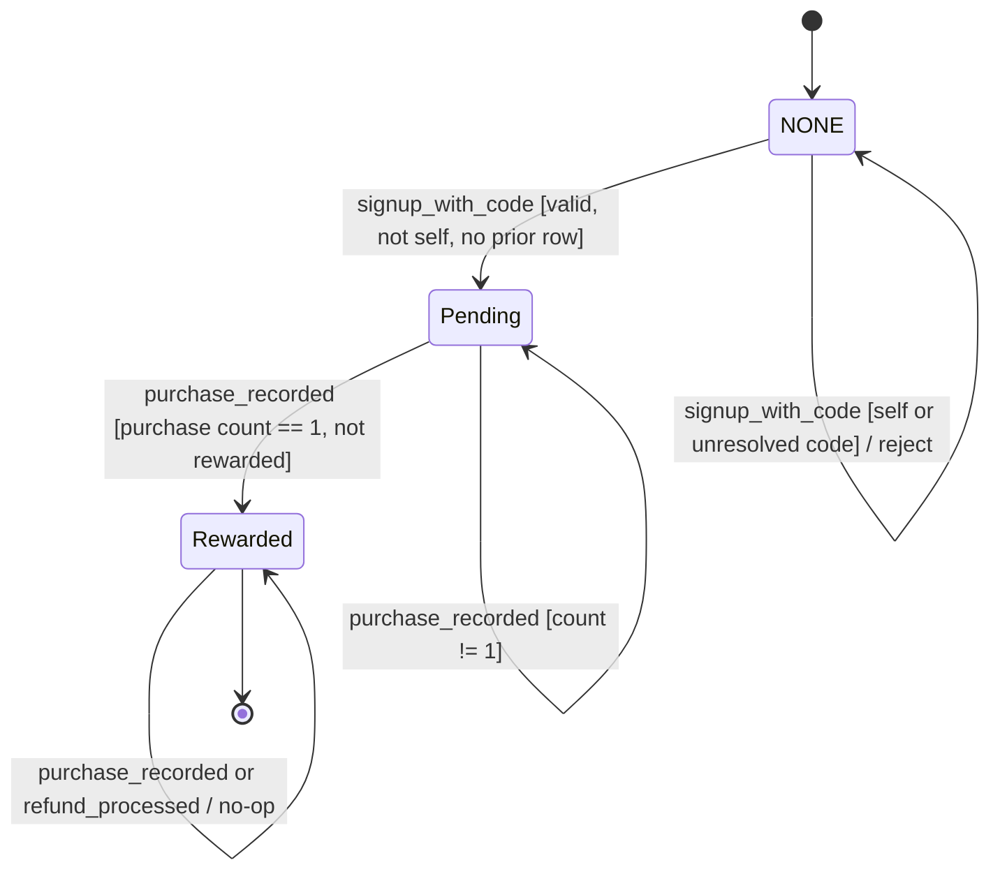
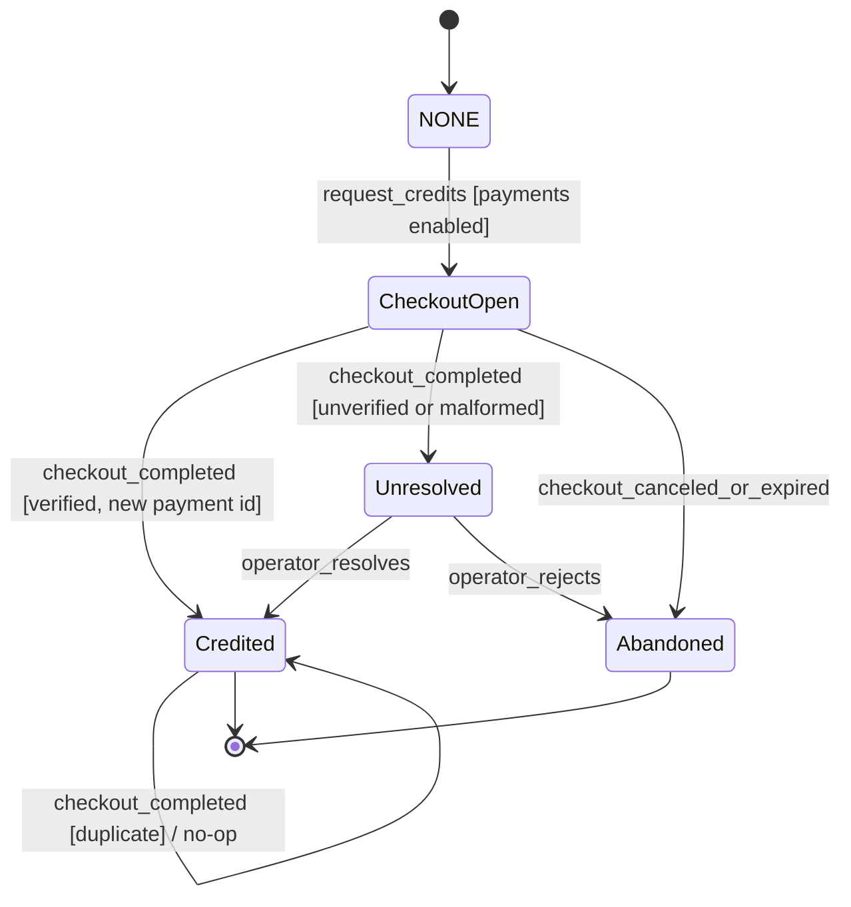
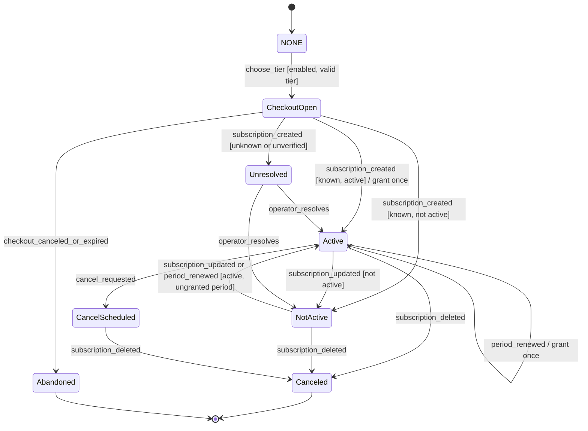

# 004: Commerce: tiers, credits, referrals

Status: DRAFT (2026-10-16). Filled by Opus 5.5 via OpenRouter from the repo docs and code listed under Sources. Each claim is labeled `[OBSERVED: <file>]` or `[INFERRED]`. The operator must confirm every `[INFERRED]` item before planning.

- **[OBSERVED: <file>]** means a source states the item.
- **[INFERRED]** means the item is derived from the sources or the constitution. The operator must confirm it.

No requirement is confirmed until the operator signs off. Prices, tier quantities, and legal or tax status come from an implementation prompt, not from a ratified pricing decision. See [Open questions](#open-questions).

## Sources

- `STRIPE_INTEGRATION_PROMPT.md`. This is an implementation prompt. It describes intended behavior, not verified shipped behavior. The excerpt was truncated at `cancel_subscription`.
- `REFERRAL_IMPLEMENTATION.md`. This file states the referral canon rules.
- `backend/monetization/`. The retained files are `routes.py` and `referrals.py`. The prompt proposes `stripe_models.py` and `stripe_service.py`, but neither is retained.
- `docs/SECURITY.md`. Its contents were not provided when this spec was drafted. It now exists; see OQ-10.

## Summary

PatchHive sells access tiers and credits through a payment provider. The sources name Stripe as that provider. A PatchBook export spends credits. Users can buy credits once or subscribe to a tier that grants credits each billing period. A referrer earns a one-time credit reward when a referred user makes a first paid purchase. All credit changes are recorded in an append-only ledger.

Why: monetization funds the product. Commerce must not leak into canon. Tier, credit, and referral state never change what PatchHive generates, shows, or lets a user explore. The constitution sets three rules for this boundary:

- Canon is deterministic.
- Evidence is not canon.
- Commerce fails closed at trust boundaries.

## Implementation status (2026-10-29)

Checked against `main` at `95ca9ee`. Paths are under `backend/` unless shown otherwise. Totals: 15 Implemented, 10 Partial, 11 Missing. Gaps map to [research.md](research.md) and the Gap closure tasks in [tasks.md](tasks.md).

| FR | Status | Evidence |
|---|---|---|
| FR-001 | Partial | Tier names and Design Engine family floors exist; every user resolves to one configured default tier, not their own (`canon/entitlements.py`). T050. |
| FR-002 | Partial | Signup writes no ledger entry (`community/auth_routes.py`). "Demo mode only" is not defined, and the default tier is `core`. |
| FR-003 | Missing | No per-period grant. T049. |
| FR-004 | Missing | No STUDIO entitlement of any kind. T049. |
| FR-005 | Implemented | Server-set price `patchbook_export_cost = 3` (`core/config.py`, `canon/routes.py`); 503 `EXPORT_FULFILLMENT_UNAVAILABLE` before any debit (#129). |
| FR-006 | Missing | No one-time checkout. T046. |
| FR-007 | Partial | Legacy `credits_ledger` uses `Purchase`, `Spend`, `Grant`; the canonical ledger uses `grant`, `debit`, `reversal`, with no `purchase` type (`canon/exports.py`). T046. |
| FR-008 | Partial | Code only inserts; no trigger or guard (`canon/models.py`). T042. |
| FR-009 | Partial | `/api/canon/credits/balance` sums the canonical ledger; the legacy `/api/monetization/credits/balance` sums another ledger and disagrees. T044. |
| FR-010 | Implemented | No expiry field or logic in either ledger (`canon/models.py`, `monetization/models.py`). |
| FR-011 | Missing | Webhook stores events as `received` and never processes them (`canon/routes.py`). T045, T046. |
| FR-012 | Partial | Event-id replay safety and payload-hash conflict (`canon/exports.py`); no payment-id idempotency; a concurrent duplicate returns 500. T040, T046. |
| FR-013 | Partial | Constant-time HMAC, 300 s tolerance, livemode gate (`canon/exports.py`); only the last `v1` is kept; live-mode events pass outside production with `STRIPE_TEST_MODE=false`. T040, T041. |
| FR-014 | Missing | No unresolved state; `processed_at` is never set. T045. |
| FR-015 | Missing | No subscription record. T049. |
| FR-016 | Missing | No subscription grants. T049. |
| FR-017 | Missing | No cancel route. T049. |
| FR-018 | Missing | No subscription-deleted handling. T049. |
| FR-019 | Implemented | `stripe_test_mode = True`, `allow_production_payments = False` by default (`core/config.py`); production webhook 403 `PRODUCTION_PAYMENTS_DISABLED` and the startup payment policy (`canon/routes.py`). |
| FR-020 | Missing | No provider customer link. T046. |
| FR-021 | Partial | `users.referral_code` is unique and random, and `ensure_referral_code` sets it only when empty (`community/models.py`, `account/services.py`); nothing at the database blocks a change. |
| FR-022 | Implemented | `/signup?ref=<code>` (`monetization/referrals.py`). |
| FR-023 | Implemented | Behind `enable_referrals` (`community/auth_routes.py`). |
| FR-024 | Implemented | `create_referral` and `apply_referral_reward` (`monetization/referrals.py`). |
| FR-025 | Implemented | `create_referral` rejects pending and rewarded users (`monetization/referrals.py`). |
| FR-026 | Implemented | 3-credit `Grant` with the note and `referral_id`; the spendable canonical copy only for a provider-verified purchase (#131). |
| FR-027 | Implemented | `purchase_count != 1` returns no reward (`monetization/referrals.py`). |
| FR-028 | Missing | No provider caller of `record_purchase(payment_verified=True)`. T046, T047. |
| FR-029 | Partial | Code appends a `Rewarded` row and never edits `Pending`; no database guard (`alembic/versions/20240921_make_referrals_append_only.py` drops the unique pair only). |
| FR-030 | Implemented | No refund path exists, so nothing revokes a reward. |
| FR-031 | Implemented | `get_referral_summary` behind the flag (`community/routes.py`); `earned_credits` reads the legacy ledger (research R6, T044). |
| FR-032 | Implemented | Row lock on the `Pending` row plus `uq_referrals_one_reward` (#98). |
| FR-033 | Implemented | The legacy `POST /api/monetization/purchases` route and `PurchaseCreate` are deleted; no client can record a purchase (T043). |
| FR-034 | Implemented | No generation module imports `monetization` or `canon.entitlements` (repo grep of `patchhive/`, `intelligence/`, `runs/`). |
| FR-035 | Implemented | The tier is read only at export, to choose a template family (`canon/routes.py`); it is not a generation input. |
| FR-036 | Implemented | Codes come from `secrets.token_urlsafe`, not the email (`monetization/referrals.py`, `account/services.py`). |

## Scope

In scope:

- Tier catalog: FREE, CORE, PRO, and STUDIO. [OBSERVED: STRIPE_INTEGRATION_PROMPT.md]
- One-time credit purchases. [OBSERVED: STRIPE_INTEGRATION_PROMPT.md]
- Subscription lifecycle: checkout, activation, updates, cancellation at period end, and deletion. [OBSERVED: STRIPE_INTEGRATION_PROMPT.md]
- The credits ledger and balance reads. [OBSERVED: backend/monetization/routes.py]
- The referral program: codes, the pending state, the reward, and the summary. [OBSERVED: REFERRAL_IMPLEMENTATION.md, backend/monetization/referrals.py]
- Feature flags that disable payments and legacy referrals. [OBSERVED: STRIPE_INTEGRATION_PROMPT.md, backend/monetization/routes.py]

## Non-goals

- Commerce does not influence patch generation, patch visibility, or exploration. [OBSERVED: REFERRAL_IMPLEMENTATION.md] This spec extends that rule from referrals to tiers and credits. [INFERRED]
- Credits do not expire, and no expiry logic exists. [OBSERVED: REFERRAL_IMPLEMENTATION.md]
- Refunds never revoke referral rewards. [OBSERVED: REFERRAL_IMPLEMENTATION.md]
- This spec does not define the refund, chargeback, or dispute flow for purchases. That flow is NOT_COMPUTABLE. See [Open questions](#open-questions). [INFERRED]
- This spec does not define tax, invoicing, regional pricing, or legal terms. These are NOT_COMPUTABLE. [INFERRED]
- This spec does not choose a technology stack. The plan holds that decision. [INFERRED]

## User stories

### P1: Buy credits once [OBSERVED: STRIPE_INTEGRATION_PROMPT.md]

As a signed-in user, I want to buy a block of credits so that I can export PatchBooks without subscribing.

Acceptance criteria:

1. **Given** payments are enabled and I am signed in, **when** I request N credits, **then** I am sent to a provider checkout page for that amount. [OBSERVED: STRIPE_INTEGRATION_PROMPT.md]
2. **Given** the provider confirms that my checkout completed, **when** PatchHive processes the confirmation, **then** it appends one `Purchase` ledger entry of +N credits and one payment record. [OBSERVED: STRIPE_INTEGRATION_PROMPT.md]
3. **Given** the same completion confirmation arrives twice, **when** PatchHive processes the second one, **then** it does not credit me again. [OBSERVED: STRIPE_INTEGRATION_PROMPT.md]
4. **Given** I cancel at the provider checkout page, **when** I return to PatchHive, **then** my balance is unchanged and the ledger has no new entry. [INFERRED]
5. **Given** a completion confirmation fails authenticity checks or lacks a resolvable user, **when** PatchHive processes it, **then** it grants no credits and records an explicit unresolved state. [INFERRED]

### P2: Subscribe to a tier [OBSERVED: STRIPE_INTEGRATION_PROMPT.md]

As a user, I want to subscribe to CORE, PRO, or STUDIO so that I receive credits each billing period.

Acceptance criteria:

1. **Given** payments are enabled, **when** I choose a paid tier, **then** I am sent to a provider subscription checkout page for that tier. [OBSERVED: STRIPE_INTEGRATION_PROMPT.md]
2. **Given** the provider reports that my subscription is active for a known tier, **when** PatchHive processes the report, **then** it records the tier, the status, and the period boundaries, and it grants that tier's credits for the period. [OBSERVED: STRIPE_INTEGRATION_PROMPT.md]
3. **Given** my subscription is active and the provider sends an update within the same billing period, **when** PatchHive processes the update, **then** it syncs status and period fields and grants no additional credits. [INFERRED] This criterion corrects observed behavior. See FR-016.
4. **Given** the provider reports a price that maps to no known tier, or a customer that maps to no user, **when** PatchHive processes the report, **then** it grants no credits and records an explicit unresolved state. [INFERRED] The observed code silently ignores these cases.

### P3: Earn a referral reward [OBSERVED: REFERRAL_IMPLEMENTATION.md]

As a referrer, I want 3 credits when someone I referred makes a first paid purchase.

Acceptance criteria:

1. **Given** I have a referral code, **when** a new user signs up with my link, **then** PatchHive stores me as the new user's referrer and appends a `Pending` referral row. [OBSERVED: REFERRAL_IMPLEMENTATION.md]
2. **Given** a referred user has a `Pending` referral, **when** their first paid purchase is recorded, **then** PatchHive appends a `Grant` of 3 credits to my ledger and a `Rewarded` referral row. The `Grant` has the note `Referral reward: <referred_user_id>`. [OBSERVED: REFERRAL_IMPLEMENTATION.md, backend/monetization/referrals.py]
3. **Given** the referred user has already been rewarded for, **when** they make another purchase, **then** I receive nothing more. [OBSERVED: backend/monetization/referrals.py]
4. **Given** I try to use my own code, **when** the referral is created, **then** PatchHive rejects it. [OBSERVED: REFERRAL_IMPLEMENTATION.md, backend/monetization/referrals.py]
5. **Given** the referred user's first purchase is later refunded, **when** the refund is processed, **then** my reward stays in my balance. [OBSERVED: REFERRAL_IMPLEMENTATION.md]
6. **Given** a referred user completes a first paid purchase through the payment provider, **when** PatchHive processes it, **then** it evaluates the referral reward through the same path as every other purchase. [INFERRED] The observed provider path bypasses referral evaluation. See FR-028.

### P4: See my balance and referral status [OBSERVED: backend/monetization/routes.py, backend/monetization/referrals.py]

As a user, I want to see my credit balance and my referral activity.

Acceptance criteria:

1. **Given** I am signed in, **when** I request my balance, **then** I see my current credits balance. [OBSERVED: backend/monetization/routes.py]
2. **Given** I am signed in, **when** I open my referral summary, **then** I see the following. [OBSERVED: backend/monetization/referrals.py]
   - My code and my `/signup?ref=<code>` link.
   - Pending referrals, excluding any referred user who is already rewarded.
   - Rewarded referrals.
   - My total credits earned from referrals.

### P5: Cancel my subscription [OBSERVED: STRIPE_INTEGRATION_PROMPT.md]

As a subscriber, I want to cancel so that I am not billed again, and I want to keep access until the period ends.

Acceptance criteria:

1. **Given** I have an active subscription, **when** I cancel, **then** PatchHive flags the subscription to end at the period end. [OBSERVED: STRIPE_INTEGRATION_PROMPT.md]
2. **Given** the provider reports that the subscription is deleted, **when** PatchHive processes the report, **then** the subscription status becomes `canceled`. [OBSERVED: STRIPE_INTEGRATION_PROMPT.md]
3. **Given** my subscription is canceled, **when** I check my balance, **then** previously granted credits remain. [INFERRED] Credits do not expire, per REFERRAL_IMPLEMENTATION.md.

### P6: The operator disables commerce safely [INFERRED]

As the operator, I want to turn off payments or legacy referrals without corrupting the ledger.

Acceptance criteria:

1. **Given** payments are disabled, which is the default, **when** a user tries to check out, **then** PatchHive refuses the request and creates no provider session. [INFERRED] The source sets `stripe_enabled` to default false, per STRIPE_INTEGRATION_PROMPT.md.
2. **Given** legacy referrals are disabled, **when** a client calls the purchase-recording endpoint, **then** PatchHive responds "not enabled" and writes nothing. [OBSERVED: backend/monetization/routes.py]
3. **Given** either flag is turned off, **when** a user reads their balance, **then** the existing ledger is unchanged and readable. [INFERRED]

## Functional requirements

### Tiers and pricing

- **FR-001** PatchHive offers four tiers: FREE, CORE, PRO, and STUDIO. [OBSERVED: STRIPE_INTEGRATION_PROMPT.md]
- **FR-002** FREE is demo mode only and grants 0 credits on signup. [OBSERVED: STRIPE_INTEGRATION_PROMPT.md]
- **FR-003** Each paid tier grants credits per billing period. The source lists CORE at 25 credits each month and PRO at 100 credits each month. It lists STUDIO as unlimited. [OBSERVED: STRIPE_INTEGRATION_PROMPT.md] The source also lists prices of $4.99, $14.99, and $29.99. These prices are unconfirmed. See OQ-1.
- **FR-004** PatchHive represents unlimited credits as an explicit unlimited entitlement. It must not use a large numeric sentinel. [INFERRED] The observed code uses `999999`, per STRIPE_INTEGRATION_PROMPT.md.
- **FR-005** A PatchBook export costs 3 credits. [OBSERVED: STRIPE_INTEGRATION_PROMPT.md] Implemented 2026-10-29 (#129): the server sets the price (`patchbook_export_cost`) and ignores a client cost, and an export that nothing will fulfill is refused with 503 `EXPORT_FULFILLMENT_UNAVAILABLE` before any debit.
- **FR-006** A one-time purchase charges according to a published per-credit rule. The source specifies $0.20 per credit with a $5.00 minimum charge. [OBSERVED: STRIPE_INTEGRATION_PROMPT.md] This rule is unconfirmed. See OQ-1.

### Ledger

- **FR-007** The credits ledger supports these change types: `Purchase`, `Spend`, `Grant`, and `Refund`. [OBSERVED: STRIPE_INTEGRATION_PROMPT.md]
- **FR-008** The credits ledger is append-only. PatchHive never updates or deletes an entry. Corrections are new entries. [INFERRED] This follows the skeleton summary and the append-only referral rule in REFERRAL_IMPLEMENTATION.md.
- **FR-009** A user can read their own credits balance. [OBSERVED: backend/monetization/routes.py] The balance is derived only from that user's ledger entries. [INFERRED]
- **FR-010** Credits do not expire. [OBSERVED: REFERRAL_IMPLEMENTATION.md]

### Payments

- **FR-011** PatchHive credits a one-time purchase only after the payment provider confirms that checkout completed. [OBSERVED: STRIPE_INTEGRATION_PROMPT.md]
- **FR-012** Payment processing is idempotent for each provider payment identifier. A repeated confirmation never produces a second credit. [OBSERVED: STRIPE_INTEGRATION_PROMPT.md]
- **FR-013** PatchHive verifies the authenticity of every provider event before acting on it. It rejects events it cannot verify. [INFERRED] A webhook secret setting appears in STRIPE_INTEGRATION_PROMPT.md, but the verification step is not in the retained excerpt.
- **FR-014** PatchHive fails closed on provider events in these cases. It grants no credits and records an explicit unresolved state for operator review. [INFERRED] The constitution principle 9 requires fail-closed behavior. The observed code returns silently, per STRIPE_INTEGRATION_PROMPT.md.
  - The customer is unknown.
  - The price maps to no tier.
  - The user metadata is missing or malformed.
  - The payment identifier is missing.
- **FR-015** For each subscription, PatchHive records the tier, the provider status, the period start and end, and the cancel-at-period-end flag. [OBSERVED: STRIPE_INTEGRATION_PROMPT.md]
- **FR-016** PatchHive grants subscription credits exactly once per subscription billing period. Status or metadata updates within a period grant nothing. [INFERRED] The observed code grants credits on every "created" or "updated" event while the status is `active`, per STRIPE_INTEGRATION_PROMPT.md.
- **FR-017** A user can cancel a subscription. Cancellation takes effect at the period end. [OBSERVED: STRIPE_INTEGRATION_PROMPT.md]
- **FR-018** When the provider reports that a subscription is deleted, PatchHive marks the subscription `canceled`. [OBSERVED: STRIPE_INTEGRATION_PROMPT.md]
- **FR-019** Payments are disabled by default. They are active only when the operator enables them. [OBSERVED: STRIPE_INTEGRATION_PROMPT.md]
- **FR-020** Each user maps to at most one provider customer. [OBSERVED: STRIPE_INTEGRATION_PROMPT.md]

### Referrals

- **FR-021** Each user has a unique referral code that is immutable once created. [OBSERVED: REFERRAL_IMPLEMENTATION.md]
- **FR-022** The referral link format is `/signup?ref=<referral_code>`. [OBSERVED: backend/monetization/referrals.py]
- **FR-023** Signup with a valid code stores `referred_by` on the new user and appends a `Pending` referral row. [OBSERVED: REFERRAL_IMPLEMENTATION.md]
- **FR-024** PatchHive rejects self-referral both when it creates a referral and when it evaluates a reward. [OBSERVED: REFERRAL_IMPLEMENTATION.md, backend/monetization/referrals.py]
- **FR-025** A referred user has at most one `Pending` row. PatchHive rejects a new referral for a user who is already pending or already rewarded. [OBSERVED: backend/monetization/referrals.py]
- **FR-026** The reward is 3 credits. PatchHive appends it to the referrer's ledger as a `Grant` with the following properties. [OBSERVED: REFERRAL_IMPLEMENTATION.md, backend/monetization/referrals.py]
  - The note is `Referral reward: <referred_user_id>`.
  - The entry links to the referral.

  Implemented 2026-10-29 (#131): the spendable copy in the canonical ledger is written once per referral, and only for a provider-verified purchase (`payment_verified`). A self-reported purchase never earns spendable credit.
- **FR-027** The reward fires only when the referred user's `Purchase` ledger count equals exactly 1, a `Pending` row exists, and no `Rewarded` row exists. [OBSERVED: backend/monetization/referrals.py]
- **FR-028** Every provider-confirmed paid purchase, both one-time and subscription, goes through the single purchase-recording path that evaluates referral eligibility. [INFERRED] The observed one-time provider path writes `Purchase` directly and skips referral evaluation. The observed subscription path writes `Grant`, not `Purchase`. Both behaviors appear in STRIPE_INTEGRATION_PROMPT.md. Whether a subscription payment counts as a "paid purchase" is unresolved. See OQ-3.
- **FR-029** Referral rows are append-only. A reward appends a `Rewarded` row with `first_purchase_id` and `rewarded_at`. PatchHive never modifies the `Pending` row. [OBSERVED: REFERRAL_IMPLEMENTATION.md, backend/monetization/referrals.py]
- **FR-030** Refunds never revoke referral rewards. [OBSERVED: REFERRAL_IMPLEMENTATION.md]
- **FR-031** The referral summary returns the following. [OBSERVED: backend/monetization/referrals.py]
  - The code and the link.
  - Pending referrals, excluding referred users who are already rewarded.
  - Rewarded referrals.
  - The total of the user's `Grant` entries that link to a referral.
- **FR-032** The `Purchase` entry and its referral evaluation commit atomically. Concurrent purchases by one referred user produce at most one reward. [INFERRED] Implemented 2026-10-28 (#98): the `Pending` row is locked, and the partial unique index `uq_referrals_one_reward` is the backstop.

### Trust boundary

- **FR-033** Only server-side confirmation from a verified payment provider can create a `Purchase` ledger entry. A client-submitted purchase must not mint credits or trigger rewards. [INFERRED] In the observed code, the legacy `/purchases` endpoint accepts an authenticated user's own `credits_delta`. A feature flag gates that endpoint, per backend/monetization/routes.py. ADVERSARY must review this endpoint.
- **FR-034** Referral logic never affects generation, patch visibility, or exploration. [OBSERVED: REFERRAL_IMPLEMENTATION.md]
- **FR-035** Tier and credit state may gate whether a user can perform an action, such as an export. That state is never an input to canonical generation, so output for fixed canonical inputs stays identical across tiers. [INFERRED] This follows constitution principle 1.
- **FR-036** A referral code must not let anyone recover or confirm a user's email address. [INFERRED] The observed code derives the code from a truncated hash of the username and email, per backend/monetization/referrals.py. ADVERSARY must review this derivation. Update 2026-10-29: codes are now random (`secrets.token_urlsafe`), so they carry no email [OBSERVED: monetization/referrals.py, account/services.py]. Codes issued before that change were not checked.

## Key entities

- **User**. Holds a referral code, which is unique and immutable, and an optional referrer. [OBSERVED: REFERRAL_IMPLEMENTATION.md]
- **Credits ledger entry**. An append-only record of a credit change. It holds the user, the change type, the signed delta, a note, and an optional referral link. [OBSERVED: STRIPE_INTEGRATION_PROMPT.md, backend/monetization/referrals.py]
- **Referral event**. An append-only record that holds the referrer, the referred user, the status (`Pending` or `Rewarded`), the first purchase, and the reward time. [OBSERVED: REFERRAL_IMPLEMENTATION.md]
- **Tier**. FREE, CORE, PRO, or STUDIO, with a per-period credit entitlement. [OBSERVED: STRIPE_INTEGRATION_PROMPT.md]
- **Provider customer link**. Maps one user to one payment-provider customer. [OBSERVED: STRIPE_INTEGRATION_PROMPT.md]
- **Subscription record**. Holds the tier, the provider status, the period boundaries, and the cancel-at-period-end flag. [OBSERVED: STRIPE_INTEGRATION_PROMPT.md]
- **Payment record**. A one-time payment keyed by the provider payment identifier. It holds the amount, the currency, the status, and the credits granted. [OBSERVED: STRIPE_INTEGRATION_PROMPT.md]
- **Unresolved commerce event**. A provider event that PatchHive could not safely apply, held for operator review. [INFERRED]

## Workflows

Status: INFERRED skeleton. Confirm before you plan.

- Governing workflows (skills): anti-slop-code, production-systems, google-developer-style.
- Owners: FORGE decomposes, a cloud agent implements, SCRIBE files the compact artifact, ADVERSARY reviews the threat model.
- CI: reuse `.github/workflows/ci.yml` (jobs `backend` and `frontend`). Do not add a new CI path.

## Stateful behavior

This spec defines three machines. Implementers treat each transitions table as the contract. A label in the `effect` cell marks the provenance of each row.

### Machine A: Referral (per referred user)

The effective state is derived from append-only rows. The state is `Rewarded` if any `Rewarded` row exists for the referred user. Otherwise, the state is `Pending` if a `Pending` row exists. Otherwise, the state is `NONE`. [OBSERVED: backend/monetization/referrals.py]

States:

- `NONE`. No referral exists. [OBSERVED: REFERRAL_IMPLEMENTATION.md]
- `Pending`. A referral is recorded, and the user has not been rewarded. [OBSERVED: REFERRAL_IMPLEMENTATION.md]
- `Rewarded`. The referrer has been rewarded once. [OBSERVED: REFERRAL_IMPLEMENTATION.md]

The initial state is `NONE`. The final state is `Rewarded`.

`Pending` can be permanently non-rewardable. This happens when the first purchase happened without triggering a reward, so the purchase count is already greater than 1. [INFERRED] See EC-3.

| from | event | guard | to | effect |
|---|---|---|---|---|
| NONE | signup_with_code | The code resolves to a user. The referrer is not the referred user. No `Pending` or `Rewarded` row exists. | Pending | Set `referred_by`. Append a `Pending` row. [OBSERVED: REFERRAL_IMPLEMENTATION.md] |
| NONE | signup_with_code | The referrer is the referred user. | NONE | Reject with an error. Write no row. [OBSERVED: backend/monetization/referrals.py] |
| NONE | signup_with_code | The code does not resolve. | NONE | Write no referral row. The signup outcome is unresolved. See OQ-6. [INFERRED] |
| Pending | purchase_recorded | The `Purchase` count is exactly 1. The referrer is not the referred user. No `Rewarded` row exists. | Rewarded | In one atomic unit, append a `Grant` of +3 to the referrer with `referral_id` and the note `Referral reward: <referred_user_id>`. Append a `Rewarded` row with `first_purchase_id` and `rewarded_at`. [OBSERVED: backend/monetization/referrals.py] Atomicity is [INFERRED]. |
| Pending | purchase_recorded | The `Purchase` count is not 1. | Pending | No reward. [OBSERVED: backend/monetization/referrals.py] |
| Pending | signup_with_code | Any. | Pending | Reject with "already recorded." [OBSERVED: backend/monetization/referrals.py] |
| Rewarded | purchase_recorded | Any. | Rewarded | No operation. [OBSERVED: backend/monetization/referrals.py] |
| Rewarded | refund_processed | Any. | Rewarded | No revocation. [OBSERVED: REFERRAL_IMPLEMENTATION.md] |
| Rewarded | signup_with_code | Any. | Rewarded | Reject with "already rewarded." [OBSERVED: backend/monetization/referrals.py] |

Illegal transitions:

- `Rewarded` to `Rewarded` with a second `Grant`. This is a double reward. [OBSERVED: REFERRAL_IMPLEMENTATION.md]
- `Pending` to `Rewarded` on a purchase that is not the first purchase. [OBSERVED: backend/monetization/referrals.py]
- `NONE` to `Pending` for a self-referral. [OBSERVED: REFERRAL_IMPLEMENTATION.md]
- `Rewarded` to `NONE` or `Rewarded` to `Pending` for any reason, including refund. [OBSERVED: REFERRAL_IMPLEMENTATION.md]
- Any update or delete of a referral row or a ledger entry. Both are append-only. [OBSERVED: REFERRAL_IMPLEMENTATION.md] The ledger rule is [INFERRED].
- A reward triggered by a client-submitted purchase that has no verified provider confirmation. [INFERRED]

### Machine B: One-time credit purchase (per checkout)

States:

- `NONE`. No checkout exists. [OBSERVED: STRIPE_INTEGRATION_PROMPT.md]
- `CheckoutOpen`. The provider session exists, and the user is at checkout. [OBSERVED: STRIPE_INTEGRATION_PROMPT.md]
- `Credited`. A payment record and a `Purchase` entry exist. [OBSERVED: STRIPE_INTEGRATION_PROMPT.md]
- `Abandoned`. The user canceled, or the session expired. [INFERRED] A cancel URL appears in STRIPE_INTEGRATION_PROMPT.md.
- `Unresolved`. A provider event could not be safely applied. [INFERRED] This follows constitution principle 9.

The initial state is `NONE`. The final states are `Credited` and `Abandoned`. `Unresolved` is not a final state. Only an operator action, defined in OQ-5, can exit it.

| from | event | guard | to | effect |
|---|---|---|---|---|
| NONE | request_credits | Payments are enabled. The user is signed in. The quantity is valid. | CheckoutOpen | Get or create the provider customer. Create a payment session that carries the user, the credit count, and the purchase type. [OBSERVED: STRIPE_INTEGRATION_PROMPT.md] |
| NONE | request_credits | Payments are disabled. | NONE | Refuse the request. Create no session. [INFERRED] |
| CheckoutOpen | checkout_completed | The event is verified. The user resolves. The payment identifier is present and unseen. | Credited | Append a payment record. Record the `Purchase` (+N) through the purchase-recording path, which evaluates Machine A. [OBSERVED: STRIPE_INTEGRATION_PROMPT.md] Routing through Machine A is [INFERRED]. See FR-028. |
| CheckoutOpen | checkout_completed | The event is unverified, the metadata is malformed, the user is unknown, or the payment identifier is missing. | Unresolved | Grant nothing. Retain the event for review. [INFERRED] |
| CheckoutOpen | checkout_canceled_or_expired | Any. | Abandoned | Write no ledger entry. [INFERRED] |
| Credited | checkout_completed | The payment identifier has already been processed. | Credited | No operation. This is idempotent. [OBSERVED: STRIPE_INTEGRATION_PROMPT.md] |
| Unresolved | operator_resolves | The operator verifies the identity and the payment. | Credited | Same effect as the verified completion. [INFERRED] |
| Unresolved | operator_rejects | Any. | Abandoned | Grant nothing. [INFERRED] |

Illegal transitions:

- `Credited` to `Credited` with a second `Purchase` for the same payment identifier. [OBSERVED: STRIPE_INTEGRATION_PROMPT.md]
- `NONE` or `CheckoutOpen` to `Credited` without a verified provider confirmation, including through a client call. [INFERRED]
- `Abandoned` to `Credited`. A new checkout is required. [INFERRED]
- `Unresolved` to `Credited` without operator action. [INFERRED]

### Machine C: Subscription (per subscription)

States:

- `NONE`. No subscription exists. [OBSERVED: STRIPE_INTEGRATION_PROMPT.md]
- `CheckoutOpen`. The subscription checkout session exists. [OBSERVED: STRIPE_INTEGRATION_PROMPT.md]
- `Active`. The provider status is `active`. [OBSERVED: STRIPE_INTEGRATION_PROMPT.md]
- `CancelScheduled`. The subscription is active and flagged to cancel at the period end. [OBSERVED: STRIPE_INTEGRATION_PROMPT.md]
- `NotActive`. The provider status is a value other than `active` and `canceled`, such as `past_due`. [OBSERVED: STRIPE_INTEGRATION_PROMPT.md] Whether PatchHive should distinguish the provider statuses further is NOT_COMPUTABLE. See OQ-4.
- `Canceled`. The provider reported deletion. [OBSERVED: STRIPE_INTEGRATION_PROMPT.md]
- `Abandoned`. The user left checkout. [INFERRED]
- `Unresolved`. The customer is unknown, the price maps to no tier, or the event is unverified. [INFERRED]

The initial state is `NONE`. The final states are `Canceled` and `Abandoned`. `Unresolved` exits only through operator action. [INFERRED]

| from | event | guard | to | effect |
|---|---|---|---|---|
| NONE | choose_tier | Payments are enabled. The tier is CORE, PRO, or STUDIO. | CheckoutOpen | Get or create the provider customer. Create a subscription session that carries the user and the tier. [OBSERVED: STRIPE_INTEGRATION_PROMPT.md] |
| NONE | choose_tier | The tier is invalid, or payments are disabled. | NONE | Refuse the request. [OBSERVED: STRIPE_INTEGRATION_PROMPT.md] The invalid-tier rule is OBSERVED. The disabled rule is [INFERRED]. |
| CheckoutOpen | checkout_canceled_or_expired | Any. | Abandoned | Write no record. [INFERRED] |
| CheckoutOpen | subscription_created | Verified. The customer is known. The price maps to a tier. The status is `active`. | Active | Record the subscription. Grant the tier entitlement for the current period once. [OBSERVED: STRIPE_INTEGRATION_PROMPT.md] Once per period is [INFERRED]. |
| CheckoutOpen | subscription_created | Verified. The customer is known. The tier is known. The status is not `active`. | NotActive | Record the subscription. Grant nothing. [OBSERVED: STRIPE_INTEGRATION_PROMPT.md] |
| CheckoutOpen, Active, NotActive, CancelScheduled | subscription_created or subscription_updated | The event is unverified, the customer is unknown, or the price maps to no tier. | Unresolved | Grant nothing. Retain the event. [INFERRED] The observed code returns silently. |
| Active | subscription_updated | Same period. The status is `active`. | Active | Sync the fields. Grant nothing. [INFERRED] The observed code grants again. See FR-016. |
| Active, NotActive | period_renewed | A new period starts. The status is `active`. | Active | Sync the period. Grant the entitlement for the new period once. [INFERRED] |
| Active | subscription_updated | The status is not `active`. | NotActive | Sync the fields. Grant nothing. [OBSERVED: STRIPE_INTEGRATION_PROMPT.md] |
| NotActive | subscription_updated | The status is `active` in a period that has not been granted yet. | Active | Sync the fields. Grant once for the period. [INFERRED] |
| Active | cancel_requested | The user owns the subscription. | CancelScheduled | Set cancel-at-period-end at the provider and locally. [OBSERVED: STRIPE_INTEGRATION_PROMPT.md] |
| Active, NotActive, CancelScheduled | subscription_deleted | Verified. | Canceled | Set the status to `canceled`. Keep the granted credits. [OBSERVED: STRIPE_INTEGRATION_PROMPT.md] Keeping credits is [INFERRED]. |
| Unresolved | operator_resolves | The operator has mapped the customer and the tier. | Active or NotActive | Apply the event as verified. [INFERRED] |

Illegal transitions:

- A second credit grant for the same subscription and the same billing period. [INFERRED]
- `Canceled` to `Active`. Resubscribing starts a new subscription from `NONE`. [INFERRED]
- Any grant for an unknown tier or an unknown customer. [INFERRED]
- A tier change derived from client input instead of the provider price. [INFERRED]

## Security, privacy, observability, and rollback

- **Security.** ADVERSARY reviews these items: the legacy client-submitted purchase endpoint (FR-033), provider event verification (FR-013), and referral-code derivation (FR-036). `docs/SECURITY.md` now states the payment rules; see OQ-10.
- **Privacy.** The provider receives the user's email and display name when PatchHive creates the customer. [OBSERVED: STRIPE_INTEGRATION_PROMPT.md] Disclosure and consent requirements are NOT_COMPUTABLE. [INFERRED]
- **Observability.** Every applied, duplicate, and unresolved provider event is recorded with its provider event identifier and its disposition. [INFERRED] The constitution principle 6 requires this provenance.
- **Rollback.** Payments are flag-gated and default to disabled. Legacy referrals are flag-gated. [OBSERVED: STRIPE_INTEGRATION_PROMPT.md, backend/monetization/routes.py] Rollback never deletes ledger or referral rows. [INFERRED]
- **Authority boundary.** Commerce state cannot mutate canonical rigs or patches, and it cannot enter generation inputs. [INFERRED] This follows constitution principles 1 and 8.

## Success criteria

Each criterion is a pass or fail test. No numeric business targets are set. Business targets are NOT_COMPUTABLE.

- **SC-001** Replaying any provider event sequence twice, including duplicates, produces the same ledger as replaying it once. [INFERRED]
- **SC-002** Across all test scenarios, no referred user produces more than one referral `Grant`. This includes concurrent first purchases. [INFERRED]
- **SC-003** No test scenario creates a `Purchase` entry without a verified provider confirmation. [INFERRED]
- **SC-004** Every unverifiable or unmappable provider event ends in `Unresolved` with zero credits granted. [INFERRED]
- **SC-005** For each subscription, every billing period produces exactly one entitlement grant. [INFERRED]
- **SC-006** Canonical generation output for fixed inputs is identical for FREE, CORE, PRO, and STUDIO users, and for any credit balance. [INFERRED]
- **SC-007** Disabling either flag leaves the existing ledger and referral history byte-identical. [INFERRED]

## Edge cases

- **EC-1** The provider delivers the same completion event twice, or out of order. [OBSERVED: STRIPE_INTEGRATION_PROMPT.md] The idempotency check covers the duplicate case. Out-of-order delivery is [INFERRED].
- **EC-2** A subscription update arrives before the subscription-created event. [INFERRED]
- **EC-3** A referred user's first `Purchase` was recorded without referral evaluation, for example through the observed provider path. The referral then stays `Pending` permanently because the count is no longer 1. [INFERRED]
- **EC-4** A `Purchase` with a delta of 0 counts as a first purchase, because `credits_delta` defaults to 0. [OBSERVED: backend/monetization/referrals.py]
- **EC-5** Two first purchases for one referred user commit concurrently. [INFERRED]
- **EC-6** A referral code collides. The observed generator appends random suffixes, so the code is not deterministic on collision. [OBSERVED: backend/monetization/referrals.py]
- **EC-7** The tier price identifiers are not configured, which leaves them empty. A provider price might then match an empty mapping. [INFERRED] Empty defaults appear in STRIPE_INTEGRATION_PROMPT.md.
- **EC-8** A user deletes their account while ledger or referral rows reference them. The observed proposal cascades provider records on user deletion. [OBSERVED: STRIPE_INTEGRATION_PROMPT.md] The effect on the append-only ledger is NOT_COMPUTABLE.
- **EC-9** A STUDIO user's "unlimited" balance meets a balance read or a spend. [INFERR
ED] The observed sentinel `999999` can be exhausted or shown as a literal number. See FR-004.
- **EC-10** A user subscribes and also buys one-time credits. The first of those events to complete is the referral-qualifying purchase only if it goes through the purchase-recording path. [INFERRED] See FR-028 and OQ-3.
- **EC-11** A user changes tiers mid-period through the provider. The observed code updates status and period fields but not the stored tier or price. [OBSERVED: STRIPE_INTEGRATION_PROMPT.md] Proration and entitlement on tier change are NOT_COMPUTABLE. See OQ-7.
- **EC-12** A refund or chargeback arrives for a one-time purchase or a subscription invoice. The ledger supports `Refund`, but no source defines when PatchHive appends one. [OBSERVED: STRIPE_INTEGRATION_PROMPT.md] The flow is NOT_COMPUTABLE. See OQ-2.
- **EC-13** A user signs up with a code for a referrer whose account is later deleted. [INFERRED]

## Open questions

Reviewed 2026-10-29 against the code ([research.md](research.md) R7). Items the code answers are marked RESOLVED with evidence. The rest are owner, business or legal decisions; each carries a recommendation.

- **OQ-1** Are the tier prices ($4.99, $14.99, $29.99), the monthly credit quantities (25, 100, unlimited), and the one-time rule ($0.20 per credit, $5.00 minimum) ratified? They come from an implementation prompt only. Currency, tax, and regional pricing are also undefined. NOT_COMPUTABLE. Still open (owner). Recommendation: ratify prices, quantities and currency before T046. The export price is already a server setting (`patchbook_export_cost = 3`).
- **OQ-2** What is the refund, chargeback, and dispute flow for purchases? When does PatchHive append a `Refund` entry, and can a balance go negative? NOT_COMPUTABLE. Partly answered: a failed export gets one `reversal`, and an export never takes a balance below zero [OBSERVED: canon/exports.py]. Purchase refunds and chargebacks are still open (owner, legal). Recommendation: on a provider refund, reverse only unspent credits, record the rest as unresolved, never go negative, and never revoke a referral reward (FR-030).
- **OQ-3** Does a subscription payment count as a "first paid purchase" for referral rewards? If yes, does it record a `Purchase` entry, a `Grant` entry, or both? NOT_COMPUTABLE. Still open (owner). Recommendation: yes. The first paid invoice records a provider-verified purchase through `record_purchase(payment_verified=True)`, and the period credits are a separate grant.
- **OQ-4** Which provider subscription statuses, such as `past_due`, `unpaid`, `incomplete`, and `trialing`, must PatchHive distinguish? What entitlement applies in each? NOT_COMPUTABLE. Still open (owner). Recommendation: grant only when an invoice is paid for a new period; `trialing`, `incomplete`, `past_due` and `unpaid` grant nothing and keep credits already granted.
- **OQ-5** What operator action resolves or rejects an `Unresolved` commerce event? Who is authorized, and what audit record does it produce? NOT_COMPUTABLE. Still open (owner). Recommendation: admin role only, one `CanonicalAdminAuditEventRecord` per resolve or reject, with a reason (T048).
- **OQ-6** Does signup succeed, fail, or warn when the referral code does not resolve? RESOLVED 2026-10-29: with referrals on, a code that does not resolve fails signup with 400 `Invalid referral code`; with referrals off, the code is ignored [OBSERVED: community/auth_routes.py].
- **OQ-7** How do upgrades, downgrades, and proration affect the stored tier and the per-period grant? NOT_COMPUTABLE. Still open (owner). Recommendation: store the tier from the provider price on every update; grant the new tier's credits only at the next period, with no proration.
- **OQ-8** What does "unlimited" mean for STUDIO: no spend check, a fair-use cap, or something else? NOT_COMPUTABLE. Still open (owner). Recommendation: an explicit entitlement flag, not a number (FR-004), with a fair-use cap the owner sets.
- **OQ-9** Which features does each tier gate beyond credits? The sources say "Basic," "Advanced," and "All" PatchBook features without a list. NOT_COMPUTABLE. Partly answered: Design Engine template families have a tier floor [OBSERVED: canon/entitlements.py]. Other tier features are still open (owner).
- **OQ-10** What does `docs/SECURITY.md` require for payment secrets, webhook handling, and personal data? RESOLVED 2026-10-29: `docs/SECURITY.md` requires append-only credit entries; webhooks with constant-time HMAC, timestamp tolerance, unique event ids, replay-conflict detection and a livemode gate; and `STRIPE_TEST_MODE=true` with `ALLOW_PRODUCTION_PAYMENTS=false` until a payment activation review [OBSERVED: docs/SECURITY.md]. Gaps against it: T040, T041, T042.
- **OQ-11** Is the legacy `/purchases` endpoint retired, restricted to server use, or kept? See FR-033. NOT_COMPUTABLE. Still open (owner). Recommendation: delete the route (research R5, T043). It mints no spendable credit since #131, but its `Purchase` row can use up a referred user's first-purchase slot (EC-3).
- **OQ-12** How does account deletion interact with the append-only ledger and referral rows? See EC-8. NOT_COMPUTABLE. Partly answered: the canonical ledger blocks deleting a user who has entries (`ON DELETE RESTRICT`), while the legacy ledger cascades; no account-deletion route was found [OBSERVED: canon/models.py, monetization/models.py]. Still open (owner, legal). Recommendation: anonymize the user and keep ledger and referral rows.
- **OQ-13** What legal terms, refund policy, and consumer-protection obligations apply to selling credits and subscriptions? NOT_COMPUTABLE. Still open (legal). No recommendation from engineering.
