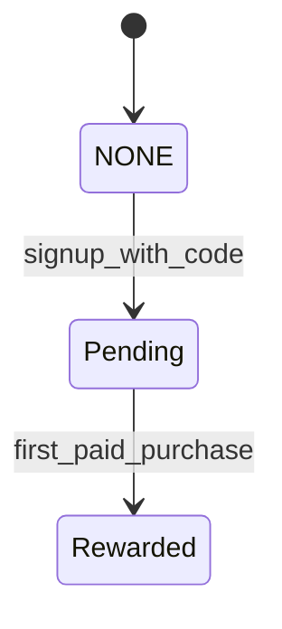

# 004: Commerce: tiers, credits, referrals

Status: DRAFT skeleton. This is a deterministic extraction from existing docs. No paid model was used. Every requirement is INFERRED until the operator confirms it.

## Sources

- `STRIPE_INTEGRATION_PROMPT.md`
- `REFERRAL_IMPLEMENTATION.md`
- `backend/monetization/`
- `docs/SECURITY.md`

## What and why

Sell tiers and credits through Stripe and reward referrers once, on first paid purchase, with an append-only ledger.

## User stories

TODO: Extract these from the sources above, one per story, each with acceptance criteria.

## Workflows

Status: INFERRED skeleton. Confirm before you plan.

- Governing workflows (skills): anti-slop-code, production-systems, google-developer-style.
- Owners: FORGE decomposes, a cloud agent implements, SCRIBE files the compact artifact, ADVERSARY reviews the threat model.
- CI: reuse `.github/workflows/ci.yml` (jobs `backend` and `frontend`). Do not add a new CI path.

## Stateful behavior

Initial state: `NONE`. Final states: Rewarded.

| from | event | guard | to | effect |
|---|---|---|---|---|
| NONE | signup_with_code | valid code | Pending | insert a referrals row and set referred_by |
| Pending | first_paid_purchase | first purchase, not yet rewarded | Rewarded | Purchase and Grant ledger entries, append a Rewarded row |

Illegal transitions:

- Rewarded -> Rewarded (double reward)
- Pending -> Rewarded on a non-first purchase
- any ledger mutation (append-only)

OBSERVED: the referral flow comes from REFERRAL_IMPLEMENTATION.md. TODO: the Stripe checkout/subscription lifecycle machine (session created, paid, failed, refunded) is NOT_COMPUTABLE from docs.
