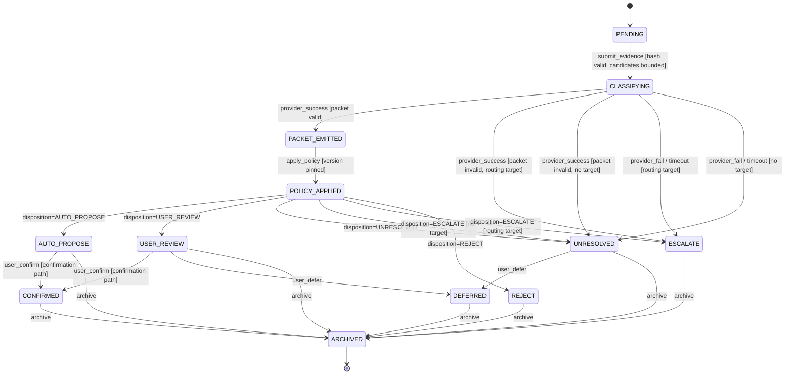

# State machines

## Resolution state

Derived 2026-11-03 from the code on `main` at 3688037: `backend/intelligence/resolution_machine.py` (`ResolutionState`, `TRANSITIONS`, `transition`). Spec 006 shares this machine ([006 tasks.md](../006-cloudflare-edge-clef/tasks.md), "Decision / Evidence Resolution state machine"). Tests: `backend/tests/unit/test_resolution_machine.py`. Every provider goes through it (`resolve_module_identity_guarded`, T082).

- Initial state: `PENDING`.
- Outcome states (`OUTCOME_STATES`): `AUTO_PROPOSE`, `USER_REVIEW`, `UNRESOLVED`, `ESCALATE`, `REJECT`.
- Terminal states (`TERMINAL_STATES`, each can be archived): the five outcome states, plus `CONFIRMED` and `DEFERRED`.
- Final state: `ARCHIVED`. It accepts no event. `is_final` is also true for every terminal state (`FINAL_STATES` = terminal states plus `ARCHIVED`).
- Canon write: `canon_write_permitted` is true only in `CONFIRMED`. The machine itself writes nothing to canon (FR-006).

### Transitions

`TRANSITIONS` lists two nominal targets: `(CLASSIFYING, provider_fail) -> UNRESOLVED` and `(POLICY_APPLIED, disposition) -> AUTO_PROPOSE`. `transition()` picks the real target from the guard. This table follows `transition()`. The effect column is the reason code written to the history record.

| from | event | guard | to | effect |
|---|---|---|---|---|
| PENDING | submit_evidence | `evidence_hash_valid` and `candidates_bounded` | CLASSIFYING | `SUBMIT_ACCEPTED` |
| PENDING | submit_evidence | either guard false | PENDING (refused) | `GUARD_EVIDENCE_INVALID` |
| CLASSIFYING | provider_success | `packet_schema_valid` | PACKET_EMITTED | `PROVIDER_SUCCESS` |
| CLASSIFYING | provider_success | packet invalid, `routing_target_exists` | ESCALATE | `PACKET_SCHEMA_INVALID` (T081) |
| CLASSIFYING | provider_success | packet invalid, no routing target | UNRESOLVED | `PACKET_SCHEMA_INVALID` (T081) |
| CLASSIFYING | provider_fail | `routing_target_exists` | ESCALATE | `PROVIDER_FAIL` |
| CLASSIFYING | provider_fail | no routing target | UNRESOLVED | `PROVIDER_FAIL` |
| CLASSIFYING | timeout | `routing_target_exists` | ESCALATE | `PROVIDER_TIMEOUT` |
| CLASSIFYING | timeout | no routing target | UNRESOLVED | `PROVIDER_TIMEOUT` |
| PACKET_EMITTED | apply_policy | `policy_version_pinned` | POLICY_APPLIED | `POLICY_APPLIED` |
| PACKET_EMITTED | apply_policy | policy version not pinned | PACKET_EMITTED (refused) | `GUARD_POLICY_UNPINNED` |
| POLICY_APPLIED | disposition | disposition is `AUTO_PROPOSE` | AUTO_PROPOSE | `DISPOSITION_AUTO_PROPOSE` (proposal only) |
| POLICY_APPLIED | disposition | disposition is `USER_REVIEW` | USER_REVIEW | `DISPOSITION_USER_REVIEW` |
| POLICY_APPLIED | disposition | disposition is `UNRESOLVED` | UNRESOLVED | `DISPOSITION_UNRESOLVED` |
| POLICY_APPLIED | disposition | disposition is `ESCALATE`, `routing_target_exists` | ESCALATE | `DISPOSITION_ESCALATE` |
| POLICY_APPLIED | disposition | disposition is `ESCALATE`, no routing target | UNRESOLVED | `ESCALATE_NO_ROUTING_TARGET` (T085, OQ-4) |
| POLICY_APPLIED | disposition | disposition is `REJECT` | REJECT | `DISPOSITION_REJECT` |
| POLICY_APPLIED | disposition | no disposition | POLICY_APPLIED (refused) | `GUARD_DISPOSITION_MISSING` |
| AUTO_PROPOSE, USER_REVIEW | user_confirm | `existing_confirmation_path` | CONFIRMED | `USER_CONFIRMED`; the only state that permits a canon write |
| AUTO_PROPOSE, USER_REVIEW | user_confirm | no confirmation path | unchanged (refused) | `GUARD_CONFIRMATION_PATH_REQUIRED` |
| USER_REVIEW, UNRESOLVED | user_defer | none | DEFERRED | `USER_DEFERRED` |
| any terminal state | archive | none | ARCHIVED | `ARCHIVED` |

Rules that apply in every state:

- An event on `ARCHIVED` is refused with `ARCHIVED_IMMUTABLE`.
- An event whose `request_id` differs from the machine's is refused with `REQUEST_ID_MISMATCH`.
- An event whose key (`type:disposition`) was already accepted returns the machine unchanged and writes no history record (idempotent replay).
- Any other pair is refused with `INVALID_TRANSITION`.
- A refused event appends a history record with `accepted=false` and leaves the state unchanged.



### Forbidden transitions

The forbidden list from the earlier narrative, restated against the implemented states:

- No state except `CONFIRMED` permits a canon write (`canon_write_permitted`). This replaces `DECISION_RECORDED -> CANONICALIZED`, `UNRESOLVED -> CANONICALIZED` and `DEFERRED -> CANONICALIZED`.
- A provider failure (`provider_fail`, `timeout`, or an invalid packet) reaches only `ESCALATE` or `UNRESOLVED`, never `CONFIRMED` or `REJECT` (FR-009, T081).
- `UNRESOLVED`, `ESCALATE`, `REJECT` and `DEFERRED` accept no `user_confirm`.
- An answer outside the `CandidateSet` cannot reach `AUTO_PROPOSE` or `USER_REVIEW`. `_packet_schema_valid` in `backend/intelligence/clef_resolution.py` marks the packet invalid when `selected_choice` is not a request choice, so the machine goes to `ESCALATE` or `UNRESOLVED`. `DecisionPolicy.evaluate` escalates it too (FR-003, #104).

## Drift: narrative states with no implementation

These machines were written before the code. Nothing in `backend/` implements their states. They stay here as a record. The owner decides at the next spec confirmation whether to delete them or build them.

### Resolution narrative (superseded by the machine above)

```text
CAPTURED
  -> EVIDENCE_EXTRACTED
  -> CANDIDATES_READY
  -> DECISION_PENDING
  -> DECISION_RECORDED
       -> PROPOSED
       -> REVIEW_REQUIRED
       -> UNRESOLVED
       -> ESCALATION_REQUIRED
       -> REJECTED
PROPOSED/REVIEW_REQUIRED
  -> CONFIRMED
  -> REJECTED
  -> DEFERRED
CONFIRMED
  -> CANONICALIZED
```

| Narrative state | Implemented counterpart |
|---|---|
| `CAPTURED`, `EVIDENCE_EXTRACTED` | None. Upload and normalization happen in `backend/evidence/` before the machine starts. |
| `CANDIDATES_READY` | None. Bounded candidates are a guard on `submit_evidence`. |
| `DECISION_PENDING` | Nearest is `CLASSIFYING`. |
| `DECISION_RECORDED` | Nearest are `PACKET_EMITTED` and `POLICY_APPLIED`. |
| `PROPOSED`, `REVIEW_REQUIRED`, `ESCALATION_REQUIRED`, `REJECTED` | `AUTO_PROPOSE`, `USER_REVIEW`, `ESCALATE`, `REJECT`. |
| `UNRESOLVED`, `CONFIRMED`, `DEFERRED` | Same names. |
| `PROPOSED/REVIEW_REQUIRED -> REJECTED` (user rejects) | None in the machine: there is no user-reject event. A user rejection is recorded by the evidence decision route (`status == "reject"` in `backend/evidence/routes.py`), outside this machine. |
| `CANONICALIZED` | None. The confirmation path writes canon outside the machine, and only from `CONFIRMED`. |
| (none) | `ARCHIVED` exists in code and not in the narrative. |

### Provider request narrative

`CREATED -> SENT -> SUCCEEDED | FAILED | TIMED_OUT`

Retry creates a new attempt bound to the same idempotent logical request; attempts are retained.

No code has `CREATED` or `SENT`, and attempts are not retained:

- The outcome is a field, not a state: `DecisionPacket.provider_status` is `succeeded`, `failed` or `timed_out` (`backend/intelligence/contracts.py`).
- The Clef and NVIDIA adapters run the adapter machine `IDLE -> INVOKING -> SUCCESS | TIMEOUT | MALFORMED | UNAVAILABLE -> IDLE` ([006 tasks.md](../006-cloudflare-edge-clef/tasks.md), "ClefProvider adapter state machine"; `ClefAdapterState` in `backend/intelligence/clef_provider.py`).
- A failed provider call writes no receipt (`receipt_id=None` in `_provider_failure_result`, `backend/intelligence/clef_resolution.py`).
- A repeat with the same `(request_id, idempotency_key)` returns the stored receipt and does not call the provider again (T083).
